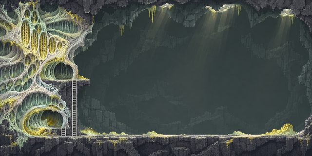
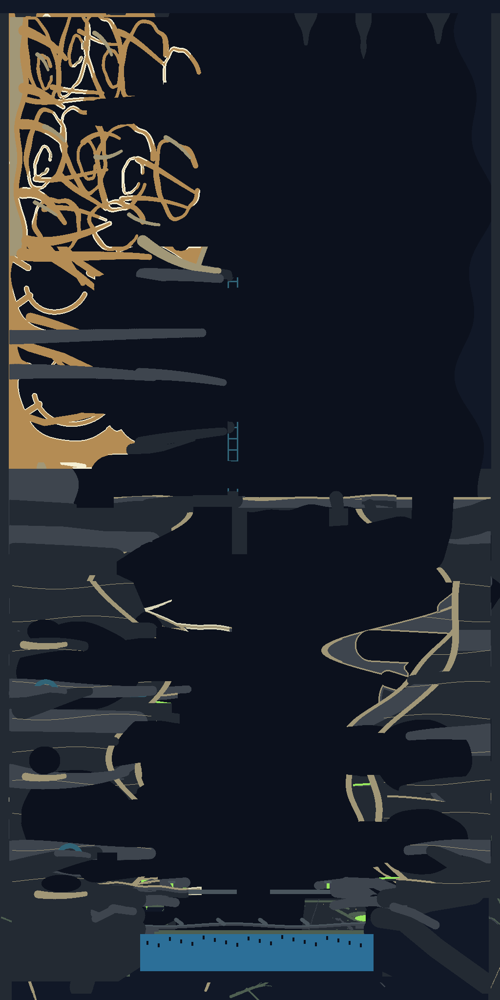

> **EXPERIMENTAL · NOT A CANDIDATE.** Copy of the PR #12 R2C6 filament cavern with intentional material roles. Occupancy is identical to R2C6 (0 cells differ; Water mask identical), so the physical route and site claims carry over unchanged; the material identity does not match the source-led reference JPEG any more.

## Intentional material pass (experiment)

`experiment_materials.js` runs after `finish_r2c6.js` and reassigns solid IDs only, by district and role:

| Original role | Tissue (upper-left lattice) | Lookout (east basalt) | Pool gantry (over water) | Shaft (everything else) |
|---|---|---|---|---|
| Chalk lattice (99) | woven wicker (92): 91,547 cells | chalk (unchanged) | chalk | chalk |
| Steel plate (62) | steel plate | none present | steel grating (66): 4,091 cells | painted steel (63): 1,639 cells |
| Quartz nodes (122) | quartz (unchanged) | uranium glass | uranium glass | uranium glass: 742 cells |

Slate, basalt, obsidian, limestone and mossy cobblestone stay natural. Water and air are untouched. The reaction guard needed no fixes.

Stats: 98,019 solid cells changed; 12,849 rectangles; setup JSON 237,187 bytes. The source-led checks (`verify_rework_r2.js` and `build_rework_r2.js --check`) pin the R2C6 hashes and will report a mismatch by design; occupancy was checked separately against the PR #12 setup.

Liquids, powders and rivets are untested in-game; NATIVE-UNTESTED.

# CURRENT R2C6 — Filament Shaft Cavern physical-cell finish

**OPEN Draft/HOLD · NATIVE-UNTESTED · owner acceptance outstanding.** Existing source-led conversion PR only; original source art, immutable archive and CyberSand main remain untouched.

**Source-derived compact upper core:** slender unequal chalk/limestone fenestrations, real rooted tapered branches, minor nested pores and deliberate full-hull access to the source's recognizable ladder and long shelf. The broad dark flying vault stays genuinely Empty. Visual ladder landings do not prove on-foot climbing.

**Extrapolated playable geology:** west mineral assay benches, sampling recesses, independent lower approaches; east dark basalt return/lookout and actual supported rock connections. All 769352 inert solid cells are one four-neighbour connected grounded structure, including formerly detached service braces.

**Exact static qualification:** 1024×2048, 12849 rectangles, 237187 JSON bytes; 195444 changed real material IDs (101321 added, 53284 removed, 40839 reclassified), zero full-grid replay mismatches. All 35688 original Water cells remain at identical coordinates. All 28 unchanged named site entries pass strict in-bounds 19×15, 23×19 and 31×27 actor-centre BFS; 31×27 central-detour exclusion also 28/28.

**Evidence:** original unchanged 640×360 committed reference JPEG directly viewed against true material-cell output. Full original untouched source PNG pixel parity UNVERIFIED. Regenerated eight actual material-index PNGs undergo binary CRC/Adler and 4194304-pixel final-grid parity tests separately.

**Native:** NATIVE-UNTESTED. Accepted source permits 32768 stamps; installed bridge unknown, legacy 4096 would refuse. No observed Godot/Rapier load, native Midge input/collision, Water progression or fresh save/reopen.

**Reproduce:** node build_rework_r2.js --check; latest finish_r2c6.js executes after finish_r2c5.js against immutable baseline. Qualification receipt records tests, component census and static limitations.

---

# BIOME-0037a — Filament Shaft Cavern (R2A3 material-cell rework)

**DRAFT / HOLD.** Existing PR branch only; historical merged canvas, original art and CyberSand engine unchanged. Source-led actual **1024×2048** Workbench Setup-v2 material grid, not illustration or native runtime acceptance.

| Authentic source JPEG | Rebuilt exact material-cell canvas |
|---|---|
|  |  |

The genuine `source-reference-preview.jpg` (Git blob `168294085274702df98f5698721890fd30874c8f`) was directly decoded and compared visually with the real grid and 1:1 upper/deep/east details. Original `artwork/living_landscapes/batch2/filament_shaft_cavern.png` (blob `9364b59479bb2eaf4d2a2924abb501ed8d9e26e3`) remains unmodified; its full-resolution pixel parity is **UNVERIFIED**.

## Physical composition

**Source-derived upper core:** coherent attached porous pale left cave tissue, a dominant uneven west-facing aperture with forked small pores, restrained calcite rims, open central air, a rock-supported visual ladder and a long continuous horizontal shelf. All solids are genuine static simulator material cells; no painted fake sky, powder-rock foundations, cloners, growth agents or floating collision illustrations.

**Extrapolated world below the source framing:** three distinct left geological relay/return chambers with substantial solid backfill and separate central entrances, two unequal right-wall return-gallery levels, and a maintenance gantry above the original sealed rectangular Water basin. All 35,688 original Water cells remain at the same coordinates and remain dynamic Liquid—not structural inert rock. Original ladder is only a supported visual/access landmark, **not a claimed climb mechanic**.

## Actual material PNG gallery

| Material-grid evidence | Cell-space region | Scale |
|---|---|---|
| [Full map](filament-shaft-cavern-material-1024x2048.png) | (0,0) 1024×2048 | 1 pixel = 1 cell |
| [Overview](filament-shaft-cavern-preview.png) | (0,0) 1024×2048 | 2 cells = 1 pixel |
| [Upper web](filament-shaft-cavern-detail-upper.png) | (0,35) 512×512 | 1:1 |
| [Porous lamina](filament-shaft-cavern-detail-lamina.png) | (0,482) 512×512 | 1:1 |
| [Ladder transfer](filament-shaft-cavern-detail-shaft.png) | (320,568) 512×512 | 1:1 |
| [Main shelf](filament-shaft-cavern-detail-lower.png) | (360,922) 512×512 | 1:1 |
| [West lower relay](filament-shaft-cavern-detail-deep.png) | (0,1320) 512×512 | 1:1 |
| [East return](filament-shaft-cavern-detail-right.png) | (512,1300) 512×512 | 1:1 |

All eight files are regenerated from **this** committed Setup grid, verified for PNG CRC/chunk structure/stored-zlib/Adler32 and compared to every displayed material-index pixel: **4,194,304 matches, 0 mismatch**.

## Exact static qualification

- **2,097,152** authored cells; **16,661 / 32,768** in-bounds nonoverlapping rectangles; **303,923 / 1,048,576** serialized bytes; **0** reconstruction mismatch.
- **171,012** material cells changed from the exact Shepherd-assigned predecessor HEAD `d01f34207b5c45991e9838795fa4223deaad15b7`.
- **193,031/193,031** upper pale tissue cells in one 4-neighbour component. Original **35,688/35,688** Water cells untouched.
- Exact Midge spawn `(512,107)`, unchanged authoring/actor. All **13 R2 + 15 historical positions** reached with strictly contained 19×15, 23×19, 31×27 whole-hull centre masks and 4-neighbour BFS. Reachable centres: **1,085,017 / 1,038,359 / 962,834**; no nearest-point or proxy-site waiver.
- Accepted CyberSand source `main@018bd09503d7f079ddac52e225c2f7daf8d678bf`; supported stable solid materials only plus the preserved truly dynamic Water. Full receipt: [qualification.json](qualification.json).

Regenerate with Node 18+ and repository history: `node build_rework_r2.js --check`, `node verify_rework_r2.js`, `node render_material_cells_r2.js`. Source builder operates from immutable baseline `8b43319f...`, layers original R2A, C and [this geometry finisher](finish_r2a_geometry.js). Builder semantics were directly executed in isolated V8; the ordinary Node CLI and native runtime were **not** exercised during this pass.

**HOLD / NATIVE-UNTESTED:** No installed CyberDemoBridge capacity handshake, Godot/Rapier actual install, Midge flight/collision, bounded simulation or save/reopen performed. Source reports 32,768 edit capacity; a legacy installed 4,096 edit bridge would reject this canvas. Full-original PNG parity and independent Shepherd/fidelity/owner physical playtest remain open.

## Current R2B: rooted tissue, distinct lower geology and reservoir service (18 November 2026)

**This newest section supersedes the previous R2A3 numerical totals above.** After the Shepherd's exact-HEAD handoff, the original committed source JPEG was visually compared directly with the previous actual-cell map. The source-derived upper western tissue now has varied fine/thick rooted web struts, forked laminae and differentiated porous junctions; the **newly extrapolated lower** regions now include a substantial broad geological calcite-fan observatory with vaulted Midge access, a distinct western deep geode-return chamber and an eastern spiral-cliff service gallery. The historical basin is still exactly **35,688 real Water cells**, now approached through a more convincing basalt shoulder and engineered observation apron. These changes are in the actual cell grid via [deterministic R2B finisher](finish_r2b.js) invoked by the committed builder after R2A3. No photo editing or fake solid background.

| Current static gate | Exact R2B result |
|---|---|
| Extent | 1024×2048 = 2,097,152 physical cells |
| Real material cells changed from assigned HEAD | 174,386 |
| Setup-v2 serialized rectangles | 15,672 / 32,768 |
| Serialized JSON | 285,727 / 1,048,576 bytes |
| Full cell replay/equivalence | 0 mismatches |
| Full grid SHA-256 | `19969ee568a7450a456f06f8dfa6567a8ab2e52fe9050db75f4d53ef684e111a` |
| Water changes vs archival baseline | 0 of 35,688 |
| Upper pale tissue primary physical component | 100.00% |
| Exact Midge destinations | 13/13 + 15/15 at 19×15; 13/13 + 15/15 at 23×19; 13/13 + 15/15 at 31×27 |
| Connected legal Midge centres | 1,058,792 / 1,017,813 / 944,034 |
| Full-resolution original art parity / native runtime | **UNVERIFIED / NATIVE-UNTESTED** |

The source JPEG is genuine, same committed blob as the predecessor; the original large PNG's full-resolution pixels remain UNVERIFIED. Eight indexed PNGs have been regenerated from the same final actual material grid; the deterministic Node renderer and independent readback are included for local reproduction, with no claim of physical native Godot admission. Accepted source bridge has 32,768 capacity, while legacy installed fallback may allow only 4,096; installed capability is unmeasured. Owner playtest, live Water containment, Midge flight/control and save/reopen remain open; no merge/Ready.

## Reworker C R2C2 — latest Shepherd-assigned physical-cell finish (18 November 2026)

**Assigned starting SHA:** `7e9b42b309012b636e124e91c7ce3c70acd34516`; implemented by `finish_r2c2.js` after R2B on this same PR branch. **150,070 actual cells changed**; preserved historical source images and all **35,688 original Water cells**. The genuine committed source JPEG (blob `168294085274702df98f5698721890fd30874c8f`) was directly viewed beside the current real-cell overview/crops. The original high-resolution PNG remains untouched; original-PNG pixel parity **UNVERIFIED**.

**Source-derived upper:** removed narrow disconnected-looking scratches, added differentiated rooted tissue bridges and smaller nested real-air pores without removing the continuous cliff organism, improved rock-backed ladder transfer, and reinforced the original broad shelf. **New extrapolated lower world:** contiguous west-rooted calcite halls with independent return approaches, differentiated east basalt observatory and shaped solid-founded observation shoulders around the intact dynamic Water reservoir. Genuine Empty flight vault remains clear; no screenshot overlays, pseudo materials, falling powder foundations or waypoint relocation.

**Static:** 1024×2048; 15,150 / 32,768 coalesced physical rectangles; 275,635 / 1,048,576 serialized JSON bytes; 2,097,152 cells deterministically built and replayed with **zero mismatch**. 177,680 upper-tissue cells, 99.963% one connected organism. Exact unchanged Midge spawn and all 13 current plus 15 legacy sites pass full-in-bounds 4-neighbour BFS at 19×15 (1,050,942), 23×19 (1,015,015), 31×27 (946,212) without nearest-point or radius exceptions. All **eight actual material-index PNGs** regenerated and independently decoded with CRC/deflate checks and **4,194,304 exact sampled pixel-index matches**. See `qualification.json` for full material histogram and preserved authoring sites.

**Evidence:** [final true 1:1 1024×2048 grid](filament-shaft-cavern-material-1024x2048.png) · [full overview](filament-shaft-cavern-preview.png) · true 1:1 [upper organism](filament-shaft-cavern-detail-upper.png), [ladder transfer](filament-shaft-cavern-detail-shaft.png), [shelf](filament-shaft-cavern-detail-lower.png), [west lower](filament-shaft-cavern-detail-deep.png), [east return](filament-shaft-cavern-detail-right.png). All from the same final physics grid.

**NATIVE-UNTESTED.** Engine `main@018bd09503d7f079ddac52e225c2f7daf8d678bf` is read-only authority: source 32,768-rectangle capacity; installed/legacy 4,096 capacity unknown and would reject this setup. No actual Godot/Rapier/bridge install, Midge flight/collision, Water simulation or fresh-process save/reopen. Remains OPEN **Draft/HOLD**, for independent Shepherd/art/native review; not Ready, merged or owner-accepted.

---

## R2C3 — source-led nested filament and inhabitable cavern repair (18 Nov 2026)

Exclusive Shepherd assignment `CANVAS-REWORK-C: 12 @ ccc14c167b501b0834a930f664f97fdff98444ea`. Genuine committed JPEG `168294085274702df98f5698721890fd30874c8f` visually compared with physical-cell overview and 1:1 crops. Original full-resolution PNG `9364b59479bb2eaf4d2a2924abb501ed8d9e26e3` is preserved, **pixel parity UNVERIFIED**.

**Real-cell source-derived repairs:** Four graded asymmetrical cream tissue apertures and connected filaments (x≈20–445/y≈42–930), new true-air mid-lattice and nursery transfers, a physical upper ladder anchorage and sheltered thresholds (x≈390–487/y≈518–1015), distinct variable-thickness geological west shelf and east receiver (x≈230–900/y≈960–1160). **Original authored continuation:** broad supported western calcite landing/halls (y≈1250–1830), east basalt return benches (y≈1490–1820), and dry buttresses/maintenance approaches around historic liquid basin; not image-stretched replicas.

**Exact static results:** 15773/32,768 construction rectangles; 287956/1,048,576 JSON bytes; 95257 changed material cells (60062 newly occupied, 6828 excavated to Empty, 28367 reclassified); **0 of 35,688 original Water identities changed**; 2,097,152/2,097,152 full reconstruction, zero differences. Static 4-neighbour exact zero-offset Midge actor-centre BFS: **13/13 authored + 15/15 historical targets at 19×15, 23×19 and 31×27**; connected centres 1005156 / 969170 / 900459; pale upper tissue main component 99.406%. No proxy points. All 8 genuine material-index PNGs independently decoded (CRC/zlib/Adler) and compared against source grid: 4194304 pixel samples, zero mismatch.

**Native limitations:** NATIVE-UNTESTED; no Godot/Rapier/installed bridge, controlled flight, Water simulation or save/reopen. Older 4,096 rectangle bridge would reject 15773 edits. This is not owner acceptance. Regenerate: `node build_rework_r2.js`, `node render_material_cells_r2.js`, `node verify_rework_r2.js` from this directory (requires historical baseline commit for the scripts); direct deterministic source exercised in V8 this pass; Node CLI not run.

**Gallery:** [authentic reference](source-reference-preview.jpg) · [full native-index material PNG](filament-shaft-cavern-material-1024x2048.png) · [full overview](filament-shaft-cavern-preview.png) · [upper nested tissue](filament-shaft-cavern-detail-upper.png) · [porous lamina](filament-shaft-cavern-detail-lamina.png) · [ladder transfer](filament-shaft-cavern-detail-shaft.png) · [shelf](filament-shaft-cavern-detail-lower.png) · [west calcite](filament-shaft-cavern-detail-deep.png) · [east basalt](filament-shaft-cavern-detail-right.png).

## Current R2C4 source-led true-cell finishing (18 November 2026)

Authorized from Shepherd exact HEAD `5d8f88f88666b4f1a1cc543048d1c4e0705af99b`. **294,506 physical material identities changed**, replacing upper ragged wedges, crossed detached rods, isolated brackets and generic caverns with nested oval/arched living laminae rooted to the left cliff and connected to generous physical flight exits. SteelPlate ladder is reconstructed as two readable interrupted runs with rock landing sequence, not a claimed climb mechanic. The long reference shelf gains irregular wall-grounded abutments and sub-shelf Midge bypass. The lower map is **newly extrapolated**, with a walk-in west calcite hall, second return, and distinct double-level east basalt destination; central cave airspace remains broad. Genuine committed 640×360 source JPEG `168294085274702df98f5698721890fd30874c8f` was visually compared with real material-index previews; unaltered original full PNG `9364b59479bb2eaf4d2a2924abb501ed8d9e26e3` parity remains **UNVERIFIED**.

**Static qualification:** 1024×2048 = 2,097,152 deterministic cells, **11,069/32,768** lossless, non-overlapping rectangles, **204,728/1,048,576** JSON bytes, **zero** full-grid reconstruction differences; 35,688 original Water cells all retained unchanged, no unsupported/nonstable solids. Original actor/spawn retained. Exact-location 13/13 R2 + 15/15 legacy sites reachable with fully bounded 19×15, 23×19, 31×27 whole-Midge-envelope cardinal BFS; legal centre counts **1,112,372 / 1,077,831 / 1,012,551**; tissue 128,326/128,326 4-connected. Eight PNGs are generated from exactly this serialized material grid (full map, overview and six true 1:1 crops); pixel-index/CRC/Adler validation recorded in handoff and [qualification.json](qualification.json). No image-only art layers. [Full actual-cell map](filament-shaft-cavern-material-1024x2048.png) · [upper](filament-shaft-cavern-detail-upper.png) · [lamina](filament-shaft-cavern-detail-lamina.png) · [ladder](filament-shaft-cavern-detail-shaft.png) · [shelf](filament-shaft-cavern-detail-lower.png) · [west](filament-shaft-cavern-detail-deep.png) · [east](filament-shaft-cavern-detail-right.png).

**NATIVE-UNTESTED:** No CyberDemoBridge/Godot/Rapier install, Midge input/collision, Water simulation, save/reopen or installed rectangle-capacity readback. Accepted main `018bd09503d7f079ddac52e225c2f7daf8d678bf` is read-only authority. Legacy installed 4096 capacity would reject 11069 rectangles. Deterministic build/verification executed in V8; Node CLI not executed. This is not native or owner acceptance; remain OPEN Draft/HOLD.

## Reworker C R2C5 — new current source-fidelity reconstruction (18 November 2026)

Newest authoritative figures, superseding previous round totals: source JPEG directly viewed; original PNG pixel comparison **UNVERIFIED**. Macro geometry is **real material-cell editing**: irregular unequal organic vaults and rooted pale trabeculae, geologically attached ladder landings, substantial supported shelf abutments, differentiated west assay and east lookout destinations and outside-only water-basin geological framing. Existing broad flight corridor and all originally reachable full 31×27 Midge hull footprints were protected, original Water mask unchanged. Source-derived district is upper left x20–470/y35–1150; newly extrapolated world is lower assay/return/reservoir area.

**Exact static:** 1024×2048; **137,975 changed cells** (+25614 nonempty, 29350 excavated, 83011 material reclassifications), **10205 / 32,768 rectangles**, **189759 / 1,048,576 JSON bytes**, zero full-grid replay mismatches/overlaps, **13/13 R2 + 15/15 historical exact destinations** in all 19×15/23×19/31×27 clearance envelopes, grounded-source upper tissue connected 117842/117842. Dynamic Water: 35,688 originally placed cells, 0 changes. All eight actual-material PNGs were regenerated from the final Setup grid and independently decoded in-process: **4,194,304 indexed pixels compared, zero mismatches**, with PNG signatures, CRC32, stored-zlib/Adler32 and IEND checked. Genuine JPEG compared visually; full original PNG parity remains UNVERIFIED.

**HOLD:** installed native bridge capacity not checked (legacy 4,096 would reject this setup); Godot/CyberDemoBridge/Rapier loading, real Midge input/collision, Water progression, save/reopen **NATIVE-UNTESTED**. Independent art, Shepherd and owner acceptance remain open. No merge or Ready.

**Additional independent final-plane checks (same HEAD material grid):** 26 static-solid cardinal components, 718,848 cells in the principal world-boundary-connected component and 2,467 inert solid cells in smaller detached fragments (largest 1,394; independent judgement still required). A 31×27 full-envelope actor-centre BFS with the rectangular centre region x480–555/y1100–1215 synthetically excluded still reached all **13+15 original named site entries** (26 unique coordinates), with 1,036,375 centres. This is a static route redundancy test, not a demonstration of physical climbing or native flight. All eight committed image Git blob SHAs were verified after publication; the full-map PNG's binary retrieval returned zero bytes, so its *postcommit binary* parity was not independently repeated, although 100% rendered PNG parity passed prior to upload.
