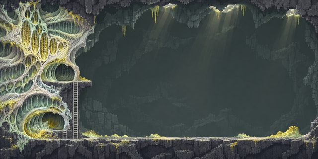
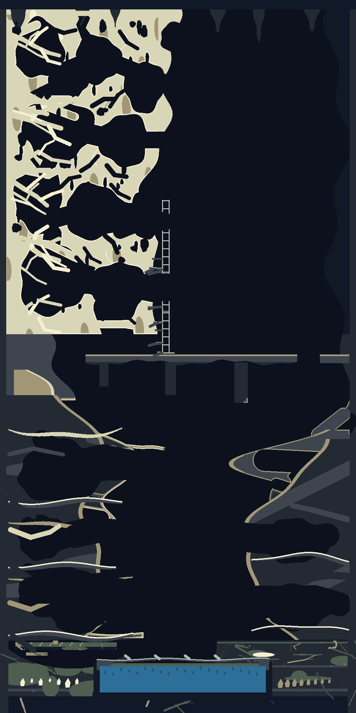

# BIOME-0037a — Filament Shaft Cavern (R2A3 material-cell rework)

**DRAFT / HOLD.** Existing PR branch only; historical merged canvas, original art and CyberSand engine unchanged. Source-led actual **1024×2048** Workbench Setup-v2 material grid, not illustration or native runtime acceptance.

| Authentic source JPEG | Rebuilt exact material-cell canvas |
|---|---|
|  |  |

The genuine `source-reference-preview.jpg` (Git blob `168294085274702df98f5698721890fd30874c8f`) was directly decoded and compared visually with the real grid and 1:1 upper/deep/east details. Original `artwork/living_landscapes/batch2/filament_shaft_cavern.png` (blob `9364b59479bb2eaf4d2a2924abb501ed8d9e26e3`) remains unmodified; its full-resolution pixel parity is **UNVERIFIED**.

## Physical composition

**Source-derived upper core:** coherent attached porous pale left cave tissue, a dominant uneven west-facing aperture with forked small pores, restrained calcite rims, open central air, a rock-supported visual ladder and a long continuous horizontal shelf. All solids are genuine static simulator material cells; no painted fake sky, powder-rock foundations, cloners, growth agents or floating collision illustrations.

**Extrapolated world below the source framing:** three distinct left geological relay/return chambers with substantial solid backfill and separate central entrances, two unequal right-wall return-gallery levels, and a maintenance gantry above the original sealed rectangular Water basin. All 35,688 original Water cells remain at the same coordinates and remain dynamic Liquid—not structural inert rock. Original ladder is only a supported visual/access landmark, **not a claimed climb mechanic**.

## Actual material PNG gallery

| Material-grid evidence | Cell-space region | Scale |
|---|---|---|
| [Full map](filament-shaft-cavern-material-1024x2048.png) | (0,0) 1024×2048 | 1 pixel = 1 cell |
| [Overview](filament-shaft-cavern-preview.png) | (0,0) 1024×2048 | 2 cells = 1 pixel |
| [Upper web](filament-shaft-cavern-detail-upper.png) | (0,35) 512×512 | 1:1 |
| [Porous lamina](filament-shaft-cavern-detail-lamina.png) | (0,482) 512×512 | 1:1 |
| [Ladder transfer](filament-shaft-cavern-detail-shaft.png) | (320,568) 512×512 | 1:1 |
| [Main shelf](filament-shaft-cavern-detail-lower.png) | (360,922) 512×512 | 1:1 |
| [West lower relay](filament-shaft-cavern-detail-deep.png) | (0,1320) 512×512 | 1:1 |
| [East return](filament-shaft-cavern-detail-right.png) | (512,1300) 512×512 | 1:1 |

All eight files are regenerated from **this** committed Setup grid, verified for PNG CRC/chunk structure/stored-zlib/Adler32 and compared to every displayed material-index pixel: **4,194,304 matches, 0 mismatch**.

## Exact static qualification

- **2,097,152** authored cells; **16,661 / 32,768** in-bounds nonoverlapping rectangles; **303,923 / 1,048,576** serialized bytes; **0** reconstruction mismatch.
- **171,012** material cells changed from the exact Shepherd-assigned predecessor HEAD `d01f34207b5c45991e9838795fa4223deaad15b7`.
- **193,031/193,031** upper pale tissue cells in one 4-neighbour component. Original **35,688/35,688** Water cells untouched.
- Exact Midge spawn `(512,107)`, unchanged authoring/actor. All **13 R2 + 15 historical positions** reached with strictly contained 19×15, 23×19, 31×27 whole-hull centre masks and 4-neighbour BFS. Reachable centres: **1,085,017 / 1,038,359 / 962,834**; no nearest-point or proxy-site waiver.
- Accepted CyberSand source `main@018bd09503d7f079ddac52e225c2f7daf8d678bf`; supported stable solid materials only plus the preserved truly dynamic Water. Full receipt: [qualification.json](qualification.json).

Regenerate with Node 18+ and repository history: `node build_rework_r2.js --check`, `node verify_rework_r2.js`, `node render_material_cells_r2.js`. Source builder operates from immutable baseline `8b43319f...`, layers original R2A, C and [this geometry finisher](finish_r2a_geometry.js). Builder semantics were directly executed in isolated V8; the ordinary Node CLI and native runtime were **not** exercised during this pass.

**HOLD / NATIVE-UNTESTED:** No installed CyberDemoBridge capacity handshake, Godot/Rapier actual install, Midge flight/collision, bounded simulation or save/reopen performed. Source reports 32,768 edit capacity; a legacy installed 4,096 edit bridge would reject this canvas. Full-original PNG parity and independent Shepherd/fidelity/owner physical playtest remain open.
