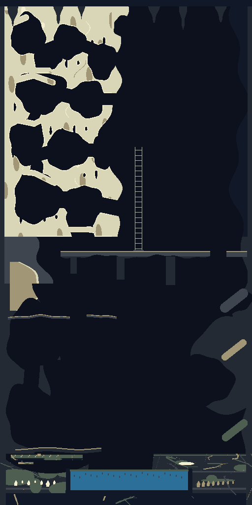

# BIOME-0037a — Filament Shaft Cavern, source-led R2

**DRAFT / HOLD, not owner-accepted.** This is an actual 1024×2048 Setup-v2 *material-cell* level, not substitute concept art. The archived first-generation material grid remains on [historical main/PR #1](https://github.com/techrote/sandmapsreference/pull/1). No engine code or source artwork changed.

| Original repository source (committed JPEG derivative) | Rebuilt material cells |
|---|---|
|  |  |

**Source provenance:** original full PNG at `artwork/living_landscapes/batch2/filament_shaft_cavern.png`, blob `9364b59479bb2eaf4d2a2924abb501ed8d9e26e3`. Original genuine `gh-pages` JPEG preview blob `168294085274702df98f5698721890fd30874c8f` was **visually inspected**. This is JPEG-source-preview-guided, **not** verified full-resolution PNG pixel parity.

## Real geometry and source composition

The old mechanically repeated opposing grotto stack has been reauthored as a single **100%-connected pale porous LEFT cliff** of inert ChalkBlock, limestone, quartz accents and stone, with unequal organic large apertures and smaller pores. There is a conspicuous real SteelPlate ladder (x548–578, y596–1016), long continuous flat shelf (x246–854, y1018), explicit east flight bypass (x855–919), broad dark central free-flight vault, and nonrepeating lower-left and right-buttress routes. Thin luminous/floating decorative collision snags have been removed. Historical Water basin is preserved. The source's delicate illustrated lace is simplified into material-cell struts; extra lower districts deliberately adapt landscape source composition to tall gameplay extent.

## Exact actual-cell evidence

The [full overview](filament-shaft-cavern-preview.png) is 512×1024, sampled two material cells per output pixel. All six linked crops below are **native-resolution 512×512, one material cell per pixel**, from the exact same committed final grid.

- [Upper pale wall](filament-shaft-cavern-detail-upper.png): x0, y35
- [Mid-lattice](filament-shaft-cavern-detail-lamina.png): x0, y482
- [Ladder / shelf](filament-shaft-cavern-detail-shaft.png): x320, y568
- [Shelf / vertical return](filament-shaft-cavern-detail-lower.png): x360, y922
- [Deep west recess](filament-shaft-cavern-detail-deep.png): x0, y1320
- [East buttress](filament-shaft-cavern-detail-right.png): x512, y1300

## Deterministic reproduction

Node.js 18+ from this directory, with Git history available:

```bash
node build_rework_r2.js --check
node verify_rework_r2.js
node render_material_cells_r2.js
```

Run `node build_rework_r2.js` without `--check` to replace the setup from immutable original R2 assignment commit `8b43319f3eb43d2deef8502d59f70849cd0179f5`. `verify_rework_r2.js` independently checks every material cell, budget, exact spawn, and exact waypoints; `render_material_cells_r2.js` writes indexed lossless PNGs directly from the committed setup. Compatibility Python wrappers now delegate to these R2 tools. The prior C2 patch files are archival and **not** applied to R2.

**Checked:** 2097152 cells; **9514 / 32768** non-overlapping rectangles, **175606 / 1048576** bytes, zero grid mismatches; **795392** changed cells versus archived R1; 35688 Water cells (0 changed). Material set: 0, 3, 38, 42, 49, 62, 99, 100, 101, 122. Accepted CyberSand `main` authority [018bd095](https://github.com/techrote/cybersand/blob/018bd09503d7f079ddac52e225c2f7daf8d678bf/native/include/cybersand/material.hpp); all decorative materials have inert Solid/None laws, Water remains active liquid. Prior combustible MossWall and stray glow materials were removed.

Midge's real rectangle hull is **4×3**. Independent full-grid integral-occupancy BFS at **19×15**, **23×19** and **31×27** conservative clearances reached **13/13 named R2 functional sites** and **15/15 exact old site positional regressions** from unchanged spawn (512,107). No site was moved to nearest air or granted arbitrary tolerance; the old R1 names are *positional regression labels*, not claims that old exhibits remain.

**NATIVE-UNTESTED:** no installed CyberDemoBridge/Godot/Rapier load, material admission readback, physical Midge input/collision, Water simulation or save/reopen was performed. A legacy 4096-rectangle installed native DLL may refuse this 9514-run candidate despite accepted-main's 32768 limit. Human source/composition assessment and physical Workbench acceptance are still required. Do not merge/mark Ready.
