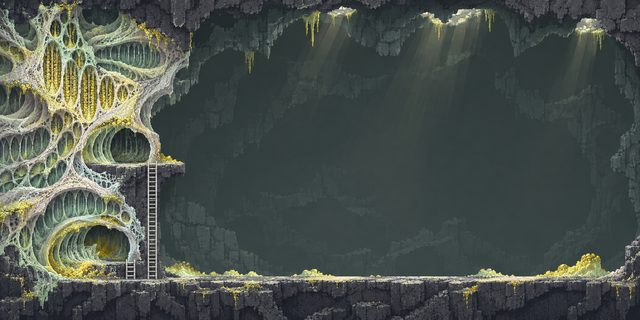

# Canvas rework R2 — BIOME-0037a Filament Shaft Cavern

**Draft / HOLD; never merge/mark Ready without owner approval.** Source-led update to the archived first generation [PR #1](https://github.com/techrote/sandmapsreference/pull/1). Keep historical original intact, edit ONLY this new branch.

## Exact source (ACTUAL included visual, not inferred)

Original source: [artwork/living_landscapes/batch2/filament_shaft_cavern.png](https://github.com/techrote/sandmapsreference/blob/198bf5bc793e59006b7ccc9e587971e3d9a857f9/artwork/living_landscapes/batch2/filament_shaft_cavern.png); Git blob `9364b59479bb2eaf4d2a2924abb501ed8d9e26e3`.
The `source-reference-preview.jpg` committed alongside this brief is the actual `gh-pages` JPEG blob `168294085274702df98f5698721890fd30874c8f`. It is a lower-resolution derivative of original artwork, not AI/new art; original high-resolution PNG remains in artwork unmodified.
See archived [current material-grid preview](filament-shaft-cavern-preview.png).

## Repair goals derived by DIRECT source/archived-preview comparison

Reference shows one **contiguous, highly porous pale branching/tissue cave mass attached to the LEFT cliff**, with multiple organically different oval voids/tunnels and a vertically exposed ladder next to it; dark cavern vault, subdued foliage, a conspicuous **long continuous broad floor/shelf** extending across much of the frame, a sparse illuminated ceiling and one very broad navigable central airspace. The archived conversion instead produces repeated alternating left/right cellular grottos and uniformly spaced shelves down a tall shaft, weakening the source identity.

- **P0 macro geometry**: build a major asymmetric *connected* tissue/filament network with interlocking irregular fenestrations and a clear outside profile. Preserve the giant left cavern organism as hero, distinguish true rock/tissue boundaries and maintain at least one substantial level-width platform/floor representing the source. Do not add cloned little wall alcoves.
- **P0 ladder and routes**: retain a prominent reachable upright ladder/service access, traversable enlarged oval apertures in the tissue wall, a large continuous central free-flight volume, and multiple controlled lateral/vertical returns for Midge. Tall recomposition is acceptable if vertical district hierarchy is natural, not simply a stretched landscape reference.
- **P1 atmosphere/material**: use stable limestone/rock-like and pale tissue-toned material surfaces with sparse luminous filaments (stable law) and a distinct darkness/negative-space silhouette; avoid excessive neon crosshatch noise, arbitrary scattered seeds and uniform bioluminescent stalk stamps. Preserve characteristic varied aperture sizes and organic branching densities.
- **P1 named districts**: differentiable upper nest, mid-lattice observation, old shelf/ladder access, lower recess, and realistic free-flight path; furnish functional cavities without blocking exits.
- **P0 correctness**: 1024×2048 exactly; accepted Workbench v2/generated-start parser and native material enum/physics source, actual current Midge hull + conservative clearance, zero hidden waypoint proximity waivers. Verify all exact functional targets; safe support and no uncontrolled growth, falling powder as walls or obstructed room access.
- **P0 validation**: reproducible deterministic builder, complete byte/rectangle checks, exact authored material-cell replay/hash, revised actual-cell full PNG and >=3 full-resolution district crops, meaningful self-review. Native installation + simulation/input/save/reopen only if actually run; otherwise explicitly NOT TESTED.

This initial PR commit includes ONLY this source-image copy and rework brief: canvas JSON/builder/preview remain the archived baseline until the assigned worker changes them. Reworker A owns the subsequent actual-cell repair on this branch; Shepherd audits final HEAD.
