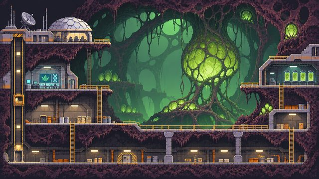

# Containment Tree Biosphere — source-led R2 actual-cell repair

**Open Draft / HOLD — independent Shepherd, native Workbench and owner acceptance still outstanding.** This is a new physical-cell repair on the existing exclusive Reworker B PR branch, not an edit of archived main or a merely repainted image.

## Genuine source and scale-led interpretation

- Catalogue source **techn-0021**, `batch1/image-0058`: `artwork/technical_interiors/batch1/amber_canopy_biosphere-containment_tree-biological_dread.png` (unaltered Git blob `b8075c08c4a3cea84a877b036537dea55c87264f`).
- The authentic, unmodified 640×360 repository preview `source-reference-preview.jpg` was **actually decoded and visually inspected** (Git blob `64d7df6352b12d1aa57ce85f4925a722705bba1d`). **Full-resolution original PNG pixel parity remains UNVERIFIED.**
- The source shows a single massive glowing yellow-green biological heart in a dark rooted cave, a segmented western observatory dome and long service elevator, asymmetric eastern green sample-vial wing, occupied lower galleries, and guarded central gantry. These are the specific source features translated into actual material cells.
- The reference is a compact *landscape* cross-section. The tall **1024×2048** canvas preserves those features at the top/mid districts while extending coherently into older root geology and logistics below. This is **not** stretching the reference to full height or reproducing a sequence of five copies of its organism.

## Physical-cell rebuild

The archived repeated five-stage circular bioreactors and eleven mirrored lab modules were replaced with **one cardinally connected central biological organism**, thick asymmetric branching crown and lower roots, plus differentiated west/east laboratories, a physical western segmented glass dome and service lift, guarded central gantry/inspection terraces, cavern ribs and deeper root-service vaults. Two protected vertical flight chimneys and lateral inspection portals preserve exact Midge circulation. The lowest root footing genuinely joins the specimen to the bottom stone; it intentionally interrupts the former straight bottom emergency slot, while other fully qualified routes remain open.

**Artistic honesty:** Static material cells cannot reproduce the source's photographic glow, atmospheric blue-green depth, or transparent volumetric glass. The original's horizontal freight gantry is reinterpreted as a central railed inspection span with accessible lateral transfer/bypass regions, not a claim of exact pixel-parity or identical continuous walking-surface geometry. The lower half is source-consistent extrapolation, not a trace of unseen original pixels.

## Actual material-grid images — all from the same committed cell plane

| Authentic source preview | Rebuilt full 1024×2048 cell world |
|---|---|
|  |  |

Real unscaled 640×640 **1:1 material-cell crops**:
[Upper organism](containment-tree-detail-upper.png) ·
[Central gantry and roots](containment-tree-detail-middle.png) ·
[Deep roots](containment-tree-detail-lower.png) ·
[West dome/lift](containment-tree-detail-west.png) ·
[East vial research](containment-tree-detail-east.png).

## Deterministic reproduction

Use Node (no npm dependencies) from this directory:

```bash
node rebuild.cjs --verify
node verify-r2.cjs
```

To regenerate the same ordered material plane and six PNGs:

```bash
node rebuild.cjs
node verify-r2.cjs
```

The final `builder.cjs` uses fixed seed **210058**, real supported Setup-v2, grid-sourced PNGs, self-contained PNG encoding, and exhaustive rectangular reconstruction. `evidence.json` is regenerated, never hand-adjusted. `verify-r2.cjs` independently reconstructs committed JSON, validates PNG integrity/ID pixel equality, and recalculates exact full-hull airspace from the file.

## Static qualification at repaired builder HEAD

| Gate | Verified |
|---|---|
| World | **1024×2048**, 2,097,152 actual material cells |
| Five-field rectangles | **21,259 / 32,768**, in bounds and 0 overlaps |
| Setup JSON | **387,804 / 1,048,576 bytes** |
| Exhaustive reconstruction | **0 cell mismatches** |
| Materials | Accepted-main immutable Solid / RuleKernel::None structural IDs only; Empty air. No Stone powder, live growth, fluids, pseudo IDs or hazards |
| Actor | One authored Midge at original **(369,95)**, 4×3 model hull, saved hash unchanged |
| Original exact semantic sites | **17/17 retained** |
| Additional source-led sites | **7/7** (western dome/lift, canopy viewpoint, east vials, two gantry approaches, root flight) |
| 19×15 Midge | **24/24 exact**, 593,647 connected legal centres |
| 23×19 Midge | **24/24 exact**, 553,138 connected legal centres |
| 31×27 Midge | **24/24 exact**, 478,890 connected legal centres |
| Organism cardinal solid connection | Heart through trunk to bottom root/rock in one physical component |
| Six indexed PNGs | Full PNG chunk integrity + **2,572,288 physical cell-pixel comparisons / 0 mismatches** |
| Source JPEG | **VIEWED**, compositional comparison |
| Full original PNG parity | **UNVERIFIED** |
| Actual Godot/CyberDemoBridge/Rapier | **NATIVE-UNTESTED** — no installed bridge load/input/collision/simulation/save/reopen |

**Native admission caveat:** Accepted engine main `018bd09503d7f079ddac52e225c2f7daf8d678bf` supports 32,768 source starting rectangles; an older/missing bridge reports a 4,096 fallback. The installed Workbench's actual capacity was **not measured** and an older bridge would reject this map.

## Pending gates

Independent source-art-fidelity and technical re-review on the **exact committed HEAD**; physical Windows 11 Godot/CyberDemoBridge/Rapier installation, true Midge thrust/contact testing and fresh-process save/reopen; full-resolution original-PNG direct comparison where feasible. **No owner acceptance, merge, Ready or native PASS is claimed.**


## R2B second owner-assigned macro repair — 18 November 2026

The previous organism had a narrow straight upper bolus and repeated lab/diamond tiers. This subsequent material-cell revision builds a connected 340-cell-span porous bio-crown with irregular tissue/bronze feeder ribs, replaces three repeated room blocks with distinct cultivation, root-vault and eastern manifold districts, removes the repeated cliff diamonds, braces the inspection gantry to its bank and differentiates lower root geology. The source remains the genuine committed catalogue JPEG, full-resolution original PNG parity UNVERIFIED. All image evidence is generated from the exact committed material cells. Static gates: 22676 rectangles, 413699 UTF-8 bytes, zero replay mismatches, 24/24 exact sites at 19x15/23x19/31x27 fully in-bounds envelope clearance. Physical installed CyberDemoBridge/Godot/Rapier and save/reopen remain NATIVE-UNTESTED. Draft/HOLD; no owner acceptance.
