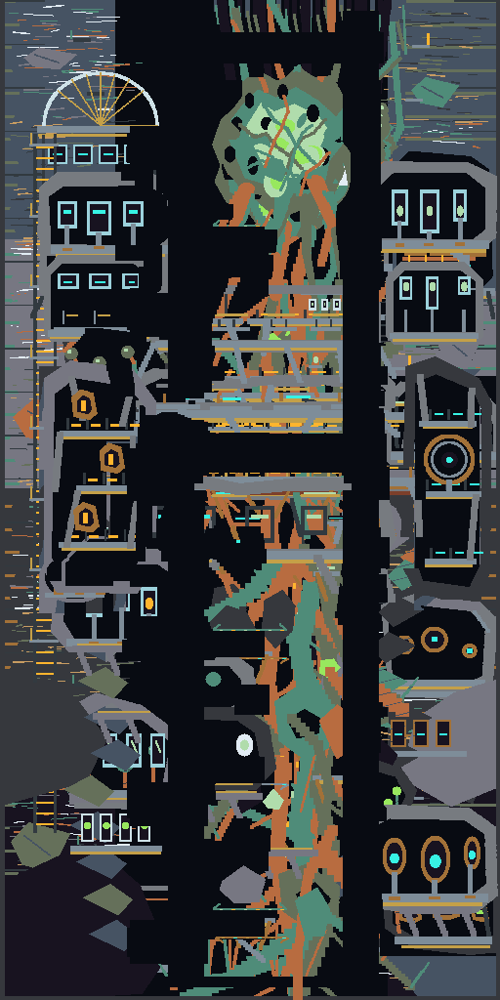

# Containment Tree Biosphere — R2C source-led physical-cell finishing

**DRAFT / HOLD — owner/Shepherd/native acceptance outstanding.** Exclusive Reworker C assignment on the existing PR #15 at starting HEAD `c40e9b4dff051e833316c38a3c885781a332aece`. No source image, archived main, engine, competing branch, or PR-state modification.

## Authentic source and designed world scale

Catalogue **techn-0021**, `batch1/image-0058`. The *actual* committed `source-reference-preview.jpg` (640×360; blob `64d7df6352b12d1aa57ce85f4925a722705bba1d`) was decoded and visually compared with real material-cell overview and 1:1 crops. The original PNG `artwork/technical_interiors/batch1/amber_canopy_biosphere-containment_tree-biological_dread.png` (blob `b8075c08c4a3cea84a877b036537dea55c87264f`) is untouched: **full-resolution PNG parity UNVERIFIED**.

Upper part: compact source-led bio-cavern with one luminous biological heart, porous roof and thick branching roots, segmented west glass dome/lift, different east vial laboratories and central guarded gantry. Below y≈1000: original functional extrapolation into rhizome ecology, resin research, rooted geology and return-pump logistics; no uniformly stretched image or replicated facility.

## Substantive authored-cell revision

- Replaced angular double-lobe heart and generic crown with one much broader, off-centre, rooted porous biological envelope, genuine large voids, vascular ribs and non-repetitive light-sensitive tissue.
- Differentiated the former uniform central bole into **three large wandering root axes**, unequal lateral buttresses, scattered reachable siphon pockets and solid-root-to-bottom attachment.
- Reconstructed matching lab levels as an asymmetric western resin-assay grotto, right-side stepped sample-vial manifold and substantially different crescent-shaped lower return/chemical collection vault.
- Braced floating-looking service/gantry transfer ledges with real solid supports; included second pass of connected pore-veins, discrete physical struts and purposeful lower rock zones.
- Kept authored Midge spawn and all **24 original semantic locations at identical coordinates**, protected side air chimneys and source-specific landmarks. No source-image painting, pseudo IDs, mobile powder structures, uncontained liquid or live reactor growth.

## Exact material-grid gallery

| Genuine unchanged source JPEG | Final actual-cell overview |
|---|---|
|  |  |

Real 1:1 crops: [upper organism](containment-tree-detail-upper.png), [middle rooted gantry](containment-tree-detail-middle.png), [lower ecology](containment-tree-detail-lower.png), [western observatory](containment-tree-detail-west.png), [eastern vial wing](containment-tree-detail-east.png).

## Deterministic static qualification

| Gate | Result |
|---|---|
| Extent | **1024×2048 = 2,097,152 physical cells** |
| Actual material identity changes versus assigned HEAD | **370,305** |
| Valid source-enum physical types | **20 immovable Solid/RuleKernel::None IDs**, no powder, liquid or growth |
| Rectangular Setup-v2 edits | **20,530 / 32,768**, 0 invalid/overlap |
| Serialized setup | **377,138 / 1,048,576 bytes** |
| Full 2,097,152-cell reconstruction | **0 mismatches** |
| Occupied physical solids | 1,260,097 |
| Exact 19×15 hull BFS from original Midge spawn | **24/24**, 489,881 connected legal centres |
| Exact 23×19 hull BFS | **24/24**, 449,282 connected legal centres |
| Exact 31×27 hull BFS | **24/24**, 382,269 connected legal centres |
| PNG indexed-pixel parity | **2,572,288 comparisons**, 0 mismatches, PNG CRC + zlib Adler PASS |
| Root physical support | Deep rooted component reaches upper heart and bottom material, 1,208,546 connected solid cells |
| Source preview | **GENUINE JPEG VIEWED**; original full PNG parity **UNVERIFIED** |
| Native Godot / CyberDemoBridge / Rapier / movement / collision / simulation / save-reopen | **NATIVE-UNTESTED** |

Current CyberSand accepted source supports 32,768 starting rectangles; installed capacity has **not** been measured. Legacy 4,096 fallback would reject this 20,530-rectangle file. Static 4-neighbour Midge clearance does not replace physical native playtesting or prove guided flight quality.

Run `node rebuild.cjs --verify` and `node verify-r2.cjs` from this directory to reproduce generator output and independently inspect all cells, PNGs, materials, and full-envelope exact-point BFS. The authentic source image and historical R1 records remain unchanged. Leave Draft/HOLD for Shepherd and independent auditors.
