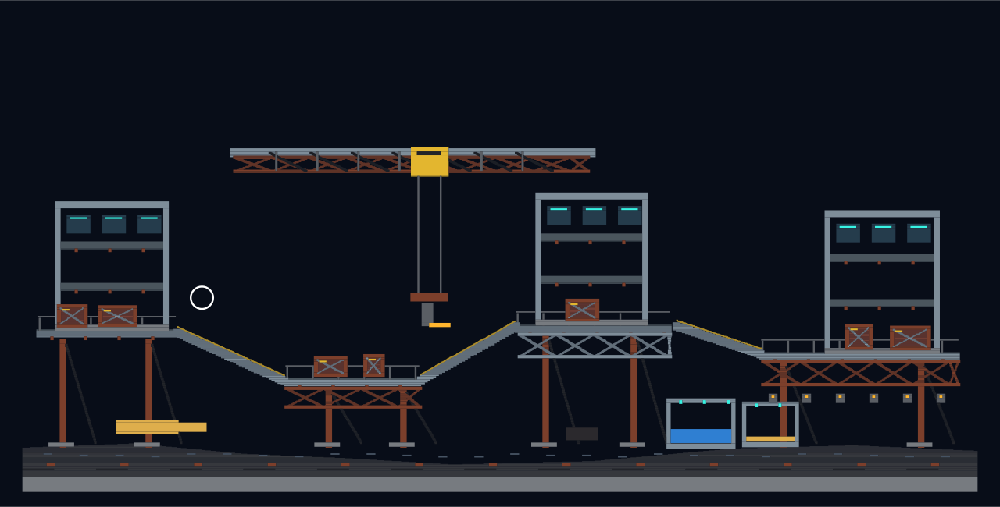
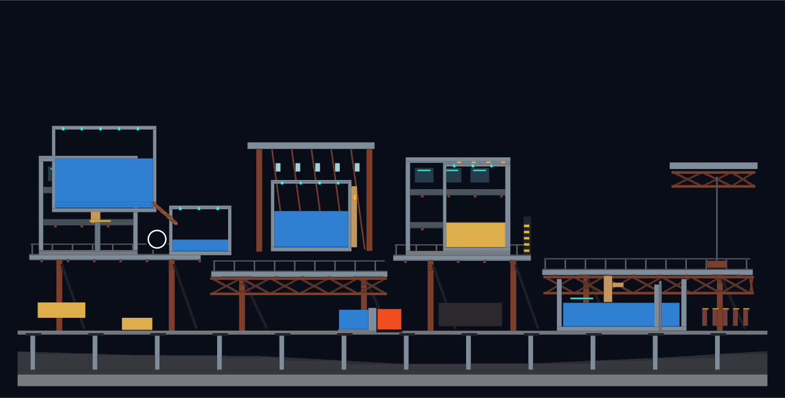
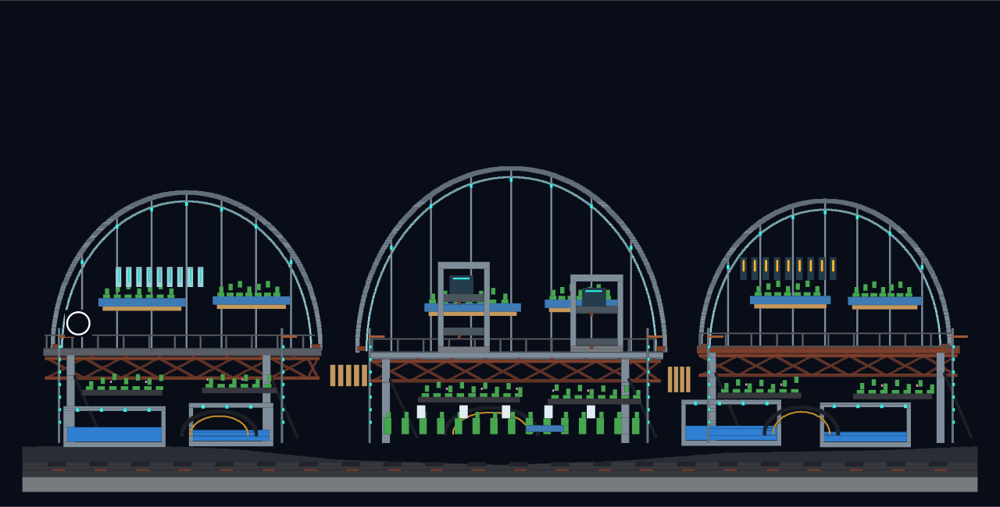

# CyberSand — EX-PLAY-001 / Three Playable Starting Maps

These are original **native 2048 × 1024 material-cell starting maps** for the standard CyberSand Shared Workbench (Setup-v2 format), not PNG backgrounds. Each starts with one Midge pilot, broad negative-space traversal routes and real simulated materials.

## First-time installation (Windows)

1. Extract this entire ZIP.
2. Double-click **INSTALL-EXEMPLARS.cmd**. It places the three source JSON maps in the normal Godot user-data Workbench folder; it does not touch game code or prior saved starts.
3. Launch CyberSand using **Open CyberSand.cmd**, then choose **Development workbench**.
4. Type one of the three names below in the starting-map name box and click **Load start**. Resume with **Play**.
5. Back up your authored starting map before experimenting; these are starting states, not snapshots of evolved physics.

## Map names

- `copperline-switchyard-trials` — Traversal, cranes, cargo, ramps and two material tanks.
- `tidelock-hydraulic-spillway` — Dams, fluid pressure, removable wooden outlets and water/lava experiments.
- `bloomglass-ruin-conservatory` — Glass domes, plant growth, fragile bridges, flooded cisterns.

Each map has a matching `preview-*.png` for visual inspection.

## Scope and validation

- All source rectangles are axis-aligned, in bounds, non-overlapping and cover the intended material grid exactly.
- Each JSON is within the 1 MiB authoring file limit; each record count is within the 32,768 Workbench limit.
- All materials use existing native IDs; reserved invalid material 10 is never used.
- Every Midge spawn includes a clear region.
- These source checks **do not prove** successful Godot/Windows native import, Save/Reopen, physical traversability or GPU performance. Treat the maps as experimental until tested in the actual Windows playtest.
- Do not merge into any accepted Gold corpus until actual host acceptance.

## Windows game-data location

The installer uses `%APPDATA%\Godot\app_userdata\Cyber Sand Reference Sandbox\workbench\`, the default path for the current Godot project name. The installer refuses to replace existing setup files. If your Godot user-data root was customised, install manually into its actual `user://workbench` folder.

## Actual material-cell previews

The previews below are generated directly from the same committed Setup-v2 rectangle records. They show authoring-time materials, not simulated evolved states.

## Reproduce source from its authoring code

Run `python -m pip install numpy pillow` followed by `python author_exemplars.py` from this folder. It writes new maps and previews under `_generated/` and never modifies the committed JSON. The three generated Setup-v2 JSONs have been compared byte-for-byte against the committed originals. For acceptance work, see [qa-acceptance-checklist.md](qa-acceptance-checklist.md).
