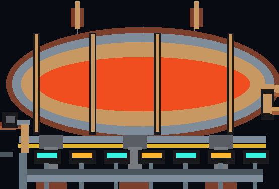

# Cinderlock Rotary Tiltworks — R2 independently authored industrial landscape

**2048×1024 genuine CyberSand material cells, perpendicular orthographic side elevation, no reference images.** Seed `26112071`. Accepted read-only CyberSand authority `de109d0131641d6adc8d25bb9ced7ca3d4991105`. Open Draft/HOLD; installed-native tests outstanding.

## Goal, spatial thesis and route network

Start (88,268) at dry ore reception. Follow left-to-right charge hoist/operated gate → massive low horizontal canted rotary kiln with trunnions → guarded ceramic receiver/ladle → three unequal billet draw and cut-off stations → isolated sealed blue quench → steel rail dispatch, goal (1973,271). Vast open flyable upper void above dense machines, 104-cell-wide central descent, two-direction alternative underground return through real blower, thermal, coolant and extraction-work districts. Dead ends have escape routes. Exact site graph (no centre substitution): West freight spawn (88,268); Ore hoist control (280,266); Charge gate lookdown (456,274); Rotary-kiln crown (664,270); Trunnion diagnostic (899,265); Receiver control (1199,266); First mould overlook (1432,269); Second mould overlook (1554,269); Shear service (1711,266); Quench inspection (1850,269); East dispatch (1973,271); Centre access shaft (1100,742); West blower shop (413,813); Kiln thermal service (744,816); Die coolant control (1478,813); East underfloor (1860,813).

## R2 response to independent first-HEAD Art and Shepherd P1

Compared to immutable R1 `d356d8eed4b853fd478b4cc9899789f5c960f965`, authored **69742 changed actual material-cell identities** (ore 9226; kiln 3809; transfer 3613; billet 7858; quench 3895; undercroft 41341), preserving every original Water and Lava cell, all 16 exact sites, skyline, giant kiln and high flyway. Ore now has a mechanical hydraulic lift clevis, two posts, charge damper, control hatch and supported feed. Kiln's refractory throat stubs and guarded receiver are **separated by the unobstructed central flight shaft**. Ladle spout, unequal withdrawal motors, cam rollers, cut-off shear and thermal isolation visually articulate processing. Quench-to-dispatch has independent inspection valves. Lower service has distinct grounded radial blower, finned heat exchanger, dual-filter rotor coolant pump and drain-bypass manifolds rather than repeated plinth consoles. Apparatus is inert collidable artwork, not claimed animated machinery.

## Exact source-static receipt

- Full plane **2,097,152** cells, SHA-256 `493d1d88426df5d7eb39636eec2a8e828b2a174acbf056b1cebd2c623d5c06fd`; Setup SHA-256 `953f4f82c2fe508349bd9a4d531c2798ef2ad90a05db10b5f5aa3f769cd0bd1f`.
- 3473 nonoverlapping five-field ordered rectangles and lossless full-plane replay; 64913 UTF-8 Setup bytes; 958064 construction-cell writes.
- Source cap 32,768 rectangles / 1 MiB JSON / 32M construction writes. Installed/legacy bridge fallback possible **4,096 rectangles** (spare 623), native compatibility unverified.
- 915311/915311 grounded inert solid cells; detached 0; repairs 22 components / 110 root connectors.
- Water 8736, Lava 34017; zero initial fluid-air faces and zero Water–Lava direct contacts. Sustained reaction/fluid solver untested.
- Exact four-neighbour full conservative Midge clearance: 19×15 16/16; 23×19 16/16; 31×27 16/16; blocked alternative [986,257,55,65] survives 16/16 at 31×27.
- Seven real indexed-material PNGs, 2923063 exact pixel-cell comparisons; signature, PNG chunks/CRC, zlib and IEND validated.
- Reproducible `node build.cjs --verify` byte-compares Setup/receipt/PNGs with committed generated artifacts; `node build.cjs` rebuilds.
- **NATIVE-UNTESTED:** no Godot/CyberDemoBridge/Rapier installed-body input, collision, fluid evolution, persistence or save/reopen tests. New exact-HEAD independent Art/Technical/Shepherd review required. Never Ready/merge/owner acceptance.

## Committed true material-cell evidence

