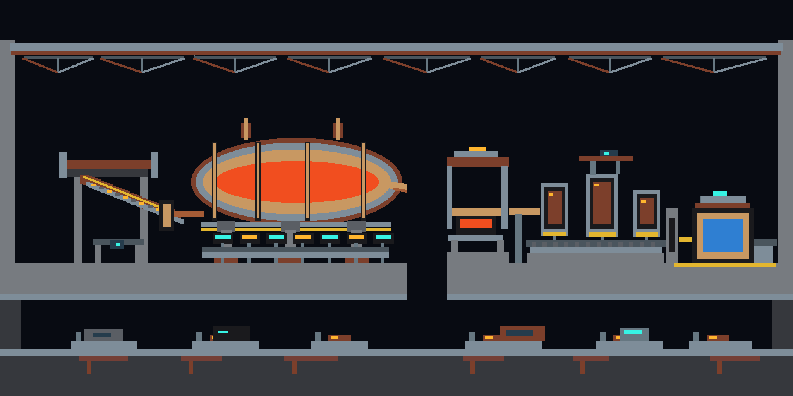
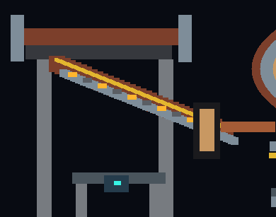
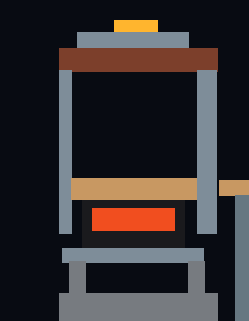

# Cinderlock Rotary Tiltworks — NEW original CyberSand industrial landscape

**Entirely independently authored 2048×1024 material-cell world, pure perpendicular side elevation.** No reference image or older map source used. Fixed seed 26112071. Industrial thesis: one massive horizontal, canted, refractory-lined rotary kiln on unequal trunnions, with a lower service undercroft, instead of classic blast furnaces or induction spires.

## Midge game route

Start **West freight spawn (88,268)**. Main high flyway connects dry ore réception -> diagonal charge bridge -> rotary kiln overhead -> shielded liquid charge receiving cup -> three distinctly shaped billet draw stations -> shear -> quench -> eastern dispatch. Midge can inspect return paths via the central transfer-shaft descent into the lower repair and extraction gallery. The underfloor circuit has west blower/heat diagnostic and east cooling-valve/return ends, connected along a broad high-ceiling horizontal void; wrong turns can be reversed. Main skyline has deliberate generous clear flight air above dense collidable machinery. Secondary low process aisles remain separate from major equipment.

**Exact named route sites** (never snapped): West freight spawn (88,268); Ore hoist control (280,266); Charge gate lookdown (456,274); Rotary-kiln crown (664,270); Trunnion diagnostic (899,265); Receiver control (1199,266); First mould overlook (1432,269); Second mould overlook (1554,269); Shear service (1711,266); Quench inspection (1850,269); East dispatch (1973,271); Centre access shaft (1100,742); West blower shop (413,813); Kiln thermal service (744,816); Die coolant control (1478,813); East underfloor (1860,813).

## Six materially differentiated districts

1. West industrial intake: complete sloping ore mono-rail, hopper, charge fence and rooted operator console
2. Rotary heat nave: a canted armoured kiln drum, heterogeneous refractory layers, three heavy trunnion bearings, static contained Lava #8, heat-inspection workfaces
3. Ladle and tundish exchange: supported off-centre ceramic receiver and dried melt-transfer throat (not functioning machinery)
4. Billet drawing: unequal three-stage metal moulds, collidable rollers, isolated controls and shearing guard
5. Sealed quench/export: water cassette with inert refractory enclosure, blue contrast, export trolley rail
6. Underdeck repairs: underground traversable shop with large negative space, grounded air blower, thermal instruments and quench valve monitors

## Physical and technical contract

Authority is accepted read-only CyberSand `de109d0131641d6adc8d25bb9ced7ca3d4991105`. Workbench Setup-v2 exact rectangle limit **32,768**, file limit **1,048,576 bytes**, construction work budget **32 million**. Installed legacy bridge may fall back to 4,096 if the capability handshake is missing. Midge authored hull 4×3, conservative four-neighbour 19×15 / 23×19 / 31×27 full-body clearance. Stable structurally rooted inert Solid/RuleKernel::None materials only; staged Water #3 and Lava #8 are mobile/reactive, initially contained, not supports.

Receipt: exact 2,097,152-grid SHA-256 `0829682212e54470c0fb83745c11212fb70f922708c8c8964db85addc1ec5be6`, Setup SHA-256 `f8f3be184a59c51418b112552e289ebc0c963dcfdd09b72e58382103a569fa53`; 2858 nonoverlapping ordered rectangles; 53226 JSON bytes; 918955 construction work; grounded 876202/876202 inert cells, detached 0; contained Water 8736, Lava 34017, initial fluid/exposed edges 0. Source full-centre 4-neighbour reachability 16/16, 16/16, 16/16 for 19×15,23×19,31×27. Physical obstruction [986,257,55,65] still 16/16. Structural connector repair uses only shortest inert-root paths, 89 cells over 13 formerly detached components, longest 50 cells.

Real original material indexed PNGs: full-grid and six genuine 1:1 crops, every 2923063 indexed material pixels compared with source grid; signature, IHDR, PNG CRC, zlib stored-block, Adler-32 and IEND checked. Reproduce using `node build.cjs --verify` to regenerate and byte-compare Setup, receipt, all PNGs. Or `node build.cjs` to regenerate in this directory. All outputs belong exclusively to this map folder.

**HOLD:** Engine installation, actual Midge controls/contact/flight dynamics, Rapier tick, fluid evolution, source-versus-installed bridge capacity and fresh-process save/reopen **NATIVE-UNTESTED**. Creator's static qualification is not independent Art/Technical/Shepherd or owner acceptance. No Ready or merge.

## Actual material-grid gallery

