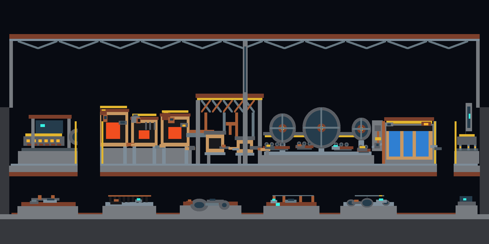
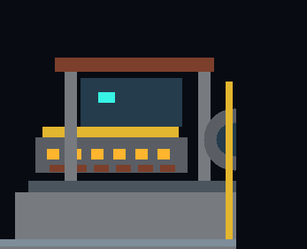
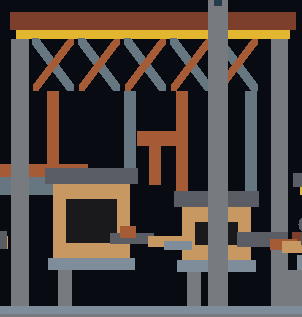
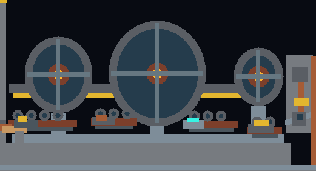
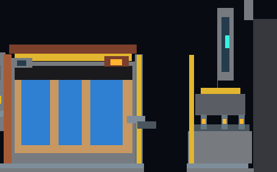

# Crownstep Continuous Stripworks — new original 2048×1024 CyberSand landscape

**ORIGINAL-NO-SOURCE · Draft/HOLD · creator source-static verification only · NATIVE-UNTESTED.** This is not a reference art conversion, 3D or isometric scene, or purported native Workbench screenshot. All visible geometry is authored as actual material-ID cells.

## Place, function and distinctive macro architecture

An industrial *continuous hot-strip finishing works* in strict perpendicular side elevation. A west horizontal side-tip rail intake feeds **three individually shielded soak hearths**, followed by a dry duct and **two unequal hanging siphon ladles**. Cast stock proceeds across **three differently sized, exposed powered crownwheel rollers**, mechanical pinch-roller stands, guarded shear, **three genuinely closed water-quench cassettes** and an east rail dispatch shed. It has a long unequal sawtooth-truss canopy and a dense mechanical middle silhouette. Nothing is reproduced from a source photograph or prior CyberSand map.

Six distinguishable grounded underplant shops—press hydraulics, finned heat exchanger, opposed pinion gearing, branch manifolds, coolant bladder isolations and a freight signal relay—occupy the deep repair mezzanine. Real negative space is reserved both above the processing deck and in the belowdeck corridor. All decks, machine plinths, narrow bridges, supports, shafts and voids are material cells, not scenery.

## Spatial and flight topology

**Spawn:** [86,272] at the west rail arrival. **Goal:** [1948,272] at the east freight dispatch. The upper main air lane traverses ore intake → furnace controls → dry transfer → counterweighted ladles → crowned strip rolling → shear → quench → dispatch.

An independent, **77-cell-high continuous excavated maintenance gallery** around y742–819 connects [213,780] press repair, [537,780] exchanger, [854,780] gearing, [1223,780] manifold, [1537,780] bladder isolation and [1948,780] dispatch relay. It is accessible through **two spatially separate Midge-clear vertical emergency shafts**, the west at x325..418 and east at x1830..1899, each linking upper and lower lanes. A rooted central torque mast sits in the upper choke and gives the alternative route a real engineering reason to exist.

Exact 23 literal site coordinates, clear hull results and source hashes are recorded in [receipt.json](receipt.json). All 23 are statically free and reachable at **19×15, 23×19 and 31×27 full envelope**, by exact-centre four-neighbour BFS without substitute target shifting. An actual material obstruction **[996,181,74,505]** eliminates the central upper crossing while the separate lower circuit preserves **23/23** reachability at 31×27.

## Deterministic reproduction and physical contract

`node build.cjs` regenerates the complete cell plane, Setup-v2 JSON, qualification receipt, full material-index overview and six original-resolution 1:1 crops. `node build.cjs --verify` checks regenerated bytes against all files in this directory. Fixed seed **261120211**, 2048×1024 = **2,097,152** final material-ID cells, and canonical lossless vertical-coalesced nonoverlapping five-field rectangles; exhaustive ordered replay has zero invalid writes, duplicates, holes, overlaps or histogram mismatch.

- Original plane SHA-256: `aa27f9653406fe4da1c1675a442a2f4072246f1e2f8df8bd16f381e5aea39230`.
- **3,732** Setup-v2 rectangles, **71,004** Setup JSON bytes, **855,407** construction visits.
- **832,200 / 832,200** inert structure cells rooted to the canvas boundary, **0** detached solids.
- Initial **14,766 Water** and **8,441 Lava** cells; **0** fluid-to-air faces, **0** direct Water/Lava contacts at construction. Their later simulation behavior is unverified.
- Source Workbench accepted rectangle ceiling **32,768**; an old unhandshaken CyberDemoBridge installation may instead accept **4,096**. Our 3,732 are below both *numeric* ceilings but native-installed acceptance remains UNTESTED.
- Accepted **read-only engine** `techrote/cybersand main@de109d0131641d6adc8d25bb9ced7ca3d4991105`. Native material IDs are the accepted 0 empty, 3 Water, 8 Lava, with static inert supports drawn from the present accepted solid material catalogue. Midge's source-registered actor hash and liquid policy are included verbatim in Setup-v2.

## Genuine material-ID image evidence

| Side-tip charge | Triple shielded hearths | Twin dry siphon ladles |
|---|---|---|
|  |  |  |

| Crownwheel rolling and shear | Sealed quench and freight | Six rooted underplant workfaces |
|---|---|---|
|  |  |  |

All seven generated PNGs are genuine 8-bit indexed pixel-for-cell outputs from the finalized, non-overlapping grid, not AI visuals or fake native screenshots. Builder tests PNG signature, IHDR dimensions, each CRC, zlib Adler, DEFLATE contents, IEND and **all 2,987,912 source-grid image pixels**. Upload-time Base64 byte roundtrips were separately verified. Remote *committed-byte* readback parity, independent review and CI are not claimed until independently performed.

**Pending qualification:** separate exact-HEAD Art, Technical and Shepherd review; installed Godot/Workbench/CyberDemoBridge actual load; Midge input, Rapier advancement/collision, fluid evolution, cold save/reopen. Source-static reachability is NOT native gameplay PASS. Preserve Draft/HOLD until owner direction.

## R2 bounded functional-art repair (20 November 2026)

The creator added supported real-cell operating hardware to differentiate all three thermal hearth charge/inspection stages; supplied a more legible ladle tilt/pour, guarded dry mill entry, compression, shearing, outfeed and quench inspection; and differentiated the underplant repair stations while preserving the 77-cell-high lower flyway and both original rescue shafts. This is **19981 changed actual material IDs** (5773 additions, 6 removals, 14202 rematerializations), not a crop or description-only revision. Water remains 14,766 cells; sealed Lava changes 8,441 → 8382, as documented in current receipt.

**Full regenerated R2 creator static receipt:** 3835 disjoint ordered rectangles; 72920 Setup bytes; 861174 material writes; material-plane SHA-256 e75eec966ec6f9e085ba8ef862faa12cdf17c3566497d86acef80e81c6aa9d28; 838026/838026 boundary-grounded inert solid cells, zero detached, zero initial exposed fluid-air faces and zero direct Water–Lava contacts. The exact 23/23 original Midge sites pass full 19×15, 23×19, 31×27 clearance and the physically obstructed upper route still reaches 23/23 at 31×27. The entire overview and six authentic 1:1 indexed material crops regenerate with CRC/Adler validation and 2987912 direct pixel tests. **Independent new-HEAD Art/Technical/Shepherd review required; NATIVE-UNTESTED, Draft/HOLD.**
