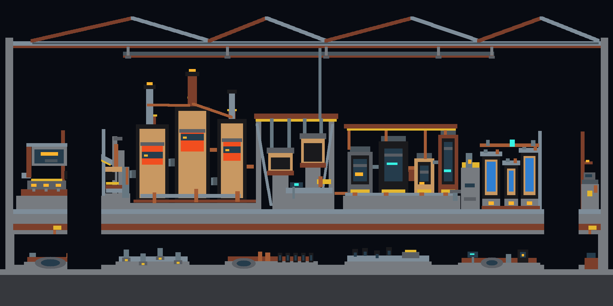
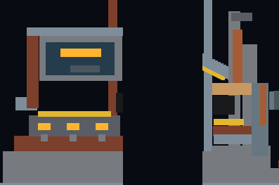
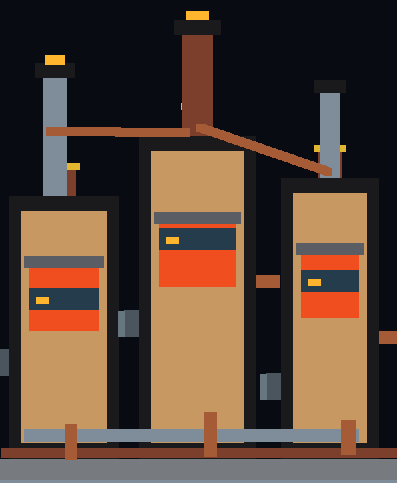
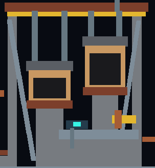
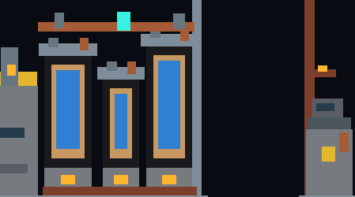

# Kilnspire Cascading Steelworks

**Original CyberSand industrial foundry, true perpendicular 2048×1024 material-cell side elevation.** New, fixed-seed author-designed world; neither a conversion of reference images nor an alteration of previous foundries. OPEN Draft/HOLD only. Source-static evidence is not a native gameplay PASS.

## Architecture and production flow

A long sawtooth roof is carried by actual end frames. A lateral tipping dock and operated charge gate occupy the west, delivering to **three independently tall, insulated vertical hearths** with sealed lava cores. Their founded thermal manifold feeds **two differently hung dry ladles**, which transfer across a guarded inspection throat into **four staggered vertical caster wells**. A hydraulic shear then enters **three differently sized sealed water quench cassettes**, terminating in an east freight coupler. All machinery is true elevation geometry, with solid support chains rather than decorative scenery.

Five unequal excavated service workfaces run beneath the works: gearbox teardown, hydraulic pressure testing, annealer and filter bank, compressor trolley, induction controls and pump. They are reachable by a continuous real lower flight passage. Negative space is deliberate: tall upper navigation void, distinct main plant silhouettes, two recovery shafts, dry lower return and full-room variations in scale.

## Flight routes and sites

- **Spawn**: West charge spawn (91,254).
- **Primary upper inspection progression**: Ore tipping (192,252) → hearths (493,251; 646,214; 781,251) → ladles (885,250; 1015,251; 1110,250) → caster (1215,250; 1372,251) → shear (1530,250) → quench (1709,250) → freight goal (1955,250).
- **Recovery/alternative**: Descend west shaft at (275,400), follow dry underdeck flight corridor via machine sites (161,821), (484,821), (884,822), (1270,821), (1667,821), exit via east shaft (1875,823), ascend (1875,417), reach freight goal. Shafts, names and coordinates are literal and never shifted during verification.
- **Real obstacle test**: Add solid 45×307 XYWH obstacle at (1043,165) to a **separate test grid**, leaving the committed plane unmodified. The same west spawn still reaches **all 21/21 exact destinations** at 31×27, using the actual collision-free connected space. The obstacle adds a substantial upper-gantry impediment, not a mere centre point marker.

The original Midge is a small 4×3 source-authored actor; the conservative whole-body rectangular hull tests are substantially larger. Every site passes exact full-in-bounds free-centre 4-neighbour BFS for 19×15, 23×19 and 31×27 **without target shifting**, with 21/21 reached at each. Physical flight feel and collision response remain native-unverified.

## Exact-source construction receipt

| Proof | Committed value |
|---|---|
| Fixed seed | `261120161` |
| Real final material plane | `2048×1024 = 2,097,152` final ID bytes |
| Grid SHA-256 | `155c12951ee1e9cec10a71d7cf358530ad4f9833a103f8a5e092e8d2b03f3402` |
| Setup JSON SHA-256 | `aab61ed4687577ff1ea05da8cbd3e37049c300691f5e8282e8fadf90d464619f` |
| Setup JSON size | `39,510` bytes |
| Canonical rowwise/vertical-coalesced edits | `2,086` ordered nonoverlapping rectangles |
| Source rectangle ceiling | `32,768`; **possible installed fallback 4,096 is not measured** |
| Construction writes | `977,131` cells |
| Grounded inert solids | `961,470 / 961,470`, 0 detached |
| Initial dynamic materials | Water ID 3: `7,256`; Lava ID 8: `8,405` |
| Initial fluid interfaces | 0 fluid-air, 0 direct Water/Lava contacts |
| Exact sites reached | 21/21 at all 3 conservative hulls |
| Obstructed alternate | 21/21 at 31×27 |
| Genuine indexed PNG pixel parity | `2,949,474` material pixels, zero mismatches |

Exact read-only engine source: `techrote/cybersand main@de109d0131641d6adc8d25bb9ced7ca3d4991105`. Loader: `godot/scripts/workbench_setup.gd`, blob `70dd964bc2d5bff9ca030edd57d7fc7aa5068fc9`. Kernel table: `native/include/cybersand/material.hpp`, blob `dcf05895da3015a2e999e3d1cbbae0fdc7fe32b3`. Every nonzero nonfluid ID used is a `Solid / RuleKernel::None`; only ID 3 water and 8 lava use mobile fluid physics, and are completely initially enclosed by inert supports. The selected accepted Midge hash is `c226d73ae56a426820d2ef842a4856bf79ac23efabe64e66569dff8de62a7a96`.

The deterministic source is `build.cjs` (Node, no external packages). Run `node build.cjs` from this directory to generate the exact binary files. Run `node build.cjs --verify` to verify every committed generated byte. The builder independently reconstructs an ordered non-overlapping rectangle plane, checks full final-grid equality, source histogram, rooted structural solids, initial fluid interfaces, full-envelope BFS, obstruction fallback, and authentic indexed PNG signature/IHDR/CRC/zlib Adler/IEND and all material pixels.

## Authentic source-material gallery

The overview contains exactly the full original 2048×1024 grid; crops are genuine 1:1 unscaled pixel rectangles extracted directly from the final indexed-material plane, not concept art or fabricated native frames.

| Process district | Exact 1:1 crop |
|---|---|
| West ore exchange / charge gate |  |
| Triple vertical hearths / thermal manifold |  |
| Dual dry crane ladles |  |
| Four stepped caster wells / guarded shear |  |
| Sealed quench / east freight |  |
| Lower real machinery and recovery |  |

## Qualification gates / limitations

**Creator source-static PASS only. Native: NATIVE-UNTESTED.** Actual installed Workbench/CyberDemoBridge rectangle capability, Godot generated-start load, Midge hull/collision/flight feel, Rapier integration, active water/lava solver progression and cold-process save/reopen were **not executed**. Counts below 4,096 are not evidence of a compatible installed bridge. The independent remote comparison of the 2.1 MB committed overview PNG may be limited by binary retrieval; generation-time exact pixel parity is not a remotely fetched parity check. No CI pass, independent Art/Technical/Shepherd acceptance or owner merge approval is claimed.

Independent exact-HEAD Art, Technical and Shepherd reviewers should check the full committed source-plane process legibility, all six 1:1 crops, fixed-site routes, 31×27 obstructed return, material laws and installed/native admission separately. Retain **OPEN Draft/HOLD** until explicitly authorized.
