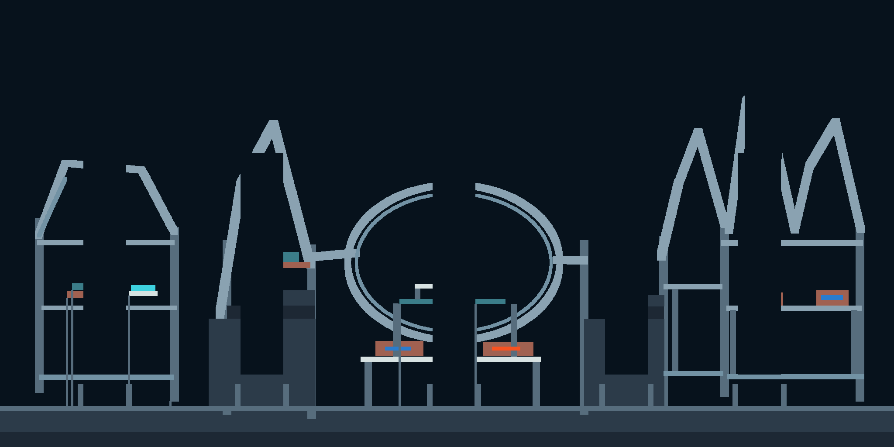
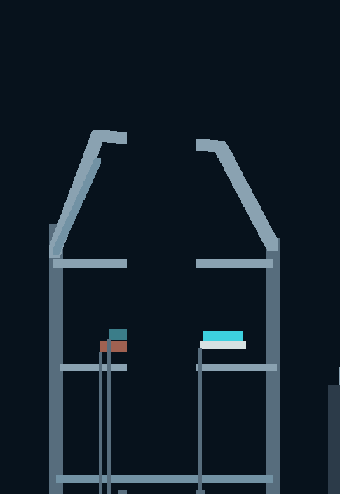
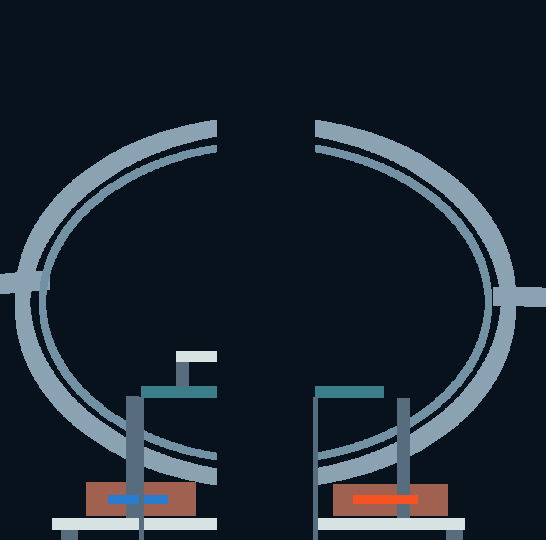
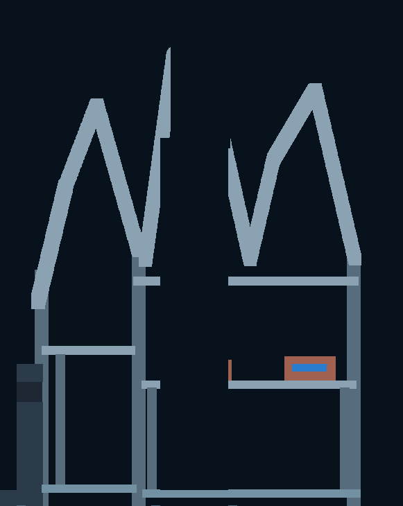

# Cairn-9 Inverted Quench Crater — original 2048×1024 CyberSand material-cell world

**SOURCE-STATIC PASS · OPEN Draft/HOLD · NATIVE-UNTESTED**. Authored orthographic 2D side elevation, actual deterministic material cells, not concept or AI art.

## Functional districts and spatial exemplar thesis

1. **West assay / freight berth (x0–480).** Sloped intake, physically entered measuring stations and unfinished lower bay for human editing.
2. **Left excavated thermal-fault shoulder (x478–780).** An oblique vent/cutter, real material excavations and a lower recovery site.
3. **Central interrupted annular quench (x780–1300).** A rooted broken oval with true upper and lower flight portals, internal inspection, dry lower workface and two isolated, inertly staged Water/Lava cores.
4. **Opposite fault relief shoulder (x1330–1655).** Unlike terrace/slope load paths and nested service recesses.
5. **Broken eastern scrubber and extraction (x1650–2048).** Two unequal canted exhaust fins, high damaged entry, separate inspection/recovery and an east exit.

Route: west launch → assay → thermal shoulder → open upper or annular approach → fault relay → scrubber → east safety exit. **15 literal checkpoints** pass all three full conservative Midge envelopes, and real overflight obstruction creates 4 strictly positive detours without shifting named sites.

## Authentic 1:1 source-cell district windows

## Reproducible source and limitation

`node build.cjs --write` produces all committed files from deterministic material geometry. `node build.cjs --verify` checks exact rebuilt file bytes, full ordered replay, literal site routes and full PNG CRC/zlib/index parity against the source material cells.

Fixed seed `2026112099`. Full grid SHA256 `63336a2ac529bf9572c40fbdd428fa9cdf5fbc3123ad84e00d34f97928c4fc39`. 2517 nonoverlapping optimized Setup-v2 rectangles, 47726 JSON bytes, 450254 paint cells. 448624/448624 grounded inert supports, 1630 liquid cells fully enclosed at time zero. No falling or unstable foundation materials.

Read-only accepted engine source `techrote/cybersand@de58bf1997ca75825cf3b29e046dc1c1022c45bf`, source repo base `99a166e7fcae45eb22be1740e9f33f62faccbcc7`. Current accepted source permits 32,768 rectangles and 1 MiB Setup; this is *not* a native installed load or dynamic fluid test. Actual Workbench import, Rapier/Midge input/advancement, save/reopen and exact-HEAD CI are **NOT TESTED**. Independent Art/Tech/Shepherd review pending. `exemplar.json` is corpus v1 metadata only, not engine contract.
