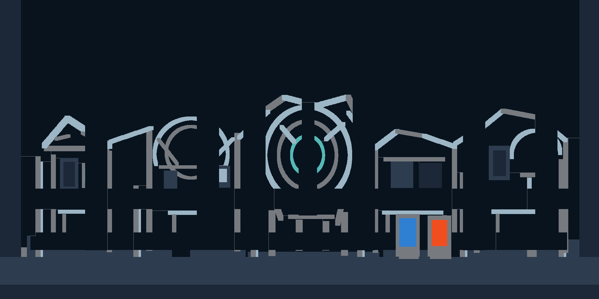

# Galen-2 — Triple-Loop Catalytic Sorting Yard

An **original 2048×1024, true orthographic side-elevation** CyberSand material-cell landscape with no reference art, no fake native screenshot and no animated machinery claims. The geometry is independently authored for editing, procedural-grammar research and scripted-event staging.

Five functional districts: **reagent gatehouse** x150–380, **dry exchanger** x500–815, **entered three-loop classifier** x895–1220, **contained quench specimens** x1274–1550, **scrubber/dispatch** x1620–1940. The large yard has distinct public sky, service gallery, entered hoop chamber, low dry recovery and retained editing voids.

**Spawn:** West ingress (144,220). **Goal:** East dispatch (1905,231). Other literal checkpoint sites are in `receipt.json`, including interior [1040,526], mid-level workfaces and low emergency returns. The 19×15, 23×19 and 31×27 Midge free-centre 4-neighbour BFS reaches **18/18 exact destinations** from the original spawn; none shifted or exempted. A real obstruction at `[924,0,70,265]` retains all destinations, causing four +88…+98 step 31×27 upper detours.

**Deterministic source:** seed `2026112111`, `node build.cjs --write` regenerates the Setup, receipt and genuine images; `node build.cjs --verify` checks all committed outputs byte-for-byte against regenerated outputs. Full grid of 2,097,152 literal IDs, 2166 disjoint nonoverlapping ordered Setup-v2 construction rectangles, 42059 JSON bytes, full ordered cell replay, SHA256 material identity, 643121/643121 grounded inert solids, 10454 initially enclosed water/lava and zero exposed/mixed cardinal contacts. Intended use: source-static qualification, *not* certified native playability.

**Unscaled genuine indexed 1:1 material crops:** [reagent](01-reagent-sluice.png), [exchanger](02-heat-exchange.png), [classifier](03-triple-loop-sorter.png), [quench](04-quench-locks.png), [scrubber](05-scrubber-dispatch.png), [entered rotor and service gap](06-rotor-service-gap.png).

**Authoring affordances** (all unscripted): classifier startup, quench reference-vat breach, two-lane pursuit, freight arrival/departure and unfinished upgrade bays. These are geometry opportunities, not functioning simulation.

**Source contract:** sandmapsreference `main@99a166e7fcae45eb22be1740e9f33f62faccbcc7`; accepted read-only CyberSand `main@f7e056c9b8791106e22f2d1c295043783d8a9701`; Workbench Setup-v2 32,768 rectangle and 1 MiB budgets. The `exemplar.json` metadata is not engine authority. Independent exact-HEAD Art, Technical and Shepherd review outstanding. Actual Godot/Workbench/CyberDemoBridge/Rapier/Midge physics, dynamic liquids, true installed native loading, actor progression and cold save/reopen are **NATIVE-UNTESTED**. DRAFT/HOLD: no merge, Ready or owner acceptance.
