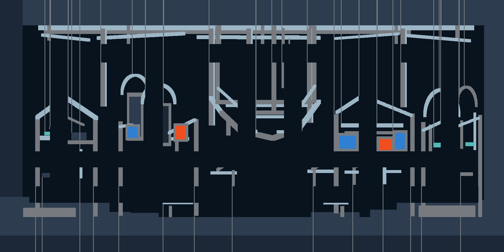

# Moraine-14 — Suspended Solvent Drydock

> **Original 2048×1024 CyberSand material-cell map · Source-static qualified · Draft/HOLD · NATIVE-UNTESTED.**

**Design thesis:** An overhead, boundary-rooted industrial gantry loads an inverted suspended salvage hull above a deliberately open drydock basin. Unequal ground-rooted workfaces, overhead drops, two solvent columns, sealed quench samples, lower salvage annexes and a distinct outbound gasometer make a new industrial *support and altitude grammar*, rather than another line of furnished compartments. Side elevation is orthographic, without perspective floor tops. Nothing here reuses a source/reference image or geometry from an earlier map.

## Functional districts and actual flight sites

1. **Incoming reagent / weighbridge** — dry arrival, receiving hopper, inspection and lower recovery.
2. **Unequal solvent fractionators** — two dissimilar casings, completely sealed initial fluid sample cards, middle assay and lower return.
3. **Roof-hung salvage hull** — asymmetric U-hull, roof-rooted hangers, exposed clear drydock well, hull transfer and underside recovery.
4. **Isolated quench / bypass** — three enclosed sample vessels with separate workfaces, upper inspection, lower recovery.
5. **Exhaust and dispatch** — two unequal gasometers, loaded dispatch stage and distinct outbound extraction destination.

There are **18 literal named checkpoints** and six access wells connecting a high public airway, mid-level process lane and lower drydock recovery. The owner can fill selected underworked bays or use the hull hanger, sampling station, quench controls and drydock pit for *future* scripted events. No event or process actuation is present in this source.

## Static qualification / full material plane

| Measure | Exact creator result |
|---|---:|
| Source extent | 2048 × 1024 = **2,097,152 final material IDs** |
| Setup-v2 ordered, nonoverlapping rectangles | **1,786** |
| Exact Setup JSON bytes | **35,093** |
| Source-grid SHA256 | `8830a8dbc55115bd57122c0301ad8ca5b5e72944b65c116e30fe1845fba8e1a6` |
| Setup JSON SHA256 | `11eba3583eed8251a1ad0de5164449fc3e535771804fa5920b711c5d06e48b52` |
| Boundary-rooted inert structural cells | **961,502 / 961,502**, zero detached |
| Initially sealed Water/Lava cells | **12,338**, zero cardinal air/mixed-fluid contacts |
| Exact checkpoint clearance/reachability | **18/18** with **19×15, 23×19, 31×27** masks |
| Real obstruction | `[845,607,65,92]` |
| Obstruction recovery | **18/18** retained; nine 31×27 forced detours, **+70** centre steps each |
| PNG gallery | One genuine full-grid indexed-material overview + six genuine native-resolution 1:1 crops |

Deterministic fixed seed: `2026112106`. Reproduction: run `node build.cjs --write` inside this folder; `node build.cjs --verify` byte-compares source-generated Setup, receipt and PNGs against committed bytes. `receipt.json` contains source-grid/Setup/PNG SHA256, per-material histogram, used/written cell counts, exhaustive ordered replay identity, literal site list, BFS clearance and obstruction receipts. Images are **indexed original material IDs**, not AI illustrations or claimed native screenshots.

## Preview gallery

- [Receiving/weighbridge — 1:1](01-feed-assay.png)
- [Solvent fractionators — 1:1](02-solvent-columns.png)
- [Suspended hull — 1:1](03-suspended-hull.png)
- [Quench isolation chain — 1:1](04-quench-chain.png)
- [Dispatch/exhaust — 1:1](05-exhaust-dispatch.png)
- [Editable drydock pit — 1:1](06-drydock-pit.png)

## Exact upstream authority and gates

- Base `techrote/sandmapsreference/main@99a166e7fcae45eb22be1740e9f33f62faccbcc7`.
- Read-only accepted CyberSand `main@f7e056c9b8791106e22f2d1c295043783d8a9701` supplies Setup-v2, accepted materials and physics kernel, Midge instance definition/hash and the **32,768 Workbench construction rectangle contract**. Obsolete standalone MicroScenario 4,096 limits are not used to suppress source authoring.
- Source Setup is **35,093 bytes**, below the accepted **1 MiB JSON** limit. Materials are accepted IDs: Air 0, Water 3, Lava 8, concrete 58, basalt 100, obsidian 101, bare iron 117, glass block 120. This is **initial containment** only; fluids may change at runtime.
- Authoring/static qualification does **not** prove installed bridge handshake, actual Godot startup, Rapier contact bodies, Midge flight or collision advancement, fluid evolution or cold save/reopen.
- **NATIVE-UNTESTED.** Independent exact-HEAD Art, Technical and Shepherd review is required. No merge, Ready, auto-merge, or owner acceptance is asserted.

See `exemplar.json` for controlled diversity axes and authored set-piece/grammar metadata.
