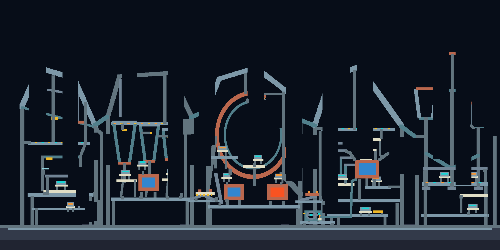
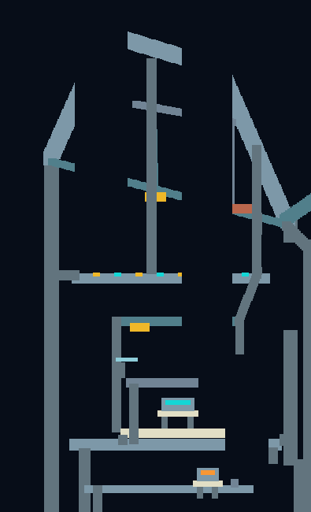
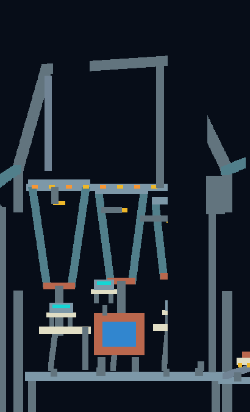
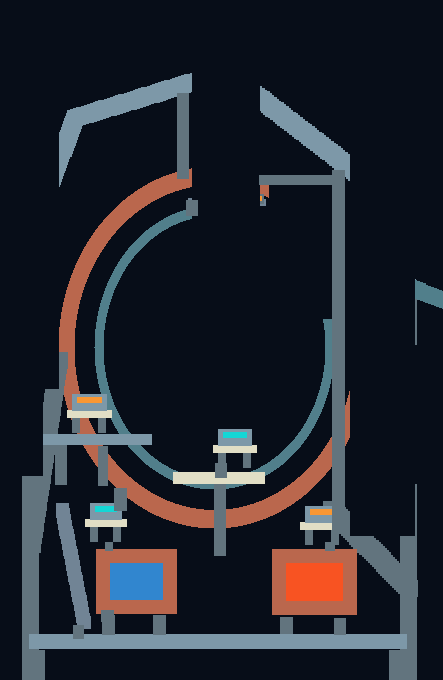
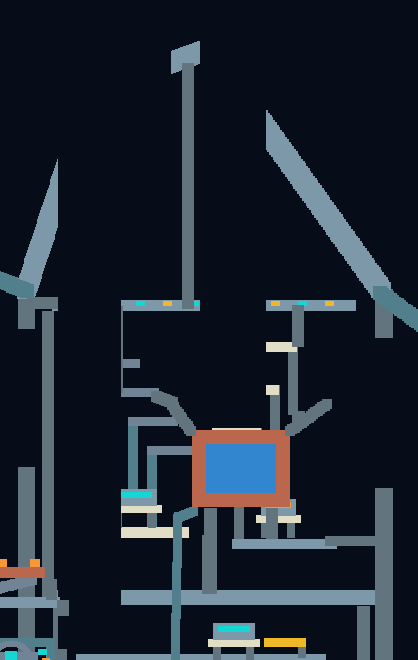
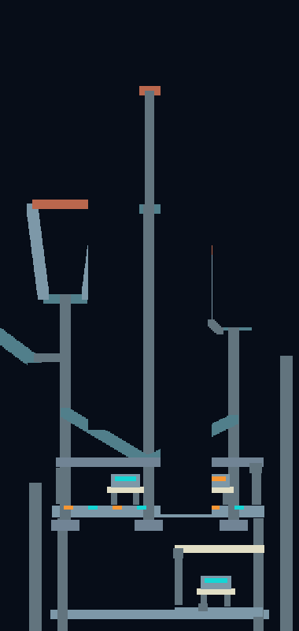
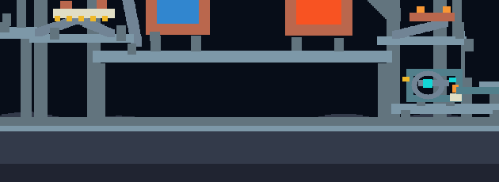

# Oxbow-6 Cyclone Transfer Lock
Original CyberSand 2048×1024 landscape · industrial-hazard-wide · **Draft/HOLD, NATIVE-UNTESTED**.

## Design
A derelict isolation-transfer refinery in literal orthographic side elevation. Five mechanically distinguishable spaces follow a freight→separation→thermal processing→quench→exhaust chain:
1. **Oxbow freight airlock:** split shed profile, slung cargo clamp, actually entered gauge hall and service recovery hatch.
2. **Tapered cyclone bank:** three unequal dry separator cones, different test stations, enclosed cooling cylinder and high approach.
3. **Breached annular kiln:** open service breach in a tall double-skinned thermal shell, opposite-side maintenance, genuinely sealed cold and hot cartridges.
4. **Vacuum-quench canyon:** opposing raked diaphragms, sampled isolated water jacket, upper watch and lower dry return.
5. **Triple-chimney extraction:** unequal exhaust stalks, paired dry inspection benches and an exterior emergency hatch.

Exterior clear sky, side entrances and separately excavated maintenance shafts provide a primary upper route, local drop/recovery and a lower service alternative. The ducts, conveyors, consoles and gauges are **inert architectural materials**, not functioning fluid/mechanical systems.

## Reproduction
Run `node build.cjs --write` to regenerate exact `setup.json`, `receipt.json`, the 2048×1024 indexed overview and six 1:1 district crops. Run `node build.cjs --verify` for deterministic byte equality, conservative 19×15/23×19/31×27 exact-centre BFS, obstruction recovery and all PNG pixel reconstruction. Source of geometry: `geometry.cjs`, fixed seed **202611206**. No reference image/AI illustration is used.

## Exact-source and engine authority
- Source repository default: `techrote/sandmapsreference/main@99a166e7fcae45eb22be1740e9f33f62faccbcc7`.
- Accepted read-only engine: `techrote/cybersand/main@7b03aa437561ec63e31fd09531171360ab60eeb4`.
- Authored Midge model `midge`, immutable hash `c226d73ae56a426820d2ef842a4856bf79ac23efabe64e66569dff8de62a7a96`, native authored hull 4×3. Conservatively proofed envelope up to 31×27.
- Material IDs are Empty 0; native mobile Water 3 and Lava 8; stable architecture IDs 58,62,68,70,76,77,79,100,101,104,117,120.
- Source advertised 32,768 rectangles and 1 MiB Setup; **installed dynamic bridge capability must be verified**, even though this map is below a possible legacy 4,096-entry limit.

## Exact source-grid receipt
| Metric | Verified |
|---|---:|
| Material-ID cells | **2097152** |
| Canonical ordered disjoint rectangles | **2695** |
| Setup-v2 serialized bytes | **50540** |
| Construction cell visits | **500886** |
| Stable inert solid cells boundary-rooted | **491074/491074** |
| Initial Water / Lava cells | **7646 / 2166** |
| Initially exposed liquid/air faces | **0** |
| Named exact sites at all three hull sizes | **16/16** |
| Hypothetical real solid obstruction | **970,50,55,275 XYWH** |
| Reachable sites with obstruction at 31×27 | **16/16** |
| Independently decoded indexed-PNG material pixels | **3656672, zero mismatches** |
| Full grid SHA-256 | `a3e925d5c69de24f647f90ff6d9fa9958e1f66efe98061ddbd2053fde1474d00` |
| Setup JSON SHA-256 | `14ade5a8e9b9a193ba6aaf266605d587b5e0f097ee1dfd26e4bb736d2cc8057a` |

## Literal Midge sites
- Freight airlock spawn — (153, 480)
- Dockside gauge hall — (284, 698)
- West recovery track — (332, 878)
- Cyclone upper approach — (522, 395)
- Cyclone assay station — (713, 758)
- Cyclone bypass ridge — (722, 253)
- Kiln west control — (850, 569)
- Breached kiln interior — (1047, 550)
- Thermal isolation office — (1202, 711)
- Canyon upper survey — (1403, 395)
- Quench sampling berth — (1495, 638)
- Deep coolant return — (1350, 858)
- Exhaust under-gallery — (1805, 628)
- Chimney operator station — (1894, 723)
- Eastern evacuation hatch — (1960, 485)
- Open-sky return — (1152, 145)

## Actual obstruction: baseline vs obstructed path lengths
- Freight airlock spawn: 0 → 0 (+0 centre steps)
- Dockside gauge hall: 787 → 787 (+0 centre steps)
- West recovery track: 1075 → 1075 (+0 centre steps)
- Cyclone upper approach: 722 → 722 (+0 centre steps)
- Cyclone assay station: 1276 → 1276 (+0 centre steps)
- Cyclone bypass ridge: 796 → 796 (+0 centre steps)
- Kiln west control: 1224 → 1224 (+0 centre steps)
- Breached kiln interior: 1402 → 1852 (+450 centre steps)
- Thermal isolation office: 1718 → 2168 (+450 centre steps)
- Canyon upper survey: 1603 → 2053 (+450 centre steps)
- Quench sampling berth: 1958 → 2388 (+430 centre steps)
- Deep coolant return: 2013 → 2463 (+450 centre steps)
- Exhaust under-gallery: 2258 → 2688 (+430 centre steps)
- Chimney operator station: 2544 → 2872 (+328 centre steps)
- Eastern evacuation hatch: 2372 → 2700 (+328 centre steps)
- Open-sky return: 1334 → 1552 (+218 centre steps)

## Authentic cell gallery

 · origin (25,235), size 395×650
 · origin (413,200), size 410×675
 · origin (822,205), size 443×680
 · origin (1263,224), size 418×660
 · origin (1662,105), size 380×800
 · origin (734,775), size 630×230

## Evidence, limits and admission
All seven indexed-material PNG streams were also decoded independently in the creator process using fixed-Huffman DEFLATE, per-chunk CRC-32, zlib Adler-32, original row filter-2 reconstruction and exact source-grid pixel comparison: 3656672 pixels, zero mismatches. This does not constitute independent reviewer acceptance.

**SOURCE-STATIC CREATOR PASS ONLY.** Independent Art, Technical, Shepherd and Windows native admission remain due. Godot/Workbench bridge, Midge real collisions and steering, actual water/lava evolution, installed bridge rectangle admission, persistence/reopen, rendered GPU publication and engine runtime performance are **NATIVE-UNTESTED**. Keep Draft/HOLD. No engine source or schedule changes.

## R2 independent Art P1 repair — 20 November 2026

Creator R2 responds to exact-R1 independent Art findings: a visible dry cyclone discharge pickup and roller-fed receiving carriage towards the kiln; a separately coloured downhill kiln-hot discharge and quench-side liner; and a genuinely entered coolant-return filter drum/inspection valve with an attached return loop below the quench vessel. The architectural mechanism is inert: no pump motion, chemistry, process transport or fluid operation is claimed.

**14,304 actual material ID changes**: 9,978 formerly empty cells became inert structure, 4,326 material reclassifications, zero erased cells, zero Water/Lava changes. The original silhouette, major open approaches, five districts, all literal checkpoints, two route alternatives and sealed material vessels are retained. The service pump uses boundary-grounded real cells; it is not UI decoration.

Reproduce using unchanged `node build.cjs --write` and `node build.cjs --verify`. R2 exact full-plane SHA-256: `a953f1668ddcbd50bfb428934b25901ec34482ec2a20d5882db4a3efff12efd0`; Setup SHA-256: `102845097404062434e33902203760c14d42b24d0f3062f86e80127420012e27`; 2990 rectangles and 56086 JSON bytes. New binary source/gallery content has been retrieved back from GitHub and independently decoded with whole material-index pixel parity. See `qualification.md` and `receipt.json`.

**Hold:** revised R2 independent Art, Technical and Shepherd reviews are pending. Installed native bridge, Godot Workbench/Rapier live Midge flight/collisions, dynamic water/lava containment and save/reopen are **NATIVE-UNTESTED**. Source limit 32,768 rectangles is distinct from possibly installed 4,096-record fallback; no capacity handshake was run. Remains OPEN Draft/HOLD, no owner acceptance, Ready or merge.
