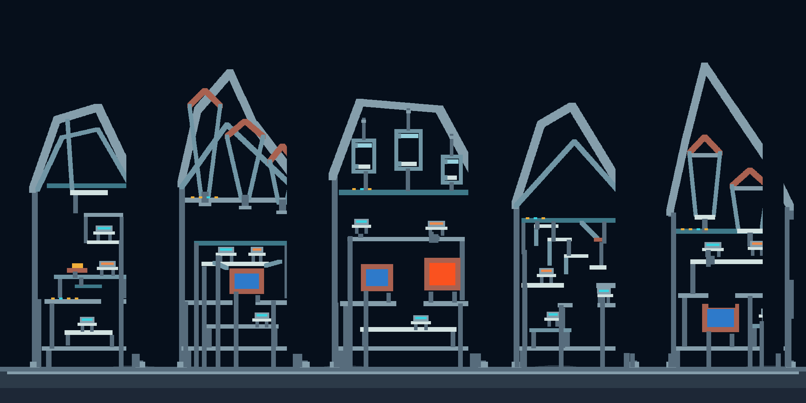
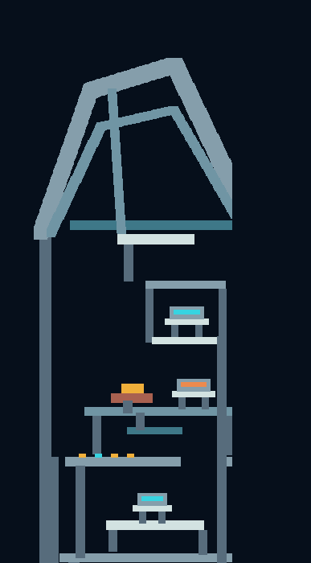
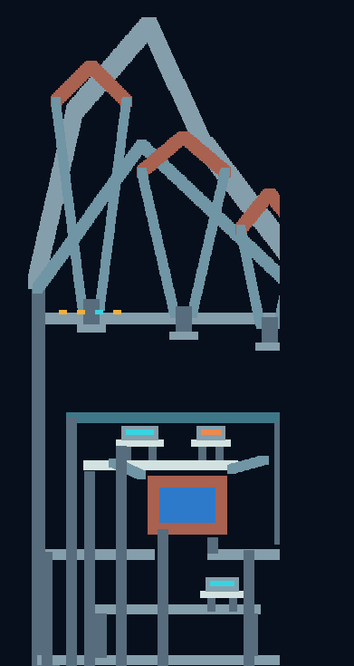
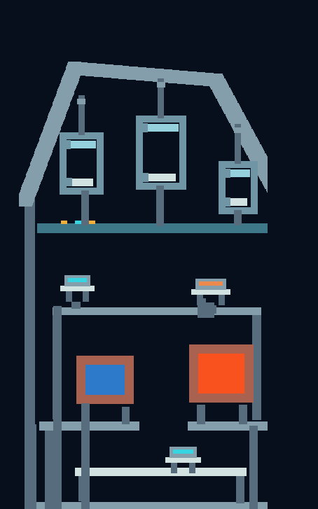
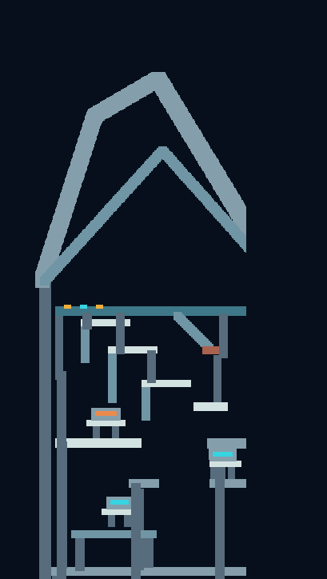
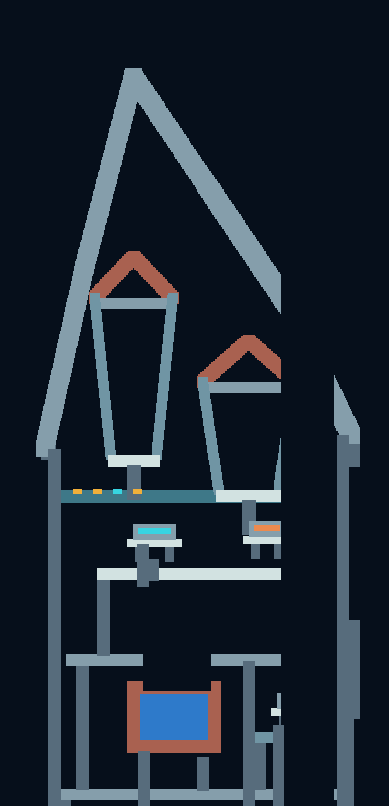
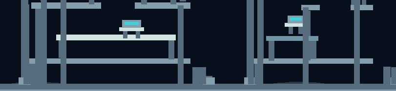

# Sable-12 Cryogenic Fractionation Gantry — original 2048×1024 CyberSand world

**Status:** creator source-static PASS / **DRAFT HOLD / NATIVE-UNTESTED**. A deterministic, genuinely authored, orthographic side-elevation material-cell level; **not** a reference-art conversion, AI illustration or native runtime screenshot.

## Industrial location and flight brief

Sable-12 is a decommissioned high-altitude gas-isotope works, built around exposed structural shoulders, three unequal absorber forks, hanging cold cassettes, a membrane-return viaduct and fraction collection. There are **five different functional districts** with readable engineering transitions. Their cabinets, instruments, pipes and baffles are static material-cell architecture, not a claim that animated chemical-processing machinery operates in the engine.

1. **Atmosphere capture and freight metering (x 60–395).** A twin-canted aeroscoop shelter, hanging capture throat, cargo scale, separate metering console and accessible south recovery deck. Spawn **[50,520]** at the free-air west service bay.
2. **Tri-fork absorber station (x 420–800).** Three unequal vertical gas-separator crowns, split measurement decks, distinct cold-seal jacket and sump return. Enter the interior inspection berth at **[608,563]**.
3. **Cryogenic cassette train (x 810–1255).** Suspended staggered internal shielding fins and two isolated hot/cold process vessels, with a central entered sampling workface at **[1020,545]**.
4. **Membrane-return viaduct (x 1260–1640).** A double-skew, asymmetric bridge over an intentional negative-space pressure canyon; instrument workfaces and dry lower-loop recovery.
5. **Fraction collector and extraction stack (x 1660–2048).** A tall, obliquely tiered skyline, two unequal collector throats, sampling and isolated condensate berth; goal at **[1961,503]**.

**Route graph:** west service launch → capture-transfer shaft → absorber fork/inspection → cold-cassette skylight and entered service → membrane-viaduct survey → fraction collector → safety extraction. Each main district includes an independently reachable deeper landing in the lower recovery stratum. Five literal 52–56-cell-wide access shafts connect dry industrial workfaces to the continuous open-air Midge flight route; they are real material-cell voids, with dedicated grounded alternative load paths, not route labels painted onto closed geometry.

**Alternative and recovery:** a physical obstruction at `[980,50,60,365]` blocks the preferred overhead approach to the downstream districts. A full **31×27** centre-grid BFS still reaches all 16 original literal sites; ten destinations require genuine detours of **+218 to +252** centre steps. No checkpoint relocation, nearest-site fallback or radius exception is permitted.

## Material-cell gallery — actual unscaled 1:1 crops

## Reproducibility and authority

- Run `node build.cjs --write` to regenerate setup/receipt/7 PNGs; run `node build.cjs --verify` to compare exact output files and independently inflate/check every indexed PNG pixel against final cells.
- World **2048 × 1024 = 2,097,152** authentic material-ID cells. Fixed seed `2026112012`. SHA256 of full grid `e2b6a16be93dbbd5ebdbec1568356c69b15d5b3ee7fd820192376596aee75674`.
- Source loader authority: read-only accepted `techrote/cybersand` main `de58bf1997ca75825cf3b29e046dc1c1022c45bf`. Base `techrote/sandmapsreference` main `99a166e7fcae45eb22be1740e9f33f62faccbcc7`.
- Exact Setup-v2 14 root keys; nonoverlapping lossless five-integer rectangles: **3446**, serialized JSON **65572 bytes**, work **522097 cells**.
- `receipt.json` and `QUALIFICATION.md` document literal sites, three full conservatively sized Midge envelopes, ordered replay, source hashing, material histograms, grounded structural solids, liquids and obstruction.
- `[Water=3,Lava=8]` are contained in deliberately enclosed vessels at time zero. The process labels and dry pipes do **not** represent real simulation apparatus.
- The accepted source advertises 32,768 paint rectangles, whereas the installed older/legacy CyberDemoBridge can still advertise 4,096: **runtime capacity not measured**, even though this recipe uses 3446 records.
- **No native Godot/Workbench/Rapier import, live Midge collisions/flight, fluid evolution or save/reopen qualification was performed.** Independent exact-head Art, Technical and Shepherd reviews are required. No owner acceptance, merge or Ready promotion is claimed.
