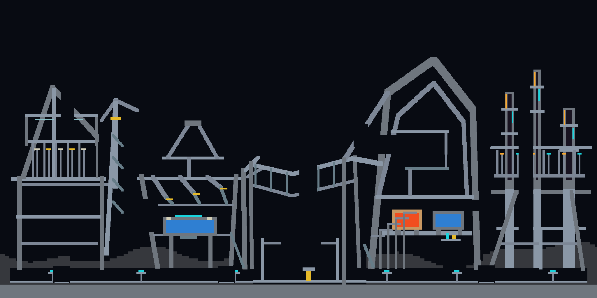
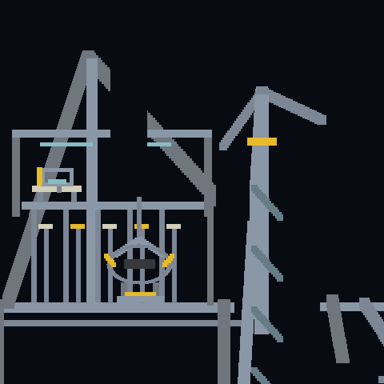
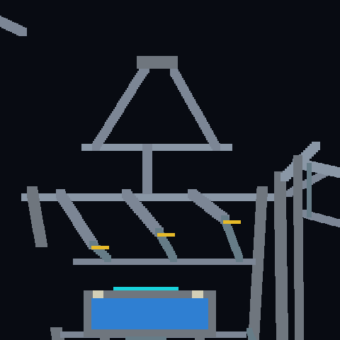
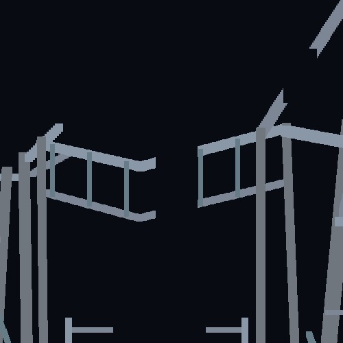
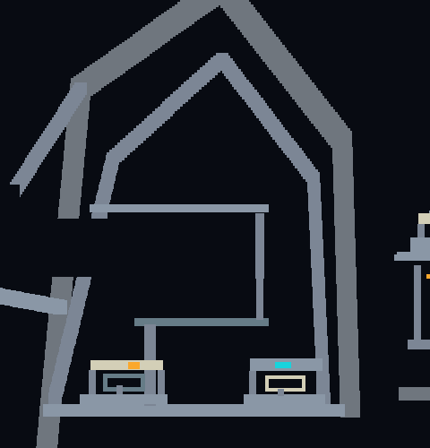
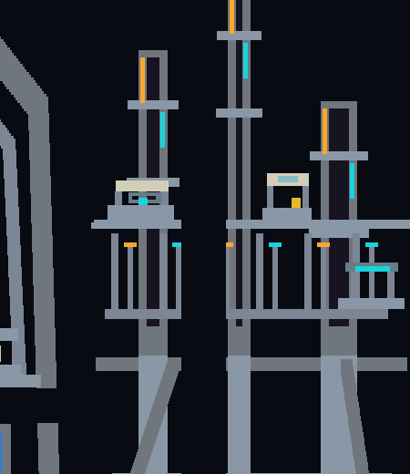
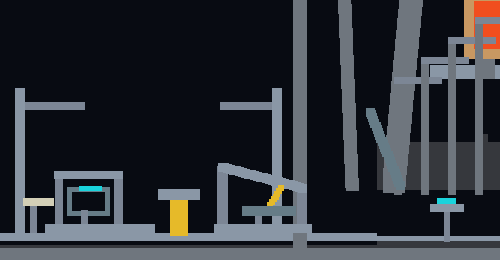

# Vesper Negative-Pressure Lock — ORIGINAL Industrial Hazard Wide

**OPEN Draft/HOLD · wholly self-authored CyberSand 2048×1024 true side-elevation material-cell world · source-static qualified only · NATIVE-UNTESTED.** No source photo, reference conversion, image-mock layer, renderer substitution, isometric projection, or functional reactor simulation.

A former emergency **negative-pressure waste lock** bestrides an ash ravine. The silhouette is deliberately asymmetric: the pitched west assay hangar, downraking brine-sluice platforms, severed suspension spanning an open gorge, gigantic nested **chevron** vacuum retort, and eastern three-height exhaust fins. No duplicate mirrored towers or repeating factory wallpaper. Inert machinery is authored collision material, not operating pumps, plasma or process code.

## Functional districts and traversal

1. **Slag intake / isolation hangar** (x40–460): staffed upper assay loft with physical roof hatch, lower freight and independent discharge decks, odd-height elevator mast.
2. **Salt-pressure sluice** (x455–842): three offset rake carriers, accessible cold inspection floor, closed water tank and deliberate maintenance entrance.
3. **Negative-pressure gorge** (x830–1270): split high suspension trusses over a deep flyable void, real 61-cell return shaft, left/right lock bearings and continuous dry recovery gallery.
4. **Chevron vacuum retort** (x1260–1665): nested supported hot-shield rafters, two separately sealed lower hot/cold retort cassettes, real entered inspection and guarded service route.
5. **Exhaust fin / export citadel** (x1680–2030): three unequal drawn-off towers, opened inter-fin recovery chute, separate elevated reading decks and export flight apron.

**Primary route:** Arrival isolation → Slag loft → West assay deck → Sluice valve overlook → Gorge west lock → Suspension span → Gorge east lock → Vacuum retort observation → Fin stack control → East export.

**Alternative and recovery:** Brine pump inspection (620,725) via dry side-entry; Void retrieval (1032,862) via 61×406 real shaft at x1027; Thermal shield service (1500,703) through the retort isolation gate; Coolant recovery (1806,812) through the fin drop. Ground-level return follows the excavated gallery rather than an unwalkable decorative tunnel. All named centers are literal, exact and tested without nearby-point substitution.

### Exact named authored destinations

| Site | x | y |
|---|---:|---:|
| Arrival isolation | 245 | 451 |
| Slag loft | 278 | 453 |
| West assay deck | 440 | 466 |
| Sluice valve overlook | 779 | 468 |
| Brine pump inspection | 620 | 725 |
| Gorge west lock | 861 | 460 |
| Suspension span | 1052 | 446 |
| Void retrieval | 1032 | 862 |
| Gorge east lock | 1210 | 414 |
| Vacuum retort observation | 1430 | 500 |
| Thermal shield service | 1500 | 703 |
| Fin stack control | 1800 | 462 |
| East export | 2008 | 440 |
| Coolant recovery | 1806 | 812 |

Every exact site has a fully in-bounds **19×15**, **23×19** and **31×27** free-cell envelope and is reachable from actual spawn **(245,451)** by four-neighbour free-centre BFS. The physical-obstruction test fills **[1400,160,61,48]** with solid material across the upper overflight lane, reruns the 31×27 graph and still reaches **14/14** named sites. Independent shortest-path measurement establishes a **forced +70-cell detour for four downstream destinations** (Thermal shield service, Fin stack control, East export, Coolant recovery), with no waypoint shifting. This tests a genuine recoverable alternative rather than an irrelevant obstruction. This is a conservative static test, **not** native Midge steering/collision proof.

## Source-grounded physical contract

- Read-only accepted CyberSand engine: [`de109d0131641d6adc8d25bb9ced7ca3d4991105`](https://github.com/techrote/cybersand/commit/de109d0131641d6adc8d25bb9ced7ca3d4991105); source `godot/scripts/workbench_setup.gd`, `native/include/cybersand/material.hpp`, and authored Midge 4×3 hull. Base sandmapsreference `main@99a166e7fcae45eb22be1740e9f33f62faccbcc7`.
- Inert, immovable and native-defined structural IDs actually used: **58, 62, 68, 70, 76, 77, 79, 100, 101, 104, 117, 120**. Grounding is 4-connected to the world boundary, checked for every inert cell. No powder- or mobile-material foundations.
- Dynamic IDs: **Water 3 (11,044 cells)** and **Lava 8 (2,902 cells)** only in different completely solid-sealed cassettes. This establishes initial four-neighbour isolation, not live thermal/fluid stability.
- Entire authored material plane **2,097,152 cells**; optimized ordered nonoverlapping material rectangles **2968**; work **486266** cells; Setup-v2 JSON **56861** UTF-8 bytes; structural cells **472320/472320** grounded, detached **zero**.
- Source-advertised Workbench max 32,768 rectangles, 1 MiB JSON and 32 million construction-cell work. Source declares installed fallback 4,096 if the native bridge capability is missing. This world is under both rectangle counts, but installed bridge capability is **UNVERIFIED**.
- Exact original seed **19112603**; source-grid SHA-256 `bd153205b87439a834f135e036edc394b69c8ba606da276bf77c959c1f65018c`; setup JSON SHA-256 `8f44fed16c71be9d966ec2ccadd26352b9726a5196ae932c093518c153b1d6a3`. Histograms, all 14 destination centres, full-grid replay, image hashes, dimensions, physical-obstruction result and receipt limits are in [`receipt.json`](./receipt.json).

## Full actual material-cell grid and true 1:1 district crops



| Hangar loft | Descending brine sluice | Central gorge |
|---|---|---|
|  |  |  |

| Chevron vacuum retort | Exhaust fins | Lower service return |
|---|---|---|
|  |  |  |

Every PNG is 8-bit indexed with pixel index = **actual material ID**. No stock art, rasterised painting, fake engine screenshots or resized crop representations. The verified source-grid-to-PNG parity counts every material index from the same final 2048×1024 plane and checks complete PNG zlib/CRC/IEND integrity.

## Deterministic replay and verification

Node 22 from this folder:

```sh
node build.cjs --verify
# To regenerate exact committed bytes in an empty output directory:
OUT_DIR=/tmp/vesper-check node build.cjs --write
```

`geometry.cjs` contains every authored physical cell operation and unique layout; `build.cjs` independently constructs the full Uint8 material plane, emits optimized disjoint rectangle edits, replays all edits, checks support connectivity, initial containment, exact hull envelope BFS, a concrete obstruction, and regenerates all seven PNGs. `--verify` additionally reopens committed files, fully inflates all seven indexed PNGs and compares **every displayed material pixel** with the reconstructed grid (not just screenshot similarity). Run from the file folder or set `OUT_DIR` to its absolute path.

## Strict HOLD

**NATIVE-UNTESTED:** No installed source-matched Godot 4.7 Workbench/CyberDemoBridge/Rapier import, dynamic fluid/thermal simulation, actual Midge flight/collision, save/reopen or on-device frame progression. Static source qualification is not owner acceptance. Reviewers must independently inspect 1:1 crops and source-accurate cell geometry; remain OPEN Draft/HOLD. No engine or other creator branch was changed.

