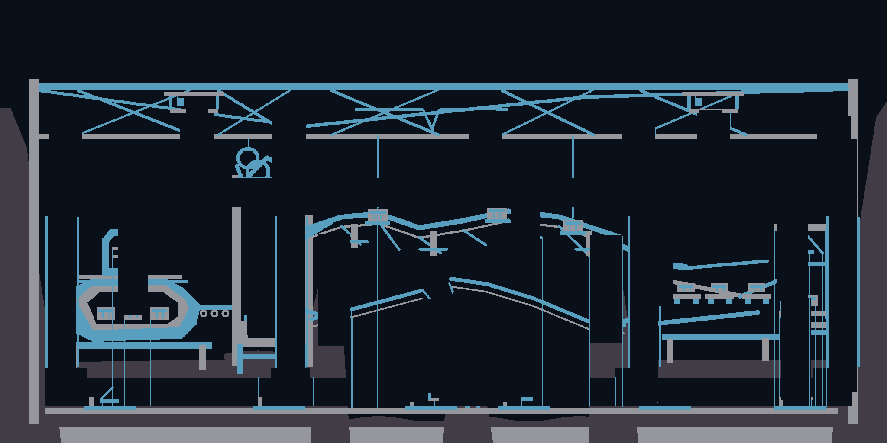
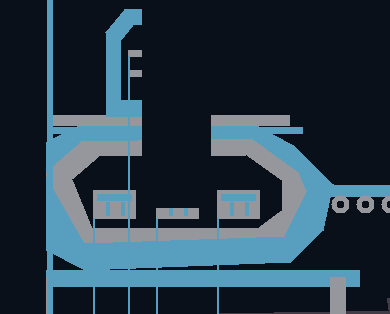
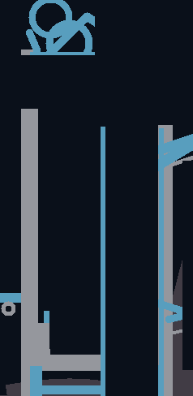
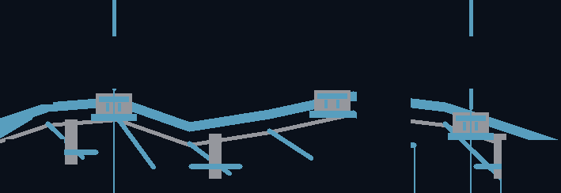
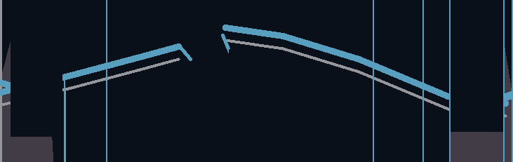
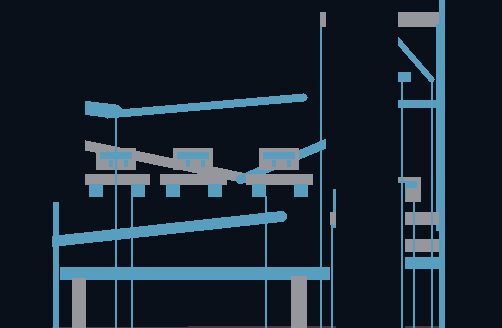
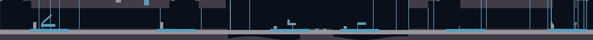

# Bracken Rift — Braided Dispatch Ravine

**ORIGINAL · 2048×1024 ACTUAL MATERIAL CELLS · Draft/HOLD candidate · CREATOR SOURCE-STATIC PASS · NATIVE-UNTESTED.**

A dry, tectonically split shipping gorge separates a western RoRo freighter dock and a smaller eastern customs settlement. The same cargo form appears in the ship's open hold, counterweight receiving cradle, overhead transfer cabs, graded rail wagons and final customs inspection. A fixed high freight viaduct, interrupted lower industrial siding, and independently entered deep recovery network form a deliberately braided navigational graph. This is true orthographic side elevation, entirely newly authored; no source image was converted.

## Corpus thesis

* **Underrepresented axes varied:** braided rather than a single linear freight line; nested centre-island / asymmetric two-settlement adjacency rather than uniform flat quay; damaged incomplete lower span instead of finished continuous bridge; vertically cascading recovery and intentional unfinished machinery workfaces.
* **Districts:** West drylocked freighter; twin counterweight drive and cradle; high suspended cable/stay bridge; broken lower goods viaduct and basalt-island bay; east three-grade classifier; customs dispatch; under-rift maintenance.
* **Gameplay:** Midge arrives at **Arrival Mooring `[154,442]`** and targets **Dispatch Gate `[1880,442]`**. Main sky ribbon, upper watch route, two nested bridge levels, and underworks return share literal traversable shafts. All 24 named sites are exact fixed grid coordinates.
* **Authored event/edit sites (not scripted):** interrupted lower rail span for future bridge failure; upper hoist for activation; unfinished island for modular SWARM/GENTEK growth; eastern customs for arrival/NPC transactions. Empty industrial volume is intentional corpus value.
* **Engineering representation:** concrete 58, steel 62, basalt 100 are native immovable solid materials; all nonzero final cells connect to the grounded world boundary. Freight machinery is static geometry; it does not animate or transfer simulated cargo.

## Reproducibility and scope

`node build.cjs` writes the immutable complete Setup-v2 JSON, receipt and seven actual source-cell PNG files. `node build.cjs --verify` checks that generated files exactly match the committed artifacts. The generator builds precisely **2097152 material IDs**, compresses them into lossless nonoverlapping Setup rectangles, exhaustively replays them and verifies the ordered material plane, all conservative Midge-centre BFS destinations, a real blocking obstruction, and PNG CRC/zlib Adler and per-pixel index parity.

| Source-static property | Result |
|:--|--:|
| Setup rectangles / accepted current cap | 3615 / 32,768 |
| Setup JSON bytes / cap | 67128 / 1,048,576 |
| Occupied stable grounded cells | 526413 / 526413 |
| Ungrounded post-build solids | 0 |
| Deterministically pruned unsupported decoration cells | 0 |
| Exact sites at all 19×15, 23×19, 31×27 hulls | 24 / 24 |
| Solid-blocked route at 31×27 (Arrival Mooring → Dock Manifest) | 306 → 434 steps |
| True indexed-cell images | 1 overview and 6 unscaled 1:1 crops |

**Accepted engine authority:** [CyberSand main at `de58bf1997ca75825cf3b29e046dc1c1022c45bf`](https://github.com/techrote/cybersand/commit/de58bf1997ca75825cf3b29e046dc1c1022c45bf); Workbench Setup-v2 loader blob `70dd964bc2d5bff9ca030edd57d7fc7aa5068fc9`; native catalogue blob `d7a47d60721598a16589daf177a6ff4401b84b43`; authored Midge hull 4×3. The current accepted source advertises 32,768 construction rectangles. No speculative obsolete-bridge cap is imposed.

**Not performed:** actual installed Workbench/Godot/CyberDemoBridge/Rapier load, actor controls, collision, simulation advancement, fresh-process persistence, or native screenshot. Native status remains **NATIVE-UNTESTED**. Independent exact-HEAD Art, Technical and Shepherd review, and owner acceptance, remain separate HOLD gates. This PR must not be merged or promoted Ready without owner approval.

## True material-grid gallery

## Machine-readable evidence

- `setup-bracken-rift.json`: exact 14-field Setup-v2 construction recipe.
- `build.cjs`: standalone fixed-seed source; reproducible, no image inputs.
- `receipt.json`: full-grid histogram and SHA-256, ordered replay and clearance, obstacle, geometry/PNG hash receipts.
- `exemplar.json`: corpus grammar and proposed staging/edit affordances, not a game file.
