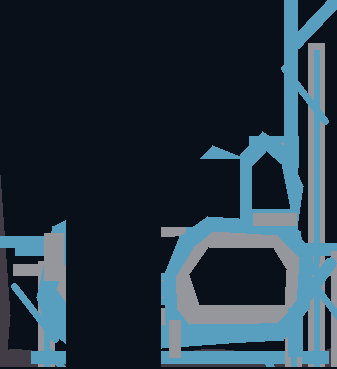
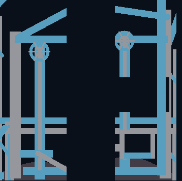
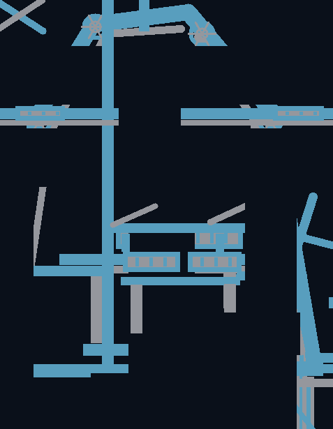
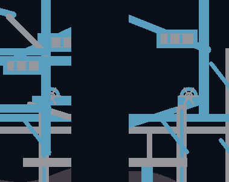

# Cobalt Narrows — Pneumatic Drydock Freight Siphon

> **NEW, NO-REFERENCE, ORIGINAL 2048×1024 TRUE MATERIAL-CELL WORLD. Creator SOURCE-STATIC PASS · DRAFT/HOLD · NATIVE-UNTESTED.** Independent Art, Technical and Shepherd review required. No owner acceptance, Ready promotion or merge.

## Place and authored engineering

Cobalt Narrows is a high salt-basin intermodal cargo facility where a serviceable drydock freighter feeds a twin-ram freight lift, a roof-suspended siphon transfer bridge, a three-grade gravity shunting distributor and an eastern customs/rail dispatch gate. Five individually equipped underground machinery stations connect with the high and main flying corridors by wide, physical rescue shafts. No source image, past map geometry, or isometric plate-top depiction was used. The considerable airborne negative space is intentional Midge flight terrain.

The main operation is **berth → load cage → siphon rail → three-grade classifier → customs/dispatch**. All machinery represents inert *static* collision geometry, not a promise of running mechanical animation. The two grounded end pylons and overhead cantilever carries plus the distinct highline ties support the span; all authored remaining solids after pruning are physically boundary-connected.

Distinct districts: **(1)** western drydock vessel/cargo hold (x114–450); **(2)** hydraulic lift and load-cage interchange (x445–797); **(3)** central long-span pneumatic siphon and entered receiving deck (x799–1280); **(4)** gravity sorting and shunt checks (x1275–1658); **(5)** stepped eastern customs/train terminal (x1684–2047), with a sixth subterranean return machinery district (y800–1023). Navigation is fully perpendicular X/Y, with no foreshortened platforms.

## Exact-source provenance

- Repo accepted base: `99a166e7fcae45eb22be1740e9f33f62faccbcc7`; branch: `original/industrial-transit-wide/cobalt-narrows-pneumatic-261120`
- Accepted read-only CyberSand engine: `de109d0131641d6adc8d25bb9ced7ca3d4991105`; material descriptor blob `dcf05895da3015a2e999e3d1cbbae0fdc7fe32b3`; Setup-v2 loader blob `70dd964bc2d5bff9ca030edd57d7fc7aa5068fc9`
- Fixed seed: `0xC0BA171` (202088817); actual world is exactly **2048×1024 = 2,097,152** final IDs.
- Valid material IDs only: **0 Empty; 58 ReinforcedConcrete; 62 SteelPlate; 100 BasaltColumns**. The occupied types are inert immovable `Solid / RuleKernel::None`. No falling powder, fluid or reactive foundations.
- Midge authored hull 4×3; independently conservative tested clear-centre envelopes **19×15**, **23×19**, **31×27**.
- Full-grid ID SHA-256: `cd5b57104050d08effc7acb28c1e9dbcd63ac45f79c2ea969125f2fdbc37c8b0`
- Byte-exact Setup JSON SHA-256: `4ad23d2c70a4be76471d24a31e23afd78db9c323630f84217bbab2278c18c9ff`
- **5891** disjoint ordered `[x,y,w,h,materialID]` rectangles / source limit 32,768; **108147 bytes** JSON / source maximum 1,048,576; **640654** work visits / maximum 32,000,000.
- **640654 / 640654** final solids grounded, **0** detached. 26405 unsupported *intermediate candidate* pixels removed before final encoding; none are included in the committed physical world.
- Histogram: `{"0":1456498,"58":257565,"62":239649,"100":143440}`.
- Source advertises **32,768** rectangles; installed legacy `CyberDemoBridge` may report **4,096** until its `workbench_start_rectangle_capacity` method is verified. This map exceeds the possible 4,096 fallback by **1795**; never silently truncate. Installed binary unknown. **NATIVE-UNTESTED**.

## Actual playable flight graph and site coordinates

**Main freight path:** West launch → Harbour clearance → Lock-lift approach → Gorge west → Transfer throat → Distributor ingress → Customs approach → Final beacon.

**Upper alternate:** Upper hoist board → Siphon crown → Flyover relay. High and main bands are separated by supported mid-level transit rail, connected by true 89px-wide gantry portals. Lower loop: West bilge return → Ram service return → Siphon valve return → Shunt recover → East tram return. Mechanically differentiated underwork stations and multiple 95px vertical shafts permit low-altitude recovery from wrong turns; no purely scenic collision layout.

All literal exact named sites from the committed builder:

| Functional destination | Exact centre X,Y |
|---|---|
| West launch | 136, 382 |
| Harbour clearance | 351, 382 |
| Drydock hold | 323, 626 |
| Lock-lift approach | 585, 382 |
| Twin ram cabin | 718, 631 |
| Upper hoist board | 535, 252 |
| Gorge west | 814, 382 |
| Siphon crown | 1013, 248 |
| Transfer throat | 1056, 382 |
| Pipe maintenance | 1122, 631 |
| Distributor ingress | 1288, 382 |
| Distributor operator | 1520, 630 |
| Flyover relay | 1450, 253 |
| Customs approach | 1570, 382 |
| East invoice station | 1843, 380 |
| Terminal tally | 1869, 630 |
| Final beacon | 1942, 382 |
| West bilge return | 227, 854 |
| Ram service return | 613, 854 |
| Siphon valve return | 1030, 854 |
| Shunt recover | 1441, 854 |
| East tram return | 1810, 854 |

**Site proof:** at 19×15 / 23×19 / 31×27, exact full-hull 4-connected free-centre BFS reached respectively 22/22 / 22/22 / 22/22 sites, with counts 1128459 / 1081306 / 988882. All targets remain in-bounds, and no goal radius, nearest-site shifting or target replacement is allowed. Real obstacle **177,344,91,84**, treated as solid during the 31×27 source-static path rerun, forces `West launch`→`Harbour clearance` travel **215 → 319** cardinal steps while retaining 22/22 exactly reachable destinations. This is simulated physical-cell clearance, **not** proven native pilot flight.

## Source-exact replay and original proof images

`node build.cjs` reconstructs the entire grid and every artifact from the fixed seed. `node build.cjs --verify` compares committed byte-exact JSON, receipt and PNGs. Every occupied rectangle has full bounds/material validation, zero overlaps and exhaustive sequential replay equality against 2,097,152 final cells. The generator verifies **all seven PNGs** with PNG chunk CRC, stored-DEFLATE/zlib Adler, exact dimensions and complete material-index/grid pixel parity before publication.

| Western drydock (1:1) | Twin-ram lift (1:1) |
|---|---|
|  |  |
| Central siphon (1:1) | Rail sorting (1:1) |
|  |  |
| East terminal (1:1) | Underworks (1:1) |
|  |  |

All images are material-ID indexed and derived from **this** final physical-cell grid, not AI art, source illustration or a Godot screenshot. Crop dimensions and SHA hashes appear in `receipt.json`.

## HOLD / independent audit gates

**Creator SOURCE-STATIC PASS** applies only to deterministic material replay, kernel selection, visual material-cell depiction, authored clearance and simulated obstruction. **NATIVE-UNTESTED:** installed Godot 4.7 + matching CyberDemoBridge handshake, actual Setup-v2 load, Rapier actor advance/collision, sustained tick, and cold save/reopen not executed. Native admission is downstream and does not block creating other original maps. Fresh **independent Art, Technical and Shepherd** exact-HEAD review requested; pay particular attention to freighter visual coherence, literal entered cargo rooms, long highline supports, and recovery around intentional air voids. Preserve Draft/HOLD.
