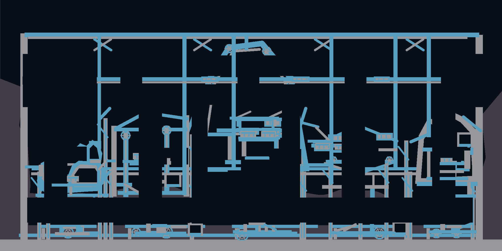
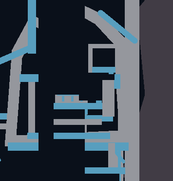

# Cobalt Narrows — Pneumatic Drydock Freight Siphon R2

Original 2048×1024 true perpendicular material-cell landscape. **OPEN Draft/HOLD / NATIVE-UNTESTED**. Read-only accepted CyberSand `main@de109d0131641d6adc8d25bb9ced7ca3d4991105`; map repository base `main@99a166e7fcae45eb22be1740e9f33f62faccbcc7`. Builder seed `0xC0BA171`.

## Designed physical location
West serviced drydock hull → twin-ram freight lift → overhead pneumatic siphon and receiving clamp → three-grade shunt/classification → entered customs scanner/weighbridge and final dispatch. Alternate open highline and lower mechanical-service loop ensure flight recovery; five distinct stations are bilge-valve, hydraulic-ram bench, pressure accumulator, shunt-brake, outbound-pallet refit. All geometry is inert solid physical cells, not scenic art or simulated movement.

R2 addresses the independent exact-HEAD Art/Shepherd P1: standardized cargo blocks are now handled at successive workfaces; customs gains a scanner/scale and the lower return different types of equipment. The source generator takes special care to **preserve previously certified source-exact 31×27 free-space routes** by excavating new obstructing material along the pre-repair real BFS corridors, including the existing actual western-blockage detour. No snapped sites, nearest-target replacements or envelope waivers.

## Literal destinations
| Authored checkpoint | X | Y |
|---|---:|---:|
| West launch | 136 | 382 |
| Harbour clearance | 351 | 382 |
| Drydock hold | 323 | 626 |
| Lock-lift approach | 585 | 382 |
| Twin ram cabin | 718 | 631 |
| Upper hoist board | 535 | 252 |
| Gorge west | 814 | 382 |
| Siphon crown | 1013 | 248 |
| Transfer throat | 1056 | 382 |
| Pipe maintenance | 1122 | 631 |
| Distributor ingress | 1288 | 382 |
| Distributor operator | 1520 | 630 |
| Flyover relay | 1450 | 253 |
| Customs approach | 1570 | 382 |
| East invoice station | 1843 | 380 |
| Terminal tally | 1869 | 630 |
| Final beacon | 1942 | 382 |
| West bilge return | 227 | 854 |
| Ram service return | 613 | 854 |
| Siphon valve return | 1030 | 854 |
| Shunt recover | 1441 | 854 |
| East tram return | 1810 | 854 |

Main route: West launch → Harbour clearance → Lock-lift approach → Gorge west → Transfer throat → Distributor ingress → Customs approach → Final beacon. Upper alternative: Upper hoist board → Siphon crown → Flyover relay. Recovery: West bilge return → Ram service return → Siphon valve return → Shunt recover → East tram return.

## Exact full-grid source qualification
- Final real material cells: **2,097,152**, complete 2048×1024 grid; accepted inert Solid/None materials 58, 62, 100, with empty 0. Zero liquids/powders/reactive foundations.
- Grounded occupied material: **657132 / 657132**, detached zero; final builder pruning 32061 unsupported pre-final cells.
- Canonical disjoint Setup-v2 rectangles: **5587 / 32,768**; UTF-8 JSON **102865 / 1,048,576** bytes; cell work 657132 / 32,000,000.
- Material plane SHA-256: `21027c529509a9a7a778e86c4ad885e9cf8e2ae5a5e2824f203540ccfc1348f9`; Setup SHA-256: `4a3e1dc76a0979caf855936ac4740fad044164e25208820b6bdcf9aa90531a58`. Full histogram and image hashes in `receipt.json`.
- Exhaustive ordered rectangle replay into all 2,097,152 cells: **PASS**. Fixed exact checkpoints **22/22 at all three conservative 19×15, 23×19, 31×27 envelopes**. Real inserted [177,344,91,84] solid blockage preserves **22/22** at 31×27; West launch→Harbour clearance 215→319 centre steps.
- True full-grid indexed-material overview and six actual 1:1 district PNGs: each CRC, DEFLATE stored block/Adler and **all decoded source-material pixels** verify (7/7). No fake native screenshots.
- Rebuild with `node build.cjs`, independently check committed artifacts using `node build.cjs --verify`. No third-party dependencies.
- Source claims 32,768 rectangles. Installed legacy CyberDemoBridge may fall back to **4,096**, shortfall 1491. Native loading, Rapier collision, Midge flight, simulation, fresh-process save/reopen all **NATIVE-UNTESTED**; independent R2 Art/Technical/Shepherd review pending.

### Genuine physical material-cell gallery

