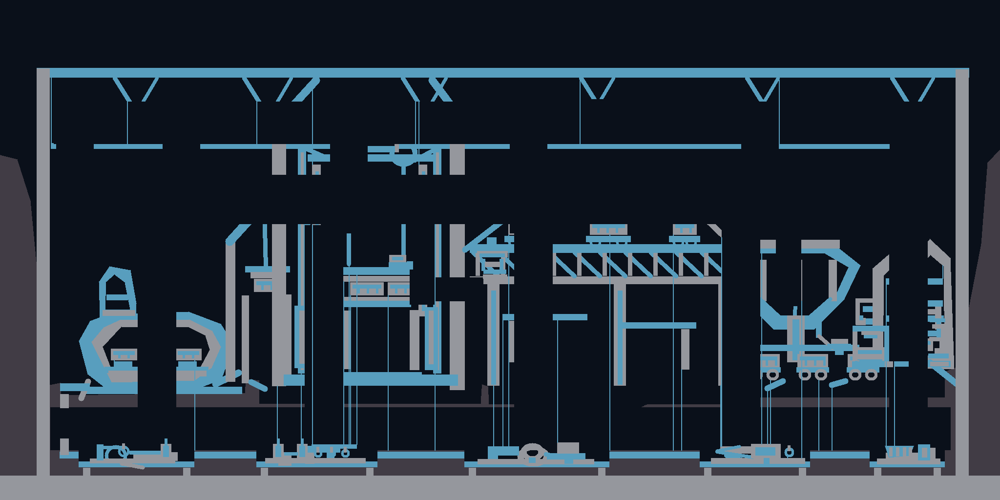

# Nacre Caisson — Drylock Ship Stacklift and Freight Truss (R2)
**NEW ORIGINAL · 2048 × 1024 real material-cell side elevation · OPEN DRAFT/HOLD · CREATOR SOURCE-STATIC PASS · NATIVE-UNTESTED.**
Physical geometry authored specifically for CyberSand, not source-art conversion, image scenery, perspective or an engine change. Original R1 stays preserved in Git history at `c3478a95a3b75ea5bf0978db30d2bc4b64438da4`.

## Industrial transaction and functional districts
**Load:** Western graving harbour holds a recognisable side-on freighter, boat ramp, cabin, three distinct cargo bays and independent quay spreader.
**Lift:** Square guided hydraulic caisson has twin sheaves, loaded pallet arrest/release, counterweights, enterable loft and servicing access.
**Traverse:** Ground-tied horizontal twin-chord freight truss transfers captured units on a lowered pickup carriage to a supported receiving pallet without compromising the broad flyable overcut.
**Sort:** Inert fixed hopper includes a shaped throat, supported discharge conveyor and distinct rail wagons, no physically falling source powder.
**Dispatch:** East stepped customs has manifest workfaces, front-yard anchored load scanner, scale and separate outbound shipping face.
**Recovery:** Five entered low galleries have actual materially different physical machines: bilge pump and valve line, paired hydraulic jacks and manifold, gantry bearing and geared drive, turnout and brake machine, reclamation separator and collection hopper.

Main flight uses the broad y358–458 air band, upper flyway y208–295, lower return y836–898. Six cross-connection shafts provide local mistake recovery without a fake or exempted spawn. Intended cargo flow: **ship → spreader → pallet lock → stacklift → truss receiver/carriage → fixed hopper → rail classification → scanner/scale → eastern dispatch**.

## R2 changed-cell repair (20 November 2026)
Responds to the independent exact-HEAD Shepherd P1 at c3478a95a3b75ea5bf0978db30d2bc4b64438da4: previously sparse five underworks, skeletal customs process, and incomplete caisson/truss/hopper handoffs. R2 changes **36,495 actual final material-ID cells**, including **21,668 additions, 2,968 excavations and 11,859 substitutions**. Review the complete [R2 changed-cell proof](./r2-change-proof.json). No site or prior pass was simply shifted or exempted. Independent Art sufficiency must be reassessed on the new HEAD.

## Static source-authority and physical contract
| Measure | R2 deterministic builder result |
|---|---:|
| Engine accepted main | `7b03aa437561ec63e31fd09531171360ab60eeb4` |
| Setup-v2 loader blob | `70dd964bc2d5bff9ca030edd57d7fc7aa5068fc9` (unchanged loader source) |
| Material catalogue blob | `dcf05895da3015a2e999e3d1cbbae0fdc7fe32b3` |
| Existing accepted map repository main at original branch | `99a166e7fcae45eb22be1740e9f33f62faccbcc7` |
| Reproducible fixed seed | `2026112013` |
| Actual complete source cells | 2,097,152 = 2048 × 1024 |
| Final material histogram | `{"0":1477459,"58":274119,"62":199480,"100":146094}` |
| Accepted physical materials | 0 Empty; 58 ReinforcedConcrete, 62 SteelPlate, 100 BasaltColumns (all inert immovable solid / RuleKernel None) |
| Disjoint ordered 5-field rectangles | 3644 / 32768 (no overlap, exact replay/equality) |
| Construction work / JSON bytes | 619693 / 32,000,000 work; 68009 / 1,048,576 bytes |
| Rooted stable occupied cells | 619693 / 619693; detached 0; zero mobile/reactive/fluid cells |
| Author Midge hull | 4 × 3; conservative centre envelopes 19×15 / 23×19 / 31×27 |
| Exact site 4-neighbour reachability | 22/22 @ 19×15; 22/22 @ 23×19; 22/22 @ 31×27 |
| Concrete obstruction | 213, 360, 80, 91 XYWH, 227 → 337 steps and all 22 sites retained |
| Final material plane SHA-256 | `328b5b25e56f2f89a068a326746e555489d3ce8780458ca6d33e03fb5be2fe81` |
| Source Setup JSON SHA-256 | `0f9ad7ac39e37a5a9b52c0f1edeb8bc51f63b28f5e1c9bc894d85070ec823718` |
| Full authentic PNG and 1:1 crops | 8/8 CRC/Adler/pixel-parity PASS |
| Installed native Workbench/CyberDemoBridge/Rapier | **NATIVE-UNTESTED** — neither player movement nor persistence executed |

**Bridge admission risk:** accepted Setup-v2 source supports 32,768 records; an installed legacy bridge may fall back to 4,096 without `workbench_start_rectangle_capacity`. R2 uses 3644 records, below that possible fallback; installed compatibility is still unverified. Native stage must attempt real Midge movement, collision/progression, sustained simulation, save/reopen with binary provenance.

## Authored exact Midge checkpoint coordinates
- Mooring Arrival: (151, 409)
- Dispatch Ledger: (378, 409)
- Vessel Gangway: (332, 568)
- West Graving Hold: (335, 740)
- Caisson Gate: (626, 408)
- Lift Counterweight: (863, 591)
- Lift Inspection Loft: (735, 217)
- North Crane Catwalk: (348, 216)
- Truss West Receiver: (1014, 407)
- Overcut Transit: (1181, 407)
- Truss East Receiver: (1470, 407)
- Classifier Control: (1580, 408)
- Hopper Access: (1615, 590)
- Dispatch Transfer: (1810, 407)
- Outbound Manifest: (1891, 407)
- East Horizon Beacon: (1925, 228)
- Upper Freight Traverse: (1228, 228)
- Underkeel Pump: (275, 871)
- Hydraulic Service: (658, 871)
- Gantry Bearing Service: (1090, 871)
- Rail Switch Workshop: (1518, 871)
- Reclamation Return: (1870, 871)

## Source-only reproducibility and authentic gallery
Run `node build.cjs --verify` in this folder to regenerate the complete cell plane, validate all disjoint stamps, root continuity, literal-site conservative BFS and real obstruction, decode all PNGs with CRC/Adler and full pixel comparison, and enforce exact committed artifact byte equality. Run `node build.cjs` to regenerate. The authored builder is standalone Node; it writes Setup JSON, receipt and PNGs. The separately committed `r2-change-proof.json` is a full-plane R1/R2 source comparison.

| Real material-cell image | XYWH crop (unscaled) | PNG bytes | Link |
|---|---|---:|---|
| overview | 0, 0, 2048, 1024 | 525537 | [authentic PNG](./overview.png) |
| 01-graving-vessel | 112, 450, 417, 365 | 38875 | [authentic PNG](./01-graving-vessel.png) |
| 02-caisson-stacklift | 525, 221, 456, 581 | 67005 | [authentic PNG](./02-caisson-stacklift.png) |
| 03-truss-handoff | 959, 410, 549, 389 | 54256 | [authentic PNG](./03-truss-handoff.png) |
| 04-hopper-classifier | 1492, 474, 283, 337 | 24449 | [authentic PNG](./04-hopper-classifier.png) |
| 05-east-customs | 1770, 469, 278, 338 | 24183 | [authentic PNG](./05-east-customs.png) |
| 06-underworks | 519, 831, 413, 190 | 20135 | [authentic PNG](./06-underworks.png) |
| 07-underworks-all-five | 103, 831, 1844, 190 | 87970 | [authentic PNG](./07-underworks-all-five.png) |

**Review request:** independent same-HEAD Artistic, Technical and Shepherd requalification of R2 real cells; preserve Draft/HOLD, no merge or Ready. No owner acceptance or native pass claimed.
