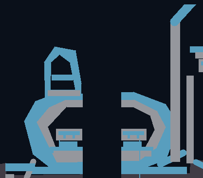
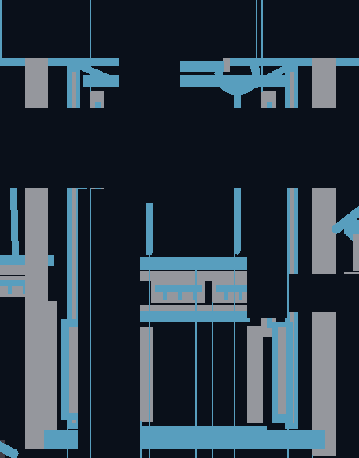
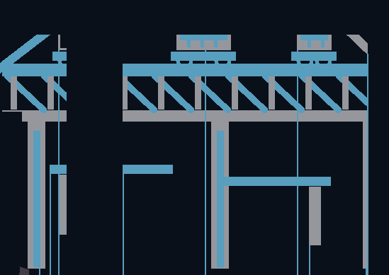
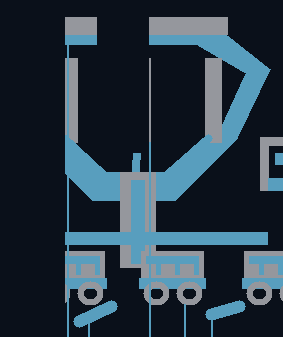
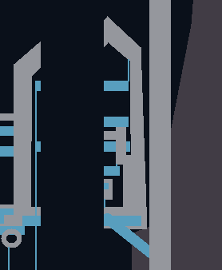
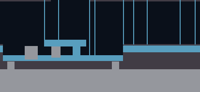

# Nacre Caisson — Drylock Ship Stacklift and Freight Truss

**NEW ORIGINAL — 2048×1024 material-ID side elevation. OPEN DRAFT / HOLD; NOT owner accepted.**

This authored sci-fi/industrial freight world follows a **ship in graving harbour → ship-side spreader → rectangular caisson stacklift → braced freight truss → fixed inert hopper and rail sorter → entered east inspection/manifest hall**. It is not a converted/reference image, not a perspective view and not an image-only level.

## Navigable physical districts and main route

1. **West graving harbour** — a distinct enclosed freighter hull with cargo blocks, service cabin, sheltered basin and separate quay crane; spawn **Mooring Arrival** at `(151,409)`, hull/checkpoint/shipyard stations.
2. **Square caisson stacklift** — twin structural guides, overhead sheaves, lift pallet with actual solid freight and accessible counterweight/inspection workfaces, distinct from a generic bridge or drydock.
3. **Transfer freight truss** — horizontal braced steel span with receiver and multiple real hoist-side freight units; transverse overcut beneath it and upper flyover alternative.
4. **Classifier hopper, shunt railway and inspection** — a shaped fixed-material hopper, separate three-wagon sortie and east customs/tally station with a traversable working face.
5. **Underworks** — five differentiated named recovery rooms, with true low-level return and connections upward, not painted scenery.

**Exact named route graph:** {"main":["Mooring Arrival","Dispatch Ledger","Caisson Gate","Truss West Receiver","Overcut Transit","Truss East Receiver","Classifier Control","Dispatch Transfer","Outbound Manifest"],"upper":["North Crane Catwalk","Lift Inspection Loft","Upper Freight Traverse","East Horizon Beacon"],"lower":["Underkeel Pump","Hydraulic Service","Gantry Bearing Service","Rail Switch Workshop","Reclamation Return"]}.

**Author-assigned literal sites (22):** `Mooring Arrival` (151,409); `Dispatch Ledger` (378,409); `Vessel Gangway` (332,568); `West Graving Hold` (335,740); `Caisson Gate` (626,408); `Lift Counterweight` (863,591); `Lift Inspection Loft` (735,217); `North Crane Catwalk` (348,216); `Truss West Receiver` (1014,407); `Overcut Transit` (1181,407); `Truss East Receiver` (1470,407); `Classifier Control` (1580,408); `Hopper Access` (1615,590); `Dispatch Transfer` (1810,407); `Outbound Manifest` (1891,407); `East Horizon Beacon` (1925,228); `Upper Freight Traverse` (1228,228); `Underkeel Pump` (275,871); `Hydraulic Service` (658,871); `Gantry Bearing Service` (1090,871); `Rail Switch Workshop` (1518,871); `Reclamation Return` (1870,871).

## Immutable source-static proof

- Source authority: accepted CyberSand main `de109d0131641d6adc8d25bb9ced7ca3d4991105`; sandmapsreference main `99a166e7fcae45eb22be1740e9f33f62faccbcc7`. Accepted Midge authored hull **4×3**; cautious envelopes **19×15**, **23×19**, **31×27**.
- World: **2,097,152** material-ID cells. Deterministic builder `build.cjs`, fixed seed **2026112013**.
- Setup-v2: **3431** ordered lossless nonoverlapping rectangles / source-advertised **32,768**; **64125** UTF-8 JSON bytes / **1,048,576** budget. Construction work **600993** material cells.
- Material histogram: `{"0":1496159,"58":261895,"62":193013,"100":146085}`. All **600993** occupied cells are physically boundary-grounded; **zero detached**, **zero initial mobile fluid or reactive cells**. Only native legal inert IDs **58, 62, 100** are used. **51** actual steel root ties join equipment to founded steel/rock; no unsupported solid left or accounting exemptions.
- Full grid SHA-256 `be28be1e1bb36923fbe87cdd548ff999b559267de4067f521658bf15d5960fa9`; Setup JSON SHA-256 `cdf74df1751d118bcaaa02bb6298b456ef7d6f56b275207974c0c50d546b4ac4`.
- Exhaustive ordered rectangle replay reproduces every cell with no overlaps or erasures; source builder validates all produced indexed PNGs with **CRC, Adler-32, full-grid material/pixel parity**.
- Exact in-bounds 4-neighbour conservative Midge full-body-centre flood from literal spawn: **22/22 at 19×15; 22/22 at 23×19; 22/22 at 31×27**.
- Actual temporary obstruction `213,360,80,91` XYWH, material 58, tested at 31×27 with **22/22** destinations reachable; west harbour detour length **227 → 337** free-centre steps. No target remapping.
- **Installed bridge capacity is NOT VERIFIED.** Accepted source exposes **32,768**, but installed legacy module may report/fallback to **4,096**. This particular map has 3431 rectangles, *under* 4,096, but that alone is not a native import result.
- **NATIVE-UNTESTED**: there is no executed compatible installed Windows Godot/CyberDemoBridge/Rapier proof for actual collision, flight, simulation progression or fresh-process save/reopen. No native PASS or owner approval is claimed.

Run `node build.cjs --verify` to regenerate and compare every committed Setup/receipt/PNG byte; `node build.cjs` to regenerate artifacts. The builder is self-contained and uses no third-party packages.

## Authentic material-cell gallery

All pixels below derive *only* from the real 2,097,152-cell final material plane; PNG palette maps `0` Empty, `100` Basalt, `58` ReinforcedConcrete, `62` SteelPlate.

**Remaining independent gates:** exact-HEAD Art, Technical and Shepherd assessments; native installed-bridge Midge/collision/progression/persistence. Remain Draft/HOLD; no Ready/merge until explicitly authorised.
