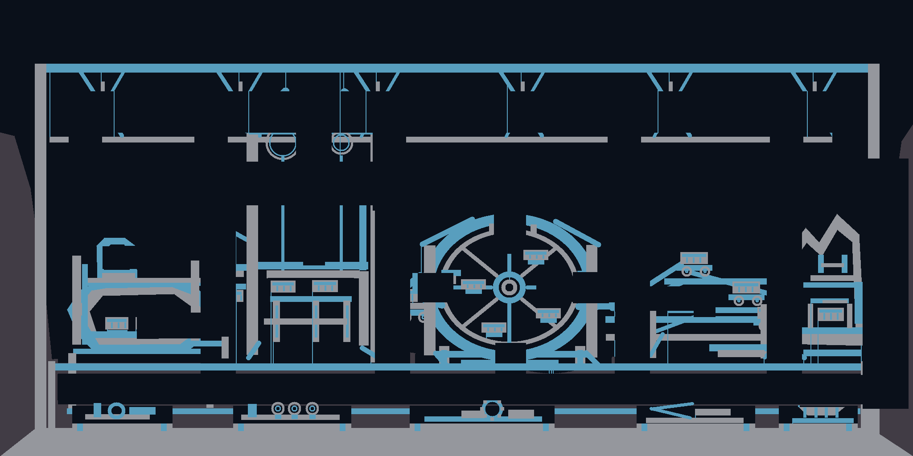

# Orison Wheelhouse — Ring Indexer RoRo Port

> **NEW ORIGINAL 2048×1024 PERPENDICULAR SIDE-ELEVATION MATERIAL-CELL WORLD · OPEN DRAFT/HOLD · SOURCE-STATIC PASS · NATIVE-UNTESTED.** Entirely independent industrial-transit map, not a reference-art conversion. Do not merge, Ready or infer owner acceptance.

## Distinctive playable place and engineered freight chain

A dry salt-basin **roll-on/roll-off vessel** (west) unloads through a true side hatch and founded drylock apron into a **twin unequal-drum freight elevator**. The two hoist cable drums, unequal basket guides, counterweight and lift well are actual steel/concrete cells, not drawn lines. A transfer cradle delivers the same recognisable barred freight crates to a **large annular eight-spoke indexing ring**; multiple angular fixed cargo pockets and side loading portals provide the core structural silhouette. This is **fixed inert material machinery**: no claim that the ring mechanically turns. Staged crates leave by a **three-grade, diverging freight marshalling fan**, pass a side-on inspection scanner and weigh bay in the customs building, then dispatch east.

Five distinct lower service workfaces support the system: berth bilge return, elevator pump/drive maintenance, indexing axle/gear service, rail-switch brake workshop, and customs recovery. The lower transverse tunnel, upper overhead-truss overflight and central open flight band offer traversable alternatives. Hatches into the wheelhouse/hold, ring interior, hoisthead and switching gallery are physical excavations in actual material IDs. Large negative-space sky, basins and service returns contrast with dense machinery. Every rendered structural element is in the final collision material plane.

**Spawn**: Berth Approach (158,413). **Goal**: Outbound Relay (1902,414). **Recommended progression:** Berth Approach → Quay Manifest → Pilot Wheelhouse / RoRo Vehicle Hold → Twin-Drum Gate → Elevator Control / Elevator Head → Indexing Ring Entry → Ring Viewing Pocket / Ring Cargo East → Ring Outer Transfer → Classification Control / Rail Switch Gallery → Freight Scan Gate → Outbound Relay.

**Main flight route:** Berth Approach → Quay Manifest → Twin-Drum Gate → Indexing Ring Entry → Ring Outer Transfer → Classification Control → Freight Scan Gate → Outbound Relay.

**Alternate upper route:** West Crane Loft → Elevator Head → Upper Truss Way → East Semaphore.

**Recovery / bottom return:** Berth Bilge Return → Hoist Pump Gallery → Ring Axle Service → Turnout Service → Customs Recovery.

### Exact named destinations

- **Berth Approach** — (158,413)
- **Quay Manifest** — (411,413)
- **Pilot Wheelhouse** — (254,578)
- **RoRo Vehicle Hold** — (331,735)
- **Twin-Drum Gate** — (650,413)
- **Elevator Control** — (704,570)
- **West Crane Loft** — (374,247)
- **Elevator Head** — (704,247)
- **Indexing Ring Entry** — (1051,414)
- **Ring Viewing Pocket** — (1143,544)
- **Ring Cargo East** — (1248,649)
- **Ring Outer Transfer** — (1368,414)
- **Classification Control** — (1575,413)
- **Rail Switch Gallery** — (1580,686)
- **Freight Scan Gate** — (1800,414)
- **Outbound Relay** — (1902,414)
- **Upper Truss Way** — (1178,247)
- **East Semaphore** — (1870,247)
- **Berth Bilge Return** — (270,872)
- **Hoist Pump Gallery** — (642,872)
- **Ring Axle Service** — (1088,872)
- **Turnout Service** — (1540,872)
- **Customs Recovery** — (1840,872)

## Source-specific qualification receipt

| Proof | Source-static outcome |
|---|---|
| Canvas size | 2048×1024 = **2,097,152** final material-ID cells |
| Deterministic seed | `2026112026` |
| Material IDs | 0 empty; 58 reinforced concrete; 62 steel plate; 100 basalt columns |
| Solid work / grounded | **581,718 / 581,718**, zero detached or intentionally uncontained falling/mobile/reactive material |
| Ordered nonoverlapping rectangles | **4,330**, exhaustive grid replay matches |
| Setup JSON | **80,463 bytes**, below 1,048,576 |
| Midge conservative exact-site clearance | 23/23 at **19×15**, 23/23 at **23×19**, 23/23 at **31×27** |
| Physically blocked route | Add solid XYWH `[231,363,92,96]`: 31×27 Berth Approach → Quay Manifest **253 → 371** centre-steps, all 23 named sites remain reachable |
| PNG evidence | Genuine source-cell indexed-material panorama + **six true 1:1 crops**; 7/7 raw-source pixel parity, PNG chunk CRC, zlib Adler, no scaling or composites |
| Native execution | **NATIVE-UNTESTED** (no proven installed Godot/Workbench/CyberDemoBridge/Rapier or fresh-process save/reopen) |

**Source identity:** base `sandmapsreference/main@99a166e7fcae45eb22be1740e9f33f62faccbcc7`; read-only accepted engine authority `techrote/cybersand/main@7b03aa437561ec63e31fd09531171360ab60eeb4`; accepted Setup-v2 loader Git blob `70dd964bc2d5bff9ca030edd57d7fc7aa5068fc9`, material catalogue blob `dcf05895da3015a2e999e3d1cbbae0fdc7fe32b3`, Midge authored hull 4×3. Re-read source Setup-v2 maximum 32,768 rectangles; the installed bridge capacity handshake can expose a **legacy 4,096 fallback**. **This map's 4,330 records exceed fallback by 234; source compatibility is not proof of installed compatibility.** No geometry is degraded to fit an unverified fallback. No engine edits.

**SHA-256 physical cell grid** `5bf8de913ea21246734a8ee57488916a3d632950c10df1d8e8071c7b5aa9cca0`

**SHA-256 Setup JSON** `d29fdd103703882f3e6ed597a8d9ede43287275175433a6580a088ffd97d8096`

The source `build.cjs` is the independently executable fixed-seed generator and byte-for-byte verifier. `receipt.json` records every named site, route, material histogram, image hash and physical-law check. Run `node build.cjs --verify` from this folder after checkout to re-run the grid, flood-fill, rectangle replay, three-envelope BFS, obstruction proof and genuine PNG parity and compare every committed generated byte. Standard `node build.cjs` re-generates the committed outputs. Only preexisting generic hashing/PNG/checking utilities are reused, not another map's landscape geometry.

## Authentic indexed material-cell gallery

These are **actual final material IDs** mapped to a fixed palette and verified pixel-for-pixel; not painted interpretations, source photos, native gameplay captures or AI concept art.

| Actual 1:1 source-grid crop | Window (x,y,w,h) |
|---|---|
| [RoRo serviced vessel and drydock](01-ro-ro-vessel.png) | 125,513,375,309 |
| [Twin-drum hoist and entered elevator](02-double-drum-elevator.png) | 520,197,359,617 |
| [Giant fixed ring indexer and four cargo slots](03-indexing-ring.png) | 924,461,460,371 |
| [Three-tier divergent freight fan](04-classification-fan.png) | 1373,552,401,267 |
| [Entered eastern inspection / manifest terminal](05-customs-terminal.png) | 1752,470,290,350 |
| [Five unlike real underworks service bays](06-machine-underworks.png) | 145,835,1789,182 |

### Independent review and HOLD policy

Request **Art / Technical / Shepherd** independent exact-HEAD source review. No exact binary-compatible installed Workbench or Godot execution was available for this source-static production. Midge flight physics, collisions, progression, replay, save/reopen and bridge 4,330-record import are **unproven**. Only change this creator-owned branch for confirmed independent P0/P1 repairs. No change to `cybersand`, original prior landscape PRs, schedules or other authors.

## R2 — bounded functional-art P1 repair (20 November 2026)

This revision responds to independent exact-R1 Shepherd and Art P1s using **33,648 actual material-cell changes** (10,714 additions, 14,023 excavations, 8,911 substitutions). It retains the original fixed annular indexer, three-grade rail fan, main/upper/lower routes and all 23 literal site coordinates. Matching steel-trimmed cargo skids and capturing stops now appear at the RoRo foredeck, hoist cradle, annulus ingress and rail release. Two formerly shallow underworks stalls have a deep entered dual-gear/drive-pump workface and a guarded customs recovery lift. Those are inert *fixed* cells, not animated cargo or machinery.

R2 exact committed-source static results: **2,097,152** cells, **4288** disjoint ordered rectangles, **79791** Setup JSON bytes, **578,409** grounded stable immovable solids / 0 detached, **23/23** exact destinations at each **19×15, 23×19, 31×27** envelope, and a physically obstructed 31×27 **253→371**-step route with 23/23 destinations still accessible. Full overview plus six 1:1 district crops are byte-generated from the exact cells with full pixel parity. New grid SHA-256: `0ffe9a9ddaa968969f11607d40fa1569168afe8e967cfe63ef2c216e0c7581b0`; Setup SHA-256: `60dadfd3cd72a1fe2e90daf3fc36f084ab2edd811ce9e77a64a3ce0c9ffde42f`. Independent R2 Art/Tech/Shepherd judgment is **pending**. Accepted source rectangle maximum is 32,768; the installed/legacy 4,096-capacity bridge fallback still needs a real handshake; **NATIVE-UNTESTED**. No native collision, Midge flight, persistence or CI PASS claimed.
