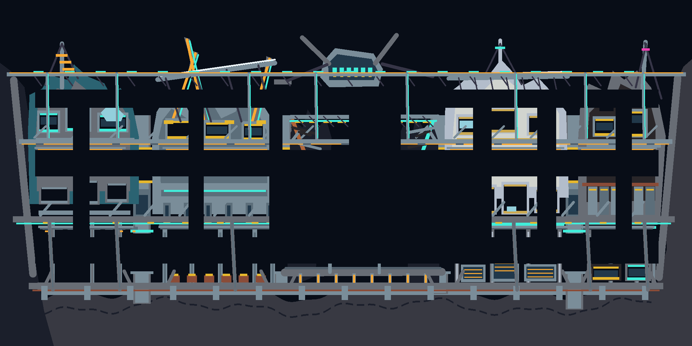
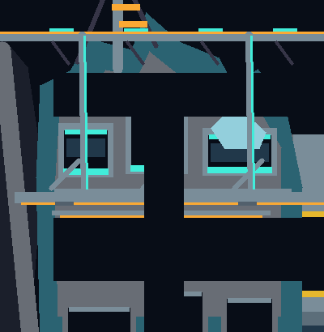
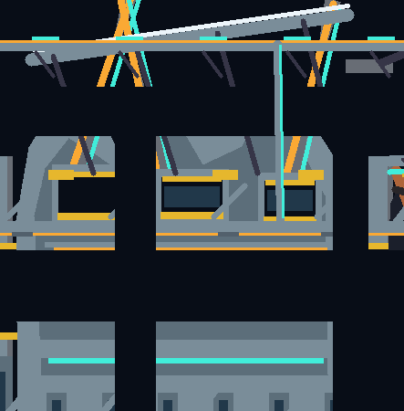
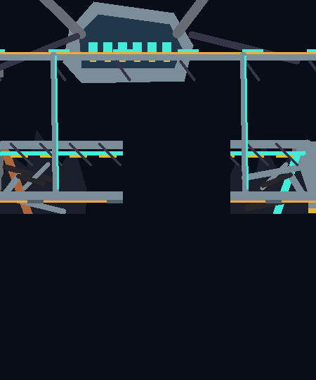
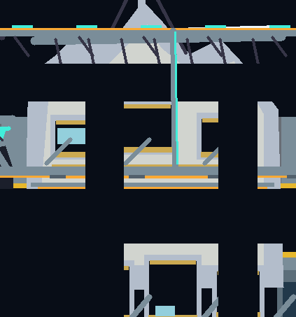
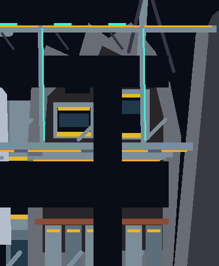

# The Ion Parapet — Stormbreaker Freight Terraces

> **Wholly original 2048×1024 CyberSand Workbench Setup-v2 material-cell level.**
> Creator lane: `original/megastructure-wide`. Independently authored from scratch; no reference image, conversion, stock/AI artwork or inherited layout. **DRAFT / HOLD — NATIVE-UNTESTED**. No owner acceptance is implied.

## Spatial thesis

This is a stormbreaker machine-city built sideways between two basalt shoulders. Five deliberately different working districts surround an unroofed, instrumented plasma-capture trench. A single long, **actually connected** high storm beam and fractured secondary service chords explain the hanging industrial megastructure rather than leaving unsupported decoration. Functional civic, induction, security, low cooling and transfer programmes sit within accessible Midge-scale cutaways, not fake three-quarter architecture. High voids contrast with densely layered fabrication and administrative machinery. Pure side elevation throughout.

- **Signal Bazaar, x80–420:** public landing, stepped street-market canopies, three service rooms, asymmetrical signal aerial, cargo weighing route and lower public subpassage.
- **Inductor Mill, x445–840:** skewed heat-exchange blades, hoist boom, cargo manifold, inspection glazing and grounded coolant undercroft.
- **Plasma Trench, x840–1310:** giant negative-space fault, opposed serrated conductor banks, suspended shield freight cradle, inspection shelves and two differently sized real-cell baffles. The horizontal transit gap is the level's visual and navigational hinge.
- **Civic Registry, x1310–1700:** bright white/brass stepped public edifice with kiosk, archive circulation, nested office spaces, telecom mast and service racks.
- **Sable Lock, x1700–1980:** asymmetric dark defensive closure, shield-control station, quarantine inspection, layered shutter assembly, return airlock and east beacon.

**Mission:** Midge launches at **Signal Bazaar landing (135,487)** and must reach **East beacon destination (1930,479)**, examining the functioning districts and returning to the public route. Alternative route under a deliberately obstructed central midline uses the descending west relief shaft, lower trench return and east ascending relief. Directional flight is actual 2D actor space; do not infer that windows are walkable platforms.

## Exact functional sites and route graph

| Site | Exact cell centre | Role / access |
|---|---:|---|
| Signal Bazaar landing | (135,487) | Spawn, mid-air public entrance |
| Signal Bazaar observation | (276,301) | Upper civic lookout |
| Signal Bazaar subpassage | (245,736) | Lower public return |
| Inductor cargo manifold | (578,475) | Industrial main entry |
| Inductor vane watch | (685,288) | Upper machinery inspection |
| Inductor coolant return | (748,743) | Underdeck service return |
| Parapet top transfer | (1045,284) | Central upper transit |
| Plasma trench neutral line | (1050,476) | Central midline crossing; test-obstructed site |
| Trench emergency underpass | (1104,737) | Lower bypass / recovery |
| Civic registry upper gallery | (1471,286) | Upper public office |
| Civic registry main kiosk | (1474,477) | Civic main access |
| Civic archive circulation | (1552,734) | Lower archive |
| Sable Lock shield control | (1793,306) | Security control upper |
| Lock security inspection | (1816,472) | Main quarantine route |
| Lock return airlock | (1871,741) | Lower inspection return |
| East beacon destination | (1930,479) | Goal, return via alternative altitudes |

The primary route is west-to-east mid air around **y≈475**. The upper canopy bypass is around **y≈285**, the grounded utility bypass around **y≈735**. Genuine roomy lift/transfer slots are at **x216–265, x558–603, x797–836, x1033–1095, x1400–1455, x1590–1646, x1822–1870**, with additional engineered west/east fault recovery openings at **x899–955** and **x1337–1395** and a separate upper cross-recovery at **x1141–1186**. All graph edges are proven against actual material cells, not off-grid navigation links. Routes deliberately include structural turns and collision exposure near support drops rather than a single straight empty tunnel.

**Forced obstruction test:** replace cells x976–1133 and y443–525 with reinforced concrete in a separate in-memory copy; the deliberately occupied `Plasma trench neutral line` is excluded, and **all 15 remaining exact sites are still reached** with each of three conservative Midge envelopes. The committed canvas itself is **not** blocked. No destination radius tolerance, nearest-centre adjustment or hidden waypoint exemption was used.

## Engine contract and physical semantics

Accepted **READ-ONLY** `techrote/cybersand` main at `de109d0131641d6adc8d25bb9ced7ca3d4991105`. Workbench loader: `godot/scripts/workbench_setup.gd`. Material enum: `native/include/cybersand/material.hpp`. Midge source: `godot/authoring/flyers/midge.json`, authored 4×3-cell rectangle hull, hash `c226d73ae56a426820d2ef842a4856bf79ac23efabe64e66569dff8de62a7a96`. Spawn and actor tuning are serialized, but dynamic outcomes depend on Godot/Rapier.

Used native IDs (all **inert, non-moving Solid/None** according to current material definitions/independent accepted-main parity): 58,62,63,64,65,66,69,70,72,74,76,77,78,79,80,100,101,114,119,120,131. All are native enum values. Stable **BasaltColumns(100)** and **Obsidian(101)** are the rock geologies, never falling Sand/Stone powder. No water, lava, acid, growable or active reaction material is authored; no uncontained fluid, combustion or growth. New map is an *actual material-ID array*, not colour-based scenery. The final **940,081 retained solid cells** form **one four-connected component grounded at the world boundary**. Builder removes 64,196 provisional unsupported feature cells during its final support cleanup; none remains in the committed output.

**Source Setup-v2:** version 2 with exactly 14 root keys; extent **[2048,1024]**; one Midge, authored spawn (135,487); ordered, nonoverlapping, legal five-word rectangle edits. Accepted source checks specify max `32768` rectangles, `1,048,576` JSON bytes, and bounded edit work, all independently below limits. **Installed binary capability is a separate gate:** a legacy CyberDemoBridge may advertise only `4096` rectangles. With 10,150 authored rectangles, **do not claim this map installable on that legacy binary**. Query the installed capacity before import and do not silently downsample the map.

## Reproduce and verify

Requirements: Node.js >=18 for builder (`zlib`,`crypto`,`fs`), Python 3 with NumPy/Pillow/SciPy for independent full-cell/PNG checks.

```bash
node build.cjs
python independent_verify.py > independent_verification.json
```

The fixed-seed JS builder **regenerates** `setup-ion-parapet.json`, `receipt.json`, the full `overview.png` (2048×1024 material-cell RGB proof) and five native **1 cell : 1 pixel** unscaled crops. Original material IDs are stored in the JSON and exhaustively replayed. Preview RGB is a diagnostic material palette; it is *not* a native-game screenshot. Independent checker validates every rectangle, exact payload and map hash, each retained grounded solid component, all PNG signatures/chunk CRCs/zlib/IEND, Adler checks and **pixel-for-pixel parity for 6/6 images** against the reconstructed cell grid.

[Receipt](receipt.json) and [independent qualification](independent_verification.json) record concrete histogram, edit count, full 2,097,152-cell equality, SHA-256, conservative 19×15/23×19/31×27 in-bounds actor-centre reachability, and the real test obstruction. No 1-cell flood-fill proxy is used. The connection proof uses a four-neighbour Midge-centre BFS after rectangular erosion by each operational envelope, and the test obstruction has no target substitution.

## Actual material-grid gallery



| Public Signal Bazaar | Inductor Mill |
|---|---|
|  |  |
| Plasma Trench | Civic Registry |
|  |  |
| Sable Lock | |
|  | |

## Native acceptance / owner test

**NATIVE-UNTESTED.** No compatible Windows/Godot/CyberDemoBridge/Rapier installation was available during generation. No claim of native installation, live flight/collision, temporal simulation, installed DLL capacity or save/reopen is made. Pending on a compatible owner Windows build: check actual bridge capacity; import setup via Workbench; confirm extent/rectangle count and Midge spawn; fly across all three levels including recovery route; verify collision, physical progression and material stability; save and reopen; compare complete live material data where the bridge supports it. Stop and report incompatible capacity instead of truncating edits.

**PR remains DRAFT / HOLD** pending independent Shepherd/art/technical and native review. Do not merge, auto-merge, mark Ready or imply owner acceptance.
