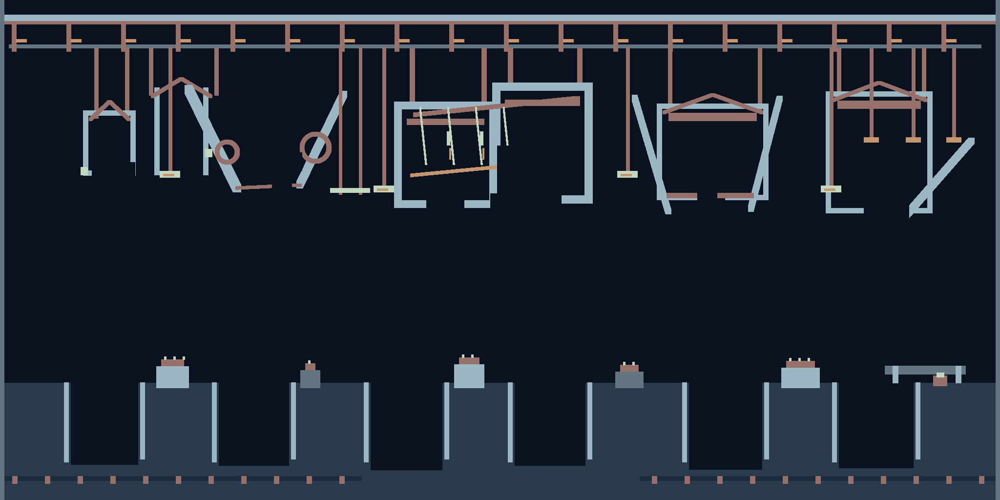
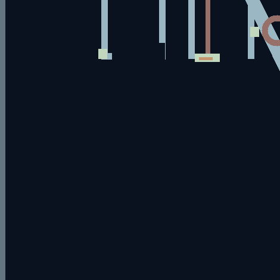
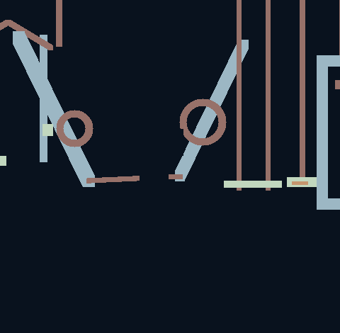
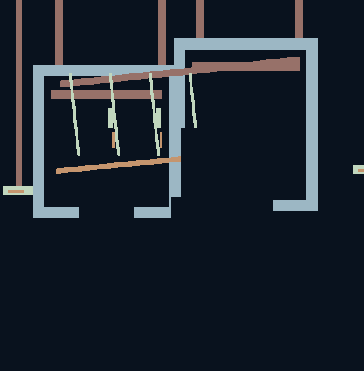
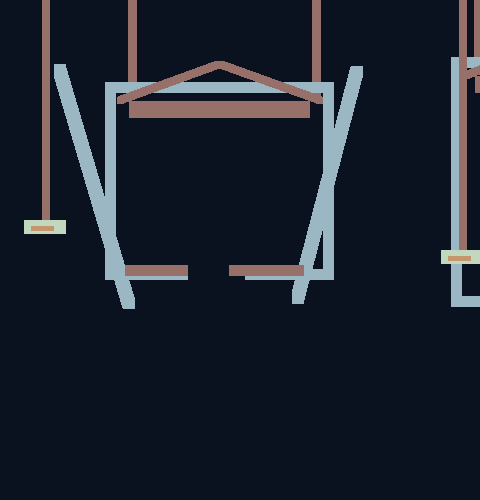
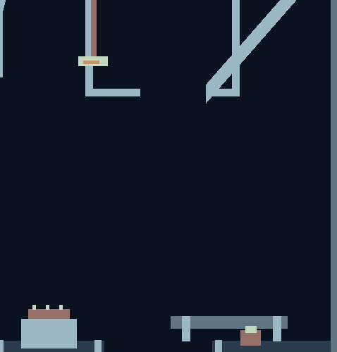
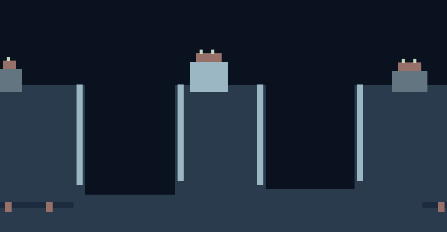

# Duskline Diaphragm Station — original 2048×1024 material-cell racing world

**OPEN Draft/HOLD candidate, NATIVE-UNTESTED.** This is original, from-scratch strict orthographic perpendicular 2D side-elevation geometry, not a conversion from a source photograph or earlier map. Rendered pixels are exact CyberSand material IDs. This is a source-static *playable candidate*, not an observed native race playtest.

## Architectural idea and flight graph

A dry industrial freight pressure-exchange facility carries suspended load-balanced machinery over real excavated maintenance vaults. Unlike an annular rail, sawtooth race or container forkbridge, its macro silhouette is a **pair of offset suspended rectangular diaphragm chambers** surrounded by angled pressure rams. The five functional districts are:

1. **West pressure ignition lock**, with launch/finish radiator, operator control room and lower vault.
2. **Counterweight hoist throat**, with unequal suspension arms, two exposed metal sheaves and a service shaft.
3. **Twin diaphragm interchange**, with offset hollow suspended pressure chambers, fly-enterable interior and unobstructed lower bypass.
4. **Cryogenic bellows/condenser bank**, with convergent angled piping and an accessible control / pump vault.
5. **East arrestor and return basin**, with grounded capture shoes, underfloor inspection bay and long east-to-west low return.

The designated Midge circuit starts at `(144,523)`, heads east through upper checkpoints `(674,503) → (913,501) → (1041,500) → (1269,503)`, enters the right-side capture `(1903,538)`, descends `(1898,651)`, returns west along y≈700 and climbs from `(179,625)` back to finish `(145,522)`. A distinct lower eastbound route branches `(674,503) → (696,594) → (1019,619) → (1307,601) → (1527,520)`.

An **actual solid block** `[960,478,126,75]` disables the literal upper-transfer site `(1041,500)` without shifting it. The 31×27 clearance flood retains the other 32/33 named sites, including the lower bypass, east capture, west return and finish; bounded alternative and local-return legs are separately verified.

Eleven named upper and lower operator/service interiors are real material-cell destinations, with ~42-cell-wide entry mouths or wider. They are not objects composited onto the PNG. The level preserves large-flight-speed negative space, staged forward/reverse choices and local recovery access; physical Midge feel, lap time and collision advancement still require native testing.

## Source identity / contracts

| Contract | Source-static result |
|---|---:|
| Full actual source grid | 2048×1024 = 2,097,152 material-ID cells |
| Setup-v2 accepted root keys | 14/14 |
| Deterministic fixed seed | `0xD05C1120` |
| Rectangle replay | 1,839 nonoverlapping ordered XYWH+material records |
| Setup JSON | 35,440 bytes (1 MiB limit) |
| Native preparation paint work | 554,369 cells (32,000,000 bound) |
| Final inert, 4-neighbour edge-connected solids | 554,369 / 554,369 |
| Unsupported candidates discarded before final recording | 29,337 |
| Final loose, falling, mobile, fluid or reactive cells | 0 |
| Exact 19×15, 23×19, 31×27 full-hull sites | 33/33 at each |
| Obstructed 31×27 sites | 32/33, only upper transfer datum covered |
| Locally bounded 31×27 route legs | 18 primary + 4 alternate + 11 service |
| Real-blocked lower alternative legs | 4/4 |
| Authentic indexed-material PNGs | overview + six 1:1 crops |
| All verified PNG material-index pixels | 3,574,922 |
| Native Godot / installed CyberDemoBridge / Rapier / persistence | **NATIVE-UNTESTED** |

- CyberSand read-only accepted source: [`main@de58bf1997ca75825cf3b29e046dc1c1022c45bf`](https://github.com/techrote/cybersand/commit/de58bf1997ca75825cf3b29e046dc1c1022c45bf). `workbench_setup.gd` declares 32,768 records, 1 MiB JSON, strict fourteen root keys, 512–2048 cell sizes in multiples of 64, Midge definition-hash validation. `workbench_generated_map.gd` enforces 32,000,000 paint-work cap.
- Starting reference-repository main was `99a166e7fcae45eb22be1740e9f33f62faccbcc7` (read-only, never changed).
- Material IDs used: reinforced concrete 58; steel plate 62; basalt 100; obsidian 101; zinc 113; bare iron 117; quartz 122. All are inert solid-class structural materials in the accepted source assumptions; only 0 is empty. Exact histogram, hashes, sampled obstruction coordinates and PNG checksums live in `qualification.json`.
- **Installed bridge risk:** no installed DLL/SO capability receipt available. 1,839 rectangles are below even a possible ~4,096 legacy capacity; this **does not** prove compatibility or native loading.
- Source-static proofs do not establish racing speeds, acceleration, steering ergonomics, actual collisions, or save/reopen fidelity.

## Reproduction and audit

Run with standard-library Python 3.10+: `python build.py && python verify.py && python route_audit.py`. The three scripts generate, independently replay and validate source cells, and verify 33 bounded route legs plus the blocked route. `verify.py` does not import or execute the builder. PNG parity checks decode genuine 8-bit indexed PNG data, CRC, decompressed material ID rows and each native-resolution district crop.

The payload is **plain Setup-v2 JSON**, not an invented generated-map manifest: drop it into Workbench's own `user://workbench/setup-<label>.json` after native qualification. The receipt and archive do not assert that loading succeeds on the owner's actual Godot/native binary. Qualify Godot loader, installed bridge capacity, Rapier Midge collision, actor advancement and fresh-process Save/reopen on compatible hardware before acceptance.

## Gallery — true material-cell screenshots

## Independent review gate

- **Art:** audit actual 1:1 mouth sizes, functional machinery, route-choice legibility and independent visual identity. Be demanding about livable interior/detail rather than decorative tubes.
- **Technical:** independently rerun the committed scripts at exact PR HEAD, inspect current Setup-v2/material/actor contract, verify ordered replay, physical adjacency, named-site hulls, blockage and full indexed PNG parity.
- **Shepherd:** verify original authorship, single owned branch/folder, exact-head evidence and Draft/HOLD; request downstream native execution separately.

No Ready, merge, auto-merge, engine change, past branch modification or owner acceptance is authorised.
