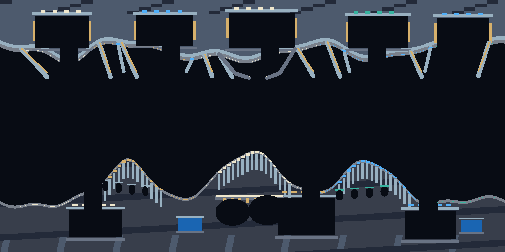
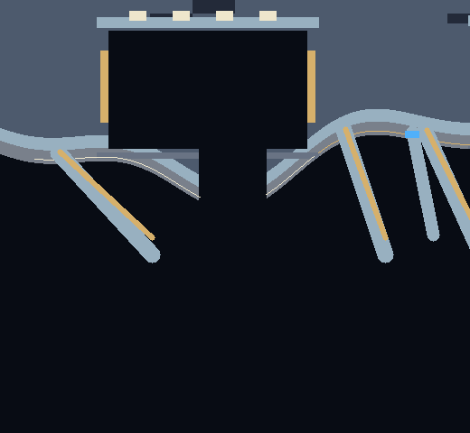
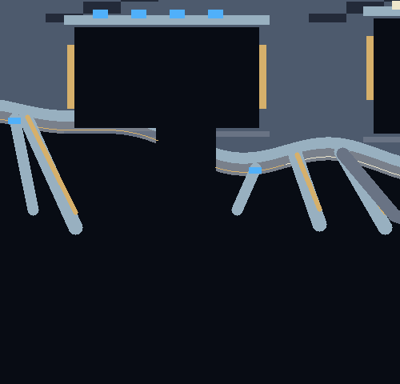
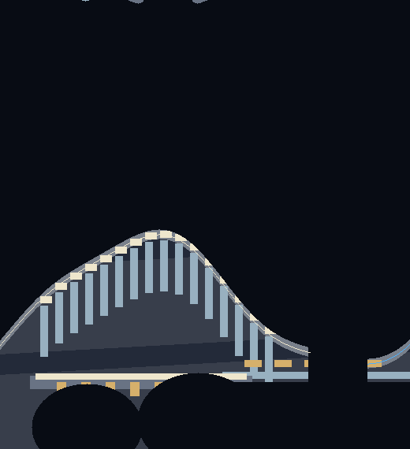
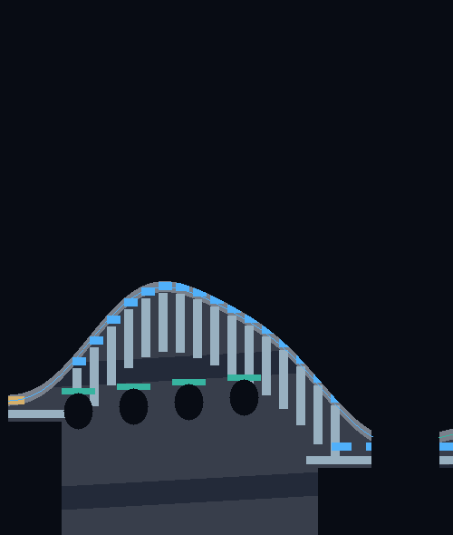
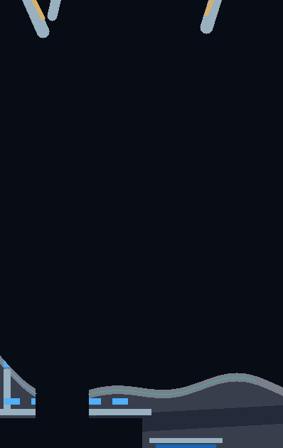

# Faraday Returnworks - closed-lap cryoline mass-driver circuit

**ORIGINAL-NO-REFERENCE | 2048 x 1024 true orthographic CyberSand material-cell world | DRAFT/HOLD | NATIVE-UNTESTED.**

Original creator lane: `racing-wide`. Source branch must be created from the current sandmapsreference default HEAD; there are no source paintings, reference-image conversions, reused Thunderclap cells, isometric surfaces or perspective backgrounds. Every visible shape is a real, collidable 2D material cell, or an intentionally excavated void.

## Spatial thesis and actual Midge game scale

An abandoned Faraday freight-accelerator has become a two-altitude closed lap: launch west on a clear upper pressure gallery, sprint east through five foundry districts, turn down a generous recovery throat, then **race westward back over three naturally raised pressure-floor ridges** before the climb and finish near launch. This is structurally and directionally different from Thunderclap Switchyard's west-to-east open race.

All 2,097,152 cells are physical CyberSand coordinates. Midge's accepted authored hull is 4 x 3 cells; racing clearance is independently checked with fully in-bounds 19 x 15, 23 x 19 and 31 x 27 rectangles. Rooms are roughly 200 x 120 cells, access shafts 75 cells wide and the recovery turnaround occupies hundreds of cells. The 1:1 crops below depict the true spatial scale, not mock gameplay or a rescaled concept image.

**Five functional districts:**

1. **Pulse Injector (x0-399):** mass-driver dispatch room with a real fly-in ceiling entrance; west launch/finish sector and large turnaround with recovery space.
2. **Magnet-Skein Metrology (x400-843):** eccentric roof-founded counterweight blades, enterable metrology chamber and the first collision-significant return crest.
3. **Twin Flywheel Press (x844-1299):** split rooted magnet prongs above the outbound flight line, twin excavated air-bearing chambers and the tallest grounded reverse-course pressure ridge.
4. **Quench-Wave Exchangers (x1300-1759):** operators' overlook, genuine lower quench service gallery, third rising return ridge and enclosed testing equipment.
5. **Far Reversal Throat (x1760-2047):** broad vertical east turnaround, rooted reverse-direction guidance and return control room.

**Flight graph and goal:** launch (120,350), outbound upper gallery from (160,350) to (1850,350), descend in the open east reversal via (1875,510), race west along the floor contour `y = min(706, floorTop[x] - 109)` through the lower checkpoint sites in reverse x-order, climb via (125,540), and finish at (190,350). Optional detours enter the roof control rooms and excavated floor maintenance chambers. The floor geometry makes three recoverable climbs and descents; nothing claims stopwatch timing, high-speed handling or gameplay feeling without native piloting.

**Counterfactual gate:** the conservative 31 x 27 check adds a real 221 x 165 rectangle-shaped obstruction at (918,284) to the collision model, using the exact centre-hull Minkowski expansion. The blocked **Upper flywheel** centre alone becomes unreachable; **14/15** precise named destinations, including finish and the lower bypass, remain connected. The temporary obstruction is not part of the committed race world. No destination snapping or waivers were used.

## Reproduction and validation

```bash
node build.cjs
node verify-independent.cjs
```

`build.cjs` needs Node.js, no dependencies, and generates the committed full-plane Setup-v2 JSON, exact indexed-material PNGs, and receipt. Fixed deterministic seed: `0xFA202611`. The independent verifier uses Node's separate crypto/zlib implementation and actual files, with material-pixel comparisons rather than concept screenshots.

Current accepted read-only CyberSand authority: [main@de109d0131641d6adc8d25bb9ced7ca3d4991105](https://github.com/techrote/cybersand/commit/de109d0131641d6adc8d25bb9ced7ca3d4991105). Workbench Setup-v2 supports 512-2048 axes divisible by 64; current **source** advertises 32,768 box edits, 1 MiB of JSON and 32 million construction cell visits. **Installed CyberDemoBridge may still use 4,096 edits; source capacity is NOT installed compatibility.**

| Exact-source property | Value |
|---|---:|
| Dimensions | 2048 x 1024 |
| Material grid bytes / cells | 2,097,152 |
| Setup rectangles | 9,518 / 32,768 |
| Setup-v2 JSON bytes | 176,167 / 1,048,576 |
| Replayed cell visits | 742,677 / 32,000,000 |
| Ordered overlap / mismatch | 0 / 0 |
| Detached inert-solid cells in final plane | 0 |
| Unsupported islands eliminated during deterministic construction | 689 |
| Exposed water-to-air cardinal edges | 0 |
| Exact named sites 19x15 / 23x19 / 31x27 | 15 / 15 / 15 |
| Upper and lower fully clear 31x27 path samples | 1691 each |
| Wall-blocked gate alternate | 14/15 |
| Full material-plane SHA-256 | `1090e36ad3a28b3d3a462b7c360ddf6e59f52e343c6e83de60d7405ee908f137` |
| Setup JSON SHA-256 | `a8bc430b081e7db90826fc7c58345295a027353d8c4ba8fa4c57219907ebc387` |

**Material law:** inert immovable `Solid / RuleKernel::None` IDs 49/58/62/100/101/113/117/120/122/123/128. The 8,976 **Water (ID 3)** cells have the actual movable Water kernel, wholly sealed inside two continuous, inert-wall containment samples; they are intentionally **not** exposed as racing spills. There are no sand/stone powders, oil, lava, reactive chemical supports or pseudo-material IDs. The generator removes disconnected solid components before encoding; the final grounded check reports zero unanchored collision solids.

### Real cell histogram

| Actual material ID | Cells |
|---:|---:|
| 0 | 1,354,475 |
| 3 | 8,976 |
| 49 | 205,432 |
| 58 | 32,514 |
| 62 | 87,226 |
| 100 | 273,513 |
| 101 | 84,772 |
| 113 | 15,788 |
| 117 | 20,650 |
| 122 | 6,750 |
| 123 | 4,948 |
| 128 | 2,108 |

### Exact named sites

| Site | Cell centre |
|---|---|
| Launch | (120, 350) |
| Injector dispatch | (269, 123) |
| Magnet lab | (676, 116) |
| Upper injector | (510, 350) |
| Upper flywheel | (1030, 350) |
| Upper quench | (1530, 350) |
| East turn | (1875, 510) |
| East return | (1710, 706) |
| Quench ridge | (1500, 547) |
| Bearing ridge | (1030, 503) |
| Magnet ridge | (531, 538) |
| West return | (275, 704) |
| West turn | (125, 540) |
| Bearing vault | (1260, 895) |
| Finish | (190, 350) |

### Genuine 1:1 material-cell gallery

8-bit indexed PNGs store the **literal material ID as their pixel index**. PLTE colours change appearance only. A single pixel corresponds to exactly one saved material cell. Each of the six files was verified for PNG signature, chunk CRC, zlib blocks + Adler32, IEND and exhaustive source-grid pixel parity.

| Exact source-grid image | Filename | x,y / dimensions |
|---|---|---|
|  | `overview.png` | 0,0 / 2048x1024 |
|  | `01-pulse-injector.png` | 22,30 / 520x480 |
|  | `02-magnet-skein.png` | 460,28 / 500x480 |
|  | `03-twin-flywheel.png` | 833,320 / 520x570 |
|  | `04-quench-exchangers.png` | 1290,340 / 500x590 |
|  | `05-east-turnaround.png` | 1650,268 / 398x630 |

### Outstanding downstream gates

**NATIVE-UNTESTED.** A compatible installed Godot 4.7 / CyberDemoBridge / Rapier setup was not available in this executor. No claim is made for actual Midge speed, momentum, collision response, physics progression, resource budgets on a particular installed binary, or cold-process save/reopen. No owner acceptance, Ready promotion or merge is requested. Independent Art, Technical and Shepherd reviews must assess this new exact commit; previous R15 review receipts for another map do not transfer.
