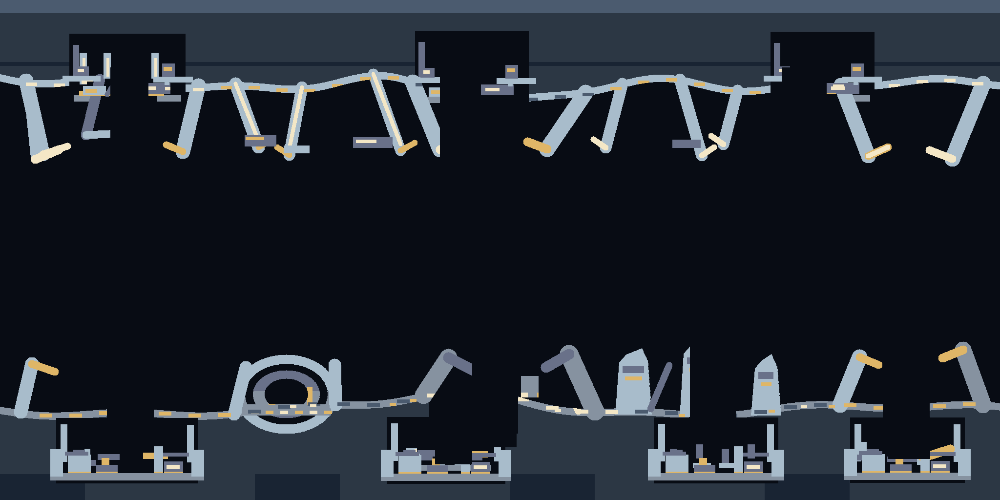
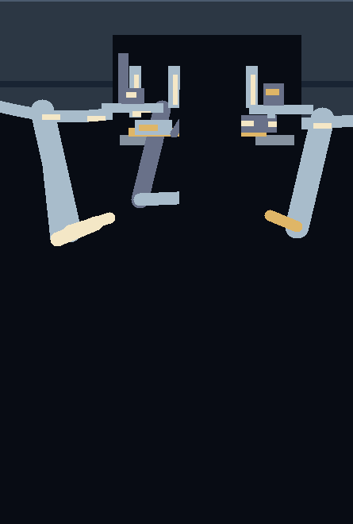
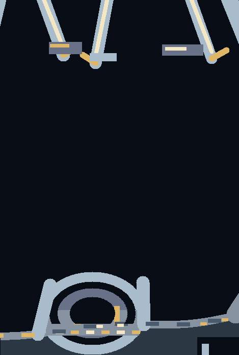
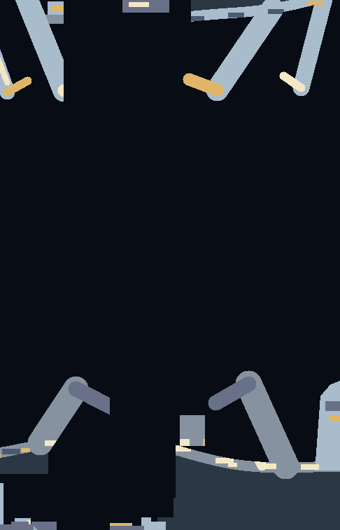
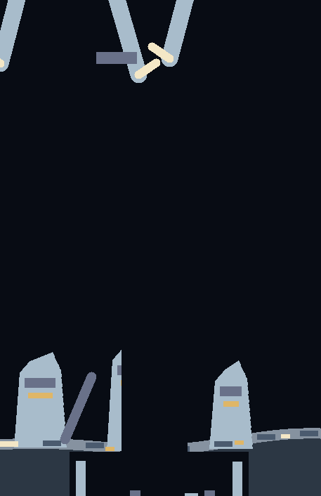
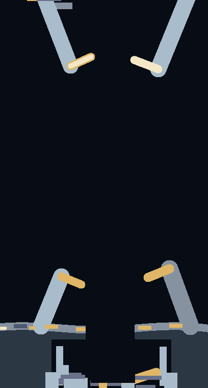
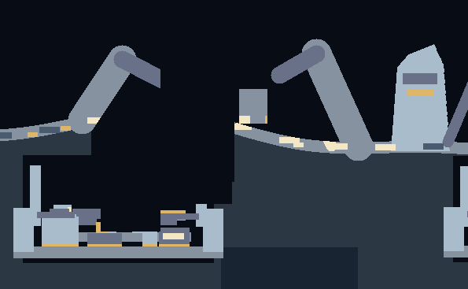

# Kestrel Counterweight Works — ORIGINAL racing-wide material-cell canvas

**OPEN DRAFT / HOLD. Source-static creator qualification only. Native Workbench, CyberDemoBridge, Rapier physics, Midge flight, collision, race speed/timing, and cold-process save/reopen: NATIVE-UNTESTED. Independent Art, Technical, and Shepherd reviews REQUIRED. No author/owner acceptance claimed.**

## Original location and route graph

True orthographic perpendicular 2D industrial landscape, 2048×1024 actual material cells. No reference art. West Kestrel launch customs and crane-operating gallery connects to the **cable-hoist counterweights** (three non-identical roof-suspended load arms and a lower, anchored drive drum); the **central transfer lattice** (paired load-tension jaws and an accessible inspection hoist); the **cryogenic ballast bank** (three unmatched filtering stacks and side-on separation ducts); and the **eastern freight ejector** (asymmetric capture jaws, lower braking arm and a genuine garage). Four foundation-anchored workshops and three enterable operator galleries provide functional interior scale rather than a painted scene.

**Intended Midge circuit** (not proof of pilot handling): West launch (145,372) → west speed aperture (335,371) → cable hoist (604,371) → upper interchange (1001,370) → cold-bank outbound (1430,370) → ejector (1750–1903,370–379) → eastern capture/descent (1910,526) → lower release (1895,655) → cold-bank return (1545,655) → lower interchange (1117,652) → hoist return (754,655) → west brake (390,653) → west ascent (131,522) → finish (156,372). Real 31×27 clearance is checked at named centres, not from artistic routes. The middle inspection shaft provides local recovery; lower garages and roof operation rooms are exact-centre reachable.

**Real alternate obstruction:** 150×80 cells of reinforced concrete at (1361,336) temporarily occlude only **Cold bank outbound** while 21/22 other exact named destinations, including finish, remain reachable at 31×27. This demonstrates static alternative connectivity; it is NOT a racing playtest.

## Provenance, rebuilding and artifact contracts

- Accepted read-only CyberSand authority: `techrote/cybersand@de109d0131641d6adc8d25bb9ced7ca3d4991105`, `godot/scripts/workbench_setup.gd`, `native/include/cybersand/material.hpp`, `godot/authoring/flyers/midge.json`. The actual Midge hull is 4×3; conservative envelopes tested at 19×15, 23×19, 31×27.
- Rebuild from fixed seed `0x26112026`: `node build.cjs` (requires Node.js built-in crypto/zlib/fs, no third-party packages). `geometry.cjs` contains actual independent coordinate geometry and fixed-seed calibration plates. Re-run `node verify-independent.cjs` for an independent replay from the committed Setup JSON, source material histogram, exact-centre 4-neighbour route proofs, grounding, and every authentic indexed-material PNG pixel.
- `setup-kestrel-counterweight-works.json` is the complete ordinary Setup-v2 **14-field** envelope with `LA-SELECTIVE`, 55 signed liquid-policy words, accepted Midge model/hash, fixed constructor options, actual 2048×1024 extent, nonoverlapping five-int rectangle edits and no simulated equipment.
- Final grid contains 2,097,152 actual material IDs; full ordered replay zero overlaps/mismatches. Every final occupied pixel is an accepted rigid, immovable, inert solid rooted to boundary: Slate 49, ReinforcedConcrete 58, SteelPlate 62, BasaltColumns 100, Obsidian 101, ZincSheet 113, BareIron 117, QuartzCrystal 122. No fluids, reactive substances, falling sand, invalid IDs or unsupported foundations.
- `qualification.json` records source grid and JSON SHA-256, exact rectangle/JSON/work counts, full material histogram, actual grounded and discarded solids, named site table, clearances, obstruction receipt and every PNG SHA-256/CRC/zlib/full material-index parity.
- Overview is **actual committed 2048×1024 indexed material cells**, not AI art or a native screenshot. The six PNGs `01`–`06` are genuine pixel-for-pixel 1:1 districts cropped from the same cell plane.

## Source and installed-capacity limitations

Accepted source advertises 32,768 rectangle edits, 1,048,576 JSON bytes and 32,000,000 construction work visits. The current Setup uses more than the possible legacy **4,096** installed bridge fallback; native loadability is **UNVERIFIED** until the actual installed `CyberDemoBridge.workbench_start_rectangle_capacity()` response is measured. Do not silently downsample or truncate geometry to the legacy cap. No real actor steering, lap-time, collision or fresh-process persistence test has been run.

## Authentic material-cell gallery

**Review requests:** independent Art audit on actual 1:1 district proportion and physically readable west/east decisions; independent Technical audit on full replay, hull sites, material laws and PNG parity; independent Shepherd intake with exact Git HEAD and native gate kept separate. Retain Draft/HOLD. No merge/Ready/auto-merge.
