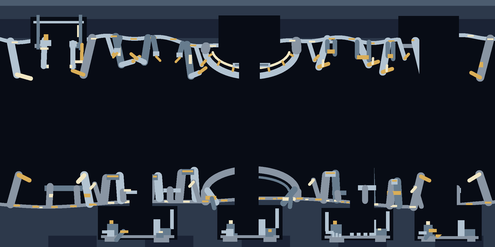
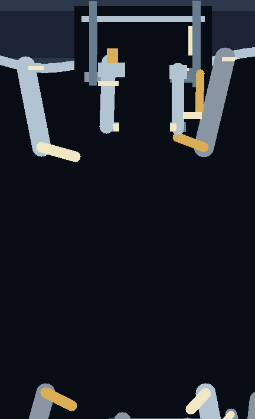
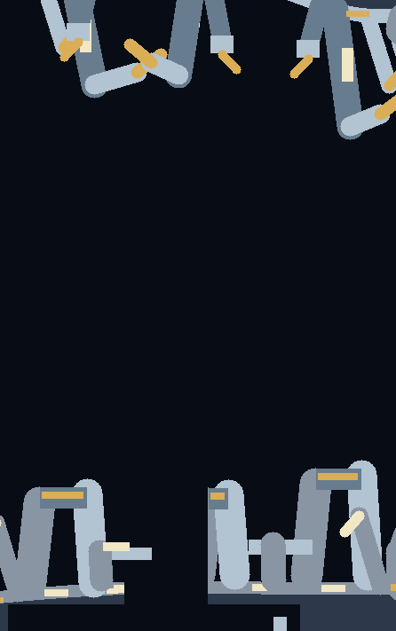
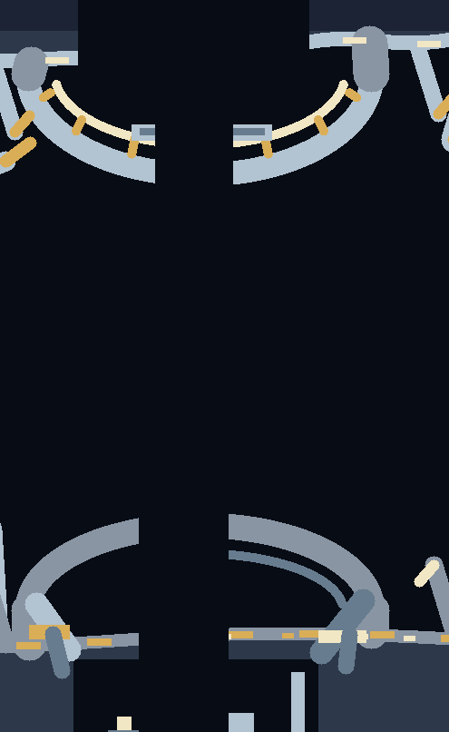
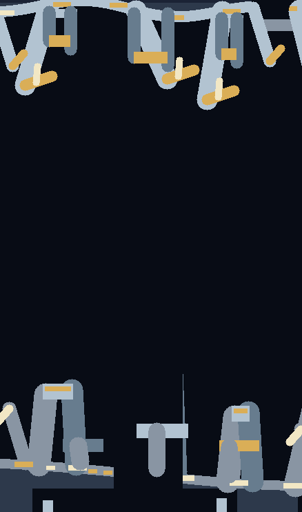
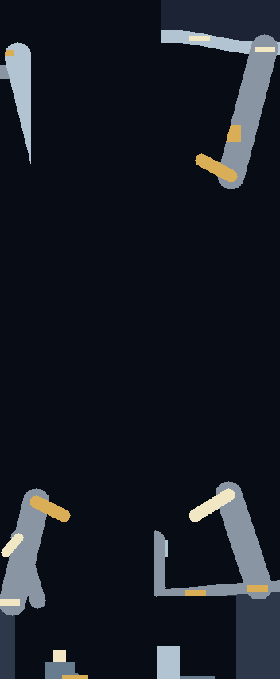
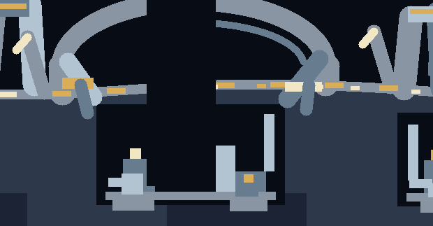

# Lagrange Slipway Six R2 — current exact geometry

R2 material-cell revision responds to the independent Shepherd functional-district P1 on R1 at `ab1a70b0f72cd83739ca4302a3f4c0db53a63823`. It adds a west ignition transformer/charge bus and operator gearing, three different counterweight-clamp mechanisms, grounded crescent actuator/feed/return linkages, differentiated thermal separator machinery, genuinely equipped work bays in each of the four foundation rooms, and supported direction/finish cues. These additions occupy **91,328 changed material-ID cells** (**73,280** newly occupied; **18,048** reclassified; **zero** removed). The two long racing corridors and central flight void remain open; do not infer native racing from static geometry.

Current R2: **2,097,152 cells**, **5777 nonoverlapping rectangles**, **108859 Setup bytes**, **720712 boundary-grounded inert solids**, **c27a8c8cf42ccada3ffb0fabac9c07e55e24f387c55cac3f88b84d43654aa5b6** indexed-grid SHA-256. Exactly **21/21 original sites** remain reachable at all three conservative full-Midge envelopes; the original physically obstructed Separator westbound case retains **20/21 reachable including finish**. The full authentic overview and six 1:1 crops are rebuilt; actual Godot/Rapier flight, collisions, persistence and installed bridge rectangle capacity remain **NATIVE-UNTESTED**. Legacy possible 4,096 rectangle bridge ceiling remains a risk. Independent exact-HEAD Art/Technical/Shepherd review is required before static promotion; retain Draft/HOLD.

---

# Historical R1 authoring and qualification notes (superseded by R2 above)

## Lagrange Slipway Six — ORIGINAL racing-wide material-cell landscape

A genuinely new, independently authored **2048x1024** orthographic side-elevation CyberSand world, not a rendering of source artwork. Source intent: a reversible Lagrange-mass flight test loop built into an abandoned dry slipway, with immense opposing resonance crescents and a stepped induction foundry.

## Districts and route
1. **West slipway ignition:** accelerator stators, west climbing/descending portal, operated roof control and low-bay railhead.
2. **Forged-weight plant:** three nonidentical overhead forging heads and rooted lower counter-mass anvils with enterable weight-smith service room.
3. **Lagrange resonance atrium:** opposing large roof/foundation crescents, central air void, upper monitor room and lower gearbox workshop.
4. **Cold thermal separators:** asymmetric dry buffer/capture vessels, reachable compressor maintenance and distinctive upper/lower machine sequences.
5. **East return tower:** unequal capture jaws, wide vertical U-turn, upper flight dispatcher and lower recovery room.

**Closed route (Midge):** West Slipway Start (142,636) -> low outbound via Induction (346,634), Forged Weights (655,635), Resonance Atrium (1041,634), Thermal Separator (1459,635) -> East Dry Release (1844,635) -> East Reversal Shaft (1912,505) -> East Upper Capture (1886,373) -> upper westbound return via Separator (1539,374), Array (1160,373), Foundry (723,374), West Deceleration (336,372) -> West Transition (136,500) -> Finish West Low (156,635). The lateral mid-map void provides return and recovery opportunities between two ends. Extra roof operator controls and four excavated workshops are real 31x27-clear site destinations.

This is **not a native race timing or playfeel claim**. No speed, Lap time, actor collision response or save/reopen result has been measured. No installed Godot/Workbench/CyberDemoBridge/Rapier execution was possible.

## Static source contract
- Exactly 2,097,152 final material ID cells. Stable seed **0x261120d1**, fixed deterministic source.
- Accepted read-only CyberSand main **de109d0131641d6adc8d25bb9ced7ca3d4991105**; accepted Midge model SHA-256 **c226d73ae56a426820d2ef842a4856bf79ac23efabe64e66569dff8de62a7a96**, authored 4x3 hull.
- Only accepted inert Solid IDs 49, 58, 62, 100, 101, 113, 117, 122; no falling, liquid, fire or reactive foundations.
- Strict Setup-v2: all 14 root keys, exact 55-integer liquid policy, canonical nonoverlapping five-field rectangles, 32,768 source max, 1 MiB JSON max, 32M construction-cell work.
- Three actual free-centre 4-neighbour BFS floods for 19x15, 23x19, 31x27, all 21 literal named destinations. No nearest-site substitutions. The temporary real collision obstruction **[1400,341,130,79]** blocks only the exact Separator Westbound site; finish remains accessible via the lower east loop.
- Full ordered grid replay, material histogram, boundary-grounded solid flood, PNG CRC+inflation+per-pixel parity are checked by the separate `verify-independent.cjs`.
- Regenerate: `node build.cjs && node verify-independent.cjs`; requires Node 18+ only.

## Genuine cell gallery

## Outstanding independent gates
Draft/HOLD; fresh Art/Technical/Shepherd exact-HEAD review required. **Native-UNTESTED**. Source advertised 32,768 construction rectangles; installed bridge may be older **4,096**, so capacity must be queried from actual Windows binary before loading. Preserving meaningful wide racing voids is deliberate; do not infer native high-speed experience from BFS.
