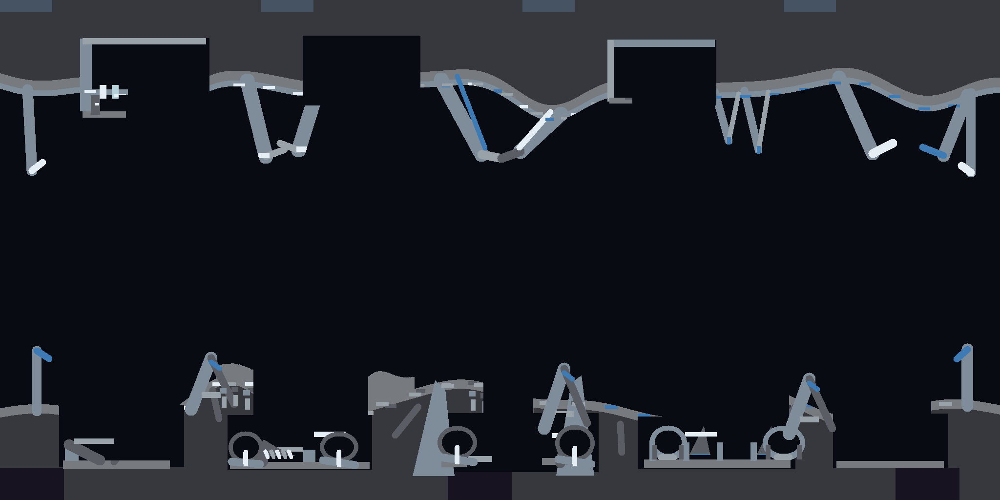
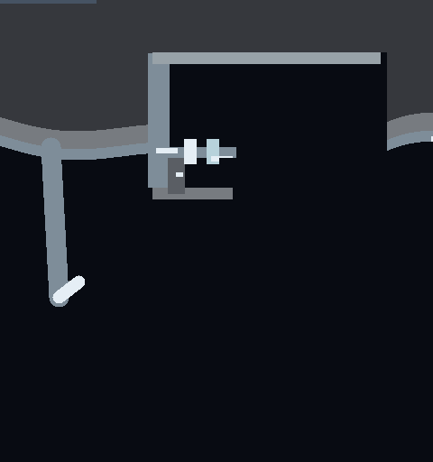
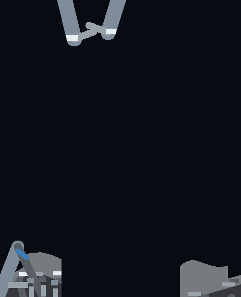
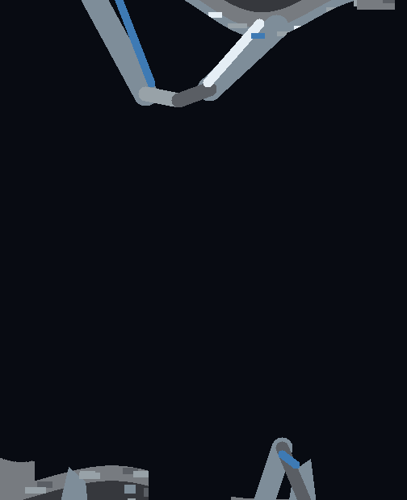
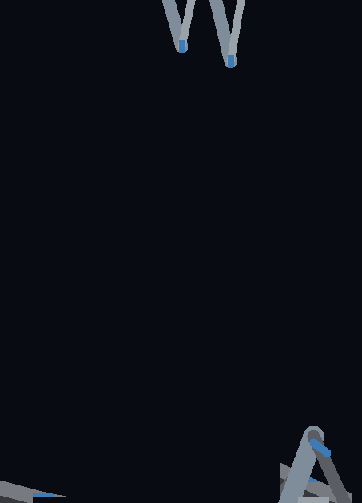
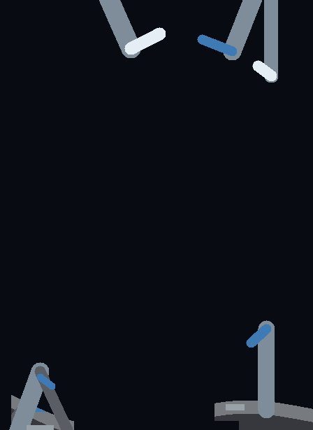
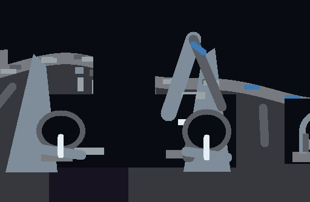

# Razorback Phase Exchange — original Midge racing-wide landscape

**New original-no-reference 2048×1024 CyberSand material-cell world** · **Draft/HOLD** · **creator source-static PASS** · **independent Art/Technical/Shepherd review REQUIRED** · **NATIVE-UNTESTED**. This is not a source-image translation, a 3-D scene, an illustration, a native screenshot, or an owner-accepted course.

## Spatial thesis and district architecture

A broad, fractured industrial vacuum channel carries a paired eastbound and westbound Midge time-trial through a roof-suspended counterphase machine. The visual hierarchy uses **unequal ratcheted overhead machinery against a lower row of pressure canisters and V-shaped stator frames**, with deliberate clear negative space between the flight corridors. Every visible structure is actual CyberSand material-ID cells: perpendicular 2D side elevation only, no platform top faces or perspective walls. Five different production districts:

1. **West magnetic dispatch (x≈65–430):** launch line, enterable excavated overhead control loft, downward access shaft, west ascent and founded recovery/service apron. Upper control site (307,169).
2. **Bellows Run (x≈430–850):** three unequal ceiling-mounted fold actuators, a separate roof telemetry loft, uneven pressure-camber, two full-hull floor-service access shafts, and grounded piston/canister workfaces. Service site (567,886).
3. **Phase Exchange (x≈845–1250):** opposed diagonal roof induction arms, opposing lower test pylons, a 102-cell-wide central access shaft, multiple grounded retention rings and a true enterable test chamber (1027,896). Upper (1016,408) and midfield breakout (1082,534) are real navigation sites.
4. **Ion Scrubber (x≈1260–1650):** five rooted angular V-cells, distinctive two-shaft absorption labyrinth, internal baffles and lower process canisters; service site (1507,894).
5. **East counterphase return (x≈1650–2048):** split magnetic capture jaws, long deceleration approach, spacious descent/reversal throat (1912,537), two-sided maintenance room and westward return release.

No materials are simulated conveyor belts or physically operating machinery. They are inert, plausible environment geometry whose function is expressed architecturally.

## Midge route graph and actual game scale

**Intended closed-loop navigation, not a measured racing lap:** West Start (139,414) → Departure (290,413) → Bellows (512,411) → Stator Divide (748,411) → Phase Transfer (1016,408) → Scrubber upper (1444,406) → East Speed Brake (1760,412) → East Pivot (1912,537) → East Lower (1878,658) → Scrubber Return (1510,656) → Exchange Return (1102,660) → Bellows Return (686,658) → West Return (284,655) → West Ascent (155,535) → Finish (190,414).

**Alternative and recovery edges:** Midfield Breakout (1082,534) joins the upper induction region to lower return. Flight voids permit rejoining the main circuit after missing the east turn or taking an early descending line; service entrances are connected to those voids. A *temporary, validation-only* 142×85 occupied obstruction at (949,365) blocks the named Phase Transfer Upper site while 19/20 other exact sites, including Finish, remain reachable at 31×27. The blocker is **not** present in the delivered grid; this is a test of geometric resilience, not evidence of live collision responses.

Authored CyberSand **Midge** is a **4×3-cell hull**, model hash c226d73ae56a426820d2ef842a4856bf79ac23efabe64e66569dff8de62a7a96, with real spawn (139,414). Full conservative **19×15, 23×19 and 31×27** envelopes are tested in-bounds at exact, unshifted sites using four-neighbour free-centre BFS. These enlarged envelopes deliberately exceed the physical 4×3 hull. Loft, access passages and chambers are represented at actual cell scale; this world is intended for ordinary Midge gameplay zoom, **not** a building facade scaled down into scenery.

## Accepted source contract and measured preflight

Read-only accepted CyberSand authority: [main at de109d0131641d6adc8d25bb9ced7ca3d4991105](https://github.com/techrote/cybersand/commit/de109d0131641d6adc8d25bb9ced7ca3d4991105), including the exact **14-field Setup-v2** loader and strict root-key validator in godot/scripts/workbench_setup.gd; native material enum/definition table, constructor admission and Midge actual model/hash/hull. Builder uses accepted 55-int default liquid policy even though the final level has no liquids.

| Source-static receipt | Verified |
|---|---:|
| Exact full material-ID plane | 2,097,152 cells |
| Ordered disjoint rectangle edits | **5,509 / 32,768** |
| Compact Setup-v2 UTF-8 bytes | **104,277 / 1,048,576** |
| Cell-work visits / budget | **669,957 / 32,000,000** |
| Lossless ordered replay | 0 overlaps, 0 grid mismatches |
| All named exact-centre sites | **20/20** at 19×15, 23×19, 31×27 |
| Temporary physically occupied alternate | **19/20**, only blocked Phase Transfer Upper unavailable |
| Final detached collision solids | **0** |
| Detached candidate ornament cells removed before final output | **38,967** |
| Liquids / fire / chemical rules | None: all final occupied IDs are inert |
| Full PNG and 1:1 district crops | **7 generated and pixel-verified** |
| Godot Workbench / CyberDemoBridge / Rapier / native save-reopen | **NATIVE-UNTESTED** |

Full final-world SHA-256: 14c7d9cccb19a325dec82c9a67a6ddf4321a4ea68d615791984257583f7a4c9f.

Setup JSON SHA-256: c2ca8b7b7c919bfb5ed37c2b4bc628a10fdf1e3eb4f33d6d3b203e58fed463f8.

Material histogram, every named location, all three exact BFS counts, initial grounded-components audit, valid rectangle and JSON budgets, actual image SHA-256 hashes and crop coordinates: [qualification.json](qualification.json).

**Stable inert materials:** 49 Slate, 58 ReinforcedConcrete, 62 SteelPlate, 100 BasaltColumns, 101 Obsidian, 113 ZincSheet, 117 BareIron, 120 GlassBlock, 122 QuartzCrystal, 123 UraniumGlass, 128 PolymerPanel. Their actual accepted source definitions are immovable **Solid / RuleKernel::None**, including tinted/transparent variants. No falling Stone/Sand used for supports; no mutable liquids/expanding materials or uncontained reactions.

**Installed bridge risk:** Source advertises 32,768 Workbench rectangle edits, but an installed/legacy bridge may expose only 4,096. This level's 5,509 rectangles exceed that fallback. The actual installed workbench_start_rectangle_capacity() must be measured; do not assume the level opens successfully or silently discard edits. Native installation, Midge thrust/steering, collisions, tick progression, speed, lap flow and cold-process save/reopen were **not performed**. Source-static BFS is not proof of racing feel.

## Reproducibility

Run from this map folder on Node 22:

~~~sh
node build.cjs
node verify-independent.cjs
~~~

The fixed geometry is deterministic under source seed namespace 0x5a71e206; generation does not use RNG draws. The builder produces the exact final Setup JSON, world qualification receipt, **indexed material** 2048×1024 PNG and **six genuine indexed-material district PNGs**. The independent script reconstructs material IDs exclusively from the committed Setup file, verifies all 14 source-loader root fields, rectangle budgets, collisions, replay/hash receipts, complete PNG signatures/CRC/IEND/zlib and full source-cell pixel parity, conservative site BFS and grounded structural connectivity. It never reads the builder's in-memory grid. PNGs are material-cell renderings only, not gameplay screenshots.

## Authentic committed material-cell gallery

| West dispatch | Bellows run | Phase Exchange |
|---|---|---|
|  |  |  |

| Ion scrubber | East return | Deep service |
|---|---|---|
|  |  |  |

All crops are 1:1 pixels from the exact committed material plane at rectangle coordinates in the receipt; none are resized concepts. The layout is an original designed *industrial racing service district*, not a derivation of sandmapsreference images or existing Thunderclap/Faraday/Catenary geometry.

**Hold gate:** independent exact-HEAD Art, Technical and Shepherd assessments. Remain Draft/HOLD; no Ready, merge, auto-merge or claim of owner acceptance.
