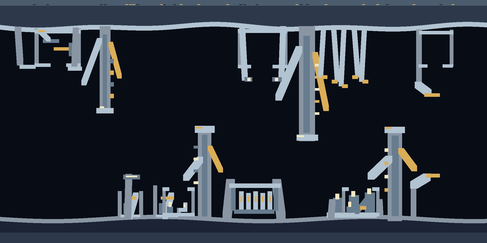
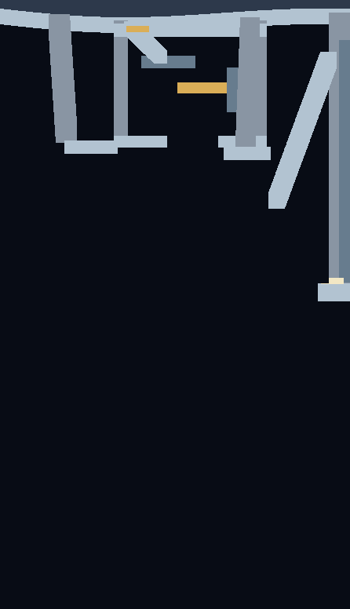
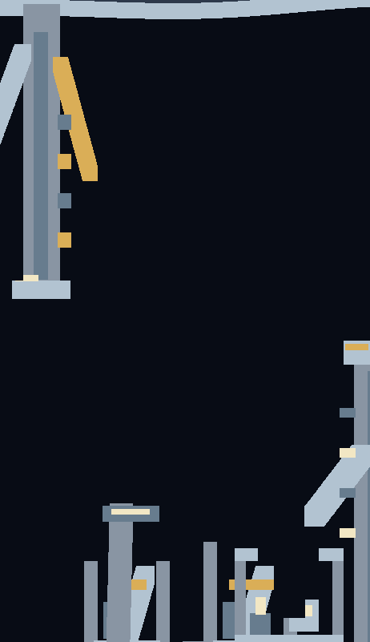
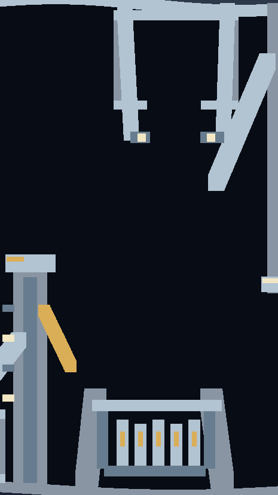
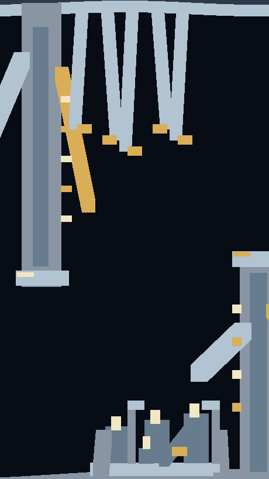
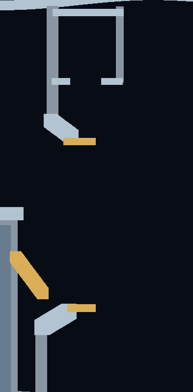
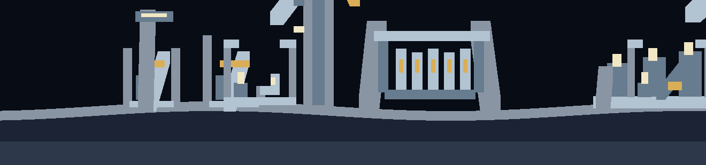

# Rookfall Cascade Locks — original 2048×1024 Midge material-cell world

**R1 · DRAFT / HOLD · NATIVE-UNTESTED**. No source art or old geometry reused. Unique true perpendicular 2D side elevation; each material pixel is an authored physical cell. Fixed-seed generator `node build.cjs`; separately authored complete-grid/material/PNG verifier `node verify-independent.cjs` (not yet run on an installed Node binary in this execution). Accepted read-only CyberSand main `de109d0131641d6adc8d25bb9ced7ca3d4991105`.

## Actual industrial facility and gameplay topology

A giant abandoned **four-stage pressure-lock ore transfer cascade** built into connected basalt roof and concrete foundations. The machine is a *slalom*, deliberately unlike the earlier racing-wide two-horizontal-lane loops: four huge grounded gates alternate ceiling-to-midfield and floor-to-midfield, so upper eastward movement repeatedly trades vertical clearance against a lower westbound return. No dynamic gate timing, actual lap performance or realistic pressure physics is claimed.

District 1 — **West ignition railhead** (x 0–405): roof-fed launch gantries, supported charge rails, an operator ignition room with 65-cell opening and broad launch apron. District 2 — **First cascade and drop gate** (x 405–832): suspended scraper gate with differentiated inert industrial metal, twin founded pressure compressors and their lower recovery galleries. District 3 — **Diaphragm regulator** (x 832–1257): inverted return gate, enterable diaphragm control plenum and lower five-cylinder machinery with a real conservative-hull access notch. District 4 — **Thermal sluice barrage** (x 1257–1630): heavy roof-mounted discharge regulator, separate tiered quench vessels, physically grounded cold service access. District 5 — **East capture and exhaust** (x 1630–2048): separate fourth grounded gate, capture jaws, foundation ejector and signed operator rooms. The mid-height expanses remain clear Midge flight voids, not display halls.

### Named literal route graph (coordinates in committed machine receipt)

West ignition **spawn (126,358)** → Launch gantry (308,355) → First lock descent (554,600) → Pressure bypass (743,584) → Second lock rise (976,404) → Central diaphragm route (1105,473) → Third lock descent (1454,656) → Fourth lock rise (1760,479) → East reversal (1902,567) → East recovery apron (1860,800) → Fourth-lock return bypass (1553,489) → Lower cascade (1460,741) → Regulator return (1070,720) → Second-lock return bypass (974,412) → Foundry underpass (690,753) → West brake (252,750) → **Finish (126,769)**. Operator and service destinations: West ignition (242,226), Diaphragm controls (1090,260), East warning (1822,214), West service (370,846), Rotor maintenance (766,836), Cold sluice (1515,800). All 23 original named sites are actual Midge centres, no coordinate replacements.

The full conservative-footprint 31×27 reachability supports flyable connections *statically*. A hard 124×78 obstruction physically installed at XY (1411,640) removes only the deliberately covered Third-lock descent destination; **22/23 including finish stay reachable**, proving a distinct recovery bypass remains. It does not establish controllability at high speed, actual contact restitution, or no-skip race progression.

## Creator-side reproducible static proof

- Grid: **2,097,152 actual material-ID cells** (2048×1024). Fixed seed `0x261120e9`; grid SHA-256 `be0dbbcd5a453f0890c5ee8f96b446cbeefbad03ff9aadfe7b91cd9058470776`.
- Complete accepted 14-field Setup-v2 saved as `setup-rookfall-cascade-locks.json`, **39918 UTF-8 bytes** (1 MiB max), `423847475b4a985681a19d0470238821cd46f3c0b6a7985898552dcd8903b6d0` SHA-256. All 55 liquid policy signed integers and the accepted Midge actor hash are retained.
- Ordered lossless, nonoverlapping rectangle replay: **2068** rectangles (32,768 accepted source limit); **766930** work cells (32 million work cap). Independent from-saved-file checker is supplied, not claimed executed.
- **766930/766930 boundary-connected stable inert solids**, zero final detached; deterministic cleanup prunes 31857 unsupported authored candidate cells before export. Exactly zero retained powders, water, lava, reactive or nonregistered IDs.
- Exact actor-centre 4-neighbour floods: 1,138,627 centres (19×15), 1,107,460 (23×19), 1,050,768 (31×27); 23/23 literal destinations at each.
- 7 authentic indexed-material PNGs (complete full-grid overview + six genuine 1:1 crops), produced from the same final cell plane by `codec.cjs`. Source generator PNG byte/hash evidence is in `qualification.json`. A separate Node PNG CRC/DEFLATE/full-pixel verifier is supplied but a genuine Node run and independent audit remain pending.
- **Installed bridge**: source advertises 32,768; this map's 2,068 rectangles is below the hypothetical legacy 4,096 fallback. Installed `workbench_start_rectangle_capacity()` has NOT been measured. Actual Godot/Workbench/CyberDemoBridge/Rapier load, flight, collision, simulation advancement and cold-process save/reopen remain **NATIVE-UNTESTED**. Do not call native PASS.

## Authentic material-cell gallery

**1. 01-west-railhead.png** — unscaled source material cells at (0,94), 446×776.

**2. 02-drop-gate.png** — unscaled source material cells at (390,105), 462×801.

**3. 03-mid-compressor.png** — unscaled source material cells at (810,105), 465×827.

**4. 04-sluice-barrage.png** — unscaled source material cells at (1220,105), 460×818.

**5. 05-east-lockworks.png** — unscaled source material cells at (1655,112), 393×799.

**6. 06-foundation-shops.png** — unscaled source material cells at (265,715), 1320×309.

**Review gating:** independent exact-commit Art / Technical / Shepherd review required. Do not Ready, merge, auto-merge or claim owner acceptance.
