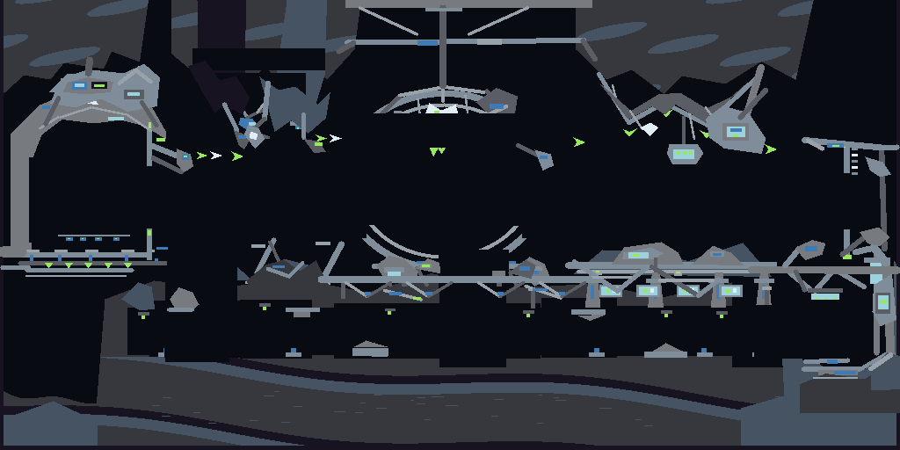

# Thunderclap Switchyard R12 — Original Industrial / Sci-Fi Racing
**OPEN Draft / HOLD · ORIGINAL-NO-REFERENCE · NATIVE-UNTESTED · 19 November 2026.**
Original source-free 2048×1024 material-cell landscape. Authored directly as a two-dimensional orthographic side-elevation game world; no source picture, backdrop or pseudo-3D platforms.

## Architectural thesis, physical scale and flight goals
A giant disused interplanetary magnet-rail switchyard is divided into five working districts: Launch and Dispatch (grounded west cradle), Drift Canyon (roof saws and upper dive), Split-Current Iris (crown-hung switching apparatus), Glassstorm (inhabited service and weigh facility), and eastern Catch/Brake/Recovery (founded two-sided deceleration jaws). Broad air voids divide clustered industrial machinery. One canvas pixel is exactly one simulator material cell, not a screen-space decorative pixel. Accepted Midge authored hull is 4×3, boost nominally 1.8; clearance is deliberately tested with much larger 19×15, 23×19, and 31×27 fully contained envelopes.

**Main launch-to-finish route:** (116,445) → (841,445) → (1037,448) → (1323,454) → (1506,453) → (1826,449) → (1943,446). The full 1,828-centre y445 straight remains wide and unobstructed for a true speed-run option.

**High detour:** Dispatch roof bypass (203,329) → Drift high (617,356) → opposed Iris crown gallery → eastern rejoin.

**Lower technical route:** West dive (443,612) → west undercroft (614,752) → ceiling bank (728,776) → floor bank (854,721) → Iris lower transit (1072,753) → east ceiling bank (1338,772) → east floor bank (1520,742) → tunnel exit (1614,753) → recovery. Banks are real, alternating full-hull obstacles. This separate confined 31×27 course crosses all seven exact checkpoints without using the upper straight. The tightest tested x1338 aperture retains 21 legal centre rows.

**Working inspection detour:** Access and return via the west and east mouths into the actual Weigh Inspection Bay at (1500,670); descent connects to the lower track. The infeed, calibration bridge and release platform are three distinct material-cell structures, not functional race timing triggers. No checkpoint clock is implemented.

## R11 → R12: occupied-cell negative-space and racing hierarchy repair

Responds to the [independent R11 Shepherd's exact-head REWORK finding](https://github.com/techrote/sandmapsreference/pull/17#issuecomment-6999969356) that the middle service band remained visually noisy. A deliberately **subtractive** revision, not yet a fidelity acceptance:

- **Excavate the redundant hanging web beneath the retained y≈635 grounded switch spine:** bounded x774–1286/y652–687. The pre-existing irregular architectural masses, stator housings and supported bridge remain; a longer dark service aperture now distinguishes the upper fast route from lower slalom. Remove newly isolated non-grounded fragments in the bounded x750–1365 maintenance zone rather than leaving floating broken machinery. Keep the 26 independently named structural probes.
- **Silence competing mid-deck glyphs:** rematerialise existing small bright solid detailing in selected Iris service and eastern truss regions as inert industrial metal, without filling free flight space. The four actual S-bank faces and the working weigh bay retain distinctive stronger cues. West entrance and east recovery gain *different*, large existing-solid portal inlays.
- **All geometry and images regenerate deterministically:** R11→R12 = **21,306 genuine cell differences: 0 new occupied, 13,102 excavated and 8,204 rematerialised**. Independent committed-output replay, 31×27 direct 1,828-centre y445 straight, 15/15 exact sites at all hulls, 14/15 physically blocked-Iris bypass, 7/7 confined slalom and grounded support probes remain passing. **Detached inert solids fall 4,213→3,735**. This confirms clearance and structural probes, not real velocity handling.
- **Review caveat:** the remaining machinery districts are intentionally intricate, but the R12 overview and genuine 1:1 crops require new independent artistic/technical/Shepherd decisions. This is not a declaration of subjective racing readability or native acceptance.

## R10 → R11: previous Shepherd flight-line clarity rework
Responds to [independent R10 Shepherd REWORK](https://github.com/techrote/sandmapsreference/pull/17#issuecomment-6999059794), preserving the independently static-qualified route graph.

- **Subtractive visual repair:** eliminate selected disconnected small high-flight clutter over the eastern crossover, remove the obsolete ungrounded western dive-shaft fixture, and recolour competing tiny signal-colour blocks *only where actual material is already present*. This improves race approach visibility without installing new collision flags in empty flight air.
- **Physical supports:** two previously floating 480-cell low-bank equipment assemblies receive continuous, grounded downward steel/iron mounts, starting below the checked racing clearance. Structural probes now include both new moorings.
- **Operational weigh station:** widen the two service mouths, reinforce a single calibrated horizontal balance bridge and contrast infeed, scale and exit as successive founded stages. The site (1500,670) stays an exact legal 31×27 actor centre.
- **Deceleration sequence:** the existing grounded twin rails carry a large two-part capture/release contrast; a small below-jaw release recess is excavated while the actual finish corridor and y445 fast straight remain unobstructed.
- **Collision protection:** all four physical lower S-course bank obstacles are retained. A full real-material 31×27 BFS, independent bounded lower course, actual physical-Iris blockage test and full-grid PNG parity remain mandatory.

The independently measured R10→R11 physical-grid delta is **12,741** material IDs: 61 newly occupied, 2,728 excavated and 9,952 reclassified. Existing decorations not selected by the surgical clearing pass remain; R11 does **not** claim every detail is anchored. Actual racing time, velocity and inertia still require human/native piloting.

## Named exact gameplay sites
No nearest-clear substitution, radius tolerance or moved target coordinates.
| Destination | Exact centre |
|---|---|
| Launch cradle | (116, 445) |
| Dispatch roof bypass | (203, 329) |
| Split-canyon high | (617, 356) |
| West dive shaft | (443, 612) |
| West undercroft | (614, 752) |
| Iris west approach | (841, 445) |
| Iris central chamber | (1037, 448) |
| Iris lower transfer | (1072, 753) |
| East conductor | (1323, 454) |
| Glassstorm viaduct | (1506, 453) |
| Weigh inspection bay | (1500, 670) |
| Eastern underpass | (1571, 756) |
| Catch cliff | (1826, 449) |
| Brake finish | (1943, 446) |
| Recovery basin | (1883, 767) |

## Accepted engine/source contract
Read-only authority: [CyberSand accepted main @ de109d0131641d6adc8d25bb9ced7ca3d4991105](https://github.com/techrote/cybersand/commit/de109d0131641d6adc8d25bb9ced7ca3d4991105). Workbench ordinary Setup-v2 JSON; 512–2048 axes aligned to 64; 32,768 maximum source edit rectangles, 1 MiB UTF-8 setup and 32,000,000 maximum cell-visits in this extent. Native *source* bridge supports 32,768 rectangles; installed binaries can expose an older 4,096 limit and must be queried independently. Generated-start manifest rules are separate and are not falsely applied to this ordinary Setup-v2 payload.

All occupied materials are numeric IDs **49, 58, 62, 100, 101, 113, 117, 120, 122, 123, 128**: accepted immovable inert Solid with RuleKernel::None. There is no unstable powder foundation, mobile fluid or active chemical experiment to contain.

| Static qualification | Current regenerated R12 result |
|---|---:|
| Exact material grid | 2048×1024 = 2,097,152 cells |
| Ordered, nonoverlapping rectangles | 13035 / 32,768 |
| Ordinary Setup-v2 JSON bytes | 245989 / 1,048,576 |
| Material-cell replay mismatch and overlaps | 0 / 0 |
| Conservative 19×15, 23×19 and 31×27 named sites | 15/15, 15/15, 15/15 |
| Physical blocked-Iris alternate | 14/15, finish reached |
| Bounded lower-only 31×27 route | 7/7 |
| Named grounded structural probes | 26/26 |
| Remaining detached inert-solid cells (not all guaranteed decoration) | 3735 |
| Material-PNGs generated and internally exact-pixel checked | 14/14 |
| Installed native Workbench/CyberDemoBridge/Rapier input/collision/ticks/save/reopen | **NATIVE-UNTESTED** |

The machine-readable [qualification receipt](qualification.json) records **full SHA-256** for committed Setup-v2 JSON, entire row-major cell plane, material histogram, full material-PNG set, blocked-Iris reach, exact full-envelope centres, grounded probes, and actual generated-image parity. It is produced by the deterministic builder rather than copied from older revisions. R12 hashes and delta are independently checked by the Node 22 exact-source workflow and committed evidence; authoritative committed setup/grid hashes are in that receipt.

## Reproduction and real-cell evidence
Execute **Node 22** from this folder: `node build.cjs --verify` regenerates the committed bytes and checks exact JSON / all 14 image artifacts; `node verify-independent.cjs` separately replays all edits, checks 15 exact named destinations at three footprints, blocked-Iris and lower-only challenges, hashes, PNG signature/chunk CRC/zlib/IEND and every PNG material pixel independently of the builder. The GitHub Actions lane workflow runs the builder and independent verifier and publishes any changed outputs **on this same Draft branch**. A passing workflow for a previous SHA must never be cited as an R12 pass.

| Genuine material-cell evidence | Image extent | Grid sampling |
|---|---:|---|
| [overview.png](overview.png) | 2048×1024 | 1:1 cell sampling |
| [overview-review-2x.png](overview-review-2x.png) | 1024×512 | 2:1 cell sampling |
| [01-launch-cradle.png](01-launch-cradle.png) | 512×384 | 1:1 cell sampling |
| [02-drift-canyon.png](02-drift-canyon.png) | 512×384 | 1:1 cell sampling |
| [03-split-current-iris.png](03-split-current-iris.png) | 512×384 | 1:1 cell sampling |
| [04-glassstorm-viaduct.png](04-glassstorm-viaduct.png) | 512×384 | 1:1 cell sampling |
| [05-catch-recovery.png](05-catch-recovery.png) | 512×384 | 1:1 cell sampling |
| [06-lower-s-turn-west.png](06-lower-s-turn-west.png) | 512×384 | 1:1 cell sampling |
| [07-lower-s-turn-east.png](07-lower-s-turn-east.png) | 512×384 | 1:1 cell sampling |
| [08-iris-service-braces.png](08-iris-service-braces.png) | 512×384 | 1:1 cell sampling |
| [09-west-dive-portal.png](09-west-dive-portal.png) | 512×384 | 1:1 cell sampling |
| [10-east-return-portal.png](10-east-return-portal.png) | 512×384 | 1:1 cell sampling |
| [11-weigh-inspection-bay.png](11-weigh-inspection-bay.png) | 512×384 | 1:1 cell sampling |
| [12-finish-catch-jaws.png](12-finish-catch-jaws.png) | 512×384 | 1:1 cell sampling |

**Limitations / owner test:** NATIVE-UNTESTED. No source-matched installed executable was available here: not measured installed rectangle capacity, no Workbench import or new-process save/reopen, no actor thrust/boost/collision or real-time physics. Static route legality does not establish a comfortable competitive high-speed lap. At full normal play zoom, independent Art/Fidelity and Shepherd must still evaluate image hierarchy, weigh-scale stages and recovery sequence. Do not merge, mark Ready, enable auto-merge or claim owner acceptance.
