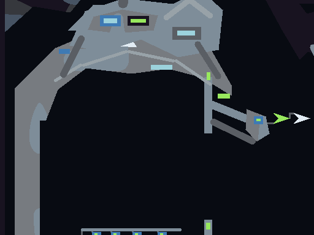
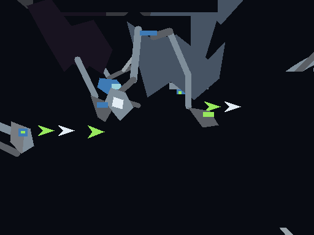
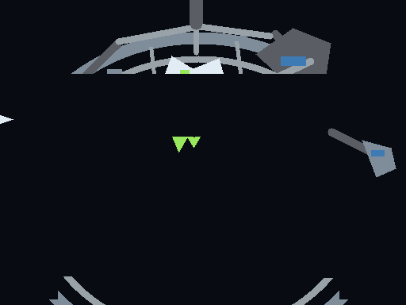
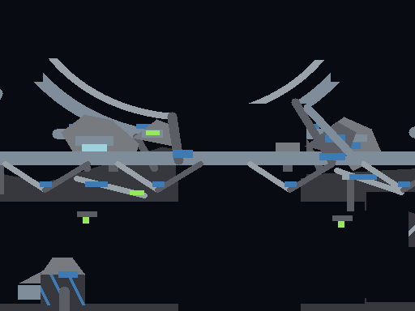
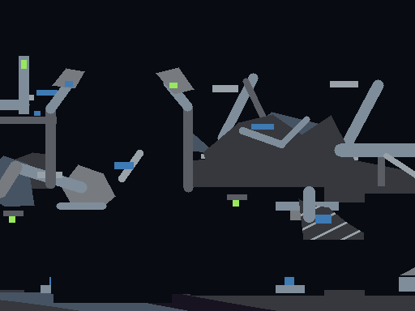
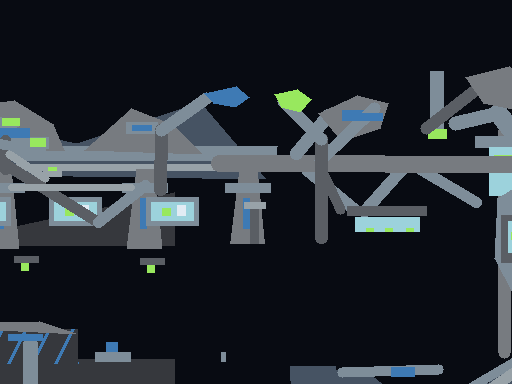

# Thunderclap Switchyard R8 — ORIGINAL CyberSand high-speed landscape

**OPEN Draft/HOLD; 2048×1024 actual material cells; ORIGINAL-NO-REFERENCE; NATIVE-UNTESTED.** No repository/source photograph or generative illustration was used. Creator lane `original/racing-wide/thunderclap-switchyard-261118` is the sole writer. Do not merge, auto-merge, mark Ready or claim owner acceptance.

**Engine authority (read-only):** `techrote/cybersand main@018bd09503d7f079ddac52e225c2f7daf8d678bf`. Rechecked 19 November 2026. Setup-v2; 512–2048 axis bounds and 64-cell alignment; 32,768 rectangle edits, 1 MiB serialized JSON; installed native CyberDemoBridge rectangle capability is **not verified**.

## Artistic thesis and Midge-scale course
A fractured magnet-rail/switchyard carrying a future-industrial race through five unequal districts: western **alignment/dispatch launch**, **roof-saw Drift Canyon**, an asymmetric **split-current Iris**, **Glassstorm weighing/transfer works** and a double-jawed eastern **brake/recovery** basin. These are physical solids with 2D side-elevation silhouettes, not background scenery. One cell is one native terrain coordinate, and Midge's authored collision hull is 4×3; all stated conservative route proofs enlarge to 19×15, 23×19 and 31×27. Inert material IDs: 49,58,62,100,101,113,117,120,122,123,128; all accepted immovable Solid/RuleKernel::None in the read-only native material table. There are **no liquids, powder, growing, thermal or reactive hazards** in this candidate.

The direct high-speed accelerator follows `(116,445)→(841,445)→(1037,448)→(1323,454)→(1506,453)→(1826,449)→(1943,446)`. A nonforced upper technical line uses Dispatch roof `(203,329)`, canyon `(617,356)`, Iris over-crown `(1033,297)` and eastern upper rejoin `(1194,308)`. The optional **physically undulating low S-course** goes West dive `(443,612)` → tunnel entry `(614,752)` → roof bank `(728,776)` → floor bank `(854,721)` → Iris lower transfer `(1072,753)` → second roof `(1338,772)` → second floor `(1520,742)` → east tunnel exit `(1614,753)` → eastern rejoin `(1760,573)` → recovery `(1883,767)`. All routes are traversable full-cell airspace; none is asserted faster without native Midge lap timing.

## R8 response to independent exact-R7 Fidelity REWORK
- Two formerly detached launch guide rails are now cardinal-connected into the western world-rock wall, clarifying their real alignment role.
- Three large lower Iris arcs now have asymmetric **real-material load cables** into the existing rooted service spine instead of reading as stranded deck remnants. The central spine remains deliberately impassable for a direct dive.
- West descent has two deliberately **separated** horned portal uprights, not a ceiling across the actual shaft; east ascent has a distinct splayed return portal. Both remain fully actor-accessible.
- Four alternating roof/floor banks now have unique slanted inlaid material-facing markings. All inlays rematerialize existing rock only, so they add **no new collision cells**.
- Glassstorm gains a nonrepeating calibration/transfer balance assembly; the far east grounded brake gains razor-like deceleration fins and recovery-floor markings. The main y445 racing corridor remains clear.
- R7→R8 **19,611 actual cells changed**, 11,261 added, 8,350 rematerialized, 0 removed. Detached material cells reduced from 11,399 to **6,905**; residual inert detail is not falsely described as all small or grounded.

## Deterministic static qualification and reproduction
Run `node build.cjs` from this folder (Node 22+, no external packages) to regenerate the complete Setup-v2 JSON and all twelve material-cell PNGs; `node build.cjs --verify` checks byte-exact committed outputs. The builder was independently executed in an isolated JavaScript V8 host for this commit, but **no standalone Node CLI or native runtime was executed here**. The source builder includes exact plane replay, overlap rejection, rectangle/byte constraints, cardinal support probes, full-hull exact-site BFS and full PNG signature/CRC/stored-zlib/Adler/IEND/pixel equivalence checks.

- Exact cells **2,097,152**; **12,298/32,768** nonoverlapping ordered rectangles; **232,140/1,048,576** JSON bytes; zero replay overlap/mismatch; 17/17 grounded support probes.
- Exact unchanged functional sites **14/14** at each 19×15, 23×19 and 31×27 hull. A real-solid-blocked central Iris retains **13/14** destinations including finish. Independent lower-only corridor `x580..1650,y700..802` reaches **7/7** exact points with full 31×27 hull, never borrowing the high-speed direct lane. Narrowest audited x1338 window remains **21 legal centre rows**.
- Final material-plane SHA-256 `008fb3fd4526294c0c1dff5b0447423173e22589a5b1edb539a44089eac293b7`, Setup-v2 SHA-256 `1b799a2631fbdc5bd691fa21a0c38af7fd032d630f0409de12b4fa4a38aa4d77`; full histogram, separate per-file PNG SHA-256 hashes, exact route graph and clearance windows in `qualification.json`. Twelve indexed PNGs self-decoded with full material-pixel parity including the exact 2048×1024 overview. Review-scale overview is a separate 1:2 sampled image and is **not** full-grid evidence.
- Native load/install, installed bridge capability, steering/collision, simulation/Rapier ticks and fresh-process save/reopen: **NATIVE-UNTESTED**. The 4,096-rectangle legacy native fallback would reject this file, notwithstanding source-side admission. Native lap timing, reaction testing and real interactive race-readability remain unverified.

## Genuine material-cell gallery

| Launch | Canyon | Iris | Glassstorm | Brake/recovery |
|:--:|:--:|:--:|:--:|:--:|
|  |  |  |  |  |

| Lower west S-course true 1:1 | Lower east S-course true 1:1 |
|:--:|:--:|
|  |  |

### R8 inspection close-ups (native material cells, 1:1)

| Rooted Iris brace/cable assemblies | Open western descent portal | Eastern ascent/return portal |
|:--:|:--:|:--:|
|  |  |  |

Each close-up is generated from the **same committed material grid**, not a separate paint-over or illustrative reference.

Independent Shepherd, Technical and Fidelity reviewers must evaluate **this new HEAD**. Keep Draft/HOLD.
