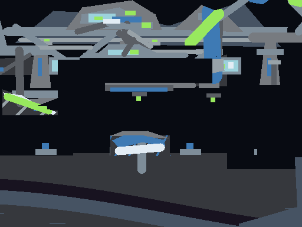
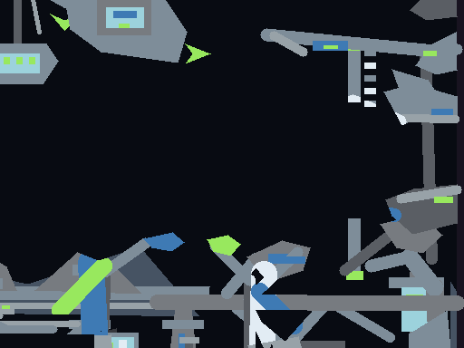

# Thunderclap Switchyard R9 — Original sci-fi industrial Midge racing landscape

**OPEN Draft/HOLD. ORIGINAL-NO-REFERENCE. Native Workbench/Rapier NOT TESTED.** Owner lane: `original/racing-wide/thunderclap-switchyard-261118`. This is an independently authored exact **2048×1024** material-cell level, not a converted image, copied source map, AI drawing, or screenshot.

## Course thesis and actual play scale

A decomposing interplanetary **magnet-rail switchyard** became a three-altitude, five-district Midge time-trial complex. A broad high-speed accelerator crosses an open central flight void; a separate optional over-crown technical line and a physically alternating lower S-course demand different piloting choices. All architecture is orthographic side elevation with actual material-cell collision. One world cell is one native terrain coordinate; the real Midge hull is 4×3 and the static margin tests use 19×15, 23×19, and 31×27.

The five purposefully differentiated districts are western **Launch/Dispatch**, fractured **Drift Canyon**, the suspended opposed-stator **Split-Current Iris**, inhabited **Glassstorm weigh/inspection works**, and the **East brake/catch/recovery** complex. The original visual syntax uses inert basalts, concrete/steel frames, zinc bracing and conspicuous blue, quartz and signal-colour industrial faces. There are no simulated fluids, chemical reactions, timed gates, or claimed functioning speed boosts.

### Functional race route graph

- Main accelerator: Launch (116,445) → Iris west (841,445) → Iris chamber (1037,448) → East conductor (1323,454) → Glassstorm (1506,453) → Catch cliff (1826,449) → Finish (1943,446). Retains broad unblocked y≈445 centre flight.
- Upper technical alternative: Dispatch roof (203,329) → Drift high (617,356) → Iris high (844,307) → over-crown (1033,297) → upper rejoin (1194,308) → main.
- Physically forced lower S-course: West dive (443,612) → lower entrance (614,752) → roof bank (728,776) → floor bank (854,721) → Iris under-transfer (1072,753) → roof bank (1338,772) → floor bank (1520,742) → east exit (1614,753) → east rise (1760,573) → recovery basin (1883,767).
- New enterable inspection branch: hollow Glassstorm station **(1500,670)** with a full-hull-accessible opening at x≈1400–1457/y678–759 to the low route. The upper deck remains rooted; this is a static inspection destination, not a fabricated working timing checkpoint.

**Exact named work/play sites (all full-hull reachable from the unchanged spawn):**

| Name | Exact centre |
|---|---|
| Launch cradle | (116,445) |
| Dispatch roof bypass | (203,329) |
| Split-canyon high | (617,356) |
| West dive shaft | (443,612) |
| West undercroft | (614,752) |
| Iris west approach | (841,445) |
| Iris central chamber | (1037,448) |
| Iris lower transfer | (1072,753) |
| East conductor | (1323,454) |
| Glassstorm viaduct | (1506,453) |
| Weigh inspection bay | (1500,670) |
| Eastern underpass | (1571,756) |
| Catch cliff | (1826,449) |
| Brake finish | (1943,446) |
| Recovery basin | (1883,767) |

## R8 → R9 substantive review repair (19 Nov 2026)

- West descent and east ascent gain opposite, major-contrast **grounded throat/edge wayfinding** rather than tiny signs above the actual air corridor. Those colour masks only rematerialise already occupied cells, preserving clearance.
- The Iris now carries two large opposed collector/stator housings and a real supported bus/cable connection for the residual lower-right assembly, without a beam across the main racing void.
- Four lower slalom banks receive distinct large-area silhouettes and advance markings cut **only into the existing stable solids**, not invisible or collision-altering wallpaper. The critical x1338 31×27 window remains **21 legal centre rows**.
- The Glassstorm service mass now contains a **real navigable inspection bay with an accessible downshaft**; the far-right brake has two boundary-anchored solid jaws aligned around the actual y≈446 finishing corridor rather than remote roof ornaments.
- Compared to R8, **48951** changed actual material identities (13353 added, 9590 excavated, 26008 rematerialised). No external art source was used. Remaining 6093 detached occupied cells are not all claimed grounded; every new named structural support probe is cardinal-boundary-connected.

## Authority, serialization, determinism and confidence

CyberSand source authority (read-only) is [`main@de109d0131641d6adc8d25bb9ced7ca3d4991105`](https://github.com/techrote/cybersand/commit/de109d0131641d6adc8d25bb9ced7ca3d4991105). The installed native bridge was **not** queried. This source accepts Setup-v2, axes 512–2048 aligned to 64, a source budget of 32,768 rectangles, 1 MiB JSON and 32 million paint work visits. A legacy installed native bridge with the 4,096-rectangle fallback would reject this payload.

- Actual grid: **2048×1024 = 2,097,152 cells**. Lossless rectangles: **13187/32768**. JSON: **249170/1048576 bytes**. Painted visits: **953959/32000000**. Overlaps / full-grid replay mismatches: **0 / 0**.
- Grid SHA-256: `f66cb0388ff4e6d869996de4656043a9ec479db08524c5726891726ad3bc0155`. Setup JSON SHA-256: `31d30314c323d5a41c3b9da661e3554943e511b48cffbfb58459059deb03079f`. Histogram and every 1:1 PNG hash are in `qualification.json`.
- All 11 non-empty numeric material IDs **49,58,62,100,101,113,117,120,122,123,128** are current accepted *immovable Solid / RuleKernel::None*. No granular Stone, spreading material, liquid, or reactive foundation.
- Actor: one current Midge, definition SHA-256 `c226d73ae56a426820d2ef842a4856bf79ac23efabe64e66569dff8de62a7a96`, authored collision rectangle 4×3, spawn **(116,445)**, boost multiplier **1.8**. Flight paths are static free-space proofs, not native race-speed/timing claims.
- Conservative exact full-hull 4-neighbour BFS: **15/15 functional sites** at all **19×15**, **23×19**, **31×27**, without nearest-cell substitution. Physically solid-blocked central Iris: **14/15** remain accessible, including finish and weigh bay. Bounded lower-only 31×27 course: **7/7 exact points**, with x1338 **21 legal centre rows**. **22/22** structural probes grounded; detached material cells **6093**.
- The deterministic fixed-seed Node 22+ no-dependency builder is `build.cjs`. Run `node build.cjs` in this directory to regenerate Setup JSON and all real indexed PNGs; use `node build.cjs --verify` for byte-exact JSON/PNG checking. Its V8 evaluation passed material replay, connectivity, support and image chunk/CRC/Adler/full-pixel parity. A separate Node process was **not executed** on this run.
- **NATIVE-UNTESTED:** no installed Godot/CyberDemoBridge/Rapier binary/version verification; no real Workbench import, actor steering, collision, ticks, timing, or save/fresh-process reopen. Independent Fidelity, Technical and Shepherd exact-HEAD review is required; no owner approval implied.

## Actual material-plane evidence

**PNG provenance and checksum summary** (all indexed colour images derived from the same committed plane, builder-validated PNG signature/chunks/CRC/Adler/IEND and material-index pixel parity):

| PNG | Pixels | Scale | SHA-256 prefix |
|---|---|---|---|
| `overview.png` | 2048×1024 | 1:1 | `9fd206011f27fbfd…` |
| `overview-review-2x.png` | 1024×512 | 1:2 | `585cd9666fddc8e2…` |
| `01-launch-cradle.png` | 512×384 | 1:1 | `45b862009d682f35…` |
| `02-drift-canyon.png` | 512×384 | 1:1 | `a84e4a47155793d9…` |
| `03-split-current-iris.png` | 512×384 | 1:1 | `dea9af985175c123…` |
| `04-glassstorm-viaduct.png` | 512×384 | 1:1 | `a1148192c76b619b…` |
| `05-catch-recovery.png` | 512×384 | 1:1 | `242e08c7628de659…` |
| `06-lower-s-turn-west.png` | 512×384 | 1:1 | `47f23ef79a43b425…` |
| `07-lower-s-turn-east.png` | 512×384 | 1:1 | `01e5eb3c8ccbf66a…` |
| `08-iris-service-braces.png` | 512×384 | 1:1 | `f04e4aeac7d650be…` |
| `09-west-dive-portal.png` | 512×384 | 1:1 | `6e5b0e6430442ffb…` |
| `10-east-return-portal.png` | 512×384 | 1:1 | `db458aad637043f3…` |
| `11-weigh-inspection-bay.png` | 512×384 | 1:1 | `31829a5580659a14…` |
| `12-finish-catch-jaws.png` | 512×384 | 1:1 | `071438b3ce7a523b…` |

### New R9 diagnostic views

The other ten true-cell district/portal/slalom crops remain separately committed; no AI illustration or sourced scenery is used. Maintain this PR as **Draft/HOLD**, never Ready or merge.
