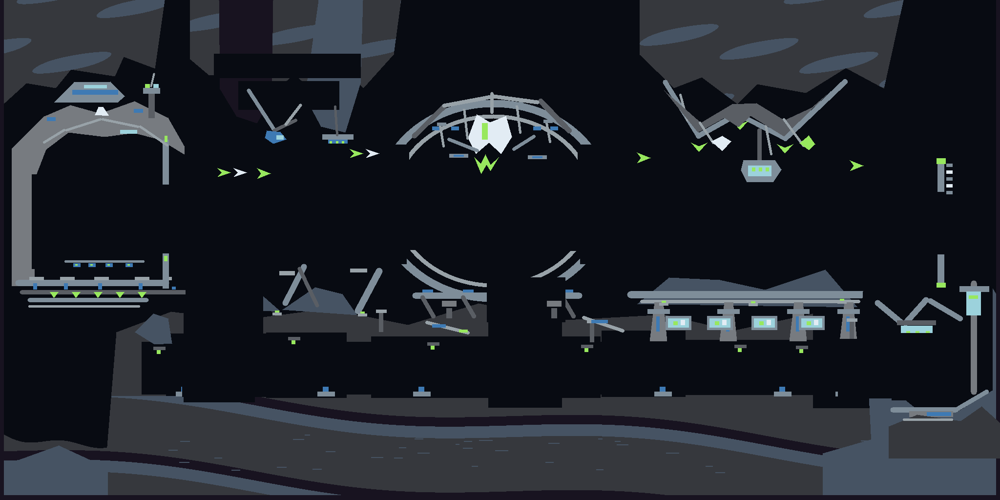

# Thunderclap Switchyard — ORIGINAL racing-wide CyberSand canvas

> **Draft / HOLD. Original design, not copied from or inspired by repository artwork. NATIVE-UNTESTED; not owner accepted.**

## Design thesis

A lightning-conductor railway has been broken open by tectonic shear. The abandoned switching instrument survives across the central racing gap while a rock-cut service return runs below it. The Midge can time-trial the broad, fast near-level main traverse, detour through the exposed overhead crown, or dive into a more demanding lower through-tunnel and recover into the eastern braking claw. **The empty flight corridors are intentional acceleration/recovery space**, unlike the densely detailed rooted machinery.

True 2D orthographic side-elevation, exactly **2048×1024**. All visible materials are physical CyberSand cells, with a crisp material-ID colour palette; this is not a native-rendered screenshot. Designed without viewing or selecting any reference image.

## Five differentiated districts and their functions

1. **Launch Cradle (west, x24–390):** rooted fractured launch roof, console sill, visual start lights, 300+ cells of spacious runway and upper dispatch bypass.
2. **Drift Canyon (x390–790):** pale sheared roof, lower false-stone shelf, supported rail-saw, high air lane, broad west undercroft dive.
3. **Split-Current Iris (x785–1265):** asymmetrical interrupted ring / lightning accumulator, two open side apertures, high crown/straight-through main line, central 151-wide dive and switch-table over tunnel.
4. **Glassstorm Viaduct (x1290–1770):** exposed conductor suspension, grounded truss deck, safeguarded static specimen panes, lower return gallery and wide upper shortcut.
5. **Braking Claw (x1770–2048):** off-centre finish arch, grounded catch-recovery bowl, optical tower, 31×27 accessible lower re-entry to the main route.

## Exact authored sites and route graph

| Functional site | Exact Midge centre (x,y) |
|---|---|
| Launch cradle | (116,445) |
| Dispatch roof bypass | (203,329) |
| Split-canyon high | (617,356) |
| West dive shaft | (443,612) |
| West undercroft | (614,752) |
| Iris west approach | (841,445) |
| Iris central chamber | (1037,448) |
| Iris lower transfer | (1072,753) |
| East conductor | (1323,454) |
| Glassstorm viaduct | (1506,453) |
| Eastern underpass | (1571,756) |
| Catch cliff | (1826,449) |
| Brake finish | (1943,446) |
| Recovery basin | (1883,767) |

**Main straight and chicane markers:** Launch cradle → Dispatch roof bypass or Split-canyon high → Iris west approach → Iris central chamber → East conductor → Glassstorm viaduct → Catch cliff → Brake finish.

**Lower return:** Launch cradle → West dive shaft → West undercroft → Iris lower transfer → Eastern underpass → Recovery basin → Brake finish. The lower passage stays connected even with the central main flight corridor x900–1110, y330–554 excluded from actor-centre traversal; only the deliberately blocked *Iris central chamber* site fails the alternate-route stress test. This test deliberately obstructs a corridor virtually; it does not modify the committed world.

**High choice:** A deliberately open high route above Drift Canyon and over the top of the iris; it can rejoin either of the large main line sightlines without a 1-cell squeeze. The visual start/finish lamps, mile markers and chevrons are **not functioning chronometer/checkpoint triggers**.

## CyberSand exact-source admission

Authority: **techrote/cybersand accepted `main` at `018bd09503d7f079ddac52e225c2f7daf8d678bf`**, read-only. Read `godot/scripts/workbench_setup.gd` Setup-v2, `godot/scripts/gcr_flyer_authoring.gd` / `godot/authoring/flyers/midge.json`, and current material catalogue Git blob `d7a47d60721598a16589daf177a6ff4401b84b43`.

Midge authored hull 4×3; 1.8× boost. All used nonempty material IDs are validated **state=Solid, movable=false, kernel=0, rule available**. Palette: Slate 49, Basalt 100, Obsidian 101, Reinforced Concrete 58, Steel Plate 62, Bare Iron 117, Zinc 113, Polymer Panel 128, Glass Block 120, Quartz 122, Uranium Glass 123. Structural crystals/signals are inert decorative cells, not lethal hazards. Water, acid, growing bio-matter, live reactions and unbounded effects are **not included**; exhibits are deliberately inert. Native installed bridge required for extended non-palette material IDs (49/62).

The current source allows **32,768 starting rectangles**, **32,768 edits** and **1 MiB Setup-v2 JSON**, each dimension 512–2048 in multiples of 64. The installed bridge's `workbench_start_rectangle_capacity` was **not** read back. A legacy/no bridge 4096-rectangle fallback would refuse this 7243-rectangle canvas. No assertion of installed capacity or successful native load is made.

## Qualification and reproduction

| Static gate | Exact final result |
|---|---|
| Extent / cell count | **2048×1024 / 2,097,152** |
| Non-overlapping, vertically merged boxes | **7243 / 32,768** |
| Setup JSON bytes | **137340 / 1,048,576** |
| Full-cell serialized replay | **0 mismatches / 0 overlaps** |
| Exact sites with 19×15 conservative Midge envelope | **14/14** |
| Exact sites with 23×19 envelope | **14/14** |
| Exact sites with 31×27 stress envelope | **14/14** |
| 31×27 blocked-centre alternate route | **13/14 sites**, deliberate blocked Iris chamber only; **finish reached** |
| Six material-index PNGs and decoded pixel parity | **6/6 PASS** |
| Native Godot/GDExtension/Rapier and save–reopen | **NATIVE-UNTESTED** |

**Raw full-cell grid SHA-256:** `5806108c1df385375b00783c938ed526077318bc548c00faff6e85dc3b43920a`  
**UTF-8 setup JSON SHA-256:** `bd84e3a13313911ebd605be627d12bb962030fcad66df6f2b88d9c40c2b838fc`  
**Fixed seed:** `539365656`.

Run `node build.cjs --verify` from this folder to reconstruct the authored grid and check every committed PNG/JSON artifact byte-for-byte, including the built-in exhaustive rectangle replay, three strict actor envelope flood fills, bypass and actual image pixel parity. Run `node build.cjs` to regenerate the output; **no dependencies**.

The [machine qualification receipt](qualification.json) contains per-PNG SHA-256 and region, exact site list, material histogram and static evidence.

## Full-grid material raster and 1:1 district evidence

| Launch Cradle | Drift Canyon |
|---|---|
|  |  |
| Split-Current Iris | Glassstorm Viaduct |
|  |  |
| Catch & recovery | |
|  | |

## Honest art & engineering review

First pass had an inaccessible western shaft destination, an obstructed recovery approach under 31×27 stress, sparse hero-area identity and simplistic oval striation. Those were specifically reworked; static routes and image parity were rerun from final **material cells**, not outdated drawings. The layout favours high-speed open sightlines instead of filling the race line with decoration. Its lower undercroft uses a broad 90–130 cell traverse rather than pinhole winding shafts. The upper route crosses real dead-space rather than unsupported fake perspective.

**Known limitations:** no installed native Godot/Rapier, no physical speed/brake/collision or save-reopen validation; timings and checkpoints are not implemented; image palette is a direct material-ID diagnostic (no lighting/screen-space effects). The independent Shepherd/technical/art auditors must review the final PR HEAD before owner acceptance. Leave Draft / HOLD; do not merge or mark Ready.
