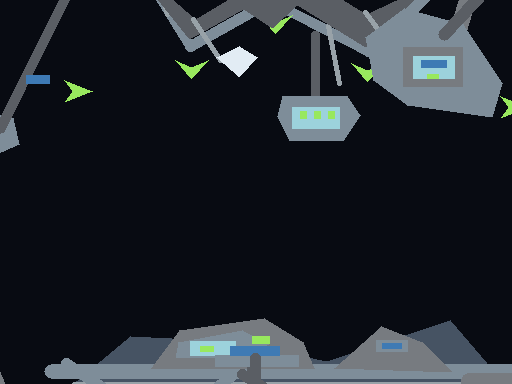
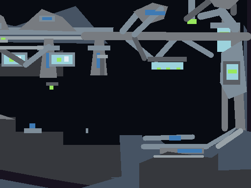
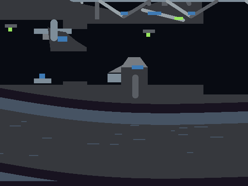
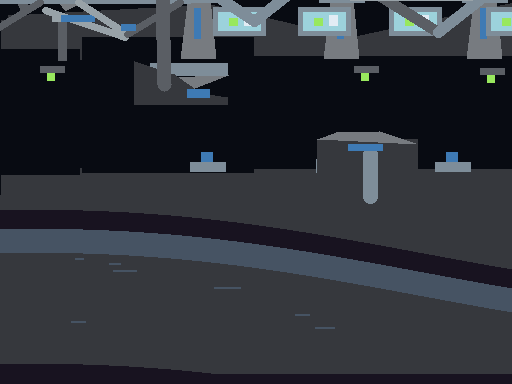

# Thunderclap Switchyard — Original CyberSand racing-wide (R7)

**OPEN Draft/HOLD · 2048×1024 actual terrain cells · ORIGINAL-NO-REFERENCE · NATIVE-UNTESTED.** Original from-scratch industrial/geological racing world. No source artwork was selected, traced, converted or otherwise used. CyberSand accepted-main authority is read-only at `018bd09503d7f079ddac52e225c2f7daf8d678bf`; this branch changes no engine, archived artwork, other creator lanes or source-led PRs.

## Design and R7 response

Five traversable districts: founded Launch Cradle and dispatch, asymmetric roof-saw Drift Canyon, split-current Iris with high suspended crown and lower switching apparatus, grounded Glassstorm viaduct with operating weigh bay, and eastern dual-jaw Brake/Recovery. True orthographic flat gameplay terrain; no perspective tricks. The broad central y≈445 straight is a safe high-speed default and remains clear for a full 31×27 conservative hull. Upper route uses founded canyon saw shoulder and Iris gallery. Lower technical/recovery route deliberately changes altitude around **four physically rooted roof/floor banks**, with wide lead-ins, no pinhole and a visible west entry and east rejoin. It is not claimed to be faster than the straight.

R6 independent technical review identified four large unsupported additions and a merely decorative low slalom. R7 physically attaches the western fork, east Iris cue and both active slalom floor banks/roof datum to existing boundary-grounded solids, adds a distinct controlled Glassstorm load apron, and proves an **actual lower-corridor-only 31×27 Midge-centre route**. The formerly repaired four very large R4 ungrounded facilities stay connected. Six original plus six new structural probes now pass. R7 leaves **11,399** material cells still disconnected from world boundaries, predominantly nonclaimed small signs/props; this is not an assertion that all minor fragments are architecturally supported.

## Explicit operational route graph and positions

**Main:** Launch (116,445) → Iris west (841,445) → Iris chamber (1037,448) → East conductor (1323,454) → Glassstorm (1506,453) → Catch (1826,449) → Brake finish (1943,446). This x≈116–1943/y445 direct centreline is fully 31×27 clear, intentionally.

**High technical:** Dispatch roof (203,329) → Canyon high (617,356) → Iris west gallery (844,307) → Over-crown (1033,297) → eastern upper rejoin (1194,308) → east conductor. The saw deflector is physical, rooted, and has an outside passing shoulder. Timing advantage **not measured**.

**Low technical/recovery:** West dive (443,612) → West undercroft (614,752) → founded ceiling bank (728,776) → floor bank (854,721) → Iris low (1072,753) → east ceiling bank (1338,772) → east floor bank (1520,742) → eastern tunnel (1614,753) → eastern ascent/underpass (1571,756)/(1760,573) → recovery basin (1883,767). Strict lower-route proof restricts all Midge centres to x580–1650/y700–802: **7/7 exact targets reachable**, with complete 31×27 envelope, from unchanged undercroft centre. Exact path-distance upper bounds from entry (614,752) along lower-only open air: West tunnel entry 0; West ceiling bank 138; West floor bank 285; Iris lower transit 489; East ceiling bank 774; East floor bank 958; East tunnel exit 1041. Six measured cross-section windows in receipt; narrowest audited cross section has 21 legal centre rows at x1338, not a pinhole.

**Blocked-main resilience:** place real solid at x900–1110/y330–554, erode the full 31×27 hull; **13/14** original named sites including finish and recovery remain connected. Iris chamber is intentionally blocked. The direct centre Iris downshaft is not traversable because of an actual solid service spine; the low route uses the west/east entries.

## Static qualification and genuine image evidence

- Actual dimensions **2048×1024 = 2,097,152 cells**; deterministic fixed seed `0x20261118`.
- **11,063** nonoverlapping five-int ordered edits / 32,768 permitted; **208,909** UTF-8 setup bytes / 1,048,576. Material edit visits **938,935** / 32,000,000. **Zero** material replay mismatches/overlaps, no erasure stamps. R7 changes **22,245** real cells from R6 (11,895 added, 0 erased, 10,350 reclassified).
- Full source grid SHA-256 `bfac4832a8726aed8aa88cf803a174384ed301d3ba4a882084920321be94cfc3`; setup JSON SHA-256 `19d73909e394a7fa0ef7f83a4a580a876d25e8f6294c95f97a8102186db1c6b6`. Histogram and complete checksums are in `qualification.json`.
- Only accepted, inert, immovable native Solids: numeric IDs 49,58,62,100,101,113,117,120,122,123,128. No active liquid, growth, powder, reactive kernel or illustrative fake geometry. Current Midge authoring is **4×3**, spawn **(116,445)**, 1.8 boost. Full operational site reachability **14/14 at 19×15, 23×19, 31×27** with exact centres and no tolerance/proxies.
- Nine actual grid-rendered indexed PNGs: complete `overview.png` 2048×1024 every native cell, retrievable `overview-review-2x.png` 1024×512 sampled composition copy, five original 512×384 true 1:1 districts, plus **two new 512×384 true 1:1 lower S-turn sheets**. All nine images independently parsed inside the builder for signature, chunk CRC, stored-zlib/Adler, IEND and checked against each intended actual material index pixel. The overview-review copy does NOT replace full-cell evidence.
- Builder: `node build.cjs` regenerates all JSON/PNG artifacts locally; `node build.cjs --verify` checks byte-exact committed regeneration. A standalone installed Node command-line run is **NOT claimed** here; builder was executed in isolated V8.

## Honest native gate

**NATIVE-UNTESTED:** no installed matching Godot/CyberDemoBridge/Rapier source-matched binary has been used for real Workbench import, Midge steering/collision at speed, tick progression or independent save/reopen. Accepted source bridge advertises 32,768 rectangles; old installed fallback 4,096 would reject this **11063**-rectangle setup. Check installed capacity before native acceptance. Time-trial markers are inert, not timer triggers. Independent current-HEAD Shepherd/Technical/Fidelity review and owner playtest remain required. Keep Draft/HOLD; no Ready, merge or auto-merge.

| Launch | Drift | Iris | Glassstorm | Recovery |
|---|---|---|---|---|
|  |  |  |  |  |

| Actual lower western S-turn | Actual lower eastern S-turn |
|---|---|
|  |  |
