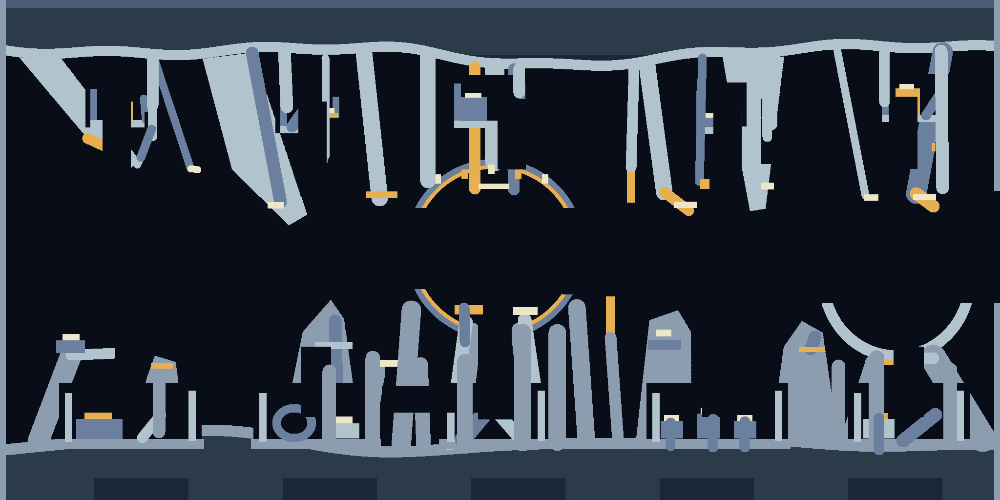
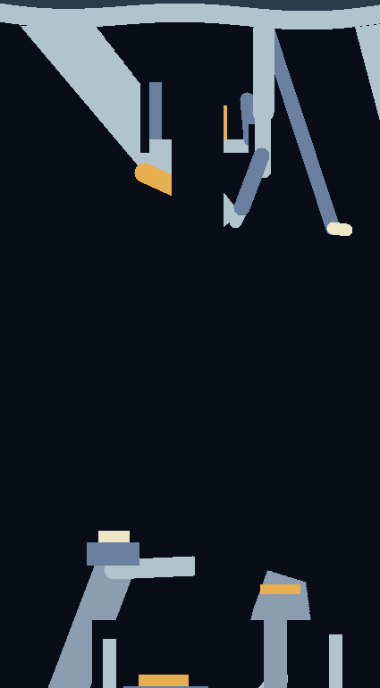
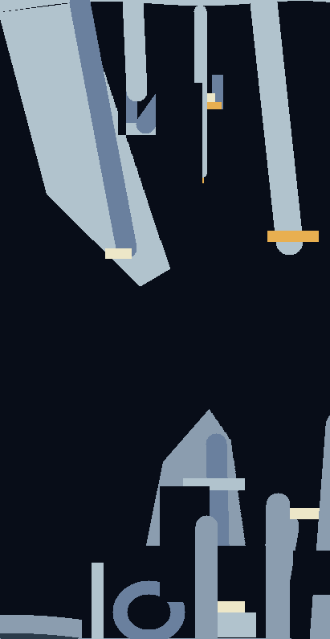
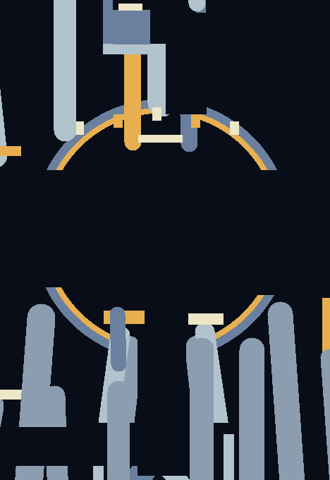
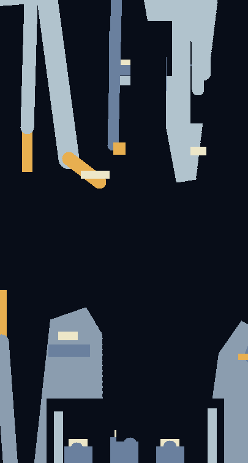
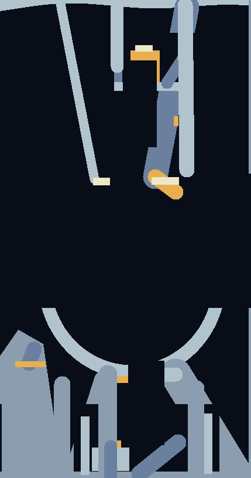
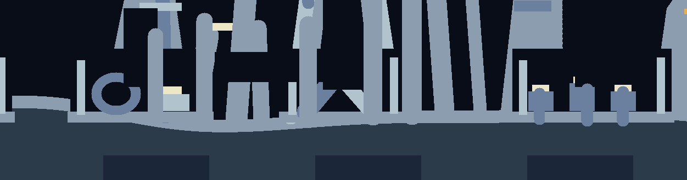

# Umbral Induction Dock — ORIGINAL Racing Wide 2048×1024

**Revision:** R1 (20 November 2026). **Status:** DRAFT / HOLD — SOURCE-STATIC-PASS, NATIVE-UNTESTED. **Authorship:** distinct from earlier racing-wide original maps; all rendered geometry comes from final material-ID cells, with no source image or generative picture substitution.

## Location, route and design

An excavated polar transshipment terminal uses an immense **interrupted induction annulus** to accelerate and redirect freight, connected to an asymmetric coil injector, inclining cargo-hoist plant, remote cryogenic handling banks and a broad eastern arrestor cradle. Real-world industrial mechanical references are interpreted only as new authored shapes. Perpendicular 2D side-elevation only: no perspectival horizontal top faces. Overhead chamber balconies and distinctly furnished foundation workshops are reachable flight destinations, not painted stage scenery.

- **West impulse lock:** spawn `(150,640)`, west coil lock, charge capacitor with broad door, operational injector bridge, protected end-of-lap west landing.
- **Rail and inclined freight hoists:** unequal opposing hoists, load-bearing inclined work, accessible drive pulpit and foundation gearbox; purposeful negative-space flight corridor.
- **Annular induction interchange:** monumental split-open metal ring supported to roof and floor, enterable central portal and real upper/lower exits, equipment readout and opposed bypass gate; large central negative void is flyable.
- **Cryopump coupling plant:** different valve/drive modules, outfitted operator and maintenance spaces, low bypass for obstructed gate recovery.
- **East brake and arrestor:** catcher with paired turn-back jaws, lift, westbound high return, occupied service vault with winch.

**Primary flight course:** Start / west coil lock → Impulse threshold → Freight incline → West annulus approach → Annulus main portal → Annulus core → Upper annulus exit → East coupling service → Finned filter clearway → East loading catcher → East ascent → East high return → Northbound bypass → Central return throat → Upper western return → West descent → Finish / coil lock.

**Alternate:** From annulus core, branch through the distinct *Lower annulus exit* before rejoining east coupling service. The committed independent verifier physically fills `XYWH [1146,409,75,109]` as a real solid obstruction: this covers literal `Upper annulus exit`, but 27 other named sites including Finish remain reachable at the full 31×27 clearance. It does not shift targets or excuse any radius. Recovery after a wrong approach is by returning to annulus core or taking the lower branch, not an implicit teleport.

**Operational destinations:** all five individual upper control rooms and all five underwork vaults have exact literal centre points in `qualification.json`, which also records the 28-node route list. Every named centre passes conservative 19×15, 23×19 and 31×27 in-bounds rectangular envelope and exact four-neighbour free-centre BFS. These static results do not prove flying speed, lap timing, handling, contact or collision response.

## Reproduce and audit

From this directory with Node.js installed:

```
node build.cjs
node verify-independent.cjs
```

`build.cjs` is the deterministic, fixed-seed, standalone source of the **full 2,097,152-cell material-ID plane**; it exports exact 14-field Setup-v2 JSON, source-static receipt and indexed material-id PNGs. `verify-independent.cjs` does not invoke the generator: it independently replays *every* nonoverlapping rectangle, cross-checks legal IDs, material hash, histogram, supported solids, non-mobile laws, all literal sites, real material obstruction, and independently decodes each PNG to confirm authentic per-cell parity (including CRC and zlib integrity). Do not treat source-native model assumptions as executed native World behavior.

### Qualification snapshot — R1

- Engine authority read-only: `techrote/cybersand/main@7b03aa437561ec63e31fd09531171360ab60eeb4`; sandmapsreference branch base `main@99a166e7fcae45eb22be1740e9f33f62faccbcc7`.
- 2,097,152 cells; 4,706 legal ordered coalesced material rectangles; JSON exactly 89,267 UTF-8 bytes; work/solid writes 887,400; source caps 32,768 rectangles, 1,048,576 bytes, 32,000,000 work.
- Full material grid SHA-256 `d0eea4607896586558be498d9599b846b54d081a33754382ab53017053ffbc30`; detailed histogram, individual file hashes and clearances are in `qualification.json`.
- All 887,400 occupied cells are boundary-grounded, inert immovable solids from accepted material catalogue. Exactly 0 loose solids, fluids, reactive/falling materials, overlaps, invalid IDs or replay mismatches.
- 28/28 exact site centres reachable under each envelope. Blocked upper annulus still 27/28 sites, including finish. PNG full overview is truly 2048×1024 and the six named district PNGs are genuine unscaled source-grid crops; 4,135,971 indexed pixels verified independently.
- Source advertises 32,768 records but installed/legacy `CyberDemoBridge` may support only 4,096; **this map uses 4,706 (+610)**. This is an explicit native-compatibility risk, not a reason to diminish geometry unconditionally.
- **NATIVE-UNTESTED:** no compatible current installed Godot + Workbench + CyberDemoBridge + Rapier execution, actor flying, contact, progression, simulation or cold-process save/reopen has been performed. A source-static PASS is NOT native acceptance.

## Review request and controls

Independent exact-HEAD **Art**, **Technical** and **Shepherd** reviews requested; assess actual authentic indexed overview and six crops plus generated grid. Maintain Draft/HOLD pending separate acceptance. No merge, Ready promotion, inherited review transfer, engine edits, schedule changes or sibling-PR modifications.

## Genuine material-index gallery









