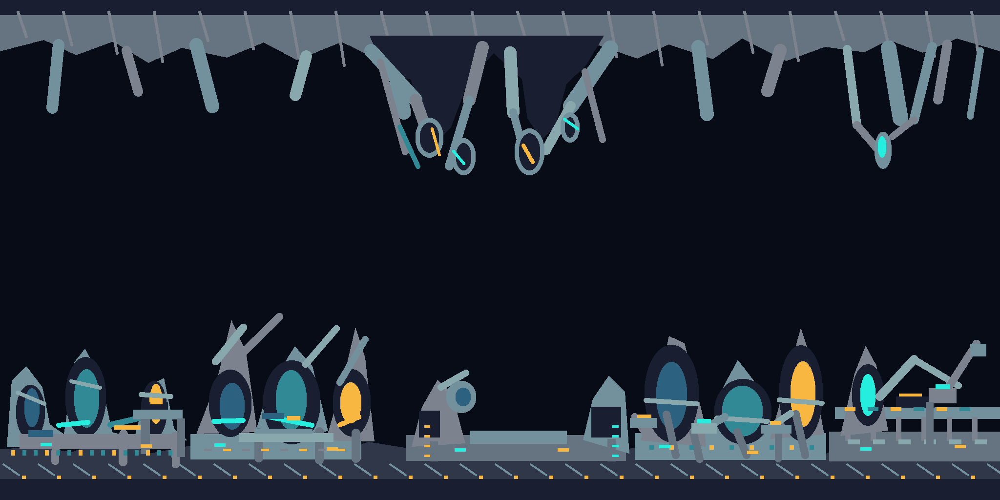
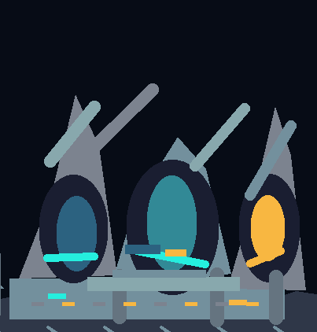
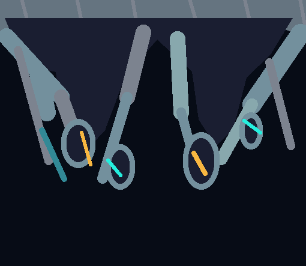
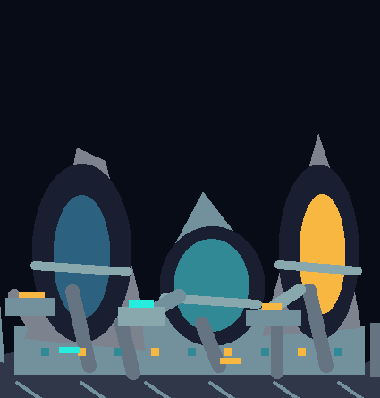

# Eidolon Osteolith Recovery Works — wholly original 2048×1024 CyberSand landscape

**Draft / HOLD · AUTHOR STATIC-PASS · independent Art/Technical/Shepherd review outstanding · NATIVE-UNTESTED.**

An ancient alien **subsurface bone-mining, assay and recovery facility** excavated into a flat-side-view strata formation. Very different from an overhead organism nursery: a continuous stressed cave roof, salvage drifts, a jagged mechanical crusher district, the massive **roof-grounded osteolith shear head** facing an **open-topped, floor-rooted, enterable work press**, three membrane-calcification separators and the dry extraction lift. Real geometric supports and machine interfaces are physically present in the canonical material-ID plane. Interconnected upper, central and underpress flight voids are left open intentionally.

## Five location districts

1. **Rib salvage drift** x0–390: three asymmetric buried core housings, keyed transfer platform, dry bone carts and roof buttresses
2. **Osteolith crusher mill** x390–770: three dissimilar shearing jaws, grounded asymmetrical processing cups, scan gauges and material-transfer linkage
3. **Ossuary shear vault** x750–1290: continuous overburden supports a jagged ceiling chisel/rib array and four asymmetric optical reader points. The separate lower entered press is rooted at the ground, with opposed manipulators and readable central inspection controls
4. **Calcifier separation** x1290–1700: differentiated membrane retorts and actual valve, transfer and assay surfaces
5. **Extraction / ballast rail** x1700–2048: asymmetric hoist, scan carriage, articulated recovery crane and serviceable dry freight line

**Goals / exact sites:** spawn (112,508) → salvage intake (315,623) → mill (548,569) → high drift (843,435) → shear reading (1015,539) → entered press (1066,805) → lower return (1239,751) → calcifier (1341,564) → valves (1530,566) → upper hoist (1820,459) → export (1886,675) → final relay (1986,640). All named sites require conservative full-envelope 19×15, 23×19 and 31×27 free-centre 4-neighbour BFS and all four legal immediate cardinal exits.

## Physical/source qualification

| Property | Exact author result |
|---|---:|
| 2048×1024 full material-ID plane | **2,097,152 cells** |
| Grounded stable inert solid cells | **769846 / 769846** |
| Detached physical solids / fluids / reactive | **0 / 0 / 0** |
| Lossless ordered, nonoverlapping rectangles | **11045 / 32768** |
| UTF-8 Setup-v2 bytes | **205992 / 1048576** |
| Exact-site 19×15 / 23×19 / 31×27 | **12/12 each, all four cardinal approaches** |
| Restricted upper/lower west→east routes | **BOTH PASS at 31×27** |
| Same routes after real 178×171 solid obstruction | **BOTH PASS at 31×27** |
| Overview and six true-material 1:1 crops | **7/7 author PNG integrity, stored-zlib and source-index parity** |
| Godot Workbench/bridge/Rapier/save and reopen | **NATIVE-UNTESTED** |

Full source material hash SHA-256: `160711c60f99c01f990710b9f48544b090eb540c0e6b50ec4636d97e9e1464b5`. Setup JSON SHA-256: `ebf2f6d4973888049574c82a3293655c1ac8253bac7005e4decc442f9f677e6a`.

Independent constrained routes from west gate (676,550) to east gate (1333,535) must cross x824–1222 either at centre y≤449 (roof drift) or y≥714 (lower return), while accommodating an actual obstruction x945–1123/y509–680. Unlike a scenic fake passage, exact 31×27 Midge body clearance is tested in final material cells.

**Exact provenance:** seed `2611200717`; source base sandmapsreference `99a166e7fcae45eb22be1740e9f33f62faccbcc7`, read-only accepted CyberSand `de109d0131641d6adc8d25bb9ced7ca3d4991105`. Final material IDs are entirely accepted **stable inert immovable solids**. The source design may propose 11,304 unsupported nominal decorative cells, all discarded by the builder before encoding; final plane has zero detached solids.

**Rebuild:** Node ≥18, no packages: `node build.js design.json ./rebuilt`. The builder deterministically regenerates the complete Setup and all PNGs, checks rectangle equality, exact-site routes, grounding, pixel integrity and the committed `qualification.json` receipt. **No prior geometry or source photos are used.** Native installed-bridge compatibility and actual Midge/Rapier progression/cold save-reopen have not been executed.

**Acceptance requested:** exact-HEAD independent Art/Technical/Shepherd qualification; remain Draft/HOLD and NATIVE-UNTESTED until appropriate native Workbench testing, without blocking further original map production.