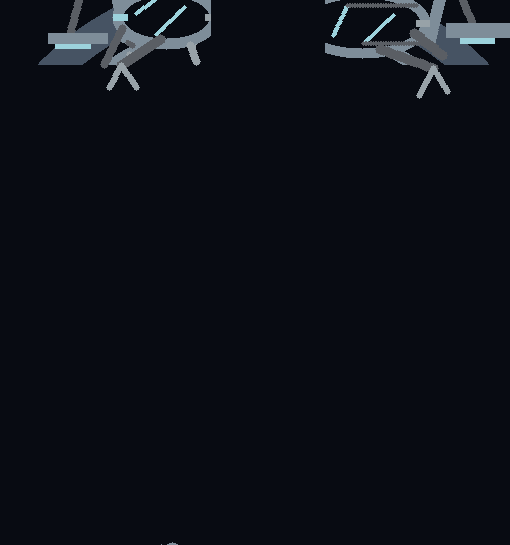
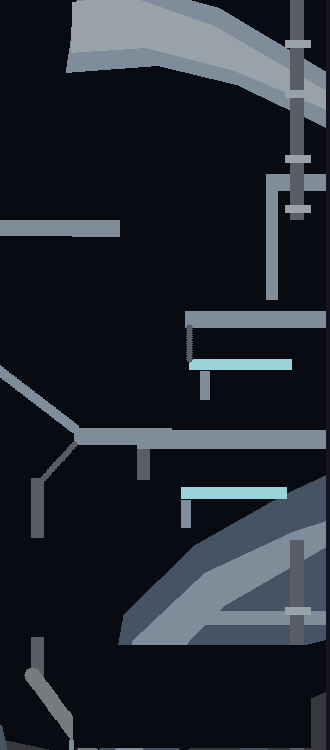

# The Graftloom Slipway — Split Mnemonic Crown & Rooted Keel

**Original CyberSand science-fiction bio-industrial landscape · exact 2048 × 1024 real material cells · deterministic seed 19112647**

> **DRAFT / HOLD — STATIC-CONTRACT / GEOMETRY / SUPPORT PASS — NATIVE-UNTESTED — INDEPENDENT ART / TECHNICAL / SHEPHERD REVIEW PENDING.** Original material-cell authoring, not a conversion, traced artwork, prior archive migration, AI concept PNG or mock gameplay screenshot. Do not merge, promote Ready, auto-merge or imply owner acceptance.

## Original spatial thesis and engineering repair

An abandoned xenotechnology *grafting shipworks* is structurally divided between a suspended, **split mnemonic crown** and an excavated **rooted underkeel cradle**. Midge must cross from the western graft-receiving slipway to the eastern salvage recovery rail, inspect the memory interface and visit all three dry refinery chambers.

This is a strict orthographic, one-plane **side elevation**. Geometry is actual paintable/solid material cells; there are no visible platform tops, camera perspective, decorative scenery pretending to be collision or uncrossable full-map facade. Monument-scale negative space between sharp industrial supports is intentional.

The early branch's full floating eye and upper refinery shell were **not physically acceptable**: an independent occupied-cell flood found 33 detached components containing 116,604 unsupported cells. Welding those components directly to the roof or floor repeatedly severed conservative actual gameplay routes. An on-branch bounded support probe tested 100+ strut candidates, found a safe 5-cell-wide stern bracket anchor, and showed the big assemblies required geometry-level redesign.

**Current structural rebuild** deliberately removed the remaining **115,002 formerly detached actual cells** and reconstructed the industrial crown, mnemonic stations, refinery frame and salvage appendages as distinct **roof- or floor-rooted open half-assemblies**, instead of concealing unsupported components or waiving Midge collisions. The rebuilt north crown includes a deliberate **114 × 92-cell aperture** so the *unchanged* Memory Engine North coordinate remains reachable. The generated results have **676,133 nonair cells, one single boundary-connected solid component, zero detached cells**. An additional **98 small non-anchored finish cells** were trimmed after the replacement pass, not represented as supported.

No initial simulated biology, free water, acid, powders or fire is used. The bio-industrial forms are inert/immobile architected solids; **no live-organism reaction behaviour is claimed**.

## Six playable districts at ordinary Midge scale

1. **Receiving slip / ferrule works** — x 12–330. Blasted western blast-rock receiving cheek; dry service decks, broad work pad, transparent inspection benches and staggered collision walls.
2. **Shunt crane / receiving scissors** — x 330–715. Rooted west mast, roof-hung mechanical scissors, intervening elevated air pockets, shunt control and independent north passage.
3. **Split mnemonic crown / memory inspection** — x 650–1240. Open northern machinic crown, large central exploration void with an exact optical inspection coordinate, lower excavation arms and **two independent altitude returns**. The former complete unsupported floating eye is **intentionally gone**.
4. **Dry bio-refinery containment** — x 1240–1710. Roof-hung forked biosynthesis rake, clear glass inspection nodules, several *enterable dry chambers* and low anchored dike supports. Broad traversable bands prevent this district becoming a solid gameplay divider.
5. **Aft salvage drydock** — x 1710–2036. Real roof-tethered salvage mandibles, rooted lower stern bracket, working galleries and the eastern salvage shoulder.
6. **Underkeel return** — x 650–1420, y 770–955. Broad alternative flight lane and floor-engineered supports, rather than an ornamental collapsed bottom or a fluid basin.

**Scale:** accepted source Midge authored hull is only **4 × 3 cells** (a small body-thrust flyer). The canvas represents hundreds of hull widths; doors, work galleries and interdistrict air gaps are sized for actual movement. Static acceptance also tests far more conservative whole-hull 19×15 / 23×19 / 31×27 centre envelopes, plus narrow-region stress bans. This does **not** prove that the native inertia/controls can execute the same path.

## Explicit mission / exact route graph

Mission: **Spawn at Receiving Dock → inspect the split memory interface → inspect each refinery chamber → reach the aft recovery rail**.

All 13 names below are exact cell-centre coordinates; the verifier does not replace inaccessible sites by a nearby radius or nearest air point.

| Site | Exact centre |
|---|---:|
| Spawn Receiving Dock | (122, 483) |
| West Filter Service | (291, 480) |
| Upper Hull Shunt | (384, 224) |
| Spinal Gate West | (570, 470) |
| Memory Engine North | (925, 145) |
| Memory Engine Core | (921, 468) |
| Memory Engine South | (914, 809) |
| Spinal Gate East | (1240, 480) |
| Refinery High Bay | (1470, 404) |
| Refinery Middle Filter | (1510, 544) |
| Refinery Lower Sump | (1500, 704) |
| Aft Drydock | (1801, 480) |
| Final Recovery Rail | (1940, 848) |

### Route sketch (topology, not a scaled elevation)

~~~text
          [Upper Hull Shunt] -- [Memory North / split crown] -- [Refinery High]
         /                   \              |                         \
[Spawn]--[West Filter]--[Spinal West]--[Memory Core]--[Spinal East]--[Middle Filter]--[Aft Drydock]--[Recovery]
                         \            /                \             /
                          [Memory South / underkeel] --- [Lower Dry Sump]
~~~

**Main:** Spawn → West Filter → West Gate → Memory Core → East Gate → Middle Filter → Aft Drydock → Recovery Rail.

**Upper alternate:** West Filter → Upper Shunt → Memory North → Refinery High → Aft Drydock.

**Lower alternate:** West Gate → Memory South → Lower Dry Sump → East Gate/Recovery Rail.

The deterministic source and separately executed independent verifier require exact four-neighbour actor-centre connectivity for all sites at **19×15, 23×19 and 31×27**. They also apply deliberately restrictive roof/sump region bans between the central gates: both resulting independent detours pass at **31×27**. These are **static free-centre searches**, not dynamic Rapier/Midge native tests.

## Full-plane Setup-v2 and source-contract qualification

| Contract | Verified current build |
|---|---:|
| Final material plane | **2048 × 1024 = 2,097,152 cells** |
| Nonair material cells | **676,133** |
| Single connected boundary-rooted component | **676,133 / 676,133; zero floating** |
| Nonoverlapping ordered material rectangles | **10,001 / 32,768** |
| Serialized UTF-8 Setup-v2 bytes | **186,957 / 1,048,576** |
| Actual full-plane replay mismatches / overlaps | **0 / 0** |
| Exact destinations reachable | **13 / 13 at all three conservative footprints** |
| Minimum visited local approaches | **4 of 4** |
| 31×27 upper/lower constrained alternate routes | **both PASS** |
| PNG full plane + downsample + 1:1 crops | **8 / 8 CRC/zlib/pixel-parity PASS** |
| Native Godot/Bridge/Rapier/flight/reopen | **NATIVE-UNTESTED** |

**Material-ID plane SHA-256:** `c354b0d97cad32e4a30bc0c7334ca232a855a4469cbc00abca271ff9680abdea`

Read-only engine authority as rechecked on 19 November 2026: [CyberSand accepted main](https://github.com/techrote/cybersand/commit/de109d0131641d6adc8d25bb9ced7ca3d4991105), [Workbench Setup-v2 parser](https://github.com/techrote/cybersand/blob/de109d0131641d6adc8d25bb9ced7ca3d4991105/godot/scripts/workbench_setup.gd), [material physical catalogue](https://github.com/techrote/cybersand/blob/de109d0131641d6adc8d25bb9ced7ca3d4991105/materials/catalogue/catalogue.json), [native material enum / physical-law kernel](https://github.com/techrote/cybersand/blob/de109d0131641d6adc8d25bb9ced7ca3d4991105/native/include/cybersand/material.hpp), [Midge authored control/hull](https://github.com/techrote/cybersand/blob/de109d0131641d6adc8d25bb9ced7ca3d4991105/godot/authoring/flyers/midge.json).

The loader admits **2048 × 1024**, multiples of 64 in permitted 512–2048 limits. Source allows 32,768 rectangles; an old installed native bridge can still expose **only 4,096** and would reject this 10,001-rectangle file. Verify **installed** bridge capability before claiming an accepted Workbench evaluation.

Valid occupied IDs: **49 Slate, 58 ReinforcedConcrete, 62 SteelPlate, 100 BasaltColumns, 101 Obsidian, 113 ZincSheet, 117 BareIron, 120 GlassBlock, 123 UraniumGlass, 128 PolymerPanel**. All ten are accepted immobile Solid / RuleKernel None at initial state. No placeholder or pseudo materials, powder support or unbounded reactions.

## Actual source-grid image evidence

The images below are **encoded directly from the final 2048 × 1024 material-ID plane** by the committed deterministic builder. Six districts are cropped at a strict **one material cell to one PNG pixel**; review-half is clearly labelled a downsample and not proof of native detail. The independent verifier checks PNG signature, chunk CRCs, zlib payload, IEND and **every** actual material RGB pixel against replayed JSON material edits.

| Receiving slip | Shunt crane | Split mnemonic crown |
|:--:|:--:|:--:|
|  |  |  |

| Dry bio-refinery | Aft salvage | Lower rooted return |
|:--:|:--:|:--:|
|  |  |  |

## Reproduce and independent check

Python 3 **standard library only**, no source art, external image assets or Git access necessary once this folder is available:

~~~bash
cd cybersand-canvases/2048x1024/original-scifi-biomech-wide-graftloom-slipway-261119
python3 build.py
python3 verify-independent.py
python3 support-probe.py
~~~

Artifacts: [Setup-v2 JSON](setup-graftloom-slipway.json) · [fixed-seed builder](build.py) · [seed](seed.txt) · [builder receipt/histogram](qualification.json) · [non-importing independent replay and support proof](verification-independent.json) · [separate diagnostic support-probe data](support-probe.json) · [historical structural repair account](STRUCTURAL-HOLD.md). The Actions build verifies source-matched deterministic regeneration and produces one exact-grid PNG overview, six 1:1 crops and a clearly labelled half-resolution preview.

## Honest acceptance and remaining gates

The exact-static-source receipt is **not independent owner review or runtime proof**. Require separate changed-HEAD **Shepherd**, **Art/Fidelity** and **Technical** review, including whether the deliberately split crown and refinery rake are expressive enough at normal player zoom and whether high/middle/low rooms visually read as destinations. Then require an **actual matching Godot / installed CyberDemoBridge / Rapier** evaluation of admission, flying manoeuvres, collision, native ticks/material responses and **fresh-process save/reopen**. Until exercised these remain **NATIVE-UNTESTED**. Keep **Draft/HOLD**, no merge, no Ready, no auto-merge or owner-acceptance claim.
