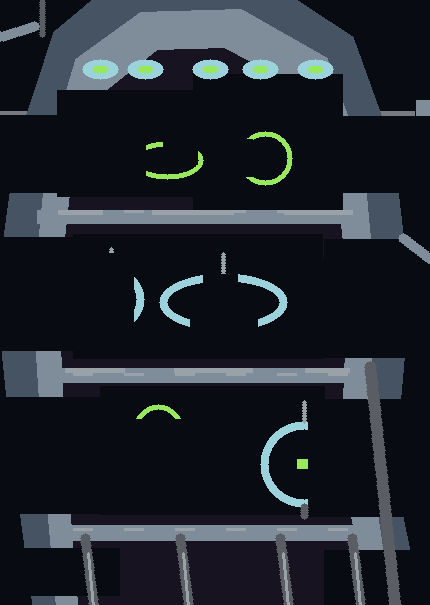

# The Graftloom Slipway
**Original CyberSand science-fiction bio-industrial landscape — 2048 × 1024 cells**

**Status:** Original, authored entirely from material cells. **DRAFT / HOLD · NATIVE-UNTESTED.** This is neither a conversion of any reference image nor an existing source-led canvas. No gameplay screenshot is claimed.

## Spatial thesis

A derelict xenotechnology **shipworks grafting dock** where engineered tissue, crystalline memory structures and machine-support rails form one continuous, industrially legible traversable level. The composition is horizontally extensive: a hard-edged receiving slipway at the west edge transfers through a giant circular memory engine into the multi-deck dry bio-refinery, ending at an aft salvage-and-recovery dock. The giant memory ring and load-bearing keel establish the silhouette; enclosed work bays, harsh overhead transit rails and open transit air distinguish the inhabitable places. Organic vocabulary is **architectural and inert**, not an uncontrolled living/fungal simulation.

Six genuinely differentiated authored districts:
1. **Receiving slip / loading ferrules** (west, x 12–330). Contoured blast-rock hull cheeks, supported docks and spaced transparent inspection platforms.
2. **Gantry and shunt** (x 330–715). A hanging crane mast, aerial splice stations, prominent structural supports and alternate ascent.
3. **Orbital memory engine** (x 620–1235). A monumental ring with a separately enterable central inspection eye, a north cavity, and a broad southern inspection deck.
4. **Dry refinery containment** (x 1240–1710). A tall tapering xenolith shell divided into distinct high, middle and lower processing chambers. Ports rejoin the common route.
5. **Aft shipworks / recovery dock** (x 1710–2036). Ship hull shoulder, service lifts, repair galleries and final recovery rail.
6. **Underkeel return** (x 650–1420, y 770–955). A broad open alternative beneath the ring and refinery; no water, lava or moving powder is staged.

## Midge mission and route graph

**Goal:** fly the single authored Midge from the receiving pad to the far-aft recovery rail while identifying the memory core and three refinery chambers. The world is intended for horizontal exploration with real alternate loops, not a passive background.

Exact **cell-centre waypoints** (x,y), with static 31×27 conservative free-centre reachability required at every coordinate:

| Node | Exact (x,y) | Role |
| --- | --- | --- |
| Spawn Receiving Dock | (122,483) | Midge start and safe retreat |
| West Filter Service | (291,480) | Receive / first inspection |
| Upper Hull Shunt | (384,224) | Aerial alternative |
| Spinal Gate West | (570,470) | First central gate |
| Memory Engine North | (925,145) | Roof-route destination |
| Memory Engine Core | (921,468) | Main optical eye |
| Memory Engine South | (914,809) | Underkeel destination |
| Spinal Gate East | (1240,480) | Far central gate |
| Refinery High Bay | (1470,404) | Upper containment access |
| Refinery Middle Filter | (1510,544) | Primary processing objective |
| Refinery Lower Sump | (1500,704) | Dry lower inspection point |
| Aft Drydock | (1801,480) | Repair dock |
| Final Recovery Rail | (1940,848) | End destination |

**Primary:** Spawn → West Filter → West Gate → Memory Core → East Gate → Middle Filter → Aft Drydock → Recovery Rail.

**Upper alternate:** West Filter → Upper Shunt → Memory North → Refinery High → Aft Drydock.

**Lower alternate:** West Gate → Memory South → Refinery Lower → East Gate / Recovery Rail.

The independent static route audit searches *every legal actor centre* cardinally; it does not substitute a nearby point for a bad target. A genuine dynamic flight trial with native Midge input remains outstanding. Separate roof/sump bans in static tests force alternate approaches between the two central gates.

## Actual physical game scale

The Midge's accepted authored rectangular hull is **4 × 3 material cells** (source flyer definition). A 2048-cell map therefore spans hundreds of its body lengths. Chambers and portals are broad enough to operate at useful playable zoom; larger clearance tests deliberately exceed the hull by applying 19×15, 23×19 and 31×27 centred full-footprint exclusion, not centre-only point tests. Side view is flat and perpendicular: no foreshortening, no platform tops, no decorative scenic render layers.

## Material behaviour, schema and constraints

Authoritative read-only accepted CyberSand main (19 Nov 2026): [engine commit](https://github.com/techrote/cybersand/commit/de109d0131641d6adc8d25bb9ced7ca3d4991105), [Workbench Setup-v2 parser/validator](https://github.com/techrote/cybersand/blob/de109d0131641d6adc8d25bb9ced7ca3d4991105/godot/scripts/workbench_setup.gd), [native material header](https://github.com/techrote/cybersand/blob/de109d0131641d6adc8d25bb9ced7ca3d4991105/native/include/cybersand/material.hpp), [material catalogue](https://github.com/techrote/cybersand/blob/de109d0131641d6adc8d25bb9ced7ca3d4991105/materials/catalogue/catalogue.json), [Midge definition](https://github.com/techrote/cybersand/blob/de109d0131641d6adc8d25bb9ced7ca3d4991105/godot/authoring/flyers/midge.json). Parsed loader admits both dimensions in multiples of 64 from 512–2048; **2048×1024 is admissible**. Workbench source limit **32,768 rectangle edits**, Setup-v2 file limit **1 MiB**, but an old installed bridge may report only **4,096**, which must be tested in its actual runtime.

Occupied native material IDs: 49 Slate, 58 ReinforcedConcrete, 62 SteelPlate, 100 BasaltColumns, 101 Obsidian, 113 ZincSheet, 117 BareIron, 120 GlassBlock, 123 UraniumGlass, 128 PolymerPanel. The accepted catalogue reports **all ten as valid, immovable Solid / kernel 0**, with no initial liquids, powders, fire, living cells or uncontrolled reaction systems. This is bio-*industrial design*, not a claim of animated biology. Transparent native materials have their actual source transparency; the PNGs are straightforward material RGB index previews rather than engine shaders.

## Reproduce / static verification

Requires **Python 3 standard library only**. From this map directory:

```bash
python3 build.py
python3 verify-independent.py
```

The fixed-seed builder constructs the complete, final 2,097,152-cell material-ID plane, losslessly coalesces it into **nonoverlapping five-field ordered rectangles**, reconstructs all cells, checks three conservative Midge full-footprint clearances, exact waypoints, route closures, Setup JSON size and constructs RGB PNGs directly from material IDs. It validates PNG signatures, CRC chunks, zlib payload and every pixel against source cells. The separate `verify-independent.py` does **not import the builder**: it replays the committed JSON independently, rechecks material pixel parity/crops, route topology and material component grounding.

Evidence: [exact Setup-v2 start](setup-graftloom-slipway.json), [fixed-seed builder](build.py), [original seed](seed.txt), [builder receipt and histogram](qualification.json), [independent replay and topology](verification-independent.json), [full material-cell plane PNG](overview.png) and [half-size index review](review-half.png). Full map is truly **2048 × 1024 pixels**; the half-size preview is **not** a replacement.

### Genuine 1:1 district crops from the exact same final grid

| Receiving slip | Crane entry | Memory engine |
| :--: | :--: | :--: |
|  |  |  |

| Refinery | Aft dock | Lower return |
| :--: | :--: | :--: |
|  |  |  |

## Structural qualification hold (19 November 2026)

**Important:** Static replay and flight-centre tests pass, but **this map does not yet meet the owner's structural-support criterion**. A separate actual-grid flood audit finds **33 detached occupied components comprising 116,604 / 763,178 occupied cells**; the largest alone has **39,183 cells** in the upper processing frame, bounding box `[1204,185,1704,386]`. These are material cells, not a PNG discrepancy. Their physical kernel is immobile, but structural believability has not passed, and the map must not be presented as owner-ready.

Several deterministic cable-welding strategies were implemented and actually exercised in Actions. Their honest result was failure: the most straightforward anchors either blocked exact Midge routes or could not legally cross protected navigable envelopes. The original verified builder is retained pending a geometry-level reconstruction with a genuine substitute flight passage, not a false acceptance waiver. See [STRUCTURAL-HOLD.md](STRUCTURAL-HOLD.md) for source-matched failures and a constrained repair direction. **Do not open or promote a production PR until this has been repaired and independently reverified.**

## Honest acceptance gates

The static material/pixel/clearance audit does not prove that a particular installed Godot build loads the setup, that its native bridge has sufficient rectangle capacity, that Midge can actively execute the route, that collisions/reactive materials behave as anticipated, or that a fresh-process save and reopen reproduces the world. **NATIVE-UNTESTED** until a source-matched Workbench process executes those tests. Independent Shepherd, Art/Fidelity and Technical review of the *changed exact HEAD* is still required; no owner acceptance, Ready promotion or merge is permitted.
