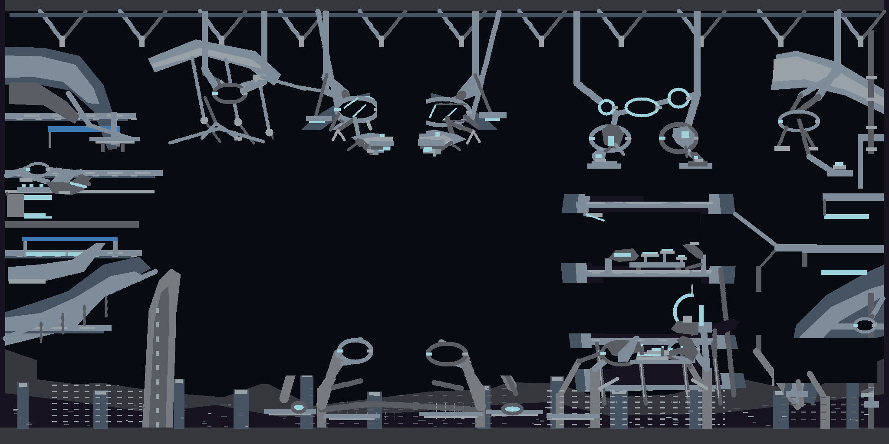
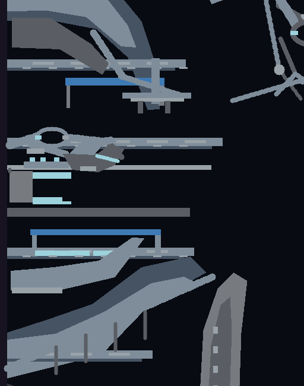
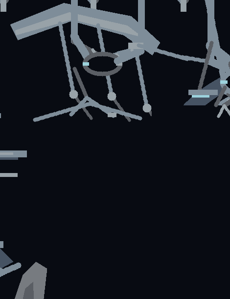
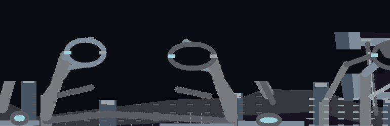

# The Graftloom Slipway — R6 Split-Throat Mnemonic Examination

**Original CyberSand science-fiction bio-industrial landscape · exact 2048 × 1024 real material cells · deterministic seed 19112647**

> **DRAFT / HOLD — STATIC-CONTRACT / GEOMETRY / SUPPORT PASS — NATIVE-UNTESTED — INDEPENDENT ART / TECHNICAL / SHEPHERD REVIEW PENDING.** Original material-cell authoring, not a conversion, traced artwork, prior archive migration, AI concept PNG or mock gameplay screenshot. Do not merge, promote Ready, auto-merge or imply owner acceptance.

## CURRENT R6 — a grounded, enterable Memory examination installation (19 November 2026)

**Exact original physical map:** 2048×1024, 2,097,152 one-byte material IDs, deterministic fixed seed 19112647. This revision directly addresses the [independent exact-R5 art P1](https://github.com/techrote/sandmapsreference/pull/22#issuecomment-7004930418), rather than making another unrelated scenery pass. Original west intake, refinery machinery, underkeel, all thirteen previous exact sites and both strictly constrained flight bypasses are preserved.

**A single split-throat mnemonic assay station** is now mechanically readable in the 1:1 Memory crop. Its grounded asymmetric *left specimen/keying inlet* occupies x≈851–907, y≈309–357, opposite a different *right multiview diagnostic/workface* at x≈963–1024, y≈305–356. Both halves bond directly to the independently supported roof lobes. Their 56-cell-wide central throat x907–963 remains physical empty space, sufficiently wide for Midge's conservative 31×27 full envelope. The **new, exact, reachable inspection workface** is at **(925,328)**, with four unobstructed cardinal approach centres at 19×15, 23×19 and 31×27. From this console Midge can descend through the real open central flight volume to the **unchanged Memory Core (921,468)**, 140 cells below. This is deliberately a **remote upper-boundary examination interface**, not a fictitious suspended station in the empty centre, not a moved Core waypoint and not a claimed native cockpit.

The previous experimental path-separation measurement showed why centre-span structural tethers fail: two conservative flight bypasses occupy separate roof and sump corridors around the central empty chamber. R6 adds no unsupported trans-cavity steel and does **not** weaken either of the existing upper/lower forced-route restrictions. Independent Art/Shepherd judgment on whether this *proximal, entered workface* resolves P1 is still required.

**Independent full-grid delta against committed R5:** **2,699 changed material IDs** inside x851–1023/y305–356, made up of **873 newly occupied stable solid cells, 1,826 rematerialised solid cells, zero excavated cells**. This is actual material-cell geometry; the old R5 refinery/receiving districts are not cosmetically reprocessed.

| Current exact R6 source-static qualification | Result |
|---|---:|
| Real material-cell extent | **2048 × 1024 = 2,097,152** |
| Occupied immovable Solid / None-kernel cells | **750,089** |
| Boundary-grounded / detached occupied cells | **750,089 / 0** |
| Non-overlapping rectangle edits (source budget 32,768) | **13,839** |
| Setup-v2 JSON UTF-8 (1,048,576-byte limit) | **258,892 bytes** |
| Full ordered rectangle replay / overlaps | **0 mismatches / 0 overlaps** |
| Exact named Midge sites, three full hull envelopes | **14/14 each**, four immediate approaches |
| Independent forced upper & lower 31×27 routes | **both PASS** |
| Real material-PNG CRC/zlib/IEND/full-grid pixel parity | **8/8 PASS** |
| Native Godot / installed bridge / Rapier / persistence | **NATIVE-UNTESTED** |

**Grid SHA-256:** `9dd2cbc298d6e91ef71e5f1617ef41a516535c97112cc3ab4dfd030fc4098e38`  
**Exact Setup-v2 JSON SHA-256:** `1714c8ced71041e5036886bff62abcbfb38c08717fe4d2903ffc4d82b5016402`  
**Builder SHA-256:** `626d59e55a82c85d954d117c4357f220f3f89c951c19cb88de613299b571ea1e`  
**Read-only accepted CyberSand engine:** `de109d0131641d6adc8d25bb9ced7ca3d4991105`. Full material-law, envelope, budget, PNG and construction receipts are regenerated as [qualification.json](./qualification.json) and independent [verification-independent.json](./verification-independent.json).

**Authentic current material-cell evidence:** [entire 2048×1024 indexed material world](./overview.png) · [true 1:1 mnemonic workface and Core crop](./03-memory-engine.png) · [receiving](./01-receiving-slip.png) · [shunt](./02-crane-and-entry.png) · [refinery](./04-refinery-filter.png) · [aft](./05-aft-dock.png) · [underkeel](./06-lower-return.png) · [half-size overview](./review-half.png). These are generated from the actual final material grid, **not AI art or mock native screenshots**. The [exact-source GitHub Actions builder/independent verifier](https://github.com/techrote/sandmapsreference/actions/runs/44557765891) succeeded and published the complete R6 map/receipt set.

**HOLD:** Existing installed CyberDemoBridge capacity remains unknown: current source advertises 32,768 rectangles, while legacy binaries may limit admission to 4,096. R6's 13,839 rectangles exceed that legacy threshold. Actual Godot import, Midge/Rapier flight and collision, simulation ticks, and fresh-process save/reopen have **not** run. Independent exact-R6 Art/Technical/Shepherd review and owner acceptance remain pending. No Ready/merge/auto-merge.

## HISTORICAL R5 — differentiated high intake, low dry extraction (19 November 2026)

**Historical R5 geometry baseline; the current R6 contract and images are described above.** Fresh from-scratch original 2048×1024 side-elevation world, in the same creator-owned Draft/HOLD branch. No source/reference-image conversions, owner acceptance, merge or Ready promotion.

The Shepherd's exact-R4 review found the **Memory Engine Core (921,468) still lacked an accessible, functionally legible examination bay**, while the upper and lower refinery silhouettes were underdeveloped. This R5 is a **partial**, substantive response: high intake now presents **asymmetric rotary receiving and translated jaw mechanisms** with distinct inert transparent sampling windows; lower refinery has an **asymmetric, bedrock-rooted dry extrusion/inspection enclosure and metering teeth**, not a third ring-on-shelf. Rooted crown reader fins have also been strengthened. **13,948 final material cells have changed from R4**. Several larger *actually constructed* examination dock candidates were rejected in structural/navigation exploration because their supports obstructed the strictly required 31×27 upper or lower alternate routes. No failed experimental dock is published; **Memory Core artistic P1 remains OPEN**.

**Exact-current qualification — deterministic builder plus separate source-JSON/PNG verifier:**

| Contract | Source-verified R5 |
|---|---:|
| Full material-ID cell plane | 2048 × 1024 = 2,097,152 cells |
| Occupied immovable inert solids | **749,216** |
| Boundary-rooted solids / floating cells | 749,216 / **0** |
| Lossless, non-overlapping paint rectangles | **13,862 / 32,768** |
| Setup-v2 UTF-8 JSON | **259,333 / 1,048,576 bytes** |
| Full-plane material replay / unexpected overlaps | **0 mismatches / 0 overlaps** |
| Exact Midge sites, 19×15, 23×19, 31×27 | **13/13 at each**; four local approach directions |
| Strict independent upper and lower 31×27 byway gate routes | **both PASS** |
| Complete material-cell overview, review thumbnail, six 1:1 district crops | **8/8 builder and independent PNG pixel-parity / CRC PASS** |
| Native Godot, installed CyberDemoBridge, Rapier Midge input/collision, fresh-process save/reopen | **NATIVE-UNTESTED** |

**Material-plane SHA-256:** `39fb83fb434438608e1aa776e06367b0d78e8796ccd8b5411f47c791500a77c5`. **Setup JSON SHA-256:** `58f79ab8e11f78cdaf41af21d9bc831c8ce0986fbf39bf2cf92b6eb50804877f`. **Independent builder SHA-256:** `f521edf2bb5c14e75488750ba0001847ee10e4268c7debc34367d05260440b4b`. Seed remains **19112647**; read-only accepted engine remains `de109d0131641d6adc8d25bb9ced7ca3d4991105`. Installed bridge rectangle limit could still be the old **4,096**, so source acceptance does NOT imply Workbench installation compatibility.

**Actual final-grid evidence:** [full 2048×1024 overview](./overview.png) · [1:1 high/mid/low refinery crop](./04-refinery-filter.png) · [1:1 mnemonic crown/corresponding core void](./03-memory-engine.png) · [1:1 receiving](./01-receiving-slip.png) · [1:1 shunt](./02-crane-and-entry.png) · [1:1 aft](./05-aft-dock.png) · [1:1 underkeel](./06-lower-return.png). All images derive from the committed grid, NOT generated gameplay screenshots. [Qualification](./qualification.json) · [separate independent grid and PNG verifier](./verification-independent.json) · [fixed-seed builder](./build.py) · [Setup-v2 JSON](./setup-graftloom-slipway.json) · [support probe](./support-probe.json).

**Review gates:** R5 corrects two weak physical process districts, but it does not close the Memory Core P1. Shepherd and independent art/technical auditors must inspect this **new** changed HEAD; previous R4 STATIC-PASS is not current independent artistic acceptance. No runtime flight/physics proof.

## Historical R4 qualification — functioning dry assay plant and readable attached optics (19 November 2026)

**Current physical evidence:** [full 2048×1024 material-cell overview](./overview.png), [true 1:1 memory examination crop](./03-memory-engine.png), [true 1:1 refinery crop](./04-refinery-filter.png), [true 1:1 aft salvage crop](./05-aft-dock.png), and three further 1:1 crops. All are regenerated from the same fixed-seed final material plane, not external reference art, and independently CRC/inflate/pixel-parity verified.

The independent **R3 Shepherd REWORK** finding remained active when R4 began: Memory Core was virtually empty, and all three refinery tiers read as repeated tray/ring silhouettes. R4 physically changes **12,356 final material IDs** through a newly supported middle assay/fractionation workface (asymmetric dry sample recipient, stepped measurement heads, separator table and distinct eastern metering jaws), a compact aft salvage transfer cantilever and asymmetrically differentiated, roof-rooted mnemonic reader pods. The high receiver bells and low grounded extrusion already have distinct mechanical purposes, so the new **middle sorting/assay station** now creates a visibly different process height rather than more free-floating rings.

**Bounded self-review:** the middle tier now shows an identifiable enterable dry processing workface in the actual 1:1 crop, but its surrounding shelves still look repetitive. The aft transfer has a locally credible load path yet remains small relative to the hull. The memory reader-pods are genuinely roof-rooted but **do not solve the important artistic P1**: Memory Core (921,468) remains a huge open inspection volume, not an enterable physical diagnostic bay. This must be judged independently, not marked owner-accepted by this creator.

**Rejected and repaired trials:** Initial R4 cassette included **901 unsupported pixels**, detected and repaired by grounding its optical membrane. A hanging mnemonic pier then severed the strict 31×27 upper alternate; a refinery-anchored long diagonal blocked Middle Filter / Final Recovery; a long west freight rail blocked the strict lower alternate. All those trial structures were **removed or redesigned**. No rejected midair service deck, floating cells, route waiver or bogus site relocation survives in the published R4 grid.

| Current R4 exact static test | Result |
|---|---:|
| Full real material plane | **2048 × 1024 = 2,097,152** |
| Actual occupied supported cells | **742,353 / 742,353** |
| Detached components / solid cells / edit overlaps | **0 / 0 / 0** |
| Lossless construction rectangles | **13,548 / 32,768** |
| Exact UTF-8 Setup-v2 payload | **253,359 / 1,048,576 bytes** |
| Exact Midge destinations, 19×15, 23×19, 31×27 | **13 / 13 each** |
| Strict upper and lower West Gate → East Gate detours | **both PASS at 31×27** |
| Full-map PNG, half-review PNG and six 1:1 district crops | **8 / 8 CRC, zlib and source-pixel parity PASS** |
| Native installed bridge / Rapier flight / fresh-process reopen | **NATIVE-UNTESTED** |

**R4 material plane SHA-256:** `57d3b8aadcd26fe773c22d2b40d35d006b0384e037289c1a896b5269f122b0d1`  
**R4 Setup JSON SHA-256:** `86a8794c30fa0f20694800271450319bd64d1898d73afabe054df846b9cdbb70`  
**Accepted CyberSand main read-only contract:** `de109d0131641d6adc8d25bb9ced7ca3d4991105`, valid 2048×1024 extent and stable immobile solid materials. The native **source** bridge advertises 32,768 rectangles, but an older **installed** bridge may only accept 4,096; R4 is *not* an installed-bridge pass.

**Historical R4 receipts:** [qualification.json](./qualification.json), [independent material replay and PNG verifier](./verification-independent.json), [reproducible Python builder](./build.py), [exact Setup-v2 input](./setup-graftloom-slipway.json) and [fixed seed](./seed.txt). Subsequent R2/R3 numbers are preserved below only as dated historical provenance.

## Original spatial thesis and engineering repair

An abandoned xenotechnology *grafting shipworks* is structurally divided between a suspended, **split mnemonic crown** and an excavated **rooted underkeel cradle**. Midge must cross from the western graft-receiving slipway to the eastern salvage recovery rail, inspect the memory interface and visit all three dry refinery chambers.

This is a strict orthographic, one-plane **side elevation**. Geometry is actual paintable/solid material cells; there are no visible platform tops, camera perspective, decorative scenery pretending to be collision or uncrossable full-map facade. Monument-scale negative space between sharp industrial supports is intentional.

The early branch's full floating eye and upper refinery shell were **not physically acceptable**: an independent occupied-cell flood found 33 detached components containing 116,604 unsupported cells. Welding those components directly to the roof or floor repeatedly severed conservative actual gameplay routes. An on-branch bounded support probe tested 100+ strut candidates, found a safe 5-cell-wide stern bracket anchor, and showed the big assemblies required geometry-level redesign.

**Current structural rebuild** deliberately removed the remaining **115,002 formerly detached actual cells** and reconstructed the industrial crown, mnemonic stations, refinery frame and salvage appendages as distinct **roof- or floor-rooted open half-assemblies**, instead of concealing unsupported components or waiving Midge collisions.

### Shepherd R2 — substantial material-cell artist rework (19 November 2026)

The independent Shepherd's exact-head verdict on R1 was **REWORK REQUIRED for artistic craft**, not static geometry. This R2 responds by altering **92,546 actual material cells** relative to the previous structurally repaired grid. The new receiving ferrule and angled transfer docks route freight into an asymmetric shunt shoulder, with visibly keyed inspection stations. The formerly sparse split mnemonic crown now carries two differently sized rooted neural/optical lobes, articulated service tines and left/right optical consoles; the lower cradle is a separate anchored material-return installation.

The **high refinery** now has distinct roof-fed dry receiver bells; the **middle refinery** deliberately retains a broad accessible inspection/chromatography gallery; the **lower refinery** contains bedrock-founded separation drums and extraction grilles. An initially more elaborate mid-tier membrane diaphragm was tested and *removed* because it physically cut the exact Midge route to high/middle/eastern objectives. This is a real functional compromise, not a claimed successful feature. The aft salvage receives a split roof-rooted extraction mandible and disconnected-from-the-airway low pallet cradles, with an intentional open approach to the final recovery coordinate. Differentiated underkeel freight pipes, grounded couplings and pump pedestals link processing back to the receiving footprint.

**R2 status:** deterministic renderer and independent verifier now pass the exact final replay for the 2048×1024 grid; **717,416 occupied cells**, **12,715 rectangles**, **237,522 JSON bytes**, one grounded solid component, **0 detached cells**, **13/13 exact sites reachable at 19×15 / 23×19 / 31×27**, two 31×27 constrained alternative routes, **8/8 material PNG CRC/zlib/pixel-parity checks**. The 92,546-cell change excludes intermediate geometry subsequently trimmed and counts only final ID differences. This is the creator's revised candidate, **not** independent artistic sign-off and **not** a native Godot pass. The Shepherd and Art/Technical reviewers must inspect this changed head anew.

 The rebuilt north crown retains a deliberate **114 × 92-cell aperture** so the *unchanged* Memory Engine North coordinate remains reachable. The generated results have **717,416 nonair cells, one single boundary-connected solid component, zero detached cells**. An additional **98 small non-anchored finish cells** were trimmed after the replacement pass, not represented as supported.

No initial simulated biology, free water, acid, powders or fire is used. The bio-industrial forms are inert/immobile architected solids; **no live-organism reaction behaviour is claimed**.

## R3 — functional craft with conservative route preservation (19 November 2026)

**Historical R3 independently rebuilt material plane:** 2048×1024 = 2,097,152 cells; **732,826 occupied**; **13,250** nonoverlapping rectangles; **247,582** Setup-v2 UTF-8 bytes; one boundary-grounded solid component (**zero detached**) and zero overlapping writes. Compared with the final R2 plane, **19,242 actual cell values changed**. All **13 exact named sites** remain reachable with **four of four local approaches** at each **19×15, 23×19 and 31×27** conservative Midge envelope. Both independently constrained **31×27 upper-roof and lower-sump alternate routes** from West Gate (570,470) to East Gate (1240,480) pass. The original 2048×1024 grid PNG, reviewer thumbnail and **six 1:1 district crops** pass independent PNG signature, CRC, zlib, IEND and exact material-pixel parity (**8/8**).

**Actual new process architecture:** A shaped, dry receiving graft cradle now enters from the western structural cheek. The mnemonic crown carries *paired, asymmetric, fully roof-rooted examination stations* with lamellar memory cassettes, optical contacts and distinct scanning teeth; an exact through-aperture keeps Memory North (925,145) connected. The refinery gains a supported west assay console, a grounded lower dry extrusion auger with asymmetric tooth casing, and actual localized supports. Aft extraction receives a grounded terminal bracket, without cutting Final Recovery Rail (1940,848).

**Explicit rejected experiments:** A much larger suspended inspection platform, an enclosed filtration laboratory, an underkeel sample room and a bridge portal over East Gate were physically constructed and tested in intermediate heads, then **rejected**. They either became thousands of detached cells or sealed strict Midge flight routes. R3 deliberately prioritizes actual level access over visual fill. The central Memory Core (921,468) therefore remains an open inspection void beneath the new supported upper operating hood, not an enterable midair room. Whether that adequately answers the independent artistic REWORK is **for the separate Shepherd/Fidelity reviewers**, not creator self-acceptance.

**Historical R3 material-plane SHA-256:** `1667138a09d9d3abcc579b42a7fa67af9701b53c27167dbd57060d1d2ee396f9`  
**Historical R3 Setup-v2 SHA-256:** `da06bb98ac185bcdc77bb031c4a1ca120aa54a8252f1d951d608c3be4e08a03d`  
**Native Workbench/Godot/Rapier/install/save-reopen:** **NATIVE-UNTESTED**.

The earlier R2 section and its phase-specific numbers remain as **historical provenance**. For acceptance inspect the **R5 current section**, current qualification and independent-verification receipts, and exact changed HEAD. R2–R4 are historical.

## Six playable districts at ordinary Midge scale

1. **Receiving slip / ferrule works** — x 12–330. Blasted western blast-rock receiving cheek; dry service decks, broad work pad, transparent inspection benches and staggered collision walls.
2. **Shunt crane / receiving scissors** — x 330–715. Rooted west mast, roof-hung mechanical scissors, intervening elevated air pockets, shunt control and independent north passage.
3. **Split mnemonic crown / memory inspection** — x 650–1240. Open northern machinic crown, large central exploration void with an exact optical inspection coordinate, lower excavation arms and **two independent altitude returns**. The former complete unsupported floating eye is **intentionally gone**.
4. **Dry bio-refinery containment** — x 1240–1710. Roof-hung forked biosynthesis rake, clear glass inspection nodules, several *enterable dry chambers* and low anchored dike supports. Broad traversable bands prevent this district becoming a solid gameplay divider.
5. **Aft salvage drydock** — x 1710–2036. Roof-rooted salvage mandibles, floor-anchored handling forks, a protected recovery approach and the eastern salvage shoulder.
6. **Underkeel return** — x 650–1420, y 770–955. Broad alternate flight lane with varied grounded material-return pipes and pump pedestals, rather than an ornamental collapsed bottom or a fluid basin.

**Scale:** accepted source Midge authored hull is only **4 × 3 cells** (a small body-thrust flyer). The canvas represents hundreds of hull widths; doors, work galleries and interdistrict air gaps are sized for actual movement. Static acceptance also tests far more conservative whole-hull 19×15 / 23×19 / 31×27 centre envelopes, plus narrow-region stress bans. This does **not** prove that the native inertia/controls can execute the same path.

## Explicit mission / exact route graph

Mission: **Spawn at Receiving Dock → inspect the split memory interface → inspect each refinery chamber → reach the aft recovery rail**.

All 13 names below are exact cell-centre coordinates; the verifier does not replace inaccessible sites by a nearby radius or nearest air point.

| Site | Exact centre |
|---|---:|
| Spawn Receiving Dock | (122, 483) |
| West Filter Service | (291, 480) |
| Upper Hull Shunt | (384, 224) |
| Spinal Gate West | (570, 470) |
| Memory Engine North | (925, 145) |
| Memory Engine Core | (921, 468) |
| Memory Engine South | (914, 809) |
| Spinal Gate East | (1240, 480) |
| Refinery High Bay | (1470, 404) |
| Refinery Middle Filter | (1510, 544) |
| Refinery Lower Sump | (1500, 704) |
| Aft Drydock | (1801, 480) |
| Final Recovery Rail | (1940, 848) |

### Route sketch (topology, not a scaled elevation)

~~~text
          [Upper Hull Shunt] -- [Memory North / split crown] -- [Refinery High]
         /                   \              |                         \
[Spawn]--[West Filter]--[Spinal West]--[Memory Core]--[Spinal East]--[Middle Filter]--[Aft Drydock]--[Recovery]
                         \            /                \             /
                          [Memory South / underkeel] --- [Lower Dry Sump]
~~~

**Main:** Spawn → West Filter → West Gate → Memory Core → East Gate → Middle Filter → Aft Drydock → Recovery Rail.

**Upper alternate:** West Filter → Upper Shunt → Memory North → Refinery High → Aft Drydock.

**Lower alternate:** West Gate → Memory South → Lower Dry Sump → East Gate/Recovery Rail.

The deterministic source and separately executed independent verifier require exact four-neighbour actor-centre connectivity for all sites at **19×15, 23×19 and 31×27**. They also apply deliberately restrictive roof/sump region bans between the central gates: both resulting independent detours pass at **31×27**. These are **static free-centre searches**, not dynamic Rapier/Midge native tests.

## Full-plane Setup-v2 and source-contract qualification

| Contract | Verified current build |
|---|---:|
| Final material plane | **2048 × 1024 = 2,097,152 cells** |
| Nonair material cells | **732,826** |
| Single connected boundary-rooted component | **732,826 / 732,826; zero floating** |
| Nonoverlapping ordered material rectangles | **13,250 / 32,768** |
| Serialized UTF-8 Setup-v2 bytes | **247,582 / 1,048,576** |
| Actual full-plane replay mismatches / overlaps | **0 / 0** |
| Exact destinations reachable | **13 / 13 at all three conservative footprints** |
| Minimum visited local approaches | **4 of 4** |
| 31×27 upper/lower constrained alternate routes | **both PASS** |
| PNG full plane + downsample + 1:1 crops | **8 / 8 CRC/zlib/pixel-parity PASS** |
| Native Godot/Bridge/Rapier/flight/reopen | **NATIVE-UNTESTED** |

**Current R3 material-ID plane SHA-256:** `1667138a09d9d3abcc579b42a7fa67af9701b53c27167dbd57060d1d2ee396f9`

Read-only engine authority as rechecked on 19 November 2026: [CyberSand accepted main](https://github.com/techrote/cybersand/commit/de109d0131641d6adc8d25bb9ced7ca3d4991105), [Workbench Setup-v2 parser](https://github.com/techrote/cybersand/blob/de109d0131641d6adc8d25bb9ced7ca3d4991105/godot/scripts/workbench_setup.gd), [material physical catalogue](https://github.com/techrote/cybersand/blob/de109d0131641d6adc8d25bb9ced7ca3d4991105/materials/catalogue/catalogue.json), [native material enum / physical-law kernel](https://github.com/techrote/cybersand/blob/de109d0131641d6adc8d25bb9ced7ca3d4991105/native/include/cybersand/material.hpp), [Midge authored control/hull](https://github.com/techrote/cybersand/blob/de109d0131641d6adc8d25bb9ced7ca3d4991105/godot/authoring/flyers/midge.json).

The loader admits **2048 × 1024**, multiples of 64 in permitted 512–2048 limits. Source allows 32,768 rectangles; an old installed native bridge can still expose **only 4,096** and would reject this 13,250-rectangle R3 file. Verify **installed** bridge capability before claiming an accepted Workbench evaluation.

Actually occupied IDs: **49 Slate, 58 ReinforcedConcrete, 62 SteelPlate, 100 BasaltColumns, 101 Obsidian, 113 ZincSheet, 117 BareIron, 120 GlassBlock, 128 PolymerPanel**. All nine are accepted immobile Solid / RuleKernel None at initial state; 123 is not used in the final plane. No placeholder or pseudo materials, powder support or unbounded reactions.

## Actual source-grid image evidence

The images below are **encoded directly from the final 2048 × 1024 material-ID plane** by the committed deterministic builder. Six districts are cropped at a strict **one material cell to one PNG pixel**; review-half is clearly labelled a downsample and not proof of native detail. The independent verifier checks PNG signature, chunk CRCs, zlib payload, IEND and **every** actual material RGB pixel against replayed JSON material edits.

| Receiving slip | Shunt crane | Split mnemonic crown |
|:--:|:--:|:--:|
|  |  |  |

| Dry bio-refinery | Aft salvage | Lower rooted return |
|:--:|:--:|:--:|
|  |  |  |

## Reproduce and independent check

Python 3 **standard library only**, no source art, external image assets or Git access necessary once this folder is available:

~~~bash
cd cybersand-canvases/2048x1024/original-scifi-biomech-wide-graftloom-slipway-261119
python3 build.py
python3 verify-independent.py
python3 support-probe.py
~~~

Artifacts: [Setup-v2 JSON](setup-graftloom-slipway.json) · [fixed-seed builder](build.py) · [seed](seed.txt) · [builder receipt/histogram](qualification.json) · [non-importing independent replay and support proof](verification-independent.json) · [separate diagnostic support-probe data](support-probe.json) · [historical structural repair account](STRUCTURAL-HOLD.md). The Actions build verifies source-matched deterministic regeneration and produces one exact-grid PNG overview, six 1:1 crops and a clearly labelled half-resolution preview.

## Honest acceptance and remaining gates

The exact-static-source receipt is **not independent owner review or runtime proof**. Require separate changed-HEAD **Shepherd**, **Art/Fidelity** and **Technical** review, including whether the deliberately split crown and refinery rake are expressive enough at normal player zoom and whether high/middle/low rooms visually read as destinations. Then require an **actual matching Godot / installed CyberDemoBridge / Rapier** evaluation of admission, flying manoeuvres, collision, native ticks/material responses and **fresh-process save/reopen**. Until exercised these remain **NATIVE-UNTESTED**. Keep **Draft/HOLD**, no merge, no Ready, no auto-merge or owner-acceptance claim.
