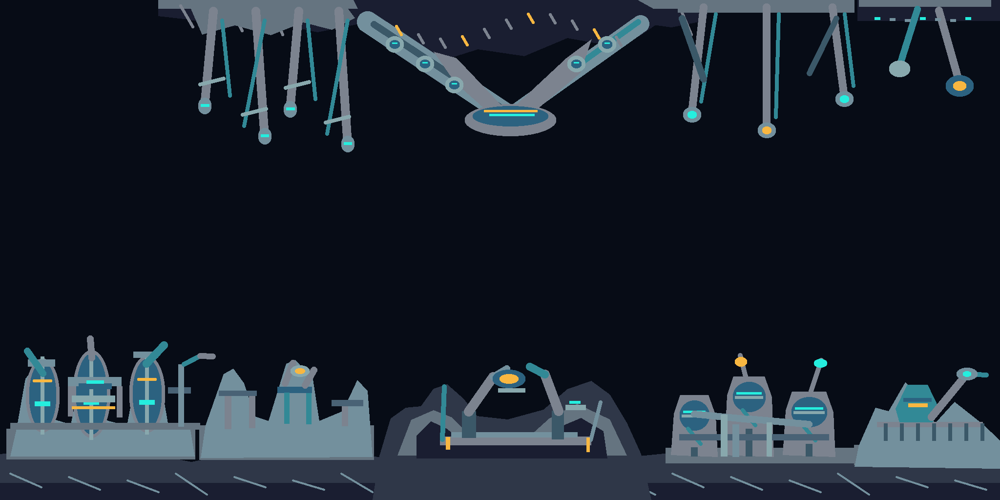
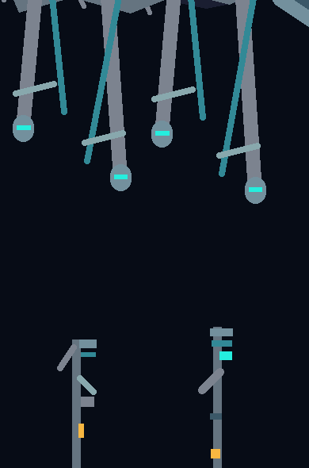

# Nacre Spindle Court — original biomechanical neural-wafer foundry
20 November 2026 · **2048×1024 exact material cells** · **Draft/HOLD / NATIVE-UNTESTED** · Independent post-R2 review pending

## Place, construction and gameplay thesis
An extraterrestrial **dry nacre neural-wafer foundry**, where branching nerve cores are cast against an inverted spindle and diagnosed in a grounded collector chalice. This is a new hand-designed map, NOT a sandmapsreference conversion, Graftloom/Calyx geometry remix, or painted scenic illustration. Entirely **true flat side-elevation**, all visible occupied features are solid material IDs.

The distinctive silhouette is a **roof-anchored inverted V-shaped spindle** over a deeply concave **floor-rooted assay chalice**, not a ring or an empty exhibition hall. A wide empty atmospheric band between them supports three Midge flight altitudes. Supports visibly carry load to top/bottom world boundaries. Left isolation, ciliary splice, central spindle assay, triple ceramic annealing and export cleat all have different equipment, footprint and detailing.

## R2 — physical-cell response to first-HEAD independent P1
Two separate grounded specimen-transfer/inspection stations now face the hanging splice fingertips without closing their flight gap. A ceiling-supported spindle sampler and an offset floor-connected collector provide upper/lower process handoff without spanning the central aerial void. At the annealers, physically supported exchange-valve and loading bays are paired with distinct outbound parcel/operator workfaces at the export cleat. All prior named destinations and both constrained bypasses were retained, including recovery with the 180×152 central physical obstruction. 50 new authored geometry operations were applied; independent Art, Tech and Shepherd re-review remains mandatory.

## Five navigable functional districts
1. **Isolation sills / quarantine samples** (x=0–390): three unequal chambered inoculation tanks above a grounded extraction bench; inlet and service exit with clear approach.
2. **Ciliary Splice Ribworks** (x=390–775): four independently tilted, roof-rooted diagnostic fingers above grounded handling tables.
3. **Inverted Nacre Spindle / lower assay chalice** (x=775–1350): immense roof-rooted converging process jaws, lower concave receiver, clearly identified **entered inspection workface at (1091,713)**. Both are connected to boundaries.
4. **Ceramic Annealing Exchange** (x=1370–1760): three different-height fired bioceramic processing towers with transfer lines, gate readouts, roof claws and control fittings.
5. **Optic Export Cleat** (x=1750–2048): supported trolley, crane cleat and operator controls with a recoverable east exit.

## Midge route contract / exact coordinates
**Goal:** Retrieve the dry neural wafer assay and exit via the east export cleat.
**Sites:** `spawn_isolation_port` (116,600); `quarantine_sampling` (232,705); `ciliary_splice` (535,530); `upper_nerve_bridge` (785,342); `spindle_window` (1025,465); `assay_workface` (1091,713); `collector_return` (1245,708); `exchange_valves` (1500,557); `upper_annealer` (1648,348); `export_operator` (1848,708); `service_exit` (1965,635).
**Gates:** west (715,497), east (1380,515).
Main transit flows along the midflight corridor; high bypass crosses beneath the inverted spindle using only y≤392 for x820–1260; low bypass follows the assay receiver above the floor using y≥611 through the same span. The **180×152 actual solid obstruction** at (940,438) is inserted into a temporary test grid and both constrained alternate gate routes must still survive. No site relocation, nearest legal target, or clearance radius waivers.
 
## Exact physical-source qualification
- Read-only authority: `techrote/cybersand@de109d0131641d6adc8d25bb9ced7ca3d4991105` Setup-v2, material table and Midge 4×3 body-thrust authoring; source rectangle 32768, JSON 1048576 bytes, construction work 32 million; dimensions 2048×1024.
- **2,097,152 complete final material cells**; **630,245 occupied inert stable solids**, 630,245 grounded, zero final detached. 498 disconnected nominal decorative cells dropped by deterministic explicit source policy.
- Used physical material-ID histogram: {"0":1466907,"58":79298,"62":115203,"63":25000,"66":5235,"72":30194,"77":5237,"79":5643,"100":129829,"101":123532,"117":84816,"128":15029,"130":11229}. Every nonzero ID is accepted Solid, immovable, RuleKernel::None. **Zero simulated fluid, agent, fire, expanding growth or powder foundations.**
- **9084 ordered lossless, nonoverlapping five-field construction rectangles**, **169237 exact UTF-8 setup bytes**, 608899 cell construction work, replay 0 errors. Source indexed-grid SHA256 `e9a17cd98734aa7e9b3fb16a2a524df590bc6db17057b065ee825cdc0d94b3ff`; Setup SHA256 `0f27067b1b62f466437882e8ef38e0de71c39628b292f88780e23e40cfcb3a31`.
- Named sites: 19×15: 11/11 · 23×19: 11/11 · 31×27: 11/11 exact legal centres with four immediate cardinal centre approaches. Both separately restricted 31×27 routes PASS, including inserted central blockage.
- Indexed-material overview PNG plus **six actual 1:1 crops**, derived from exact committed material values, integrity checked (PNG magic, per-chunk CRC, zlib stored-block integrity + Adler32, final IEND, exact indexed-material pixel parity). Each pixel index is material ID, not a generated mock screenshot.
- Rebuild reproducibly using **Node ≥18**: `node build.js design.json ./regenerated`. The standalone builder reconstructs full grid and outputs setup, receipts and images, **failing closed** if static predicates do not pass.
- **NATIVE-UNTESTED**: installed bridge capacity (source 32768 vs possible older 4096), Godot Workbench import, Midge/Rapier advancement, binary provenance and cold save/reopen require runtime tests. No native PASS or owner acceptance claimed.

## Source and evidence
See `design.json` for explicitly authored geometry and named-route thesis, `build.js` for deterministic constructor/verifier, `setup-nacre-spindle-court.json`, `qualification.json`, and source-index PNGs below. No source images, user pictures or existing source-led branches are involved.

## Authentic source-grid gallery

**overview.png — x0 y0, 2048×1024 exact cells**

**01-quarantine.png — x35 y345, 370×530 exact cells**

**02-splice-ribworks.png — x390 y55, 390×590 exact cells**

**03-upper-spindle.png — x750 y15, 565×380 exact cells**

**04-lower-assay.png — x815 y545, 535×395 exact cells**

**05-annealing.png — x1370 y270, 420×600 exact cells**

**06-export-cleat.png — x1750 y425, 290×505 exact cells**

