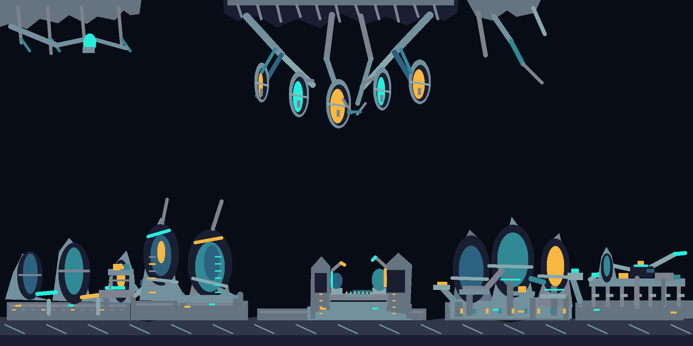
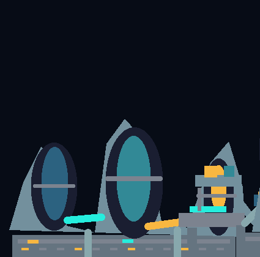
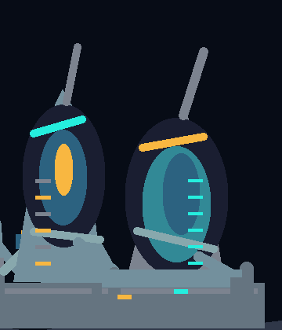
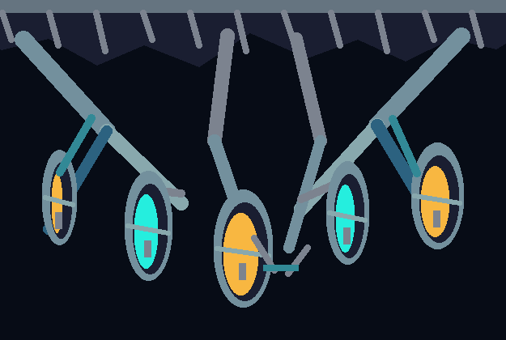
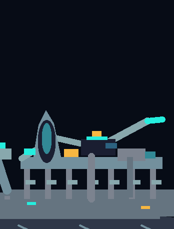

# Vesper Lattice Nursery — original 2048×1024 material-cell landscape

**OPEN Draft/HOLD candidate — AUTHOR STATIC-PASS; independent Art/Technical/Shepherd review outstanding; NATIVE-UNTESTED.** No source art, prior map conversion, engine changes, merge or owner acceptance.

A genuinely new **alien germ-line propagation and dry xenohorticulture plant** in strict perpendicular 2D side elevation. The asymmetric scene opposes a roof-rooted five-organ vesper cilia canopy to a floor-rooted and **physically enterable examination crèche**. It intentionally retains broad playable three-altitude negative space; every rendered pixel comes from real final material-ID cells, not overlaid scenery.

## Districts and flight objectives

1. **Quarantine sluice** (x≈0–410): three unequal isolation lobes, keyed transfer table, decontamination reader and overhead customs canopy.
2. **Root-polymerase mill** (x≈410–730): two different anchored molecular reactors with service ribs and accessible tube approaches.
3. **Vesper canopy and examination crèche** (x≈700–1290): five uneven germinal pods on branching ceiling organs, opposing floor-rooted specimen reader with side-instrumented, open-topped entered bay.
4. **Catalytic ossuary** (x≈1300–1710): three differentiated membrane retorts, operator-loading stations and materially legible valve/extraction connections.
5. **Dry export cleat** (x≈1710–2048): freighter rail, parcel transfer benches, crane and downstream recovery berth.

**Progression:** spawn intake (115,514) → quarantine sluice (337,680) → polymerase (558,550) → canopy sample (1090,402) → nursery core (1050,550) → entered exam (1057,802) → catalytic outlet (1337,660) → export operator (1822,630) → eastern relay (1968,616). Side stations provide upper and lower loop recovery. Exact named sites and coordinates are in `design.json`.

**Dual alternative flight proof:** west gate (679,548) → east gate (1314,554) separately forced above y406 or below y684 while 810≤x≤1220. The full 31×27 hull can traverse **either** and return with an actual solid obstruction (954,446,168,170). Both unblocked and blocked restricted routes pass exact four-neighbour legal-centre BFS without moved endpoints.

## Static physical and serialization contract

- Read-only accepted engine: `techrote/cybersand@de109d0131641d6adc8d25bb9ced7ca3d4991105`, accepted Workbench Setup-v2 source limits **32768 rectangles / 1048576 UTF-8 bytes / 32000000 construction visits**. Actual installed bridge may differ.
- Base: `techrote/sandmapsreference@99a166e7fcae45eb22be1740e9f33f62faccbcc7`; builder seed `2611200706`.
- Complete **2,097,152** material cells; full-grid SHA-256 `f4ceb648ce1120bb021974755c50fb9d31291bd086904e7659729669ef0eaf5f`.
- **606,475 / 606,475** boundary-grounded stable immovable inert solid cells, **0 detached**; no initial water/lava, falling or reactive material; **2145 nominal unsupported cells rejected before final grid**.
- Lossless disjoint ordered five-field rectangles **9534 / 32768**; zero overlap/bounds/replay mismatches. Serialized JSON **177917 bytes**, SHA-256 `de4f041767de14df808bb2ed743fb3e7eac003a0b65ff50108394df774460764`.
- Exact Midge full-body **19×15 / 23×19 / 31×27**: **12/12** precise sites, all four cardinal local steps, main/upper/lower paths and obstructed alternatives pass at 31×27.
- Genuine complete indexed-material **2048×1024** overview and **six unscaled district crops**; all seven pass PNG signature, chunk CRC, stored zlib/Adler32, IEND and exact material-cell pixel parity. Not native gameplay screenshots.
- **NATIVE-UNTESTED:** compiled installed-bridge capacity, Godot Workbench load, actual Midge/Rapier motion/collision/time advancement and fresh-process save/reopen have not been performed here. Compiled CI bridge capacity from prior evidence does not prove owner Windows installation.

## Reproducibility and evidence

`node build.js design.json ./rebuilt` on Node ≥18 (no packages) regenerates the exact Setup JSON, all seven indexed-material PNGs and a fresh qualification receipt, and checks the committed `qualification.json` contract. Source `design.json` defines every authored material drawing operation with fixed seed; the builder prunes unsupported nominal cells, orders lossless rectangles, performs exhaustive replay, checks conservative 4-neighbour hull BFS and obstruction, and verifies the PNG encoder against source materials.

**Qualification boundary:** AUTHOR STATIC-PASS is not independent qualification, gameplay/native compatibility or owner acceptance. Maintain Draft/HOLD; request exact-HEAD independent art, technical and Shepherd assessment.