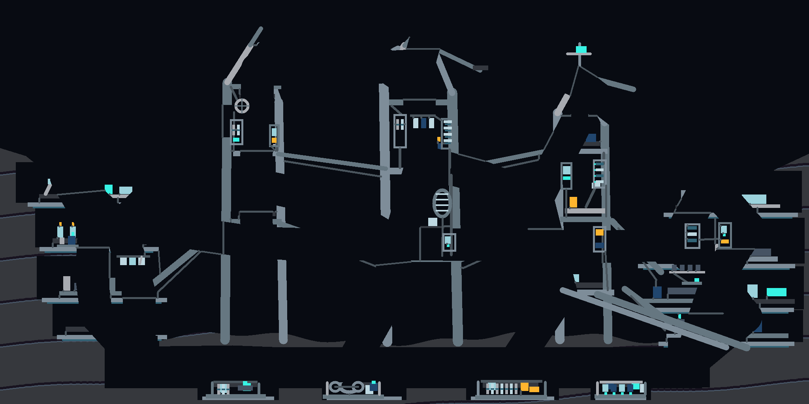
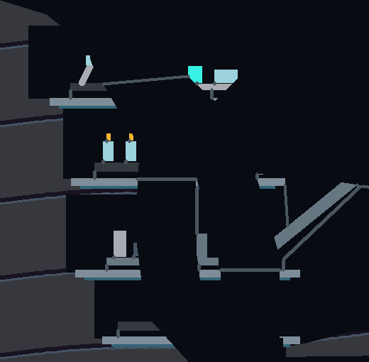
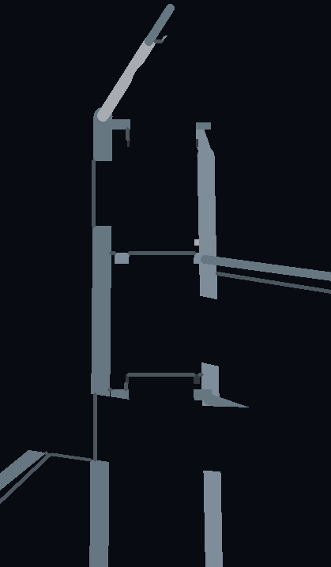

# Aster Drift — Three Needle Storm Refuge (R2)

**ORIGINAL / NO REFERENCE.** Fixed-seed, exact **2048×1024** CyberSand Setup-v2, physically authored in perpendicular orthographic 2D side elevation. **Draft/HOLD; NATIVE-UNTESTED; independent Art/Technical/Shepherd qualification requested.** Not an illustration or source-art conversion.

## R2 substantive functional-geometry repair — 20 November 2026

Independent Shepherd [P1 at original 15bc7b93](https://github.com/techrote/sandmapsreference/pull/59#issuecomment-7038725543) found thin mast bars, insufficient industrial function and underdeveloped underground stations. This R2 revision changes **37,901 actual final material-cell IDs** (**29,641 additions, 243 excavations, 8,017 rematerializations**), preserving the three-needle silhouette, basin voids and original 26 literal Midge sites. Workfaces are physical solids, not overlays or generated concept art.

- **Needle A:** wind-speed rotor with drive linkage, framed ice sampler and independently legible encoder housing, attached to the fork spar.
- **Needle B:** dual intake filter/ice-exchanger banks, cross-needle coolant header, reservoir drum and grounded lower control cabinet.
- **Needle C:** four-stage weather-shield membrane stack, upper sampling enclosure, actuator and servo feed to grounded shield strut.
- **Inhabited west/east:** ferry diagnostic desk, cryogenic cassette conveyor, two-stage quarantine wash, instrumented scrub processor and freight transfer line.
- **Geothermal return:** four differentiated, entered stations for fossil assay, duplex return pump, finned heat-exchange archive and refuge pressure/medical terminals. Continuous lower flyable corridor retained.

All previously declared points are still reached from the unchanged spawn by literal-centre 4-neighbour flood at **19×15, 23×19 and 31×27** hull envelopes; a physically added obstruction at **[1034,374,1113,448]** continues to disable only the intentional Crown transfer node, leaving **25/25** other stations reachable. All **385,967** material solids are edge-rooted; 0 detached. Independent **R2 exact-HEAD Art/Tech/Shepherd qualification required**; preceding static findings must not be carried forward as R2 acceptance.

## World and engineering

A frontier community at the edge of a storm-eroded off-world shelf operates **three structurally different atmospheric monitoring needles**. Left: a split/fork-tip anemometer mast and inhabited meteorological test decks. Centre: a huge double-legged cryogenic air-condenser and sonic-receiver gallery, with physically side-enterable instrument voids. Right: an asymmetric shield-leaf electrical and biofilter station, tied by two structural buttresses into the eastern ridge. They overlook broad overflight/return cavities rather than repetitive factory tiles. All visible supports, diagnostic plates, specimen trays and industrial fixtures are real material cells. Nothing assumes perspective, platform tops, illustrated backgrounds or authored fluids.

Six interconnected functional districts, distinct in structure and activity:

1. **West Stormport:** landing ferry, crew exchange, cultivation, cold cassette pressing and pressure testing in excavated shelf chambers
2. **Anemometer Crown:** fork-tip aerial sensor, calibration and crew refuge distributed through vertical mast decks
3. **Crown Condenser:** split cryogenic compressor, seismic reference, measurement gallery and accessible transfer node
4. **East Shield Needle:** asymmetric lightning/research receiver, shielded biofilter and operational upper decks
5. **Quarantine and Evacuation:** scrubbed personnel intake, specimen nursery, cargo hoists and supercapacitor hall
6. **Geothermal Return:** fossil sensor bank, pump manifold, heat archive and refuge cells in a continuous underfloor flyable tunnel

**Gameplay graph (semantic, not hand-waved nearest-site):**

- Primary: West stormport → Wind bridge west → Grand atrium → Basin overflight → East health quarantine → Evacuation hangar
- High recovery: West stormport → Upper diagnostic dock → Anemometer crown → Seismic reference pod → Jetstream recovery → Needle three upper
- Laboratory links: Tower one midshaft → Wind bridge west → Crown transfer node → Biofilter terrace → Needle three upper
- Independent lower return: West descent → Fossil sensor lab → Return pump manifold → Thermal archive → Storm cellar refuge → East tunnel mouth
- East local loops: East health quarantine ↔ Scrub holding bay ↔ Evacuation hangar ↔ Shield capacitor hall ↔ East tunnel mouth

**Midge spawn:** literal *West stormport* (304,574). Exact named destinations and coordinates live in `receipt.json` and are never snapped, radius-waived, shifted to an alternative empty centre or replaced by approximations. The physical blocked-test rectangle **[1034,374,1113,448]** intentionally covers *Crown transfer node* (1068,408); the **other 25 named sites remain reachable** via upper/lower alternatives at 31×27. All 26 sites are reachable from the literal spawn with 19×15, 23×19 and 31×27 full clearances before obstruction.

## Reproducible build

Run `node build.cjs` from this folder to regenerate all canonical outputs, or `node build.cjs --verify` to check the committed `setup.json`, `receipt.json`, all six authentic indexed-material PNGs byte-for-byte. Seed **0x26A721**. The builder creates exactly **2,097,152 material IDs**, encodes the final grid losslessly as disjoint five-integer `[x,y,width,height,material_id]` rectangles, exhaustively replays the rectangles and verifies exact material equality. It verifies boundary-grounded 4-connected structural components, literal-site free-centre BFS, real temporary obstruction, PNG decoding/pixel parity and SHA-256.

- Source: `techrote/cybersand` accepted main **de109d0131641d6adc8d25bb9ced7ca3d4991105** (read-only)
- Base repository: `techrote/sandmapsreference` main **99a166e7fcae45eb22be1740e9f33f62faccbcc7**
- Output extent: 2048×1024; total material cells **2,097,152**
- Grounded inert static material cells **385967 / 385967**, with **0** detached
- Ordered nonoverlapping rectangles **5454 / 32,768**
- Setup-v2 UTF-8 JSON **101945 / 1,048,576 bytes**
- Construction cell budget **385967 / 32,000,000**
- Material grid SHA-256: **c4900fc764a469ba48babc3cb2a2a76d377ec9c0305ca9837b482cf253b5711c**
- Setup JSON SHA-256: **41858caca8254bbcbf27d583ed0444805e6e0f403b9bde9105d594f760e22908**
- Physical-material palette: `49, 62, 63, 66, 68, 77, 79, 100, 101, 120, 121, 129, 130, 131`, validated against the accepted stable inert Solid/None catalog; no falling powders, mobile fluids, reactive or combustible foundations
- Named sites: **26/26** at each conservative clearance; physical-obstruction recovery **25/25 other sites**
- Printed image proof: one full **2048×1024**, plus **five authentic unscaled 1:1 district crops**, IDs encoded as actual indexed PNG palette indices; no fake game screenshot or AI scene illustration
- No native performance or gameplay assertion: actual installed CyberDemoBridge/Workbench/Godot/Rapier actor movement, collision, physics tick and cold save/reopen remain **NATIVE-UNTESTED**

## PNG gallery — actual physical cells

| 1:1 district crop | 1:1 district crop |
|---|---|
|  |  |
|  |  |
|  | |

## Installed-bridge admission

Accepted source `godot/scripts/workbench_setup.gd` advertises 32,768 rectangles and 1 MiB JSON, but falls back to **4,096** if the installed bridge lacks a compatible `workbench_start_rectangle_capacity` method. **This map exceeds that legacy fallback by 1,358 rectangles.** Establish the actual installed binary capability before asserting admission. Native runtime test still requires exact binary hashes, Workbench import, piloted Midge traversal/collisions, tick progression and cold save/reopen. Keep **Draft/HOLD** and request independent exact-HEAD Art/Technical/Shepherd review.