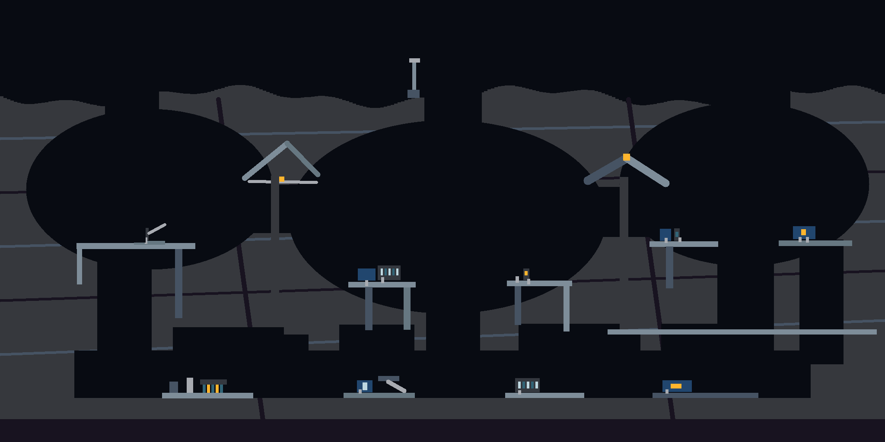

# Copperwake Fault — Three-Vent Relay Colonies

**ORIGINAL, NO SOURCE ART · 2048×1024 orthographic physical material-ID cells · Draft/HOLD · creator STATIC-PASS · NATIVE-UNTESTED**

This is an independently designed *subterranean colony braid*: three unequal hollowed bedrock cavities below a weather-exposed overland surface, three accessible vertical intake shafts and a long dry understrata gallery. The western settlement supports rover recovery and nursery interchange; a central lithic relay houses isolated assay/archive workfaces; eastern quarantine and freight stages connect toward a lower chain of ore, data, sediment and dispatch workbays. Nothing isometric or scenic-only is presented as geometry.

## Corpus thesis
The deliberate underrepresented axes are **nested cavities rather than open valley**, **interleaved surface/cavern/substrata altitude grammar**, **braided routes with separate transit/equipment stages**, and **sparse colonised interior versus large deliberate excavation voids**. Every visible image is generated by sampling one physical material-ID cell per image pixel. Purposefully vacant mezzanines and expansion seams are preserved for human edits, procedural module derivation and future scripted-event geometry, not errors to automatically furnish.

## Gameplay and staging
Spawn: **West airlock [191,417]**. Goal chain: **West clinic / nursery → West transfer → Mid assay / Relay cradle / Mid archive → East transfer → East quarantine / East rover service → Deep freight and return**. Navigation can use the high exposed surface, excavated bore connectors or lower service return; named waypoints (33) must remain literal. The fixture solid-block test covers **[1014,457,1067,512)** and intentionally disables only Relay cradle, preserving all **32 other destinations** at the most conservative 31×27 envelope. The narrower 19×15 and 23×19 envelopes also cover 33/33. The obstruction is a **test-only fixture**, not included in the committed world.

Candidate scripted-event stages, *not scripted here*: fracture-jaw bridge failure, relay commissioning, quarantine holdout and deep freight chase/arrival. Empty bays remain possible insertion and reconfiguration sites.

## Mechanical proof and contracts
- Accepted read-only CyberSand main: `de58bf1997ca75825cf3b29e046dc1c1022c45bf`; map base: `99a166e7fcae45eb22be1740e9f33f62faccbcc7`.
- Fixed seed: `12644353`; grid: **2,097,152** final byte material cells, SHA256 `95c4062f52694ec7a7664723692014043e8e593f1036ef72a748a7a96fbbbf5a`.
- Exactly **2696** in-bounds, ordered, nonoverlapping five-integer rectangles and **745451** cell writes; **52783** UTF-8 bytes; full-row plus vertical-run canonical encoding with exhaustive zero-difference replay.
- **745451/745451** occupied inert hard-surface cells rooted to the map boundary. Prototype detached candidates removed: **12454** cells in **15** groups; **zero detached final cells**. No powders, fluids, reactive, falling or uncontained liquids.
- Source contract: 32768 rectangles, 1 MiB Setup JSON, 32 million paint-work cells. The owner operates the current accepted main; no speculative installed legacy bridge assumption. **Source static verification is not native gameplay evidence.**
- Exact named waypoint clearances: **19×15: 33/33; 23×19: 33/33; 31×27: 33/33**. Obstruction result **32/33** with only the intended relay destination unavailable.
- Engine Setup-v2 keys, Midge actor model/hash/spawn/options, deterministic seed, material histogram, PNG dimensions/hashes and destinations are recorded in [receipt.json](receipt.json). All source-authored materials are accepted inert solid-state construction IDs.

## Authentic indexed-material gallery

- [01 West colony — 1:1 physical cells](01-west-colony.png)
- [02 Central relay — 1:1 physical cells](02-mid-relay.png)
- [03 East quarantine — 1:1 physical cells](03-east-quarantine.png)
- [04 Deep service return — 1:1 physical cells](04-deep-return.png)
- [05 Surface vent network — 1:1 physical cells](05-upper-vent-network.png)

Run `node build.cjs --verify` in this directory to independently reproduce each Setup, receipt and PNG byte and verify equality; plain `node build.cjs` regenerates these artifacts. `exemplar.json` is **corpus metadata only**, not part of Workbench Setup v2.

**Independent Art/Technical/Shepherd exact-HEAD review requested.** No Godot binary, installed CyberDemoBridge, Midge/Rapier runtime or save/reopen was executed in this creator environment: **NATIVE-UNTESTED**. Maintain Draft/HOLD; no Ready, merge, auto-merge or owner acceptance.
