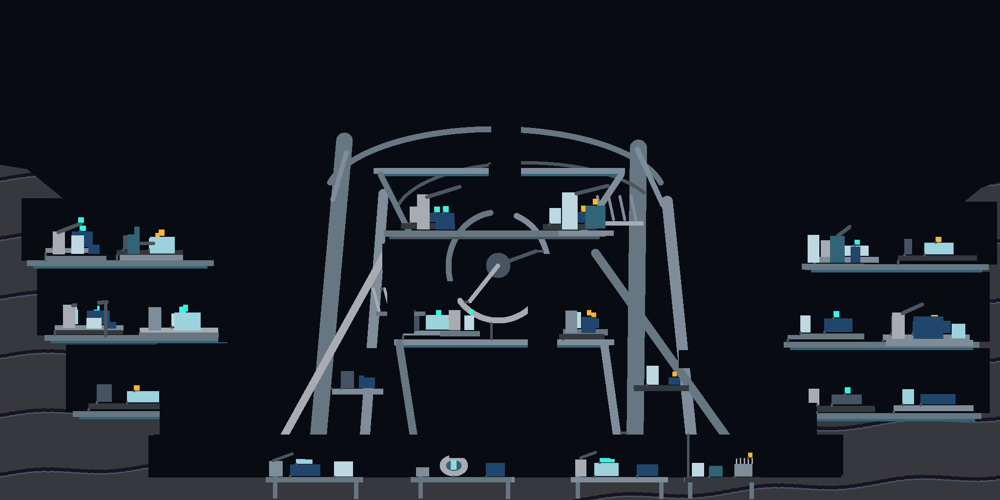
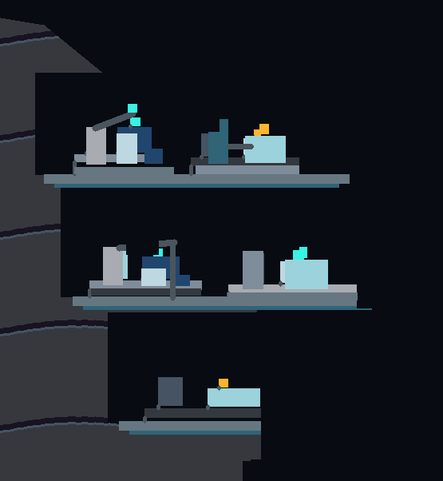
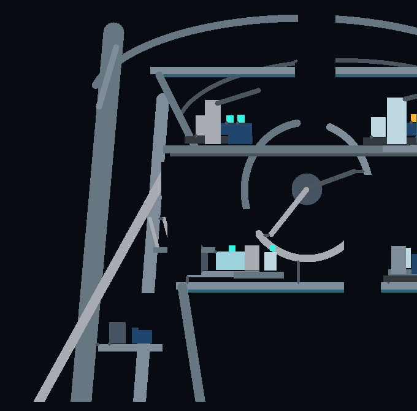
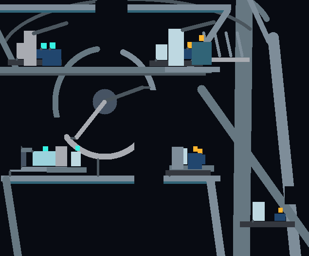
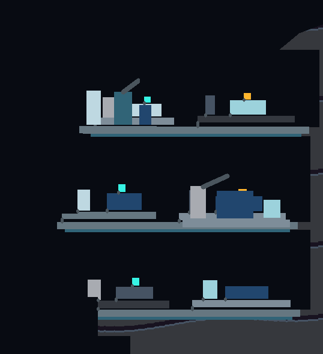

# Harrow Mere — Basalt Spore-Dam Pneumatic Harvest

**Entirely original 2048×1024 perpendicular side-elevation CyberSand material-cell world.** A frontier settlement harvests alien atmospheric spore deposits using four unequal, bedrock-anchored pressure bulkheads and an open industrial diaphragm/rotor. No reference painting, perspective surfaces, fake screenshot, or prior-map geometry was used.

## Functional places and flight graph

The macroscopic spore-dam occupies the basalt cleft between a rover-operated western settlement and an isolated eastern sample-handling colony. It is intentionally playable at material-cell scale: authored 1:1 rooms, cartridge hoppers, diagnostic tables, compressor actuators, quarantine workfaces, work platforms, elevators and a dry subterranean rescue return.

The west district contains rover service at **West arrivals (254,461)**, **Spore cold intake (178,615)** and **Machinist exchange (285,751)**. The east district contains **Eastern decon intake (1763,472)**, **Quarantine cleanroom (1903,457)**, **Biofilter assay (1769,620)** and **East rover depot (1888,759)**. The central dam has separately functional **Dam intake pump (749,739)**, **West baffle controls (814,523)**, **Rotor inspection (1103,563)**, **West culture assay (874,605)**, **East xenology analyzer (1161,617)** and **East service deck (1410,735)**.

**Main route:** West arrivals → western intake/maintenance → Dam intake pump → West baffle controls → Upper baffle catwalk → Rotor inspection → East xenology analyzer → East quarantine intake / cleanroom / freight. **Upper bypass:** West ridge lookdown → upper sky overflight → East duct loft → eastern ridge lookout → quarantine. **Underground alternative:** West rescue hatch → Deep silt-free lab → Deep sample centrifuge → Deep mineral archive → Deep return east → East rescue hatch → East biofilter. **Mistake recovery:** lower basin and either escape shaft connect to the same graph. All stations use literal immutable coordinates in `receipt.json`.

The actual obstruction `[997,367,1062,428]` physically closes only **Upper baffle catwalk (1031,395)** while preserving 25 other sites at 31×27; the overflight and lower route remain available. The four laterally entered machine hatches were excavated *before* static qualification rather than substituting nearby targets.

## Real indexed-material evidence

| West inhabited sporeport | Central pneumatic dam |
|---|---|
|  |  |
| Separator rotor / service hatches | Eastern quarantine and freight |
|  |  |

Overview is exactly **2048×1024 pixels**. All five crops are true **one material ID per pixel** and are neither AI imagery nor native-gameplay screenshots.

## Static qualification — exact creator output

- Fixed-seed `build.cjs`, seed `0x26D120` (2543904 decimal); run `node build.cjs --verify` to regenerate and compare every committed file, including independent Node crypto and PNG inflation/CRC checks.
- Accepted read-only CyberSand `main@de109d0131641d6adc8d25bb9ced7ca3d4991105` (Setup-v2, 14 root keys, actual 2048×1024 dimensions, Midge authored 4×3 rectangle).
- Map repository source base `main@99a166e7fcae45eb22be1740e9f33f62faccbcc7`; no engine modification.
- Exactly **2,097,152** material ID cells; **482035 / 482035** grounded inert solids; **0** detached. No fluid, sand, unstable falling/reactive support; static Solid/None only.
- **4888** legal ordered, disjoint, losslessly replayed 5-word rectangles. JSON **91726** bytes; construction work **482035** cells. Accepted source budgets: 32,768 rectangles, 1 MiB Setup, 32 million work.
- Final material SHA-256 `24cb3bfcd5c396b94178a52eaa83396ea9d1bb05f350e7ccde9e53fe2bdf241b`; Setup SHA-256 `2cd66a97f96c15f9d8513e6be20edbaeb62abe1d2fc7baadbbfcb5f968f59b50`.
- Every **26/26** literal named site tested with 19×15, 23×19, 31×27 full-footprint free-centre 4-neighbour BFS, no exemptions, nearest-site replacement or shifting. Physical obstruction preserves **25/25 unaffected** sites at 31×27.
- Full ordered replay plus byte and histogram receipts in `receipt.json`. Indexed PNG generation from same final committed plane with fixed-Huffman zlib (PNG chunk CRC, Adler-32, raw material pixel parity verified in the creator's deterministic build).
- Installed older bridge **4,096** fallback may not admit this map's **4888** rectangles. Accepted source advertises 32,768 but that does *not* prove installed compatibility.

**Review status:** creator static PASS only; independent exact-HEAD Art, Technical, and Shepherd P0/P1 decisions pending. **NATIVE-UNTESTED:** no compatible Godot/CyberDemoBridge/Rapier binary, real input/collisions/simulation, or fresh-process save/reopen has been demonstrated. OPEN Draft/HOLD, not Ready, not merged, no owner acceptance.

## R2 real-cell P1 correction — 20 November 2026
The current Shepherd exact-R1 functional-place P1 was addressed by rebuilding distinct physical machinery: western cold-spore capture/hopper and seed sieve, opposed dam compression/pressure regulators and rotor inspection, eastern decontamination/membrane filtration and freight weighing. The original long empty underdam floor is now a sequence of four materially different rooted workcells: crane-fed ore assay, mechanically legible drum centrifuge, mineral scanner/archive, and finned pump/recovery station. Lower workcell operator clearance and side entries were designed around the literal Midge centres, not by shifting destinations. Exact route receipts, obstruction, grounded structural checks and all images were regenerated from material cells and rechecked. The original dam silhouette and free aerial basin are retained. Creator STATIC-PASS only; **fresh exact-R2 independent Art/Technical/Shepherd review required**. Installed bridge and native game/persistence remain **NATIVE-UNTESTED**.
