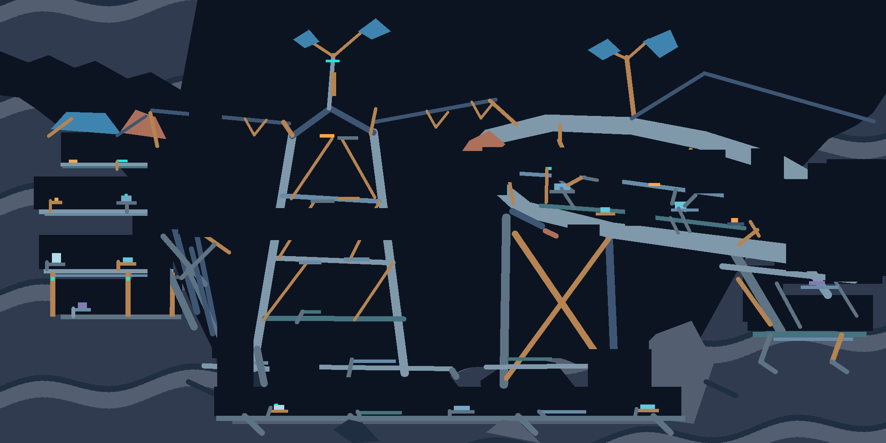

# Keelgrave Cryodock — Salvage of the Broken Ark

**Wholly original** 2048×1024 CyberSand Setup-v2 material-cell landscape, true perpendicular side elevation. **DRAFT/HOLD · STATIC AUTHOR-VERIFIED · NATIVE-UNTESTED · independent technical/art/Shepherd review requested.** No image tracing, source asset or artificial concept rendering. This is a new world unrelated to prior Sci-Fi Frontier maps.

## Place and geometry
The wreck of a long-range interstellar Ark hangs across a xenogeological fault above an abandoned cryogenic industrial dock. From west to east the independently composed geographic districts are:
1. **West rover settlement and xenology galleries:** grounded cliff-cut habitable work floors, separate assay station, controlled rover arrival, and a return to the fracture throat.
2. **Survey uplink and twin-stage signal lift:** asymmetrical elevated sensor station and antenna arms, split service cages, functional suspended cable bays, alternate high route and lower throat.
3. **The Broken Ark:** broad tilted, breached ship hull with separate prow, navigation, medical-archive and salvage areas. Service bracing and gaps permit Midge to enter from the open rift rather than presenting a solid backdrop.
4. **East emergency cryodock:** displaced emergency locks, recovery gantries and upper beacon, with deliberately different deck geometry and direct passage into the rift.
5. **Deep mineral survey and cable basin:** supported mining airlocks, weather lab, geological vault, and a cross-world lower return alternative.

True 2D flat side elevation throughout: every visible mass is a real material ID. Intentional negative sky and rift voids contrast with functional human-scale decks and equipment. The largest broken pieces are supported by real rock-to-rock paths: no detached solids.

## Route topology
Main inhabited crossing: West rover arrival → Settler assay lab → Rift transit throat → Elevator machinery → Crashed ark prow → Ark navigation → Ark medical archive → Ark salvage hangar → East emergency lock.

High reconnaissance alternative: West rover arrival → High xenology alcove → Suspended sensor station → Uplink outboard → Crashed ark prow → East upper beacon → East emergency lock.

Lower recovery alternative: Rift transit throat → Mine west airlock → Deep mineral vault → Fissure weather lab → Lower cable basin → Mine east survey → East emergency lock. Side connections between these routes are intentionally open and flyable at Midge conservative clearance.

All **18** exact named site centres are recorded verbatim in receipt.json; no nearest-position substitutions. Two large deliberate physical obstructions were stress-tested independently at [1020,466,1130,575] and [1020,730,1140,860]; 31×27 centre graph retains all 18 sites in each case.

## Physical contract and reproducibility
- Source of truth: accepted CyberSand **`de109d0131641d6adc8d25bb9ced7ca3d4991105`**; Setup-v2 loader Git blob `70dd964bc2d5bff9ca030edd57d7fc7aa5068fc9`; native material definitions Git blob `dcf05895da3015a2e999e3d1cbbae0fdc7fe32b3`. Engine is READ ONLY; no native/bridge modifications.
- Midge authored hull **4×3**; full-envelope conservative axis-aligned 19×15, 23×19 and 31×27 site clearance, 4-connected *exact* centre BFS, no target shifting.
- Fixed seed **`202611192143`**. Run **`node build.cjs`** to reproduce JSON, receipt and all six authentic indexed material-ID PNGs; **`node build.cjs --verify`** refuses byte drift on generated artifacts. No npm packages or external images required.
- Real full grid **2048×1024 = 2,097,152 cells**; all occupied IDs are inert `MaterialState::Solid` / `RuleKernel::None`, zero liquids/powders/agents, no unsupported IDs. Full histogram is included in receipt.
- **9,750 nonoverlapping ordered rectangle edits**, **182,500 JSON bytes**, **735,779 occupied/work cells**, below source limits of 32,768 edits, 1,048,576 bytes, 32M construction writes.
- Every occupied cell is boundary-connected by 4-neighbour *solid-to-solid* traversal: **735,779 / 735,779 grounded, zero disconnected**.
- Material plane SHA256: `afa998ba1d2e98990d16d9f8baf8beb0d11252ed4a4215c2eaea7f5f0c8f65f7`; Setup-v2 SHA256: `54cd07adda406a2312601b2797359f22e8b793ab0400c262afee1748424e7c01`.
- True full-cell overview plus five original 1:1 district crops; each palette index encodes the *exact* material ID, not a concept illustration. PNG integrity, raw full-grid/crop equality and deterministic replay independently checked by builder; the PNGs are not Godot screenshots.

## Proof gallery

[West settlement](01-west-settlement.png) · [Signal lift](02-signal-lift.png) · [Ark prow](03-ark-prow.png) · [Ark drydock](04-ark-drydock.png) · [Deep mines](05-deep-mines.png)

## Outstanding gates / truthful interpretation
**NATIVE-UNTESTED.** An accepted source may advertise 32,768 edits but installed CyberDemoBridge can fall back to **4,096**; this map has **9750** and cannot be assumed loadable under a stale native binary. No installed Godot/CyberDemoBridge/Rapier simulation, Midge thrust/contact or fresh-process save/reopen acceptance was executed. Independent exact-HEAD art, technical, Shepherd and owner reviews remain required. STATIC AUTHOR-VERIFIED is not native or independent acceptance. Keep Draft/HOLD; do not merge, Ready, auto-merge or claim acceptance.
