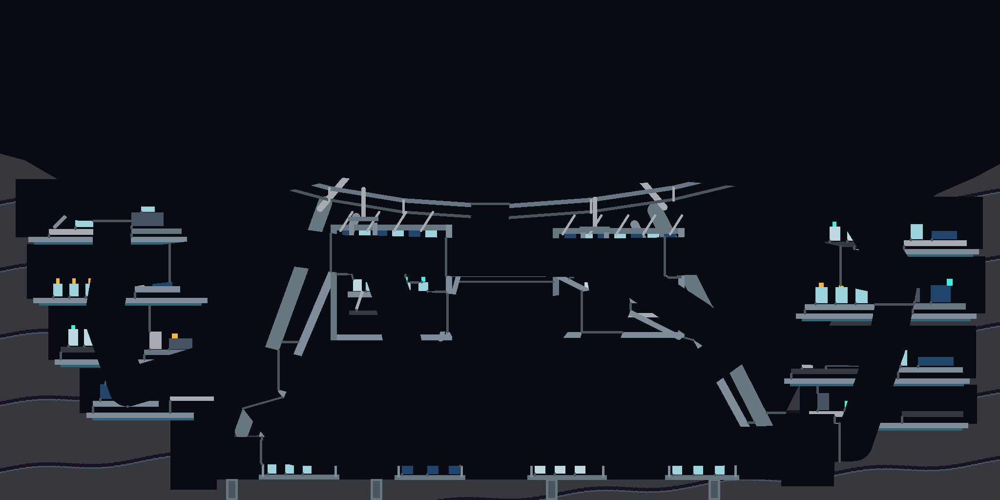

# Nacre Fault — Biofoundry Cableway (original Sci-Fi Frontier, 2048 × 1024)

**Draft/HOLD · independent reviews required · NATIVE-UNTESTED.** Completely independently authored, perpendicular orthographic side elevation; no reference artwork, previous geometry, compositing or imitation screenshot. All art is a direct material-ID grid export.

## Landscape, architecture and encounter structure

On an off-world tectonic shelf, two settlements operate a sagging double-tendon cableway over a great navigable fault. West: inhabited rover intake and crane, diagnostics and xenobotanical assay, seedbank and specimen freezer. Mid: tensile station, a two-tier service pod with green laboratory machines, an open-air transfer stop and an asymmetrical suspended xenoculture medical pod. East: cleanroom intake, quarantine scrubbers, freight battery handling and ridge observation. Below: a rock-cut interconnected chain of geology archive, water-pump service, biomass reclamation and climatology lockers. Cable support pylons are physically anchored into the strata and reinforced by diagonal compression members; overhead guideway lines and open sky are actual material cells and free space.

**Route graph (exact Midge centres)**

- Primary inhabited route: West rover checkpoint (228,552) → West cliff turnout (466,731) / upper winch → Seedfoundry entry (773,521) → Midline service hatch (1000,526) → Xenoculture east (1233,527) → East xenoculture library (1841,570) → Freight battery room (1815,710).
- Upper aerial alternative: Rover crane (159,412) → Winch lookout (527,365) → Upper guideway west (700,324) → Lagrange transfer (1006,360) → Upper guideway east (1379,330) → Ridge observation (1822,365) → Eastern decon (1760,440).
- Below-fault recovery: West biofoundry → Specimen freezer (261,793) → Underfault geoarchive (606,914) → Return pump plant (866,914) → Biomass reclaimed store (1151,914) → Deep climatology (1451,915) → East descent (1748,905).
- Independent sky and basin recoveries: Cableway sky recovery (1023,120), Open basin recovery (1027,794), and side-door/shaft transitions connect the upper and lower networks. The exact physically blocked 75×62 rectangle enclosing the Midline service hatch leaves all **25 other** named sites reachable at 31×27 clearance.
- **All 26 named sites** are stored by literal unshifted coordinates in `receipt.json`. Exact conservative hull scans and full 4-neighbour free-centre BFS at 19×15, 23×19, 31×27 run inside `build.cjs`. No nearest-site substitutions.

## Authentic indexed-material gallery

The 2048×1024 overview and **six pixel-for-pixel, unscaled** district crops are generated from the same final 2,097,152-byte material plane. PNG palette index **equals material ID**, with filter-0 scanlines. Crop XYWH and source hashes are enumerated in the receipt.

| File | Covered district |
|---|---|
| `01-west-rover.png` | Western rover intake, stacked residential/seedbank and assay machinery |
| `02-seedfoundry.png` | Sagging cable, west structural pylon and first laboratories |
| `03-cable-transfer.png` | Mid-span service stop and underside flight opening |
| `04-xenoculture.png` | Distinct eastern suspended xenoculture clinic |
| `05-east-quarantine.png` | Staffed eastern cleanroom, freight and ridge |
| `06-underfault.png` | Genuine connected low geological service return |

## Construction and static provenance

- **Map repo accepted base**: `99a166e7fcae45eb22be1740e9f33f62faccbcc7` on `main`.
- **CyberSand READ-ONLY engine authority**: `de109d0131641d6adc8d25bb9ced7ca3d4991105` on `main`; `godot/scripts/workbench_setup.gd` defines 32,768 source-side rectangle ceiling, 1 MiB JSON ceiling and 4,096 older-installed-bridge fallback. Only recognised static inert-material IDs are used (basalt/obsidian, steel, glass, metals, equipment); no unsupported sand/liquid/reactive support.
- **Fixed generator seed**: `0x26B520`. Run `node build.cjs --verify` to replay **all grid and ordered nonoverlap rectangles**, check 3 hull sizes, physical obstruction, full static grounding, SHA-256, PNG CRC, zlib decode and **every indexed pixel against final cells**, verifying committed filenames byte-for-byte. Run `node build.cjs` to regenerate.
- **Actual final material cells**: 2,097,152, of which 369,792 are occupied. 369,792 / 369,792 supported and boundary-connected; detached **zero**.
- **Lossless rectangles**: 4,370 distinct nonoverlapping ordered 5-tuples, all within source budget; **rectangle work 369,792**. Actual Setup JSON bytes **82,003**.
- **Plane SHA-256** `cf2cec0c8d04a00668a4c0659e316d88b855126aba38995fc1f52aa5d8a6beeb`; **Setup SHA-256** `c72b01c0224521088542022ef1672ef4722f95db7bdef98d453c91e3cf87d626`. Full histogram and crop SHA-256 in `receipt.json`.
- Creator static SOURCE PASS is distinct from independent Art/Technical/Shepherd qualification and actual Workbench gameplay. No Godot / CyberDemoBridge / Rapier runtime or matching installed binary available in execution environment. **NATIVE-UNTESTED** for import, actor collisions/advancement and save/reopen. This map needs 4370 rectangles and **would not fit a 4,096-capacity installed legacy bridge**; do not fake admission or trim scene to fit without a real installed capability measurement.

Never merge, Ready, auto-merge or claim owner acceptance without independent review.
