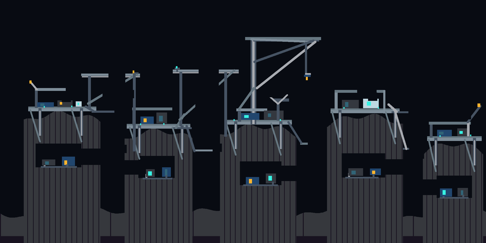
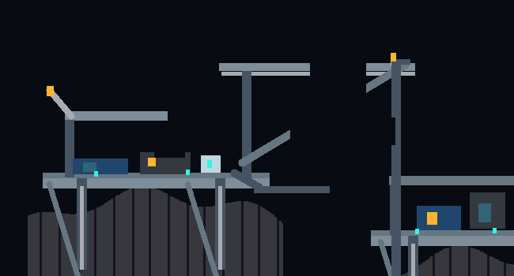
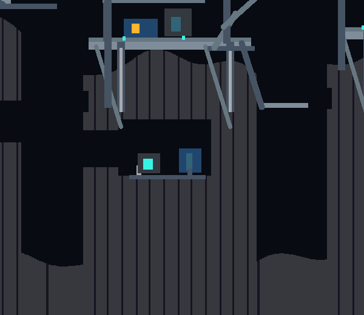
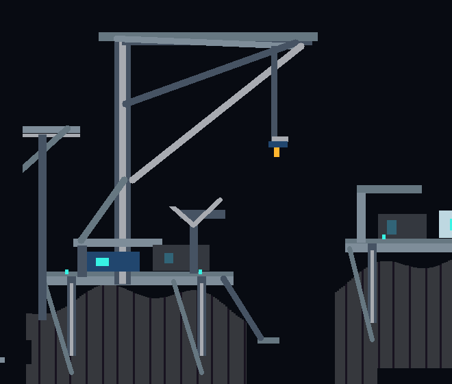
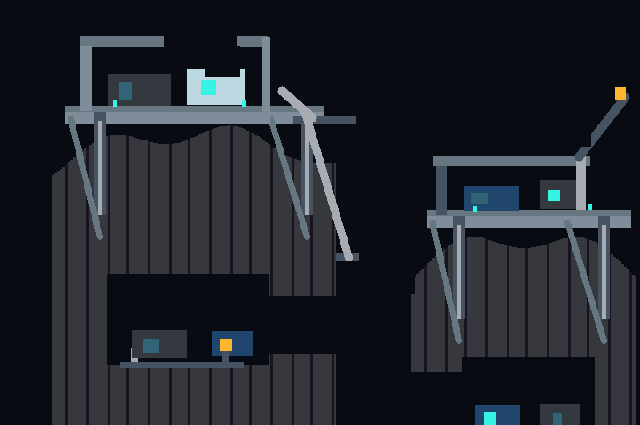
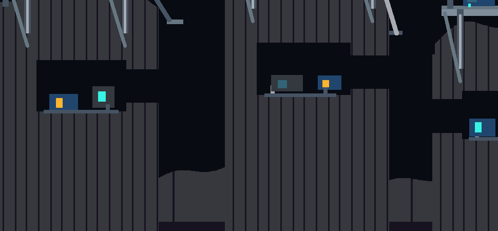

# Orison Strand — Fracture-Island Salvage Exchange

**New, independently authored 2048×1024 CyberSand material-cell landscape · original/scifi-frontier-wide · Draft/HOLD · creator STATIC-PASS · NATIVE-UNTESTED.**

This is a true perpendicular 2D side elevation, not source-led conversion or scenery. A five-island geological salvage chain contains west rover medicine, thermal materials audit, a giant salvage crane and instrument works, eastern quarantine custody, and outbound rescue-ferry services. Each mesa also contains an accessible side-cut chamber or service vault. The intentionally incomplete tram limbs are rooted to local geological piers; the broken spans, empty expansion stubs and canyon voids are deliberate authoring affordances.

## Authentic material-cell overview

### Actual unscaled 1:1 grid crops

## Source and hard qualification

- Engine authority: `techrote/cybersand/main@f7e056c9b8791106e22f2d1c295043783d8a9701` (read-only). Map repository base: `99a166e7fcae45eb22be1740e9f33f62faccbcc7`.
- Reproducible scene/encoding: `build.cjs` fixed seed `12625681`; run `node build.cjs` from this folder, or `node build.cjs --verify` to test generated artifacts against checked-in bytes. Requires only Node.js standard modules.
- Exact source grid: **2,097,152 material-ID cells**; SHA-256 `74e0cf09f84cf2033d90bef5e20cf5a342dcd779931eb2ff5ee5d9312a4b8013`. **3,911** ordered lossless nonoverlapping rectangles, JSON **74,008 bytes**, paint work **822,121 cells**. Caps (source): 32,768 rectangles; 1,048,576 JSON bytes; 32,000,000 work cells.
- Physical state: **822,121/822,121 final occupied cells boundary-grounded**. Zero final detached solids or fluids. **382 prototype disconnected cells across 3 groups** removed before final serialization, not part of the committed level. All 12 used nonzero material IDs were individually matched against accepted inert Solid/None native catalogue entries. No falling powder or free liquid foundation.
- Exact named destinations: **31/31** at **19×15**, **23×19**, **31×27** full in-bounds hulls using nonshifted centres and exhaustive 4-neighbour BFS from the literal Midge spawn `[205,408]`. The physical test wall `[653,249,694,290)` blocks only the designated ruined-tram inspection destination; **30/30 unaffected destinations still admit flight and return** at 31×27.
- `route_graph.json` contains all literal node coordinates, route groupings, proof and the actual obstruction. `exemplar.json` includes Corpus-Index v1 controlled diversity axes, relationships, edit affordances and four non-scripted set-piece candidates.
- All six real indexed-material PNGs derive directly from the final committed cells, not AI illustrations or substituted screenshots. They pass independent PNG chunk CRC, zlib Adler, full-grid 1:1 pixel parity and SHA-256 checks (**3,786,912 image pixels verified**).

## Corpus purpose / new information

Distinguishes this piece from the ceiling-hung counterweight worlds, nested chamber maps, stepped terrace settlements, and reflector rings: **five separated-in-profile geological islands; a damaged multi-part tram canopy; a towering one-off crane with explicit ground load-path; entered side-cut vaults; open ravine recovery.** It teaches broken-span adjacency, district-to-district vertical flight rejoining, uneven mesa supports and partially complete modular workface construction. Unused expansion bays are intentionally kept.

## Outstanding independent/native gates

Creator static validation is not independent reviewer signoff or real gameplay evidence. **Independent exact-HEAD Art/Technical/Shepherd reviews, GitHub CI status, installed Workbench/Godot/CyberDemoBridge/Rapier load, physical collisions, progression, save and reopen are not proven here. Status remains NATIVE-UNTESTED / Draft-HOLD.** The source budget uses accepted 32,768-rectangle Workbench main, not the obsolete fallback. No merge, Ready promotion, engine or scheduling changes.
