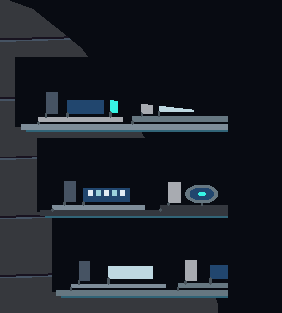
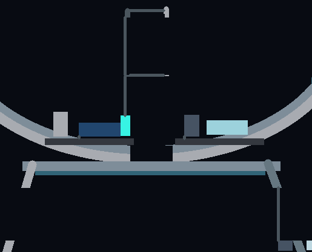
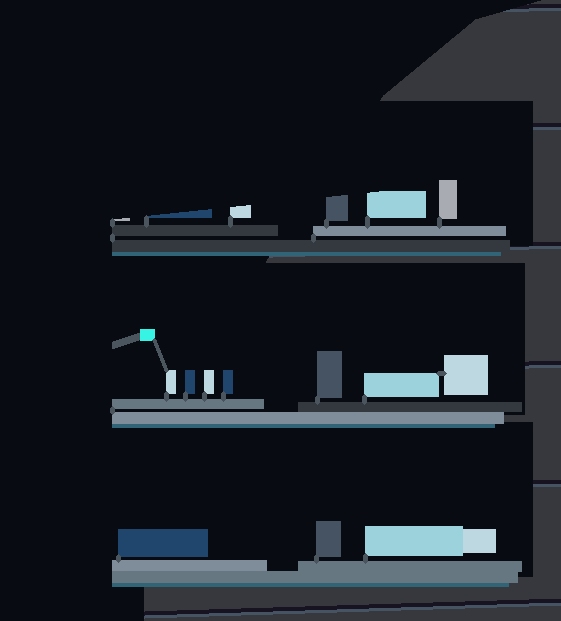

# Penumbral Sink — Split-Mirror Resonance Mill

**Entirely original 2048×1024 CyberSand material-cell level**, never based on reference art. True perpendicular side-elevation geometry. Author-only source-static evidence; **OPEN DRAFT/HOLD, NATIVE-UNTESTED, independent exact-head Art / Technical / Shepherd review requested**.

## Situation and districts

An off-world resonance-milling installation is bored into opposed basalt shelves around a hollow, fractured elliptical acoustic collector. The double-crescent mirror is an actual material structure, broken into entered portals rather than a painted background. Arrival is **West rover arrivals (180,445)**; the playable objective is **East rover freight (1900,779)** by surveying the instrument hall and returning cargo east.

1. **West rover/compression service:** real vehicle receiving, high-pressure drive, controls, sample handling.
2. **West listening/biomaterial laboratory:** entered chambers, instrument cassettes, protected station and human-scale walkways.
3. **Split elliptical acoustic reflector:** twin broken baffles, rooted trusses, opened lateral ports and upper observation routes.
4. **Mill pressure-control and specimen transfer:** separated operational benches, twin lift cords, indexed core handling.
5. **East quarantine and mineral processing:** physically different isolator, classifier, radiation archive, rover freight.
6. **Deep quarry return:** four distinguishable ore, rotary pressure, thermal and rover-recovery workfaces.

## Real flight paths

Main: west arrival → main cross-sink passage → ring ports / mill transfer → eastern service hall. Overflight bypass traverses the roof of the broken mirror. Lower basin and deep maintenance return provide separate recovery paths via left and right rescue shafts. Exact 32 named sites and their literal XY centres are in `receipt.json`; no nearest-reachable substitution.

The temporary physical obstruction `[1006,547,1067,606]` (XYXY) intentionally isolates *Mill drop transfer* only; the other **31/31** targets remain reachable under the complete **31×27** envelope. All **32/32** exact sites pass baseline exhaustive 4-neighbour flood at **19×15, 23×19, 31×27**.

## Source-static qualification

- Accepted CyberSand source: `7b03aa437561ec63e31fd09531171360ab60eeb4` (read-only). Reference repository base: `99a166e7fcae45eb22be1740e9f33f62faccbcc7`.
- Deterministic builder and fixed seed: `build.cjs`. Run `node build.cjs` to regenerate; `node build.cjs --verify` to compare exact outputs, CRCs, zlib stream and pixel parity.
- Actual final material plane: **2,097,152 ID cells**, SHA-256 `9ce7895ddbb5b38490c1f1a88c44e29775ce36ab5f8eb38f853c936e3243b604`.
- **2936** lossless nonoverlapping ordered five-field rectangles, **55681** bytes of Setup-v2 JSON, **452048 / 452048** inert occupied boundary-grounded solids, **0** ungrounded, no fluids/unsafe sand foundations.
- Authored source loader permits 32,768 rectangles / 1 MiB / 32M paint visits. Installed CyberDemoBridge capability is **not measured**; possible legacy 4,096 capacity must be checked rather than assumed.
- Creator-side deterministic replay and route checks: **PASS**. No native Godot, Rapier, Midge flight, physics advancement or fresh-process persistence executed; **NATIVE-UNTESTED**.
- Complete indexed-material authentic PNG overview and five **unscaled 1:1 crops** are generated solely from the final material ID plane. No source art, photographs, AI pictures or Workbench screenshot substitutions.

## Committed indexed-material gallery

Only this map's own exclusive output directory may be modified. No Ready promotion, merge or owner acceptance is implied.
