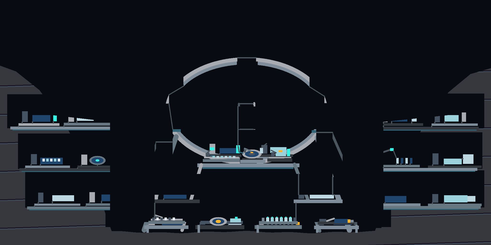
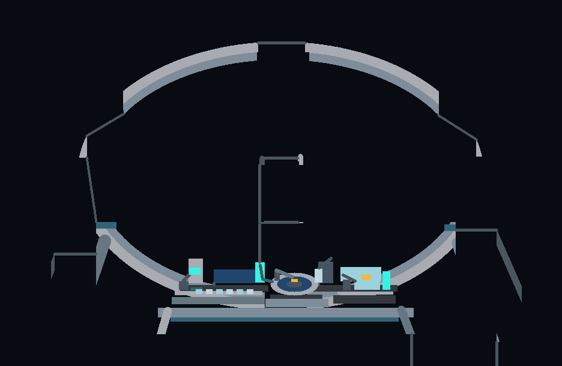

# Penumbral Sink - Split-Mirror Resonance Mill (R2)

**Original 2048x1024 orthographic CyberSand material-cell world. OPEN Draft/HOLD.**
**Creator source-static PASS; independent R2 Art / Technical / Shepherd pending; NATIVE-UNTESTED.**

## R2 physical art repair

Independent R1 Art and Shepherd reviews identified two genuine P1 defects, now amended in
**actual final material cells** rather than caption-only art.

* **Inlet -> mill contact -> outfeed:** The central entered workbench now contains an
  open specimen feed with rollers, a coaxial milling drum and guarded stylus, a distinct
  receiving cradle with examination cassette, and a real thin tether linking the mirror's
  measurement channel. All parts are tied to the original mill platform; Midge targets
  and ring portals are not moved or filled.
* **Four different deep industrial workfaces:** The lower return now features a stepped
  core-sampling sieve, a hub-and-ring pressure rotor, a rack of individual sealed
  specimen cassettes, and an asymmetric rover recovery hoist. These occupy the existing
  accessible service bays above their rooted deck surfaces.

The original interrupted elliptical dish, inhabited west/east escarpments, upper bypass,
main basin and underground service return remain unchanged in purpose and topology.

## Reproducibility and static clearance

* Fixed-seed authoring source: `build.cjs`. Run `node build.cjs --verify` after checkout;
  the builder includes independent Node crypto SHA256, zlib decode, PNG chunk CRC and
  every-pixel grid comparison. Run without `--verify` to regenerate.
* Accepted engine main (read-only): `7b03aa437561ec63e31fd09531171360ab60eeb4`.
  Sandmapsreference original parent main: `99a166e7fcae45eb22be1740e9f33f62faccbcc7`.
* Material plane: **2,097,152 final IDs**, SHA256 `131bf0dbf4e32dfa7bd61315cc138b9c827bf88e8d08e42c06d29ff07de06ad5`.
  Inert grounded cells: **468048 / 468048**, detached: **0**;
  all authored nonempty IDs are established immobile Solid/None kernel materials.
* Canonical ordered nonoverlapping rectangles: **3421**, source budget
  32,768; JSON **64791 bytes** (source max 1 MiB), paint work **468048**
  (source max 32M). Legacy installed bridge limit of ~4,096 may be insufficient
  depending on deployed binaries. This does not establish installed capability.
* Literal named-site traversal **32/32, 32/32, 32/32**
  for 19x15, 23x19, 31x27 full-envelope cardinal BFS. Physical obstruction at
  half-open XYXY [1006,547,1067,606] blocks only Mill drop transfer while leaving
  the other 31 exact destinations reachable via genuine recovery circulation.
* True indexed material output: 1 complete 2048x1024 overview and five authentic
  1:1 district crops. No photos, source art, AI rendering or fake native screenshots.
  Publisher independently decoded **3811728 / 3811728** generated pixels, validating
  full material index parity, CRC and Adler. The exact committed files should be
  separately refetched by independent auditors before their verdict.
* The accepted source supports these edits, but actual Godot/CyberDemoBridge/Rapier
  load, simulated movement, collision and cold save/reopen remain **NATIVE-UNTESTED**.

## Exact source-cell gallery

Only this existing original-world output folder is altered. No merge or owner acceptance.
